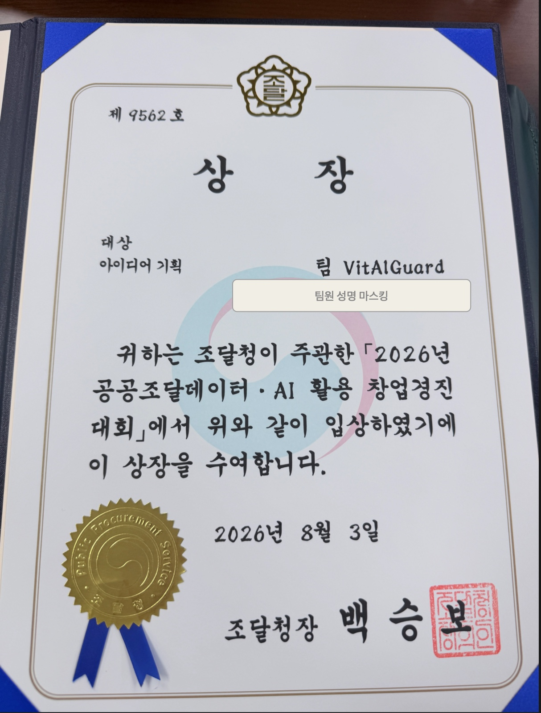
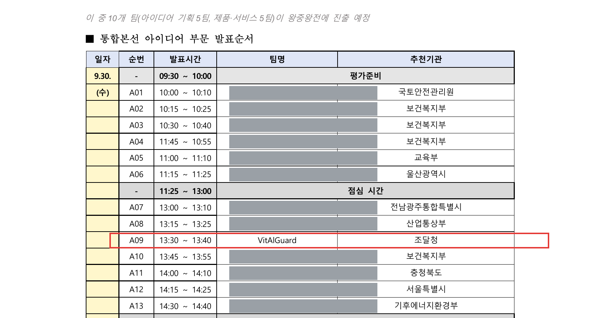

# 🏆 수상 이력 (Awards)

## 대상(大賞) — 2026년 공공조달데이터·AI 활용 창업경진대회

| 항목 | 내용 |
|---|---|
| 주최·수여 | **조달청** (조달청장 명의, 상장 제9562호) |
| 부문 | 아이디어 기획 · 통합본선 |
| 수상 | **대상** |
| 수상일 | 2026년 8월 3일 |
| 팀 | **VitAlGuard** (팀원 3인 — 개인정보 보호를 위해 성명 마스킹) |
| 출품작 | 산업현장 생체·환경 통합 관제 기반 건설현장 **안전관리비 실집행 검증 플랫폼** |

  

> 상장 원본은 팀 보관. 본 이미지는 기록·증빙 목적의 사본이며 팀원 성명은 마스킹 처리됨.

## 참가 이력 — 제14회 범정부 공공데이터 활용 창업경진대회 · 통합본선 (아이디어 부문)

조달청 대회 대상 수상으로 **조달청 추천**을 받아 범정부 통합본선(아이디어 부문 61팀)에 진출, 발표 심사에 참가했다. 이 중 10팀(아이디어 기획 5·제품서비스 5)이 왕중왕전에 진출하는 구조였고, VitAlGuard 는 **통합본선 발표까지**였다(왕중왕전 미진출).

| 항목 | 내용 |
|---|---|
| 대회 | 제14회 범정부 공공데이터 활용 창업경진대회 — 통합본선 · 아이디어 부문 |
| 추천기관 | **조달청** |
| 발표 | **2026년 9월 30일(수) 13:30~13:40 · 순번 A09** |
| 결과 | 통합본선 발표 참가 (왕중왕전 미진출) |
| 발표자료 | VitAlGuard 본선발표 V.3.0 (28쪽, 5분 발표) · 2차 시연 영상 |

  

> 공식 발표순서표(2026-09-16 배포) 1쪽 일부. **다른 참가팀·개인 명칭은 마스킹**했고, 원본 PDF 는 팀 보관.
