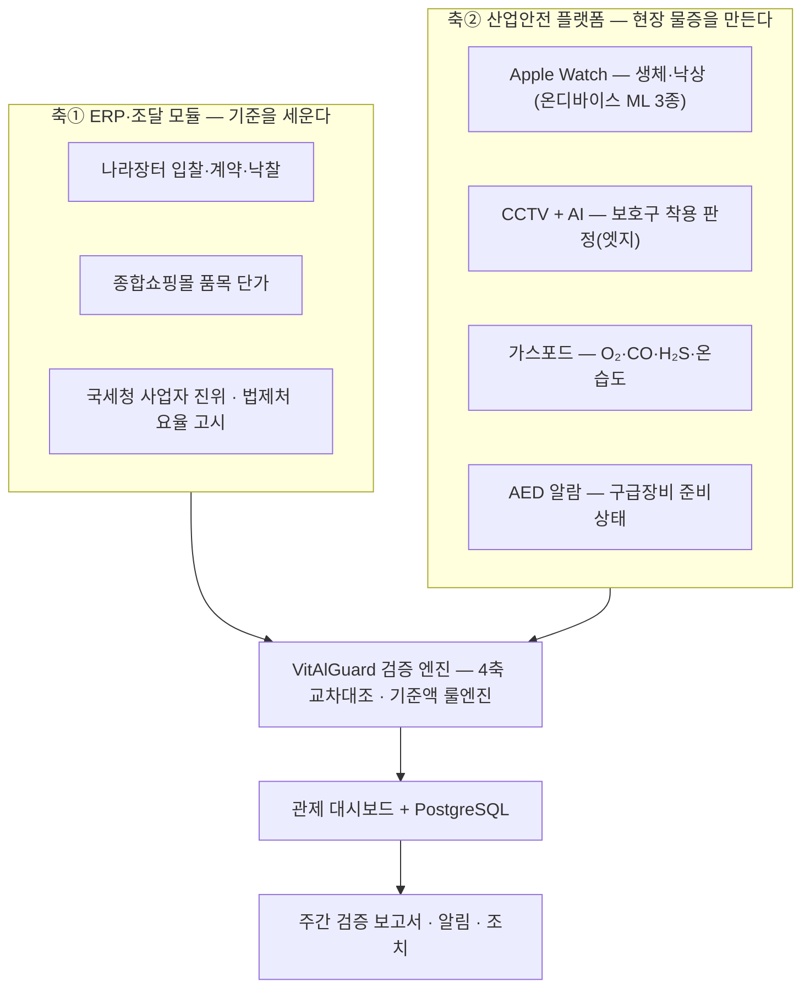

  
  

# VitAlGuard — Industrial Safety OS

> 🏆 **2026 공공조달데이터·AI 활용 창업경진대회 — 대상(조달청장상)** · 제14회 범정부 공공데이터 활용 창업경진대회 **통합본선 발표**(조달청 추천) · [수상·참가 이력 →](AWARDS.md)

   
  ▶ 시연 영상 3:37 (1080p · <a href="https://github.com/becks0724/vitalguard/releases/tag/portfolio-2026-10">Release 자산</a>) · <a href="포트폴리오/시연 영상/">장면 구성</a> · <a href="포트폴리오/발표자료/">발표자료</a> · <a href="포트폴리오/서비스 화면/">서비스 화면 112장</a>

**산업현장 생체·환경 통합 관제 기반, 건설현장 안전관리비 실집행 검증 플랫폼.**
나라장터 조달데이터와 현장 IoT·AI로 **계상된 안전관리비가 작업자에게 실제 도달했는지** 검증한다.
(조달청 조달데이터 AI 활용 창업경진대회 · 아이디어 부문 통합본선 — 팀 VitAlGuard)

> **문제의 정식화** — 예산이 부족한 것이 아니라, 계상된 예산이 현장에 도달했는지
> **확인할 수 없는 것**이 문제다. 현행 구조는 시공사 서류를 시공사 서류로 검증한다.

## 시스템 구조 — 조달이 기준을 세우고, 현장 실측이 그 기준을 확인한다

- 4축 교차대조 = **① 장부↔사람 · ② 돈↔장부 · ③ 사람↔대장 · ④ 증빙(촬영시각·GPS)**
- 공공데이터 **12종 실연동** (전부 클라이언트 구현·실응답 확인)
- 판정 원칙: 입력이 부족하면 단정하지 않고 **검토필요로 강등** — 최종 판단은 사람
- 금액 산정은 AI가 아닌 **결정적 계산** — 행정 판단의 근거는 재현 가능해야 하므로

## 저장소 지도

| 폴더 | 내용 |
|---|---|
| [`ML 3종 모듈/`](ML%203종%20모듈/) | **워치 낙상 ML 모듈** — 판정 코어·모델 3종·검증 게이트·통합가이드 (모듈 단위 관리) |
| [`apps/`](apps/) | 현행 앱 — VitAlGuard-iOS-WatchOS-App, VitAlGuard-Flutter-Android-App |
| [`hardware/`](hardware/) | **현장 물리 장치** — AED 알람(라즈베리파이), 가스포드 요약·링크 |
| [`Final_GasPod/`](Final_GasPod/) | 가스포드 v4.2 확정 문서·펌웨어·서버 연동 가이드 |
| [`db/`](db/) | DB 스키마·감사·통합 문서 (fall_ml / imu_collect / integrated / audit 등) · **[`erd-vitalguard2/`](db/erd-vitalguard2/) 신규 스키마 ERD(74표·Mermaid)** |
| [`Lenova idea tap 12.7/`](Lenova%20idea%20tap%2012.7/) | **담당관 태블릿 앱** — Compose/Kotlin `vitalguard_field_android`(현장 대시보드·경보·기록·사진·펜 주석·전송 이력) |
| [`포트폴리오/`](포트폴리오/) | **포트폴리오 묶음** — [서비스 화면 112장](포트폴리오/서비스%20화면/) · [시연 영상](포트폴리오/시연%20영상/) · [발표자료 2종(PDF·슬라이드)](포트폴리오/발표자료/) · [공개 전환 점검표](포트폴리오/공개전환-점검표.md) |
| [`기존_조달청모듈/`](기존_조달청모듈/) | safetymonitor — 대시보드(현역), cctv-ai, ml/fall-detection, 구 PoC 앱 |
| [`조달청_안전관리비_모듈/`](조달청_안전관리비_모듈/) | 안전관리비 기준액 계산 모듈(safeprocure) |
| [`조달청 공문/`](조달청%20공문/) | 대회 공고·참가신청 양식 |
| [`VitAlGuard_logo/`](VitAlGuard_logo/) | 로고 에셋 (라이트/다크) |

## AI는 규칙이 실패하는 세 지점에만 쓴다

### 1. 워치 낙상 감지 — 온디바이스 ML 3종 (주)
IMU 88특징 → Core ML 직접 추론 (서버 왕복 없음, event-gated 배터리 보호):

| 모델 | 역할 |
|---|---|
| work_veto | 작업동작을 낙상 후보에서 기각 (precision≥0.95 운영) |
| impact | 고G 충격 이벤트 판정 — 증거 전용 |
| recovery | 쓰러짐 후 **미회복만** 경보 |

- 오탐 **-79%** (75→16건) · 4명 600+윈도 **LOSO 평가** · 실기기 시나리오·25시간 착용 검증
- **ML 단독 경보 금지** — 억제기로만 배치, 경보 확정 권한은 본인 무반응 확인(카운트다운)에 있음
- 모듈·검증 게이트·통합 방법: [`ML 3종 모듈/`](ML%203종%20모듈/)

### 2. CCTV 보호구 착용 판정 (부)
국내 현장 데이터 재학습(AI Hub E63 등 35,227장) · Jetson Orin Nano TensorRT 엣지 추론 ·
미착용 알림 재현율 **0.987** — 결과 프레임만 전송(대역폭·프라이버시 동시 해결).

### 3. 공고문 위험작업 추출 — LLM 환각 차단 3단 (부)
키워드 선별(결정적) → LLM 구조화 추출 → **근거 원문 검증 100%** (불일치 폐기) —
환각은 담당 공무원에게 도달하지 않는다.

## 현장 하드웨어

- **가스포드** (ESP32-S3): 밀폐공간 O₂·CO·H₂S·온습도 — 현장 즉시 경보 + 5초 주기 서버 전송 → [`hardware/`](hardware/)
- **AED 알람** (Raspberry Pi): AED 배터리·패드 상태를 서버 판정으로 받아 현장 빛·사이렌 경보 → [`hardware/AED_alarm/`](hardware/AED_alarm/)

---
문서 기준일: 2026-08-12 · 내용 기준: 통합본선 발표자료 V2.9
