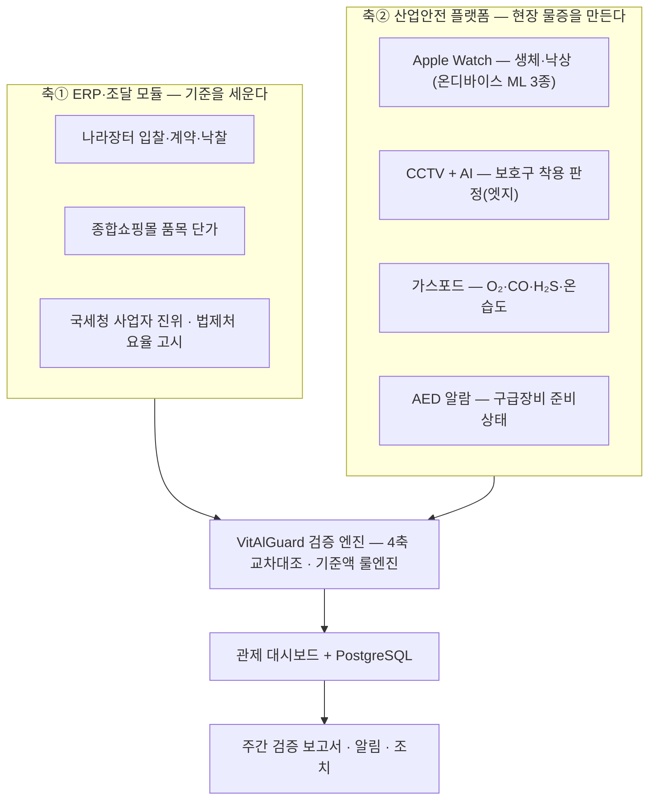

  
  

# VitAlGuard — Industrial Safety OS

> 🏆 **2026 공공조달데이터·AI 활용 창업경진대회 — 대상(조달청장상)** · 제14회 범정부 공공데이터 활용 창업경진대회 **통합본선 발표**(조달청 추천) · [수상·참가 이력 →](AWARDS.md)

   
  ▶ <a href="https://youtu.be/suM9BOJuzj0">YouTube 에서 보기</a> (3:37 · 1080p) · <a href="https://github.com/becks0724/vitalguard/releases/download/portfolio-2026-10/VitAlGuard_demo_2026-10.mp4">mp4 원본</a> · <a href="포트폴리오/시연 영상/">장면 구성</a> · <a href="포트폴리오/발표자료/">발표자료</a> · <a href="포트폴리오/서비스 화면/">서비스 화면 135장</a>

**산업현장 생체·환경 통합 관제 기반, 건설현장 안전관리비 실집행 검증 플랫폼.**
나라장터 조달데이터와 현장 IoT·AI로 **계상된 안전관리비가 작업자에게 실제 도달했는지** 검증한다.
(조달청 조달데이터 AI 활용 창업경진대회 · 아이디어 부문 통합본선 — 팀 VitAlGuard)

> **문제의 정식화** — 예산이 부족한 것이 아니라, 계상된 예산이 현장에 도달했는지
> **확인할 수 없는 것**이 문제다. 현행 구조는 시공사 서류를 시공사 서류로 검증한다.

## 한눈에 보기

| | |
|---|---|
| 현장 물증 장치 | Apple Watch 생체·낙상(온디바이스 ML 3종, IMU 88특징) · CCTV AI 보호구 판정(Jetson 엣지) · **GasPod**(ESP32, O₂·CO·H₂S·온습도·기압, 배터리 OTA) · **AED-alert**(라즈베리파이, 빛·소리 위치 알림) |
| 사람이 쓰는 화면 | 관제 웹(Next.js, Cloud Run) · 담당관 태블릿 앱(Kotlin/Compose, Lenovo Idea Tab 12.7) · 작업자 워치 앱(Galaxy Watch·Apple Watch) · 폰 앱(Flutter·iOS) |
| 데이터 | PostgreSQL 14 — 표 74 · 외래키 119 · 인덱스 246 · **RLS 정책 149 · 트리거 146** · 마이그레이션 101 · 공공데이터 **12종 실연동** |
| 검증 | 안전관리비 4축 교차대조 룰엔진(결정적 계산, 부족하면 「검토 필요」 강등) · 태블릿 앱 JVM 테스트 327/327 · DB 외부 감사 후 12건 수정 |
| 성과 | **대상(조달청장상)** 2026-08-03 · 범정부 통합본선 발표 2026-09-30 · 시연 영상 3:37 · 서비스 화면 135장 |

## 타임라인 (2026)

| 시기 | 일 |
|---|---|
| 6월 | 아이디어 플랜 V2.x 제출 · 신규 DB 설계 착수 |
| 7/13 → 7/16 | 2차 심사 자료 제출 → **5분 대면 발표**(v2.8) |
| 8/3 | **대상(조달청장상)** 수상 → 조달청 추천으로 범정부 통합본선 진출 |
| 8월 | DB 외부 감사·보안 보강(RLS·트리거·검사기 10종), GasPod v5 OTA 실증 |
| 9월 | 담당관 태블릿 앱 Flutter → **Compose 재작성**(1.0 → 1.3.18), 통합본선 발표자료 V3.0 |
| 9/30 | 범정부 통합본선 아이디어 부문 **발표(A09)** |
| 10/2 | 시연 영상 공개 · 포트폴리오 정리 |

## 팀 · 역할

팀 VitAlGuard 3인. 본인 행의 성명 표기는 각자 결정하며 기본은 GitHub 핸들이다(팀원 행은 각자 기입).

| 구성원 | 담당 | 주요 산출물 |
|---|---|---|
| **김태곤** ([@rlaxorhs77-eng](https://github.com/rlaxorhs77-eng)) · 저장소 관리 | **DB 설계** — 신규 스키마 74표·RLS 149·트리거 146·마이그레이션 101, 법 요건 반영, 외부 감사 대응 · **현장 하드웨어** — GasPod ESP32 펌웨어 v4→v5·배터리 단독 OTA 실증·배터리 곡선 실측·케이스 설계, AED-alert 라즈베리파이 알람 · **담당관 태블릿 앱** — Compose 재작성 요구정의·UI/UX 계획·단계별 검수·실기기 검증(1.0→1.3.18) · **워치 ML 모델링** — 낙상 판정 모델 3종 학습·검증 | [`db/erd-vitalguard2/`](db/erd-vitalguard2/) · [`Final_GasPod/`](Final_GasPod/) · [`hardware/`](hardware/) · [`tablet-app/`](tablet-app/) · [`ML 3종 모듈/`](ML%203종%20모듈/) |
| 팀원 A | _(담당 기입 — 예: iOS/watchOS 앱, 온디바이스 추론 연동)_ | _(산출물 경로 기입)_ |
| [@becks0724](https://github.com/becks0724) | **관제 웹·서버** — Next.js 대시보드·API, 기상·태풍·재난문자 연동, Cloud Run 배포·운영, CI 시크릿 스캔 · **CCTV AI 엣지** — 보호구(안전모·조끼) 판정 모델 학습·검증, Jetson TensorRT 엣지 추론 · **웨어러블 수집 앱** — Apple Watch→iPhone→서버 수집 앱, 갤럭시워치(Wear OS) 단독 수집기 | [`dashboard-web/`](기존_조달청모듈/safetymonitor/apps/dashboard-web/) · [`cctv-ai/`](기존_조달청모듈/safetymonitor/cctv-ai/) · [`ml/ppe-detection/`](기존_조달청모듈/safetymonitor/ml/ppe-detection/) · [`vitalguard_app/`](기존_조달청모듈/safetymonitor/apps/vitalguard_app/) |

> 팀원 행 작성 방법: 이 표의 자기 행에 담당·산출물 경로를 적고 PR 또는 직접 커밋. 구성원 칸은 "팀원 A/B"·GitHub 핸들·실명 중 본인이 고른다.

## 시스템 구조 — 조달이 기준을 세우고, 현장 실측이 그 기준을 확인한다

- 4축 교차대조 = **① 장부↔사람 · ② 돈↔장부 · ③ 사람↔대장 · ④ 증빙(촬영시각·GPS)**
- 공공데이터 **12종 실연동** (전부 클라이언트 구현·실응답 확인)
- 판정 원칙: 입력이 부족하면 단정하지 않고 **검토필요로 강등** — 최종 판단은 사람
- 금액 산정은 AI가 아닌 **결정적 계산** — 행정 판단의 근거는 재현 가능해야 하므로

## 저장소 지도

| 폴더 | 내용 |
|---|---|
| [`ML 3종 모듈/`](ML%203종%20모듈/) | **워치 낙상 ML 모듈** — 판정 코어·모델 3종·검증 게이트·통합가이드 (모듈 단위 관리) |
| [`apps/`](apps/) | 현행 앱 — VitAlGuard-iOS-WatchOS-App, VitAlGuard-Flutter-Android-App |
| [`hardware/`](hardware/) | **현장 물리 장치** — AED 알람(라즈베리파이), 가스포드 요약·링크 |
| [`Final_GasPod/`](Final_GasPod/) | 가스포드 v4.2 확정 문서·펌웨어·서버 연동 가이드 |
| [`db/`](db/) | DB 스키마·감사·통합 문서 (fall_ml / imu_collect / integrated / audit 등) · **[`erd-vitalguard2/`](db/erd-vitalguard2/) 신규 스키마 ERD(74표·Mermaid)** |
| [`tablet-app/`](tablet-app/) | **담당관 태블릿 앱** — Compose/Kotlin `vitalguard_field_android`(현장 대시보드·경보·기록·사진·펜 주석·전송 이력) |
| [`포트폴리오/`](포트폴리오/) | **포트폴리오 묶음** — [서비스 화면 135장](포트폴리오/서비스%20화면/) · [시연 영상](포트폴리오/시연%20영상/) · [발표자료 2종(PDF·슬라이드)](포트폴리오/발표자료/) · [공개 전환 점검표](포트폴리오/공개전환-점검표.md) |
| [`기존_조달청모듈/`](기존_조달청모듈/) | safetymonitor — 대시보드(현역), cctv-ai(CCTV 엣지), ml/ppe-detection(보호구 판정 모델), ml/fall-detection, apps/vitalguard_app(워치 수집 앱), 구 PoC 앱 |
| [`조달청_안전관리비_모듈/`](조달청_안전관리비_모듈/) | 안전관리비 기준액 계산 모듈(safeprocure) |
| [`조달청 공문/`](조달청%20공문/) | 대회 공고·참가신청 양식 |
| [`docs/`](docs/) | 운영 인수인계·앱 조율 요청 등 작업 문서 |
| [`archive/`](archive/) | 대체된 구현 보존본 — Flutter 태블릿 앱 1.0.0 (Compose 재작성 전) |
| [`VitAlGuard_logo/`](VitAlGuard_logo/) | 로고 에셋 (라이트/다크) |

라이선스: [All rights reserved](LICENSE) — 열람·평가 목적 공개, 재사용·재배포 불허.

## 기술 스택

| 영역 | 기술 |
|---|---|
| 관제 웹 | Next.js(React) · TypeScript · Tailwind · Google Cloud Run · GitHub Actions(검증·시크릿 스캔) |
| DB | PostgreSQL 14 · Row-Level Security · 트리거 기반 서버 강제 · 파티션 · PII 컬럼 암호화(AES-256-GCM) |
| 태블릿 앱 | Kotlin · Jetpack Compose · Android 16(targetSdk 36) · 스크린샷 테스트 · 앱 JWT |
| 워치·폰 앱 | Swift(watchOS/iOS) · Core ML 온디바이스 추론 · Kotlin·Compose for Wear OS(갤럭시워치) · Flutter(Android) · XcodeGen |
| 현장 장치 | ESP32-S3(Arduino, WiFi OTA, 배터리 곡선 실측) · Raspberry Pi(systemd 폴링 알람) · Jetson(엣지 PPE 판정, TLS 게이트) |
| 공공데이터 | 나라장터 G2B(입찰·계약) · 종합쇼핑몰 단가 · 국세청 사업자 진위 · 법제처 요율 · 기상청 · 응급의료(E-gen) 등 12종 |
| 영상·문서 | Remotion(React) 영상 파이프라인 · 실물 참조 이미지 생성 + 실제 UI 사영 합성 · Fish Audio 나레이션 |

## AI는 규칙이 실패하는 세 지점에만 쓴다

### 1. 워치 낙상 감지 — 온디바이스 ML 3종 (주)
IMU 88특징 → Core ML 직접 추론 (서버 왕복 없음, event-gated 배터리 보호):

| 모델 | 역할 |
|---|---|
| work_veto | 작업동작을 낙상 후보에서 기각 (precision≥0.95 운영) |
| impact | 고G 충격 이벤트 판정 — 증거 전용 |
| recovery | 쓰러짐 후 **미회복만** 경보 |

- 오탐 **-79%** (75→16건) · 4명 600+윈도 **LOSO 평가** · 실기기 시나리오·25시간 착용 검증
- **ML 단독 경보 금지** — 억제기로만 배치, 경보 확정 권한은 본인 무반응 확인(카운트다운)에 있음
- 모듈·검증 게이트·통합 방법: [`ML 3종 모듈/`](ML%203종%20모듈/)

### 2. CCTV 보호구 착용 판정 (부)
국내 현장 데이터 재학습(AI Hub E63 등 35,227장) · Jetson Orin Nano TensorRT 엣지 추론 ·
미착용 알림 재현율 **0.987** — 결과 프레임만 전송(대역폭·프라이버시 동시 해결).

### 3. 공고문 위험작업 추출 — LLM 환각 차단 3단 (부)
키워드 선별(결정적) → LLM 구조화 추출 → **근거 원문 검증 100%** (불일치 폐기) —
환각은 담당 공무원에게 도달하지 않는다.

## 서비스 화면 — 갤럭시워치 · CCTV

### 갤럭시워치 9 — 작업자 워치 앱

<table><tr><td align="center" width="25%"> 1 · 생체 요약</td><td align="center" width="25%"> 1 · 위험(SpO₂)</td><td align="center" width="25%"> 2 · 심박 추이</td><td align="center" width="25%"> 0 · 로그인 QR</td></tr></table>

화면은 옆으로 넘기며 본다 — **0 로그인·로그아웃 → 1 생체 요약 → 2 심박 · 3 산소포화도 · 4 체온 · 5 스트레스 · 6 오늘 걸음**.
요약 화면은 심박을 크게, SpO₂·피부온·생리적 부담을 작은 게이지로 보이고 상태(정상·주의·위험·무동작·전송 대기)를 색으로 가른다.
현행 코드(Kotlin·Compose for Wear OS)를 Galaxy Watch 9 해상도(480×480)로 렌더한 화면이며 이름·사번은 예시 값이다.
전체 19장과 08-31 디자인 시안 79장 → [서비스 화면 · 워치](%ED%8F%AC%ED%8A%B8%ED%8F%B4%EB%A6%AC%EC%98%A4/%EC%84%9C%EB%B9%84%EC%8A%A4%20%ED%99%94%EB%A9%B4/#워치-앱--galaxy-watch-9)

### CCTV — 관제 웹 · 태블릿

<table><tr><td align="center" width="50%"> 관제 웹 CCTV 8칸</td><td align="center" width="50%"> 태블릿 판정 화면 (얼굴·명패 모자이크)</td></tr></table>

- **관제 웹 8칸** — CAM-01 사무실 IP캠·CAM-03 현장 GoPro 는 보호구 판정 칸, CAM-02 는 낙상 칸, CAM-04~08 은 자리 표본. 칸을 누르면 팝업에 작업자 수·위반 건수·준수율.
- **태블릿 현장 CCTV** — 대시보드 카드에서 카메라를 고르면 실시간 화면, 두 손가락 확대. 상단 줄에 엔진·추론 시간(PPE v7e@544×960 · 자세 11s-pose@640 · 14+16ms · 30fps).
- **판정 오버레이** — 작업자 상자·안전모 미착용 머리 상자·자세 골격. 판정은 젯슨 두 대가 현장에서 하고, 1호기 게이트가 일회용 서명 티켓으로 영상을 내보냈다.
- **2026-10-07 젯슨 반납** — 지금 라이브 칸에는 영상이 나오지 않는다. 구조와 복원 방법 → [CCTV 최종 구현 기록](기존_조달청모듈/safetymonitor/cctv-ai/%EC%B5%9C%EC%A2%85-%EA%B5%AC%ED%98%84-%EA%B8%B0%EB%A1%9D-20261007.md) · 모델 보관 → [MODELS.md](기존_조달청모듈/safetymonitor/ml/ppe-detection/MODELS.md)

전체 CCTV 화면 → [서비스 화면 · CCTV](%ED%8F%AC%ED%8A%B8%ED%8F%B4%EB%A6%AC%EC%98%A4/%EC%84%9C%EB%B9%84%EC%8A%A4%20%ED%99%94%EB%A9%B4/#cctv--관제웹-8칸--태블릿-현장-cctv)

## 현장 하드웨어

- **가스포드** (ESP32-S3): 밀폐공간 O₂·CO·H₂S·온습도 — 현장 즉시 경보 + 5초 주기 서버 전송 → [`hardware/`](hardware/)
- **AED 알람** (Raspberry Pi): AED 배터리·패드 상태를 서버 판정으로 받아 현장 빛·사이렌 경보 → [`hardware/AED_alarm/`](hardware/AED_alarm/)

---
문서 기준일: 2026-08-12 · 내용 기준: 통합본선 발표자료 V2.9
