> **출처** — Obsidian 설계 노트 `VitAlGuard DB/신규 스키마 ERD.md` 를 2026-10-07 에 그대로 내보냈다(원본 갱신 2026-09-28). 실제 적용 스키마(`VITALGUARD2`, 마이그레이션 001~101)의 카탈로그에서 뽑은 관계이며, 라이브 전환은 보류 상태의 기록이다. ERD 도식은 Mermaid `erDiagram` 으로 GitHub 에서 바로 렌더된다.


# VitAlGuard 신규 스키마 ERD

대상 `VITALGUARD2` (PostgreSQL 14.5) · 적용 `001~101` (마이그레이션 **101개**, 캠퍼스 적용 확인 · 035는 두 파일, 086은 번호만 비어 있음 · 093 포함). **신 DB 라이브 연결은 보류**한다.
스키마 `public`·`ml` · 테이블 **74** · 외래키 **119** · 인덱스 **246** · RLS 정책 **149** · 트리거 **146** · 뷰 **13**. **2026-09-28 캠퍼스 카탈로그 읽기 전용 실측**이며 파티션 자식을 제외하고 부모를 포함한다. 트리거는 내부 생성 항목을 제외한다.
> 062 는 번호가 비어 있던 자리다(061 다음이 063 이었다) — 가스 v2 몫으로 예약돼 있었고 2026-09-14 에 `gas_calibration` 만 먼저 채웠다.

> 실제 DB의 `pg_constraint`에서 뽑은 관계다. 문서가 아니라 적용된 스키마 기준.
> 파티션 자식(`*_default`)은 부모와 같은 관계라 생략했다.
> **2026-09-04 갱신은 원본 불통(캠퍼스 DB 포트 폐쇄, 라이브도 "DB 조회 실패")으로
> 로컬 재현본(PG 14.24, 비-superuser 소유 롤 + SSL, 61/61 적용 성공) 카탈로그에서 뽑았다.**
> ~~원본 복구 후 같은 쿼리로 대조할 것.~~ → **2026-09-28 캠퍼스 연결에서 상단 카탈로그 수를 다시 실측했다.** 9월 4일 기록은 당시 이력으로 보존한다.

**설계 기준** — 라이브 서버가 실제로 받고 저장해야 하는 것만 둔다. 구 DB에 있으니 옮긴 것은 없다.
**제외 → 착수** — 폰·워치 유래 생체 데이터. 신규 앱 계약이 확정된 뒤 별도 설계하기로 했고, **2026-09-07 워치 센싱 리스트업(앱 사양)을 받아 §17 설계 초안에 착수**했다. 워치가 실제로 읽고 보내는 것을 기준으로 설계한다 — 구 `vital_samples` 57필드는 기준이 아니다.

---

## 현재 전환 상태 (2026-09-28)

- **스키마:** 캠퍼스 적용 101개. 101의 과업지시서 출처·기상 컬럼 6개를 ERD 도식과 데이터 사전에도 반영했다. 이번 9/28 작업으로 새 표·관계·마이그레이션을 추가하지 않았다.
- **준비 코드:** `feat/newdb-cutover` **5abff069** push 완료. 대시보드 서버 소스·검증 이미지의 기준은 변경 없는 **6fe1c227**이다.
- **검증:** 서버 기존 2,375 통과/0실패/10 skip, Compose↔신 DB 격리 통합 6/6, 실제 Jetson 실행본 기반 UUID 게이트 14/14·PPE 함수 4/4·관련 서버 43/43. 서로 다른 검사 범위를 합쳐 실장비 전환 완료라고 부르지 않는다.
- **현재 영상:** AICAM_301A + Tailscale ON에서 기존 라이브 CAM-03 실수신 확인. 신 DB UUID 티켓으로 실제 장비를 전환한 상태는 아니다.
- **실증 CCTV 권한 완료(9/28):** 사용자 지정 데모 시공사 `(주)VG종합건설`을 만들고 학원 현장의 시공사와 `demo_site_mgr` 소속을 같은 회사로 연결했다. 기존 현장 배정을 유지한 채 실제 현장관리자 문맥에서 CAM-01·CAM-03 열람 허용을 확인했다. 준비 점검 37/37과 실제 권한 검사를 각각 통과했다.
- **라이브 적용 보류:** main 병합·새 DB/PII/크론키 연결·예약 작업 재개·Jetson 현장 ID 변경은 전환 승인 뒤 수행한다. 준비 파일만 생성했다.
- 자세한 최신 근거는 9월 28일 갱신 절을 따른다. 이전 날짜의 갱신 절은 당시 이력이다.

## 사용자 4부류

소속(`company.org_type`)과 역할(`app_user.role`)의 조합으로 표현한다. 테이블을 넷으로 나누지 않는다.

| 부류 | org_type | role | 현장 범위 |
|---|---|---|---|
| 어드민 | `platform` | `platform_admin` | 전체 |
| 조달청 담당관 | `owner` | `owner_officer` | 조달 계약 현장 중 **본인이 선택한 것** |
| 현장 관리자 | `contractor` | `site_manager` | 배정된 1~2개 |
| 작업자 | `contractor` | `worker` | 배정된 현장 |

세 부류 모두 `site_member`로 범위가 정해진다. **조달청은 후보 목록이 조달 계약 데이터에서 나온다는 점만 다르다** — 조달청과 무관한 현장은 애초에 후보에 없다.

관제 웹과 폰 앱이 **같은 계정**을 쓴다. 어느 쪽에서 가입해도 연동된다.

---

## 전체 골격

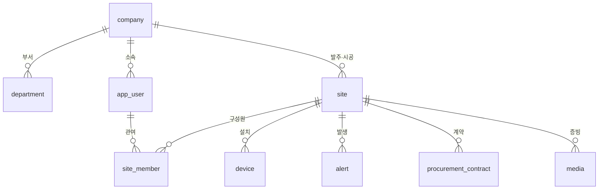

---

## 1. 조직 · 사람

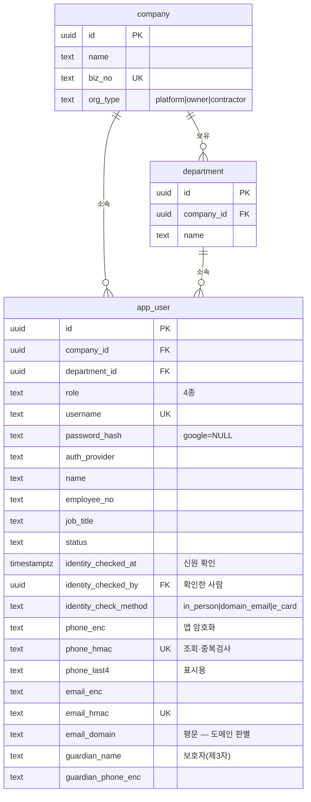

**연락처는 앱에서 암호화하고 DB 는 암호문만 받는다(008).** `pgp_sym_encrypt` 를 DB 안에서 쓰면 **키가 SQL 에 실려 `pg_stat_activity`·로그에 남고**, 그러면 같은 서버의 슈퍼유저(`moai`·`postgres`)에게 노출된다 — 방어 대상이 바로 그들이므로 목적을 달성하지 못한다.

- `*_enc` AES-256-GCM 암호문(base64) · `*_hmac` 조회·중복검사용 · `phone_last4` 는 복호화 없이 `010-****-5678` 을 그리려고 둔다.
- `email_domain` 만 평문이다. 2층 승인의 도메인 판별에 필요하고, 도메인은 기관 정보이지 개인 식별정보가 아니다.
- **`name`·`employee_no` 는 평문이다.** 전부 암호화하면 목록 정렬·사번 UNIQUE 가 깨진다(결정: 연락처만).

**주민등록번호·생년월일·신분증 이미지 컬럼은 두지 않는다. 누락이 아니라 설계다.** 개인정보보호법 제24조의2 상 우리에게 처리 근거가 없다. 신원은 사람이 눈으로 확인하고 **확인했다는 사실만** 남긴다.

**`department`를 목록으로 관리한다.** 조달청 부서는 사전 등록해 가입 시 선택하게 하고, 그 외 기관은 입력값을 목록에 자동 등록한다. 자유 입력만 두면 같은 부서가 표기 차이로 여러 값이 된다.

**`role`이 실제 권한 구분이다.** 구 `users`는 5명 전부 `role='admin'`이고 실제 구분은 `admin_access`·`org_type`이 했다 — `role`이 죽어 있었다.

---

## 1-2. 계정 · 가입 · 동의 (008)

> B2G 는 공개 회원가입이 성립하지 않는다. 계약한 기관만 들어와야 한다.
> 다만 계약 건마다 사람이 확인하면 운영 인력이 계약 수에 비례해 늘어난다.
> **폐쇄성을 지키면서 확인 업무가 기관 수에만 비례하게** 만든 구조다.

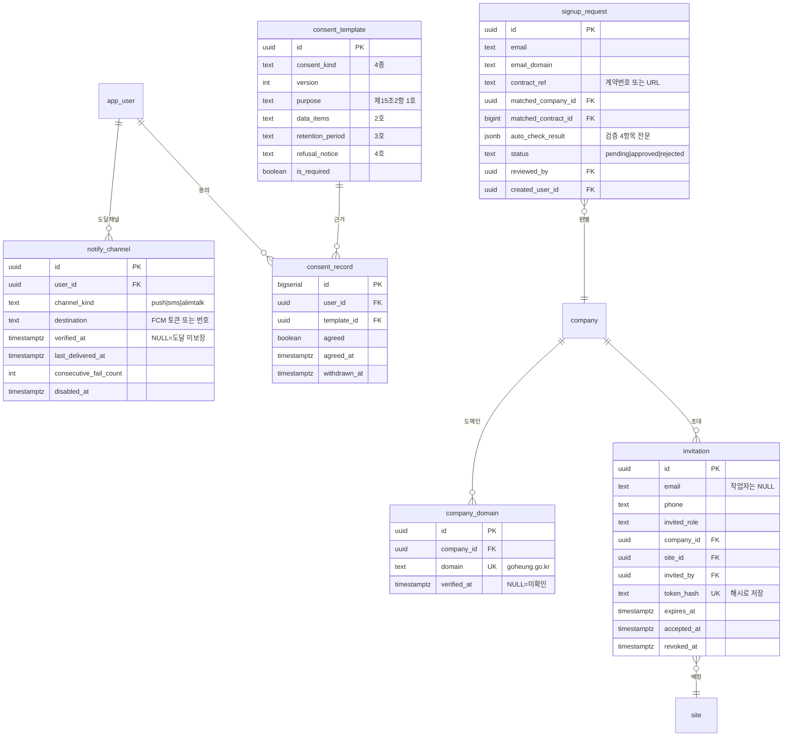

### 승인이 두 층이다

| 층 | 누가 | 무엇을 확인 | 빈도 |
|---|---|---|---|
| 1층 | **우리** | 이 기관과 **계약했는가** | 기관당 1~2회 |
| 2층 | **기관 관리자** | 이 사람이 **우리 직원인가** | 기관이 알아서 |

우리는 고흥군 재무과 김대리가 실존하는지 알 방법이 없다. 반대로 고흥군 관리자는 옆자리 사람이라 당연히 안다. **계약은 우리가 갖고 있고 사람은 기관이 안다.**

**`company_domain.domain` 은 전역 UNIQUE 다.** 한 도메인이 두 회사에 걸리면 가입자를 어느 쪽에 붙일지 결정할 수 없다. 공직 이메일은 그 기관이 발급하므로 **도메인 보유 자체가 소속 증명**이 된다.

**`auto_check_result` 를 jsonb 로 통째 남긴다.** boolean 4개만 두면 나중에 "도메인 불일치였나 계약이 없었나"를 알 수 없다.

**`invitation.token_hash` 는 해시다.** 평문으로 두면 DB 를 볼 수 있는 사람이 남의 초대를 가로챈다.

**연락처도 암호문만 남는다(055, 2026-08-18).** `invitation`·`signup_request` 의 평문 `email`·`phone` 컬럼을 **삭제했다.** 남은 것은 `*_enc`·`*_hmac`·`email_domain`·`phone_last4` 뿐이다.
028 이 "029 에서 제거 예정"이라고 적어 두고 실행하지 않아 그대로 남아 있었고, **같은 회사 작업자가 남의 초대 이메일·전화번호를 평문으로 조회할 수 있었다**(재현 확인). 변경이력에도 복제되고 있었다 — 토큰을 해시로 분리한 이유(행 단위 RLS 라 목록을 보면 비밀이 보인다)가 연락처에는 빠져 있었던 것이다.
→ `create_invitation()` 도 암호문 인자로 바뀌었다. 앱은 09 문서 11-2 절을 볼 것.

**초대장에 배정 정보(`site_id`)가 들어간다.** 승인만 하고 배정을 빠뜨리면 로그인해도 화면이 비어 있다 — 현장 범위는 `site_member` 가 정하기 때문이다.

### 권한 상승 차단은 DB 가 강제한다

`fn_check_invitation_authority()` 트리거가 막는다. 앱 코드에만 두면 실수 한 줄로 뚫린다.

| 승인자 | 부여 가능 역할 | 배정 가능 현장 |
|---|---|---|
| `platform_admin` | 전부 | 전부 |
| `owner_officer` | 같은 회사의 `owner_officer` 이하 | 자기 회사 |
| `site_manager` | 자기 현장의 `worker` | 자기 현장(`left_on IS NULL`) |
| `worker` | 없음 | 없음 |

**`platform_admin` 부여는 `platform_admin` 만 할 수 있다** — "기관 관리자 추가는 우리가 승인한다"는 결정을 DB 로 굳힌 것이다.

### 동의는 법이 요구하는 4항목을 버전으로 남긴다

`consent_template` 이 **개인정보보호법 제15조제2항 각 호**를 각각 컬럼으로 갖는다(수집·이용 목적 / 수집 항목 / 보유·이용 기간 / 거부권과 불이익). 한 덩어리 `text` 로 두면 "보유기간을 알렸는가"를 증명할 수 없다. 약관이 바뀌어도 **그때 무엇에 동의했는지**가 남는다.

**`privacy_sensitive` 는 반드시 분리한다.** 심박·SpO2·체온은 **제23조의 민감정보(건강)**이고, 제1항제1호가 *"다른 개인정보의 처리에 대한 동의와 **별도로**"* 받으라고 정한다. `privacy_basic` 과 합치면 위법이고 화면에서도 체크박스를 따로 둬야 한다.

`consent_record.agreed` 는 **거부(false)도 기록한다.** "동의를 거부할 권리"를 실제로 보장했다는 증거가 된다.

### 가장 위험한 컬럼 — `notify_channel.last_delivered_at`

FCM 토큰은 앱 재설치·장기 미사용으로 **조용히 무효화**된다. 다른 오류는 사용자가 "안 된다"고 신고하지만 **푸시 실패는 아무도 모른 채 경보가 사라진다.** 연속 실패가 쌓이면 자동 비활성화하고 관리자에게 알린다.

`verified_at IS NULL` 인 계정은 **사고가 나도 본인에게 알림이 안 간다.** 대시보드에서 눈에 띄게 표시해야 한다.

---

## 2. 현장

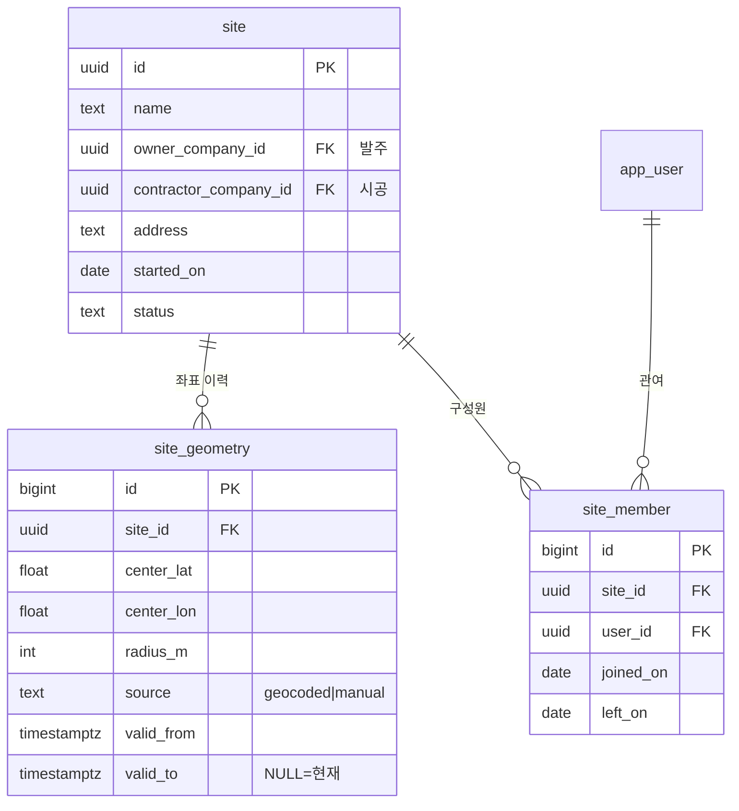

**`site_geometry`가 핵심 변경이다.** 현장 좌표를 고정값으로 두고 유효기간으로 이력을 남긴다. 구 시스템은 하루 최초 작업자 GPS를 현장 중심으로 캐시해, **이탈 판정의 기준점이 이탈하는 사람을 따라 움직이는 모순**이 있었다.

경계는 **중심 + 반경**만 쓴다. PostGIS가 없고 라이브에 폴리곤을 쓰는 기능도 없다.

**`site_member` 하나로 세 부류를 담는다.** 작업자는 일하고 관리자는 감독하고 담당관은 관리하지만, DB가 답할 질문은 같다 — *이 사람이 이 현장을 볼 수 있는가.*

---

## 3. 장치 · 센서

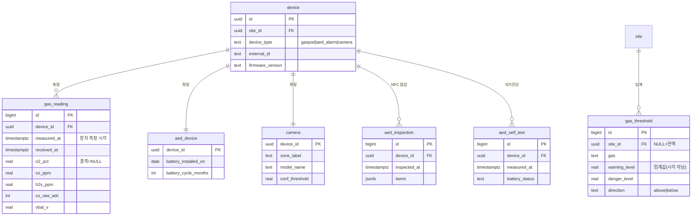

**결측을 `NULL`로 둔다.** 구 라우트는 `Number(b.o2) || 0`으로 파싱해 산소 0%와 미수신을 구분할 수 없었다. 실측상 발생은 18,326건 중 1건이었으나 설계로는 구분이 맞다.

**`warning_at` → `warning_level` 로 고쳤다(011).** `real` 타입인데 `_at` 접미사를 달고 있어 시각으로 읽혔다. 001 에서 잘못 지은 이름이고, 스키마 검사기가 "이름은 시각인데 타입이 아님"으로 잡아냈다.

### 적재 방어 (009)

측정 성격 테이블 전부에 `data_origin` 이 붙는다 — **`device` 와 `mock` 둘뿐**이고 기본값은 `device` 다(반대로 두면 앱이 값을 빠뜨렸을 때 실데이터가 통계에서 조용히 사라진다).

```
measured_at   장치가 잰 시각. 서버가 덮어쓰지 않는다
received_at   서버가 받은 시각
data_origin   device | mock
UNIQUE (device_id, measured_at)      진짜 중복은 여기서 막힌다
```

**구 DB 실측(335,532행)이 설계 근거다.**

| | |
|---|---|
| 저장 순서 대비 측정 시각 역전 | **24,650건 (7.35%)** · 최대 역전폭 **1일 10시간** |
| 같은 `(worker_id, ts)` 중복 | **0건** — 재전송은 실제로 없었다 |
| `received_at < ts` (장치 시계 미래) | 1건 |

늦게 도착한 과거 데이터는 **오프라인 버퍼의 정상 동작이라 버리지 않는다.** 시계열은 `measured_at` 으로 정렬하면 역전이 사라진다. 위험한 곳은 조회가 아니라 **실시간 경보**다 — 12:58 데이터가 13:05 에 도착했는데 "지금 낙상" 알림이 나가면 안 된다. `is_late_arrival()` 이 **5분 초과**를 판정하고 경보만 억제한다.

`fn_guard_measure_time()` 이 미래(+5분)·서비스 개시 이전 값을 거부한다. ESP32 는 NTP 동기화가 없으면 시계가 리셋되는데, 그 값이 `default` 파티션에 조용히 쌓이면 썩는다. 파티션 부모에 건 BEFORE 트리거가 자식에 전파되므로 `ensure_month_partition()` 이 새 파티션을 만들어도 자동 적용된다.

집계·ML 은 원본이 아니라 **`gas_reading_real` 같은 뷰**를 쓴다. `WHERE data_origin='device'` 를 손으로 붙이면 언젠가 빠뜨리고, 그때 mock 이 섞여도 아무도 모른다.

**임계를 서버가 소유한다.** 구 시스템은 ESP32 펌웨어가 판정해 임계 변경 시 전 장치 재배포가 필요했고 과거 재판정이 불가능했다.

`aed_self_test`는 신설이다 — 구 시스템은 AED 실제 상태를 재지 않고 교체일 경과로만 추정했다. 하드웨어 작업이 선행돼야 채워진다.

---

## 4. 영상 판정

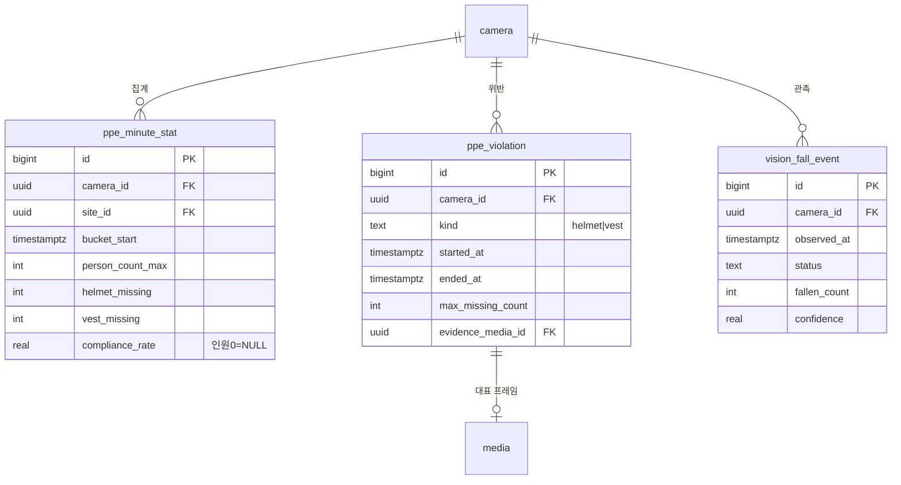

**구 시스템은 PPE 판정을 하나도 저장하지 않았다.** 엣지가 `cctv-ai` 서비스로 보내는데 그 서비스에 DB 연결이 없어 메모리에만 있었다. 초당 6회 전송하지만 그 주기는 **대시보드 영상 송출용**이며 적재와 무관하다.

`compliance_rate`가 인원 0명일 때 `NULL`이다. 구 엣지는 분모가 0이면 100을 넣어 **아무도 없는 시간대가 준수율 100%로 집계**됐다.

---

## 5. 경보 (통합)

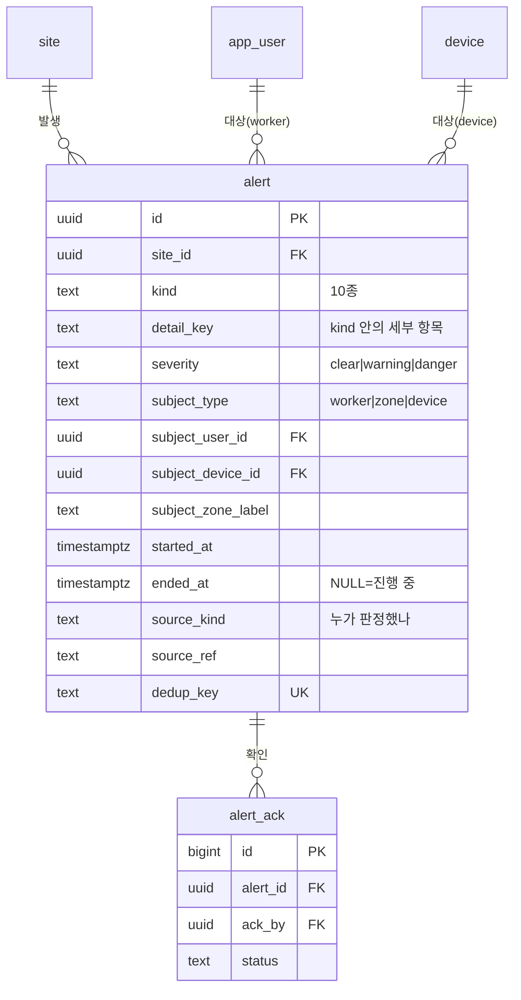

경보 10종 — `sos` `fall` `vital` `geofence_exit` `zone_fall` `gas` `ppe` `aed` `env` `absence`. 구 시스템은 이 중 5종만 한 테이블에 있었다.
(`danger_zone_entry` 는 069 에서 표와 함께 제거됐고, `absence`(감시 공백)가 067 에서 편입됐다.)

**대상이 사람이 아닐 수 있다.** 구 `alerts`는 `worker_id NOT NULL`이라 영상 단독 낙상(대상 미특정)을 담지 못해 메모리에만 두었고 재시작 시 소실됐다.

`subject_type`을 `worker`로 둔 이유 — 조달청 담당관에게 낙상 경보가 붙을 일은 없다. 값은 성격을, 컬럼(`subject_user_id`)은 참조 대상을 나타낸다.

### 구 시스템이 못 담던 것 (015 에서 전부 편입)

| 경보 | 구 시스템 | 신규 |
|---|---|---|
| **존 낙상** | **메모리만** — 서버 재시작 시 소실 | `subject_type='zone'` |
| **가스** | 텔레메트리 컬럼(`state`) — "언제부터 언제까지" 를 못 뽑음 | **구간 이벤트** (`started_at`·`ended_at`) |
| **환경 9종** | 현재 상태만, 이력 없음 | `kind='env'` + `detail_key` |
| **PPE** | **저장 경로 없음** | `kind='ppe'` |
| **AED** | 이력 없음 | `kind='aed'` |

### `kind` 와 `detail_key` 를 나눈 이유

`env` 만 9종이라 `kind` 로 펼치면 목록이 18개가 된다. **`kind` 는 "무슨 종류의 위험인가", `detail_key` 는 "그 안의 어느 항목인가"** 다.

```
env    apparent_temp · discomfort · wind · precipitation · uv ·
       pm · kma_warning · kma_preliminary · disaster
gas    o2 · co · h2s          ppe  helmet · vest
aed    battery · pad · self_test    vital  heart_rate · spo2 · temp
```

`sos`·`fall`·`zone_fall`·`geofence_exit`·`absence` 는 세부가 없어 NULL 이다.

### `source_kind` — 누가 판정했나

```
watch · phone · camera · gaspod · aed_device · weather_api · disaster_api · server · manual
```

**`kind` 와 혼동하지 말 것.** 같은 `fall` 이라도 워치가 잡은 것과 영상이 잡은 것은 신뢰도·후속 조치가 다르다.

구 시스템은 **구획 이탈·위험구역 진입을 브라우저가 판정**했다 — 관제 화면을 안 켜두면 경보가 나지 않는다. `server` 판정으로 이관한다.

### dedup_key — 중복을 막는 규칙

`<kind>:<식별자들>` 형식이고 UNIQUE 다. 전문은 컬럼 코멘트에 있다.

- **`fall` 은 워치 시각을 쓴다.** 영상이 확증해도 키가 같아 1건으로 합쳐진다 — 영상 시각을 쓰면 같은 사고가 두 건이 된다.
- **구간 경보(`gas`·`ppe`·`env`)는 시작 시각을 넣는다.** 진행 중이면 같은 행을 갱신하고, 해제 후 재발생은 새 행이 된다.
- **`env` 는 severity 를 포함한다.** 주의→위험 악화 시 새 행이 생겨 "언제 올라갔나" 가 남는다.
- **대상을 특정하지 못하면 임의 귀속하지 않는다.** 같은 구역 다른 사람에게 잘못 붙이면 그 기록이 사고 조사에서 거짓이 된다.

### 운영 함수·뷰

| | 하는 일 |
|---|---|
| `close_alert(dedup_key, ended_at)` | 진행 중인 경보를 닫는다. 이미 닫힌 것·없는 것은 `false`. **시작보다 이른 종료는 무시**한다 — 지연 도착한 해제 신호가 구간을 음수로 만드는 것을 막는다(009 의 순서 역전 7.35%) |
| `alert_stale_open` | 너무 오래 열린 경보. 종류별 기준 — 가스 2h · PPE 4h · 환경 24h · AED 30일. **대개 해제 신호를 못 받은 것**이지 위험이 지속되는 게 아니다 |

---

## 6. 조달 · 안전관리비

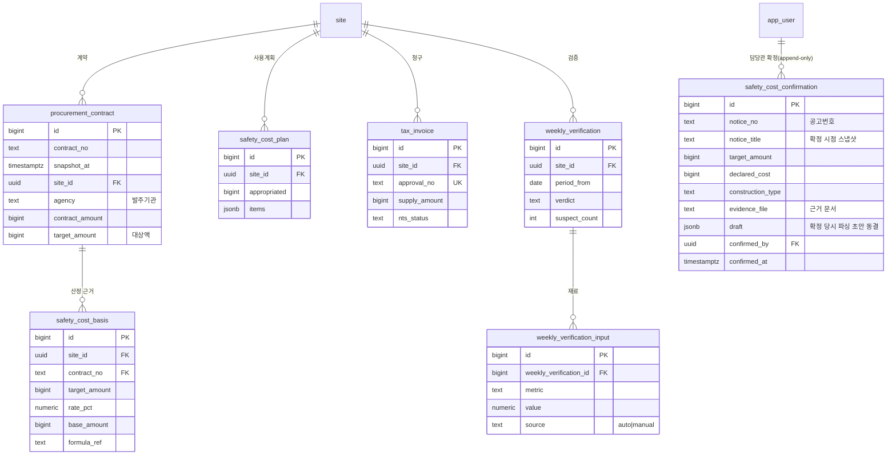

**조달 데이터를 시점 스냅샷으로 박제한다.** 구 시스템은 30분 메모리 캐시만 두고 저장하지 않아 과거 판정을 재현할 수 없었다. `safety_cost_basis`가 계약 스냅샷을 복합 FK로 참조해 **설계변경 후에도 그때의 산정을 되짚을 수 있다.**

`procurement_contract.agency`가 **조달청 담당관의 현장 후보를 거르는 기준**이다.

**`safety_cost_confirmation` — 담당관 확정 원장 (설계 편입 2026-08-27 · ✅ **061 로 작성·적용 완료**(2026-09-14 재현본 실측 · 2026-09-16 캠퍼스), 구 DB `procure_cost_confirm` 선행 구현 · 09-04 사양 확정 D-1~5 — 하단 15절).** 조달 API 는 안전관리비를 주지 않는다(공고 143·계약 43 필드 실측). 첨부 내역서 파싱은 **초안**이고, 판정은 근거 문서를 본 담당관의 확정값만 쓴다(시공사 자기신고 금지). append-only — 정정도 새 행이고 최신 1행이 현행이다. `notice_title` 을 확정 시점에 스냅샷하는 이유: 공고 목록이 3일 롤링 창이라 창에서 빠지면 번호만 남는다. 확정 권한 = 최고관리자 또는 **현장 담당관**(`app_user.is_site_officer` — 부여제·자가취득 불가) 이고, 시공사 소속(`company.org_type='contractor'`)은 부여 자체가 불가하다. 과소계상 하한은 정확값의 10원 끝수 버림(국고금 관리법 제47조).

`weekly_verification_input.source`가 자동/수기를 구분한다. 구 시스템은 4축 재료 5개가 전부 수기였고 그 사실이 화면에 드러나지 않았다.

이 외에 `procurement_notice` · `procurement_award` · `shop_price_daily` · `risk_task_extraction` 이 같은 스냅샷 원칙으로 존재한다.

---

## 7. 증빙 · 일지 · 환경

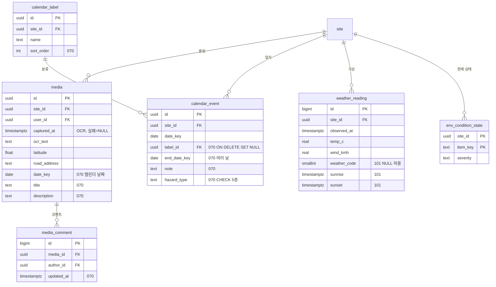

기상은 **현장 고정 좌표 기준**이다. 작업자 위치를 쓰지 않는다.
`env_condition_state`는 현재 상태만 보관(중복 알림 억제용)하고, 발생 이력은 `alert(kind=env)`가 갖는다.

---

## 8. 세션 · 감사

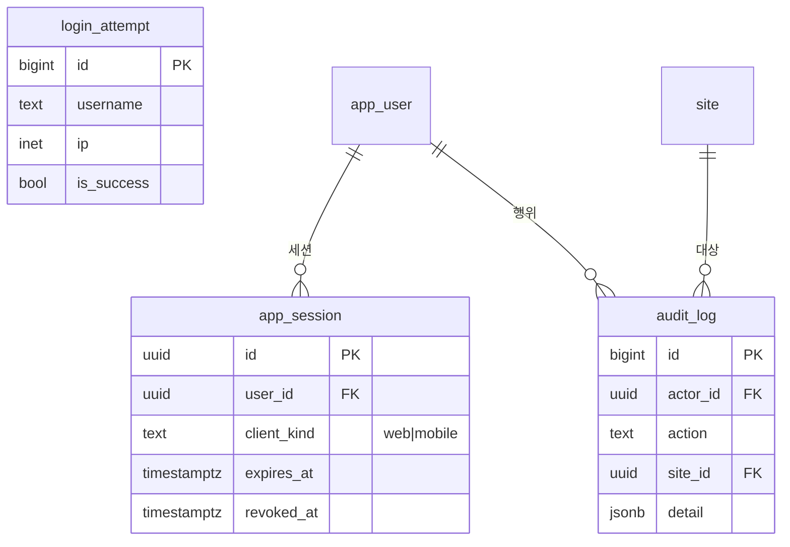

`app_session.client_kind`가 관제 웹과 폰 앱 세션을 구분한다. 같은 계정이 양쪽에 로그인하기 때문이다.

`audit_log`는 **앱 레벨** 기록이다. 서버에 `pgaudit`이 없어 DB 직접 접속은 잡지 못한다 — 개인정보보호법 시행령 제30조제1항제5호 대응의 한계.

---

## 남은 제약

**역할 생성 불가** — 학원 DB 계정에 `CREATEROLE` 권한이 없다. 앱과 테이블 소유자가 같은 계정이 되어, RLS 를 켜도 앱이 세션 변수를 정직하게 설정해야 현장 격리가 성립한다. 요청해 둔 상태.

**N-1 이후 러너 CREATE(2026-09-07 실측)** — `REVOKE CREATE ON SCHEMA public FROM PUBLIC` 을 실행하면 러너 롤(vg2owner)도 public 에 객체를 못 만든다(063 리허설 1차 `permission denied for schema public`). 스키마 소유자가 **`GRANT CREATE ON SCHEMA public TO <러너 롤>`** 을 REVOKE 직후 같이 실행해야 한다(plan-063a). 캠퍼스 본적용 절차(061a 2단계)에 반영.

~~**SSL 불가** — 서버가 `ssl=off`. 민감 컬럼은 애플리케이션에서 암호화해 암호문만 전송해야 한다. 서버측 `pgp_sym_encrypt` 는 평문 SQL 이 네트워크를 흘러 의미가 없다.~~

**현재 연결 상태(2026-09-28 실측)** — 캠퍼스 신 DB 연결은 `pg_stat_ssl.ssl=true`로 TLS 협상됨을 확인했다. 위 문장은 과거 상태다. 연락처 등 민감 컬럼의 애플리케이션 암호화는 계속 유지하며, PII 키 준비와 라이브 리비전 연결 여부는 별도로 확인한다.

---

## 관련 문서

`Desktop/조달청 프로젝트/DB재구축/`

- `01_수신데이터_인벤토리` — 라우트 91개 전수 조사
- `02_설계결정` — 확정 사항
- `05_명명_정리` — 명명 규칙
- `07_대상DB_환경실측` — 서버 제약
- `migrations/001_init.sql`

`Desktop/라이브서버_변경필요목록_20260811.md` — 이 스키마로 전환할 때 앱에서 바꿔야 할 6가지

---

# 추가 구현 (2026-08-12)

마이그레이션 002~006 적용. 테이블 59 · RLS 53 · 정책 56.

## 9. 추적성

사고가 났을 때 원인을 되짚는 장치다. 스키마 정합성과 별개로, 이게 없으면 로그를 뒤져야 한다.

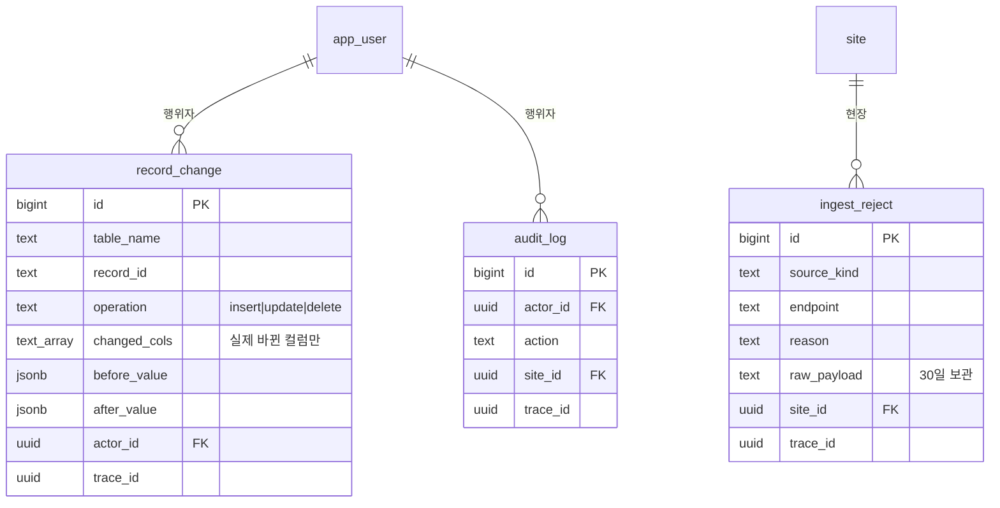

**`trace_id` 로 한 줄로 잇는다.** `gas_reading` · `vision_fall_event` · `ppe_violation` · `aed_self_test` · `alert` · `audit_log` · `ingest_reject` 가 같은 값을 공유한다.

```sql
SELECT * FROM trace_timeline WHERE trace_id = '...' ORDER BY at;
```

```
alert          gas/danger        ← 경보 발생
ingest_reject  schema_invalid    ← 같은 요청에서 거부된 것
record_change  gas_threshold#2   ← 그때 임계가 바뀌었음
```

**변경 이력은 9개 테이블만** — 돈·권한·임계. 전부 걸면 쓰기가 두 배가 되고 이력이 본 테이블보다 커진다.

**정상 수신 원본은 보관하지 않는다.** 문제는 들어온 데이터보다 안 들어온 데이터에서 난다.

---

## 10. 현장 격리 (RLS)

정책은 **세션 변수만** 읽는다. 테이블을 조회하면 무한 재귀가 난다 — 실제로 겪었고, `SECURITY DEFINER` 로는 풀리지 않는다(정의자가 곧 소유자이고 `FORCE RLS` 가 소유자에게도 적용됨).

```
앱이 트랜잭션마다 설정
  app.actor_id       사용자 uuid
  app.actor_role     platform_admin | owner_officer | site_manager | worker
  app.actor_company  회사 uuid
  app.actor_sites    현장 uuid 목록 (쉼표 구분)

미설정 시 조회 0행 (fail-closed)
```

판정은 `can_access_site()` 하나를 거친다.

```sql
rls_bypassed()                        -- 마이그레이션 전용 우회
OR is_platform_admin()                -- 운영팀은 전체
OR target = ANY(session_site_ids())   -- 배정된 현장
```

### 검증 결과

전체 현장 2 · 경보 2 · 사용자 4 · 회사 3 인 상태에서

| 사용자 | 현장 | 경보 | 사용자 | 회사 |
|---|---|---|---|---|
| 운영자 | 2 | 2 | 4 | 3 |
| 조달청 담당관 (A·B 배정) | 2 | 2 | 1 | 2 |
| 현장관리자A (A만) | **1** | **1** | 2 | 2 |
| 현장관리자B (B만) | **1** | **1** | 2 | 2 |

미인증 세션 0행, 남의 현장 쓰기는 `new row violates row-level security policy` 로 차단.

### 로그인 시 닭과 달걀

세션 변수를 채우려면 역할·배정을 알아야 하는데, 그 조회 자체가 정책에 막힌다. 전용 정책 두 개로 푼다.

```
p_app_user_self      id = current_actor_id()      → 자기 행만
p_site_member_self   user_id = current_actor_id() → 자기 배정만
```

`app.actor_id` 만 먼저 설정하고 이 둘을 읽어 나머지를 채운다.

### 파티션 자식 구멍 (실제로 뚫렸던 것)

**파티션 부모의 RLS 는 자식에 상속되지 않는다.**

```sql
SELECT count(*) FROM gas_reading         -- 1행 (격리됨)
SELECT count(*) FROM gas_reading_202608  -- 2행 (남의 현장이 보였다)
```

자식에도 정책을 걸어 막았고, `ensure_month_partition()` 이 새 파티션 생성 시 자동으로 걸도록 고쳤다.

**수동으로 `CREATE TABLE ... PARTITION OF` 를 하면 그 달만 격리가 없는 상태가 된다.** 반드시 함수를 거칠 것.

### RLS 를 걸지 않은 것

`login_attempt`(로그인 전엔 신원이 없음) · `procurement_notice` · `procurement_award` · `shop_price_daily` · `risk_task_extraction`(공개 정보) · `schema_migration`(메타데이터). 이유는 테이블 주석에 있다.

---

## 11. 운영 함수

| 함수 | 주기 | 안 하면 |
|---|---|---|
| `ensure_partitions(2)` | 월 1회 | 파티션 없는 달이 default 로 몰림 |
| `check_integrity()` | 일 1회 | 이상 징후가 조용히 쌓임 |
| `check_rls()` | 배포 후 | 새 테이블의 격리 구멍을 놓침 |
| `purge_ingest_reject(30)` | 월 1회 | 거부 원본의 개인정보가 무기한 보관 |
| **`check_schema_health()`** | **마이그레이션마다** | 이름·타입·인덱스·RLS 결함을 놓침 |
| **`check_fk_policy()`** | **마이그레이션마다** | 계정 파기가 막히거나 삭제 시 오류 |

### 검사기를 DB 안에 둔 이유 (010·011)

같은 종류의 누락이 **두 번** 있었다.

- 004 가 컬럼 **이름 목록**으로 훑어서 008 이 새로 만든 컬럼 7개를 놓쳤다 → 010
- 001 에서 임계값에 `_at` 을 붙인 것을 아무도 못 봤다 → 011

**사람이 기억하는 방식으로는 또 놓친다.** 이름은 계속 늘어나지만 구조는 그대로이므로, 검사도 이름이 아니라 구조로 한다.

`check_schema_health()` 가 보는 것 — 정수 PK 범위 위험(L003) · 무효 인덱스(H001) · 중복 인덱스(H004) · `site_id` 가 있는데 RLS 미적용 · **FORCE RLS 누락**(소유자가 정책을 우회한다) · 정책 없는 ENABLE(전면 차단) · 이름은 시각인데 타입이 아님 · `updated_at` 자동갱신 없음 · 파티션 default 적재.

`check_fk_policy()` 가 보는 것 — `NOT NULL` 인데 `ON DELETE SET NULL`(부모 삭제 시 실행 오류) · `app_user` 참조인데 `NO ACTION`(**계정 파기가 막힌다** — 개인정보보호법 제21조제1항이 보유기간 경과 시 지체 없는 파기를 요구하는데, 자식 한 줄 때문에 삭제가 막히면 그 의무를 이행할 수 없다).

기준은 [postgres-checkup](https://postgres.ai/docs/checkup/) 의 H·L 계열이다. F·G·K 계열(bloat·연결·쿼리 성능)은 데이터가 쌓인 뒤에 의미가 생긴다.

**둘 다 ERROR 0행이어야 정상이다.** 011 적용 후 실측 0건.

`check_integrity()` 가 훑는 것 — default 파티션 적재 · 24시간 넘게 안 닫힌 경보 · **좌표 없는 활성 현장** · 현장 미배정 사용자 · 최근 수신 거부 · **행위자 미상 변경**.

마지막 항목이 특히 쓸모 있다. 앱이 `app.actor_id` 를 빠뜨리면 변경 이력에 누가 했는지가 안 남는데, **그 누락 자체를 탐지한다.**

---

---

## 12. 보안 (016~038 · 외부 리뷰 대응)

> 외부 AI 리뷰(codex gpt-5.6-sol) 3회로 **52건**을 지적받아 **49건**을 고쳤다.
> 재현으로 실재를 확인한 것만 손댔고, 고친 뒤에도 재현해 차단을 확인했다.

### 근본 원인 — RLS 는 행만 막는다

치명적 결함 대부분이 한 뿌리였다.

```sql
-- 005 에서 이렇게 썼다
CREATE POLICY p_app_user_self ON app_user
  USING (id = current_actor_id());        -- WITH CHECK 없음

-- 의도  자기 계정을 "본다"
-- 실제  자기 계정을 "마음대로 바꾼다"
```

PostgreSQL 은 `FOR ALL` 정책에 `WITH CHECK` 가 없으면 **`USING` 식을 쓰기 검사에도 그대로 적용**한다. *"누가 볼 수 있나"* 만 생각하고 *"누가 바꿀 수 있나"* 를 분리하지 않았다.

그리고 **RLS 는 행 단위다.** 어느 행에 접근하는지는 막았으나 **그 행의 어느 컬럼을 바꾸는지**는 통제하지 않아 `role`·`status` 가 열려 있었다. 앱이 테이블 소유자라 `GRANT UPDATE(컬럼)` 도 무의미하다 — **트리거만 남는다.**

### 재현으로 확인한 것 (일반 worker 세션)

| 시도 | 수정 전 | 조치 |
|---|---|---|
| 자기 `role` 을 `platform_admin` 으로 | **성공** | 권한 컬럼 트리거(017) |
| 남의 현장에 자가 배정 | **성공** | `FOR SELECT` 로 분리(017) |
| 감사 로그 삭제 | **성공** | DELETE 정책 없음(017) |
| 위험구역 임의 추가 | **성공** | 관리자만(017) |
| 남의 초대 토큰 조회 → 가로채기 | **성공** | 별도 표 분리(026) |
| 타 현장 경보 허위 확인 | **성공** | 현장 범위 복원(030) |
| 가짜 측정을 `device` 로 확정 | **성공** | 보호 방향 반전(027) |

### 세 겹 방어

한 겹이 뚫려도 다음이 남도록 나눴다.

```
정책(RLS)     어느 행에 접근하나        · 현장 범위 · 본인 여부
트리거        어느 컬럼을 바꾸나        · role·status·received_at·data_origin
함수          토큰·권한이 필요한 동작    · accept_invitation · close_alert · purge_user_pii
```

`aed_self_test` 는 정책이 `WITH CHECK (true)` 인데 트리거만으로 막히고 있었다(031) — 재현에서는 차단으로 보여 눈으로는 못 찾는다. **검사기가 잡았다.**

### 파기·보존 (제21조 · 산업안전보건법 제164조)

두 법이 반대 방향을 요구한다.

| | |
|---|---|
| 개인정보보호법 제21조①③ | 불필요해지면 **지체 없이 파기**, 보존해야 하면 **분리 저장** |
| 산업안전보건법 제164조①4 | 산업재해 원인 기록 **3년 보존** |

경보 전체를 3년 남기면 사고와 무관한 경보의 개인정보까지 남는다 → **`incident_archive` 로 사고만 옮기고 대상은 `uuid` 만** 남긴다. 이름·연락처는 없다.

`record_change` 가 `to_jsonb(OLD)` 로 행 전체를 복제해 **계정을 파기해도 완전한 사본이 남았다**(제21조② "복구 불가능하게" 미충족). 이제 민감값은 `***` 로 가린다 — *"바뀌었다"* 는 남고 *"무엇이었다"* 는 안 남는다.

### 검사기 10종

```sql
SELECT * FROM run_all_checks();   -- 0행이어야 정상
```

| 검사 | 잡는 것 |
|---|---|
| `check_schema_health` | 정수 PK · 무효/중복 인덱스 · RLS 커버리지 · 명명 · 파티션 여유 |
| `check_fk_policy` | `NOT NULL` + `SET NULL` 모순 · 계정 파기를 막는 `NO ACTION` |
| `check_rls_write_policy` | `FOR ALL` 인데 `WITH CHECK` 없음 · 로그에 DELETE 열림 |
| **`check_rls_read_path`** | RLS 켜졌는데 SELECT 정책 없음 — **bypass 도 못 읽는다** |
| `check_policy_site_scope` | 쓰기 정책에 현장 범위 조건 누락 |
| `check_session_state_leak` | 함수가 세션 설정을 고정값으로 복원 |
| `check_trigger_delete_return` | `BEFORE DELETE` 가 `OLD` 를 안 돌려줌 |
| `check_device_auth` | 자격증명 없는 장치 |
| `check_retention` | 약속한 파기가 실제로 되는가 |
| `check_partition_runway` | 파티션이 몇 달 남았나 |

참고 목록(`list_pii_columns`·`list_actor_columns`)은 **일부러 뺐다** — 매번 뜨는 항목은 진짜 결함을 가린다.

### 고치면서 낸 결함 — 전부 재현으로 잡았다

수정이 새 구멍을 만든 사례가 반복됐다. **오류를 내지 않는 것들이 특히 위험했다.**

| 결함 | 증상 |
|---|---|
| `PERFORM` 이 `FOUND` 를 덮어씀 | **아무 키나 통과** |
| `<>` 가 NULL 이면 NULL → `IF` 가 거짓 | 없는 키도 통과 |
| 함수가 `bypass_rls` 를 `off` 로 고정 복원 | 호출 뒤 문장이 **조용히 0행** |
| `BEFORE DELETE` 가 `RETURN NEW` | **삭제가 오류 없이 취소** |
| `mock` 을 잠그고 `device` 를 열어 둠 | 보호 방향이 거꾸로 |
| `SELECT` 정책 없이 bypass 만 믿음 | **초대 수락이 통째로 사망** |

마지막 것이 가장 오래 갔다. 검증 스크립트가 낡은 컬럼을 참조해 **오류로 죽으면서 아무것도 검증하지 않았기** 때문이다.

> **"오류 0건" 이 아니라 "검사 N건이 실제로 돌았나" 를 본다.**
> 그리고 결과는 성공/실패가 아니라 **실제 값**으로 판정한다 — 지워진 행 수, 저장된 값, 보이는 행 수.

## 데이터 사전

> **이 표는 DB 의 `COMMENT` 에서 생성한다.** 손으로 쓰면 스키마와 반드시 어긋난다 — 컬럼을 바꾸면서 문서를 같이 고치는 일은 잊히기 때문이다(001 의 `warning_at` 오명명을 아무도 못 본 것이 그 예다).
> 재생성 = `013_comments.sql` 에 코멘트를 더한 뒤 생성기를 다시 돌린다.
>
> 기호 — `PK` 기본키 · `UK` 고유 · `→` 참조 대상 · `*` NOT NULL

### 조직 · 사람

#### `company`

조직. 발주기관·시공사·운영사를 한 테이블에 둔다.

| 컬럼 | 타입 | 키 | 의미 |
|---|---|---|---|
| `id` | uuid | PK | 기본키 |
| `name` \* | text |  | 이름 |
| `biz_no` | text | UK | 사업자등록번호. 같은 상호가 여럿일 수 있어 실제 식별은 이 값으로 한다. |
| `org_type` \* | text |  | platform=VitAlGuard 운영사, owner=발주기관(조달청·지자체), contractor=시공사. |
| `created_at` \* | timestamptz |  | 생성 시각 |
| `updated_at` | timestamptz |  | 마지막 변경 시각 (트리거가 자동 갱신) |

#### `department`

부서·소속팀. 조달청 부서는 사전 등록해 가입 시 선택하게 하고, 그 외 기관은 입력값을 목록에 자동 등록한다. 자유 입력만 두면 같은 부서가 표기 차이로 여러 값이 된다.

| 컬럼 | 타입 | 키 | 의미 |
|---|---|---|---|
| `id` | uuid | PK | 기본키 |
| `company_id` \* | uuid | UK → company | 소속 회사 |
| `name` \* | text | UK | 이름 |
| `created_at` \* | timestamptz |  | 생성 시각 |
| `updated_at` | timestamptz |  | 마지막 변경 시각 (트리거가 자동 갱신) |

#### `app_user`

시스템에 로그인하는 모든 사람. 관제 웹과 폰 앱이 같은 계정을 쓰므로 어느 쪽에서 가입해도 연동된다. 사람을 두 테이블로 나누면 같은 사람이 두 곳에 생겨 동기화 문제가 난다.

| 컬럼 | 타입 | 키 | 의미 |
|---|---|---|---|
| `id` | uuid | PK | 기본키 |
| `company_id` \* | uuid | UK → company | 소속 회사 |
| `department_id` | uuid | → department | 소속 부서. 조달청은 007 에서 사전 등록했고 그 외 기관은 가입 시 입력값이 자동 등록된다. |
| `role` \* | text |  | 구 users 는 5명 전부 role=admin 이고 실제 구분은 admin_access·org_type 이 했다 — role 이 죽어 있었다. 여기서는 role 이 실제 권한 구분이다. |
| `username` \* | text | UK | 로그인 아이디. 이메일과 별개다 — 작업자는 이메일이 없을 수 있다. |
| `password_hash` | text |  | google 가입자는 NULL. |
| `auth_provider` \* | text |  | password 또는 google. google 가입자는 password_hash 가 NULL 이다. |
| `google_sub` | text | UK | 구글 계정의 고유 식별자(sub). 이메일이 바뀌어도 유지된다. |
| `name` \* | text |  | 이름 |
| `employee_no` | text | UK | 사번. (company_id, employee_no) 로 UNIQUE — 회사가 다르면 같은 사번을 써도 된다. |
| `job_title` | text |  | 직책. 표시용이고 권한과 무관하다(권한은 role). |
| `status` \* | text |  | pending(승인 대기) · active · disabled. 계정을 지우지 않고 disabled 로 두면 과거 기록의 행위자가 보존된다. |
| `approved_at` | timestamptz |  | 승인 시각. NULL 이면 아직 승인 전이다. |
| `approved_by` | uuid | → app_user | 승인한 사람. 오승인을 사후 추적하는 근거다. |
| `created_at` \* | timestamptz |  | 생성 시각 |
| `updated_at` | timestamptz |  | 마지막 변경 시각 (트리거가 자동 갱신) |
| `identity_checked_at` | timestamptz |  | 신원을 확인한 시각. 신분증을 눈으로 본 사실만 남기고 그 내용은 저장하지 않는다. |
| `identity_checked_by` | uuid | → app_user | 신원을 확인한 사람. 확인자 계정이 파기돼도 "확인했다"는 사실(identity_checked_at)은 남는다. |
| `identity_check_method` | text |  | in_person=현장 관리자 대면 확인 / domain_email=기관 도메인 이메일 보유(그 기관이 이미 신원을 확인해 발급) / e_card=건설근로자 전자카드(연계 가능성 미확인). **주민등록번호·생년월일·신분증 이미지 컬럼은 두지 않는다.** 제24조의2 상 우리에게 처리 근거가 없다. 누락이 아니라 설계이므로 나중에 채워 넣지 말 것. |
| `phone_enc` | text |  | 전화번호 암호문(AES-256-GCM base64). 앱이 암호화해 넣는다. |
| `phone_hmac` | text |  | 같은 번호면 같은 해시. 번호 중복 검사와 조회에 쓴다. status<>disabled 조건부 UNIQUE 인 이유 — 작업자가 현장을 옮기면 계정 하나를 이어서 쓰지만(결정 2), 퇴사 처리된 옛 계정이 번호를 붙잡고 있으면 재등록이 막힌다. |
| `phone_last4` | text |  | 화면 표시용 평문 뒤 4자리. 목록에서 "010-****-5678" 을 그리려고 매번 복호화하면 키 사용이 급증하고 감사 로그가 무의미해진다. |
| `email_enc` | text |  | 이메일 암호문. |
| `email_hmac` | text |  | 이메일 HMAC. 로그인·중복검사에 쓴다(암호문은 같은 값이어도 매번 달라 조회에 못 쓴다). |
| `email_domain` | text |  | 평문으로 둔다. 2층 승인의 도메인 판별에 필요하고, 도메인은 기관 정보이지 개인 식별정보가 아니다(회사는 company_id 로 이미 드러난다). |
| `guardian_name` | text |  | 보호자 이름. 제3자 정보이므로 consent_record 에 guardian_contact 동의가 있어야 채운다. |
| `guardian_relation` | text |  | 보호자와의 관계(배우자·부모 등). |
| `guardian_phone_enc` | text |  | 보호자는 제3자다. consent_record 에 guardian_contact 동의가 없으면 채우면 안 된다. 수집 근거는 제15조제1항제5호(급박한 생명·신체의 이익)이나, 그 근거만으로 무제한 보관이 정당화되지는 않는다. |
| `guardian_phone_hmac` | text |  | 보호자 번호 HMAC. 중복 확인용이다. |
| `location_paused_at` | timestamptz |  | 개인위치정보 수집의 일시중지 시각. NULL 이면 수집 가능, 값이 있으면 **그 시점부터 수집·이용·제공을 멈춘다**. 위치정보법 제24조제2항 — 정보주체의 일시중지 요구를 **거절할 수 없고 이를 위한 기술적 수단을 갖추어야** 한다. 앱 설정에만 두면 앱을 지우거나 기기를 바꿨을 때 중지가 풀리므로 서버가 들고 있는다. ⚠ 중지는 파기가 아니다 — 이미 수집된 위치정보는 그대로 있고, 지우려면 동의 철회(제24조제1항·제4항) 경로를 탄다. |
| `is_company_account` | boolean |  | **073** 시공사 법인 계정 표지(NOT NULL DEFAULT false). 현장별로 발급되는 슈퍼계정 — 소속은 그 현장의 시공사(site.contractor_company_id), 역할은 site_manager, 현장 묶음은 site_member. contractor 소속·site_manager 가 아니면 트리거(fn_guard_company_account)가 거부하고, 스스로 바꿀 수 없다(fn_guard_privileged_columns). |
| `password_must_change` | boolean |  | **073** 초기 비밀번호 상태(NOT NULL DEFAULT false). true 면 로그인 대신 비밀번호 변경을 먼저 요구한다(앱 403). 본인이 password_hash 를 바꾸는 UPDATE 에서만 false 로 풀린다(fn_stamp_password_change). 관리자·서버는 발급/재발급 때 true 로 둔다. |
| `password_changed_at` | timestamptz |  | **073** 비밀번호를 마지막으로 바꾼 시각(트리거가 도장). NULL = 바꾼 적 없음. "언제 바꿨나"는 감사 질문이다. |
| `is_site_officer` \* | boolean |  | 현장 담당관 자격 — 안전관리비 확정 권한의 근거. **부여제**: platform_admin 만 부여할 수 있고(자가취득은 fn_guard_privileged_columns 가 차단), contractor 소속은 부여 자체가 성립하지 않는다(fn_guard_site_officer — bypass 분기 없음). 부여·회수는 record_change 에 남는다(003 트리거가 app_user 에 이미 붙어 있다). |
| `totp_secret_enc` | text |  | **088** 2단계 인증 시크릿 **암호문**(AES-256-GCM · 008 연락처 규약과 같은 층위 · 앱이 `lib/pii-crypto` 로 암호화). ⚠ 어떤 응답으로도 나가면 안 된다 — 사용자 목록은 화이트리스트로 짓고 `totp_enabled` 만 내린다. 감사 로그에서는 `mask_sensitive_jsonb` 가 이름(`secret`·`_enc`)으로 잡아 자동으로 가린다. `_hmac` 짝을 두지 않는 이유 — 시크릿은 조회 대상이 아니다. |
| `totp_enabled` \* | boolean |  | **088** 등록 완료 여부(NOT NULL DEFAULT false). 대상 판정(고권한 계정)은 앱이 한다(`requiresTwoFactor`). ⚠ 대상이지만 미등록인 계정을 로그인에서 막지 않는다 — 막으면 등록 화면에 못 가 계정이 잠긴다. `chk_app_user_totp` 가 "시크릿 없이 활성화" 를 막는다. |
| `totp_last_step` | bigint |  | **088** 마지막으로 **소비한** 30초 스텝(unix time / 30). 같은 코드 재사용을 막는다. ⚠ 이것이 DB 컬럼인 이유 — 앱 메모리로 세면 인스턴스마다 따로 센다(Cloud Run 다중 인스턴스). `trg_app_user_totp_step` 이 되돌리기를 막아 단조 증가를 강제한다. |
| `temp_password_expires_at` | timestamptz |  | **089** 임시 비밀번호 만료. 관리자가 재설정을 승인하면 앱이 채운다. ⚠ 임시 비밀번호 **평문은 어디에도 저장하지 않는다** — `password_hash` 만 갱신하고 여기엔 만료만 남는다. ⚠ 만료 판정은 **세션 발급보다 먼저** 와야 한다. |
| _(위 1행은 2026-09-14 전수검사 C-002 보강 — 재현본 001~075 실측 · TOTP 3컬럼은 088 · 임시 비밀번호 만료는 089 · 2026-09-15)_ |  |  |  |

#### `site_member`

이 현장에 관여하는 사람. 작업자 배정·관리자 담당·조달청 담당관 담당이 모두 이 표다. 작업자는 일하고 관리자는 감독하고 담당관은 관리하지만, DB 가 답할 질문은 같다 — 이 사람이 이 현장을 볼 수 있는가.

| 컬럼 | 타입 | 키 | 의미 |
|---|---|---|---|
| `id` | bigint | PK | 기본키 |
| `site_id` \* | uuid | → site | 현장. 모든 시계열의 테넌트 키이고 RLS 격리 기준이다 |
| `user_id` \* | uuid | → app_user | 대상 사용자 |
| `joined_on` \* | date |  | 배정 시작일. |
| `left_on` | date |  | NULL 이면 현재 배정 중. 서버가 세션 변수를 채울 때 이 조건으로 거른다 — 이게 빠지면 이전 시공사가 옮겨간 작업자를 계속 본다. |
| `granted_by` | uuid | → app_user | 배정한 사람. |
| `updated_at` | timestamptz |  | 마지막 변경 시각 (트리거가 자동 갱신) |

### 계정 · 가입 · 동의

#### `company_domain`

기관 이메일 도메인 → 회사 매핑. 공직 이메일은 그 기관이 발급하므로 도메인 보유 자체가 소속 증명이 된다.

| 컬럼 | 타입 | 키 | 의미 |
|---|---|---|---|
| `id` | uuid | PK | 기본키 |
| `company_id` \* | uuid | → company | 소속 회사 |
| `domain` \* | text | UK | 전역 UNIQUE. 한 도메인이 두 회사에 걸리면 가입자를 어느 쪽에 붙일지 결정할 수 없다. 소문자로만 저장한다(대소문자 혼용 시 같은 도메인이 두 행이 된다). |
| `verified_at` | timestamptz |  | NULL 이면 아직 우리가 확인하지 않은 도메인. 자동 승인 후보에서 제외한다. |
| `verified_by` | uuid | → app_user | 이 도메인을 확인한 우리 쪽 담당자. |
| `note` | text |  | 확인 근거(계약번호·공문 등). |
| `created_at` \* | timestamptz |  | 생성 시각 |

#### `signup_request`

초대 없이 계약을 근거로 들어오는 가입 신청. 이 경로로 들어온 사람은 우리가 직접 승인한다(기관 관리자 추가는 우리 몫이라는 결정).

| 컬럼 | 타입 | 키 | 의미 |
|---|---|---|---|
| `id` | uuid | PK | 기본키 |
| `email_domain` | text |  | 이메일에서 분리해 저장. 도메인 판별·통계에 쓰고 인덱스를 태운다. 매번 split_part 로 계산하면 인덱스를 못 쓴다. 055: 평문 email 을 지운 뒤에도 도메인은 남긴다(기관 정보이지 개인 식별정보가 아니다). 전화만으로 신청하면 NULL 이다. |
| `name` \* | text |  | 이름 |
| `contract_ref` | text |  | 계약번호 또는 계약 공개 URL. 지자체는 gyeyak.<지자체>.go.kr 패턴이라 URL 을 그대로 받아 파싱한다. |
| `matched_company_id` | uuid | → company | 도메인으로 판별된 회사. NULL 이면 미판별이라 자동 승인 후보에서 빠진다. |
| `matched_contract_id` | bigint | → procurement_contract | 대조에 성공한 계약. |
| `auto_check_result` \* | jsonb |  | 검증 4항목 결과를 통째로 남긴다. boolean 4개만 두면 나중에 "도메인 불일치였나 계약이 없었나"를 알 수 없다. 예: {"domain_match":{"ok":true,"domain":"goheung.go.kr","company":"고흥군"}, "contract_found":{"ok":true,"source":"url_parse","url":"https://gyeyak..."}, "issuer_match":{"ok":false,"expected":"고흥군","actual":"본청"}, "department":{"ok":true,"value":"재무과"}} |
| `status` \* | text |  | pending · approved · rejected · expired. |
| `reviewed_by` | uuid | → app_user | 검토한 사람. |
| `reviewed_at` | timestamptz |  | 검토 시각. |
| `reject_reason` | text |  | 거절 사유. rejected 면 반드시 있어야 한다(CHECK). |
| `created_user_id` | uuid | → app_user | 승인으로 만들어진 계정. approved 면 반드시 있어야 한다(CHECK). |
| `created_at` \* | timestamptz |  | 생성 시각 |
| `updated_at` \* | timestamptz |  | 마지막 변경 시각 (트리거가 자동 갱신) |
| `email_enc` | text |  | 신청자 이메일 암호문. |
| `email_hmac` | text |  | 이메일 HMAC. 중복 신청 확인에 쓴다. |
| `phone_enc` | text |  | 신청자 전화번호 암호문. |
| `phone_hmac` | text |  | 전화번호 HMAC. |

#### `password_reset_request` — **신설 (089 · 2026-09-15)**

비밀번호 재설정 요청 원장. 미인증 사용자가 신청하고 관리자가 승인·거부한다.
그전에는 표가 없어 라우트가 501 이었고, 비밀번호를 잃으면 복구 경로가 아예 없었다
(관리자가 계정을 비활성/재활성만 할 수 있었다).

**권한 경계는 가입 승인(`signup_request`)과 같다** — 앱 가드가 그렇게 고정했고, 정책·트리거·분류를
같은 층위로 두었다. 라우트가 501 뿐이라 앱 코드에서 설계를 뽑을 수 없어, 가드 테스트가 적어 둔
**지켜야 할 성질 7개**에서 뽑았다(`lib/2026-08-15-account-recovery.guard.test.ts`).

| 컬럼 | 타입 | 키 | 의미 |
|---|---|---|---|
| `id` | uuid | PK | 기본키 |
| `user_id` \* | uuid | → app_user | 대상 계정. **NOT NULL 인 이유** — "계정을 찾았을 때만 행을 만든다"는 규약을 구조로 강제한다. 없는 계정으로 온 신청은 행을 만들지 않고 응답만 똑같이 준다(열거 공격 방지 · 앱 몫). |
| `status` \* | text |  | pending → approved / rejected / expired. |
| `requested_ip` | text |  | 신청 IP. 요청 제한(429)의 근거이자 남용 추적용. ⚠ `mask_sensitive_jsonb` 의 `client_ip` 규약에 안 걸려 감사 로그에 남는다 — 가리려면 마스킹 정규식에 추가해야 한다. |
| `reviewed_by` | uuid | → app_user (ON DELETE SET NULL) | 심사자. **SET NULL 인 이유** — 004 정책(app_user 참조 FK 가 NO ACTION 이면 계정 파기가 막힌다). 지워져도 `reviewed_at` 과 `record_change` 이력이 남아 감사 추적은 끊기지 않는다. |
| `reviewed_at` | timestamptz |  | 심사 시각 |
| `reject_reason` | text |  | 거부 사유. 거부면 필수(CHECK). |
| `created_at` \* | timestamptz |  | 신청 시각 |
| `updated_at` \* | timestamptz |  | 마지막 변경 시각 (트리거) |

**제약이 막는 것**

| 제약 | 막는 것 |
|---|---|
| `chk_prr_status` | 정의 밖 상태값 |
| `chk_prr_reject` | 사유 없는 거부 |
| `chk_prr_reviewed` | **심사자·시각 없는 승인·거부** — "누가 남의 계정 접근을 넘겼는지" 가 빠지는 것 |
| `uq_prr_pending_per_user` | **같은 계정에 pending 둘** — 승인 두 번으로 임시 비밀번호가 두 개 나가는 것 |

★ **이 표가 담지 않는 것 — 임시 비밀번호 평문.** 승인 시 앱이 평문을 만들어 화면에 한 번 보여주고,
DB 에는 `app_user.password_hash`(해시)와 `temp_password_expires_at`(만료)만 남는다.
`password_must_change`(073)가 이미 있어 "첫 로그인에 변경 강제" 는 그대로 동작한다.

⚠ **앱 구현은 아직이다**(2026-09-15) — 표는 섰고 신청·심사 라우트가 501 이다.

#### `invitation`

초대장. 수락 시 app_user 와 site_member 를 함께 만든다. 승인만 하고 배정을 빠뜨리면 로그인해도 화면이 비어 있다 — 현장 범위는 site_member 가 정하기 때문이다.

| 컬럼 | 타입 | 키 | 의미 |
|---|---|---|---|
| `id` | uuid | PK | 기본키 |
| `invited_role` \* | text |  | platform_admin 부여는 platform_admin 만 가능하다(트리거 fn_check_invitation_authority). 기관 관리자가 자기보다 높은 권한을 만들 수 없어야 한다. |
| `company_id` \* | uuid | → company | 소속 회사 |
| `department_id` | uuid | → department | 배정할 부서. |
| `site_id` | uuid | → site | 현장. 모든 시계열의 테넌트 키이고 RLS 격리 기준이다 |
| `invited_by` | uuid | → app_user | 초대한 사람. 계정이 파기되면 NULL 이 된다 — 초대가 있었다는 사실과 그 내용은 남는다. 누가 보냈는지는 record_change 이력으로 추적한다. INSERT 시점에는 NULL 일 수 없다: fn_check_invitation_authority 가 초대자를 조회하지 못하면 예외를 던진다. |
| `expires_at` \* | timestamptz |  | 만료 시각. 지난 초대는 수락되지 않는다. |
| `accepted_at` | timestamptz |  | 수락 시각. NULL 이면 아직 미수락이다. |
| `accepted_user_id` | uuid | → app_user | 수락으로 만들어진 계정. |
| `revoked_at` | timestamptz |  | 회수 시각. 수락과 회수는 동시에 성립하지 않는다(CHECK). |
| `revoked_by` | uuid | → app_user | 회수한 사람. |
| `revoke_reason` | text |  | 회수 사유. |
| `created_at` \* | timestamptz |  | 생성 시각 |
| `updated_at` \* | timestamptz |  | 마지막 변경 시각 (트리거가 자동 갱신) |
| `email_enc` | text |  | 초대 대상 이메일 암호문(앱에서 AES-256-GCM). |
| `email_hmac` | text |  | 초대 대상 이메일의 HMAC. 수락 시 "초대받은 사람이 맞는가" 를 대조하는 데 쓴다 — 평문 비교는 암호화 규약을 깨고, 암호문은 매번 달라 비교할 수 없다. |
| `phone_enc` | text |  | 초대 대상 전화번호 암호문. |
| `phone_hmac` | text |  | 전화번호 HMAC. 같은 번호로 중복 초대를 막는 데 쓴다. |
| `email_domain` | text |  | 도메인만 평문. 승인 화면에서 기관을 판별하는 데 필요하고 개인 식별정보가 아니다. |
| `phone_last4` | text |  | 화면 표시용 뒤 4자리. 복호화 없이 "010-****-5678" 을 그린다. |

#### `invitation_secret`

초대 토큰 해시. **invitation 에서 분리한 이유** — RLS 는 행 단위라 컬럼을 가릴 수 없는데, 같은 회사 사람이 초대 목록을 보는 것은 정상 업무다. 한 표에 두면 목록을 보는 순간 토큰도 함께 보여 "토큰 소지자만 수락" 관문이 무너진다(리뷰 7·10, 재현 확인). 이 표는 accept_invitation() 만 읽는다. 사람은 아무도 못 읽는다.

| 컬럼 | 타입 | 키 | 의미 |
|---|---|---|---|
| `invitation_id` | uuid | PK → invitation | 대상 초대. 초대가 지워지면 함께 사라진다(CASCADE). |
| `token_hash` \* | text | UK | 초대 토큰의 해시. **원본 토큰은 초대받은 사람의 메일·문자에만 있다** — DB 는 모른다. accept_invitation() 이 이 값으로 대조하는 것이 유일한 검증 수단이다. |
| `created_at` \* | timestamptz |  | 생성 시각 |

#### `notify_channel`

경보가 실제로 도착하는지를 책임지는 표. 사람이 여러 채널을 가질 수 있고 폰을 바꾸면 토큰이 바뀌므로 app_user 컬럼이 아니라 별도 표로 둔다.

| 컬럼 | 타입 | 키 | 의미 |
|---|---|---|---|
| `id` | uuid | PK | 기본키 |
| `user_id` \* | uuid | UK → app_user | 대상 사용자 |
| `channel_kind` \* | text | UK | push(FCM) · sms · alimtalk. 사업자등록 전이라 현재는 push 만 쓸 수 있다. |
| `destination` \* | text | UK | push 면 FCM 토큰, sms/alimtalk 이면 전화번호. 번호는 앱에서 암호화해 넣는다(연락처 암호화 규약). |
| `destination_label` | text |  | 사람이 읽는 채널 이름(기기명 등). 화면 표시용이다. |
| `verified_at` | timestamptz |  | NULL 이면 **도달 미보장**. 이 사용자는 사고가 나도 본인에게 알림이 안 간다. 대시보드에서 눈에 띄게 표시해야 한다. |
| `last_sent_at` | timestamptz |  | 마지막 발송 시도 시각. 도달 성공은 last_delivered_at 이 따로 본다. |
| `last_delivered_at` | timestamptz |  | 이 표에서 가장 중요한 컬럼. FCM 토큰은 앱 재설치·장기 미사용으로 조용히 무효화된다. 다른 오류는 사용자가 신고하지만 **푸시 실패는 아무도 모른 채 경보가 사라진다.** |
| `last_failed_at` | timestamptz |  | 마지막 실패 시각. |
| `last_fail_reason` | text |  | 실패 사유. 토큰 무효인지 일시 오류인지 가른다. |
| `consecutive_fail_count` \* | integer |  | 연속 실패가 쌓이면 앱이 자동 비활성화하고 관리자에게 알린다. 성공 시 0 으로 되돌린다. |
| `disabled_at` | timestamptz |  | 비활성화 시각. 연속 실패가 쌓이면 앱이 자동으로 채운다. |
| `disable_reason` | text |  | 비활성화 사유. |
| `created_at` \* | timestamptz |  | 생성 시각 |
| `updated_at` \* | timestamptz |  | 마지막 변경 시각 (트리거가 자동 갱신) |

#### `consent_template`

동의받을 때 화면에 띄운 고지 내용의 버전. 제15조제2항이 요구하는 4가지를 각각 컬럼으로 둔다. 한 덩어리 text 로 두면 "보유기간을 알렸는가" 를 증명할 수 없다.

| 컬럼 | 타입 | 키 | 의미 |
|---|---|---|---|
| `id` | uuid | PK | 기본키 |
| `consent_kind` \* | text | UK | 동의 종류. **근거 법률이 다르면 종류를 나눈다** — 한 덩어리로 묶으면 고지 항목이 새고, 하나를 거부한 사람의 다른 동의까지 함께 무효가 된다. service_terms(이용약관) · privacy_basic(개인정보 일반) · privacy_sensitive(건강정보 = 민감정보, 개인정보보호법 제23조) · **location**(개인위치정보 — 위치정보법 제19조제1항. 개인정보 동의서에 없는 **확인자료 보유근거·보유기간**을 추가로 고지해야 한다) · guardian_contact(보호자 연락처 — 정보주체가 **보호자 본인**이라 작업자 동의로 갈음되지 않는다). 그중 privacy_sensitive 는 **건강 정보(심박·SpO2·체온) 전용**이다. 개인정보보호법 제23조제1항제1호가 "다른 개인정보의 처리에 대한 동의와 별도로" 받으라고 정하므로 privacy_basic 과 합치면 위법이다. **화면에서도 체크박스를 따로 둬야 한다.** |
| `version` \* | integer | UK | 양식 버전. 문구가 바뀌면 새 버전을 만들고 옛 버전은 남긴다 — 과거 동의가 무엇이었는지 답할 수 있어야 한다. |
| `title` \* | text |  | 동의 항목 제목(화면 표시용). |
| `purpose` \* | text |  | 개인정보보호법 제15조제2항제1호 — 수집·이용 목적. |
| `data_items` \* | text |  | 개인정보보호법 제15조제2항제2호 — 수집하려는 개인정보의 항목. **실제 스키마와 대조해 유지한다.** 034 에서 로그인 아이디·접속 IP·단말·알림 목적지·촬영 위치가 빠져 있던 것을 채웠다(리뷰 24). 컬럼을 새로 추가하면 여기도 함께 고치고 **버전을 올린다** — 이미 동의한 사람에게는 새 항목이 고지되지 않았기 때문이다. |
| `retention_period` \* | text |  | 보유기간. 동의서에 **문구로** 적히는 값이다(개인정보보호법 제15조제2항제3호 · 위치정보법 제19조제1항4호의2). ★ **개인위치정보는 7일**로 결정됐다(2026-08-18). 근거 — 위치정보법 제23조제1항이 "목적 달성 시 즉시 파기" 를 원칙으로 하고 실시간 안전 확인은 그 순간 목적이 달성된다. 7일은 주말·연휴를 건너뛰어 사고 인지까지의 최소 구간을 덮는 값이며, 30일을 넘기면 동선이 **생활 패턴**을 드러내 근참법 제20조제1항제14호(근로자 감시 설비)의 무게가 달라진다. 사고 발생분은 이 기간과 무관하게 **산업안전보건법 제164조제1항제4호(3년)** 근거로 별도 보존한다 — 근거가 다른 두 기록이라 보존 의무와 파기 의무가 충돌하지 않는다. |
| `refusal_notice` \* | text |  | 제15조제2항제4호 — 동의 거부 권리와 거부 시 불이익. |
| `is_required` \* | boolean |  | 필수 동의 여부. **임의로 정할 수 없다** — chk_consent_required_scope 가 consent_kind 별로 고정한다. 바꾸려면 마이그레이션이 필요하다. |
| `effective_from` \* | timestamptz |  | 이 버전이 유효해진 시각. |
| `effective_to` | timestamptz |  | NULL 이면 현재 버전이다. |
| `created_at` \* | timestamptz |  | 생성 시각 |
| `extra_notice` | text |  | **개인정보보호법 제15조제2항에 대응물이 없는 고지 항목**을 담는다. 현재는 위치정보법 전용이다 — **제19조제1항제1호**(사업자 상호·주소·연락처)와 **제5호**(시행령 제23조 → 제19조제3항 통보에 관한 사항 = 제3자 제공 시 매회 통보를 **어떤 방법으로** 하는지). 화면에 하드코딩하지 말 것 — 동의 시점의 고지 내용이 남지 않으면 나중에 무엇에 동의했는지 증명할 수 없다. 위치 외 동의(privacy_basic 등)는 NULL 이다. |

#### `consent_record`

누가 어느 버전에 동의했는지. 철회(withdrawn_at)가 있어야 제21조 파기 판단이 선다 — 철회 시점부터 그 정보는 불필요해진다.

| 컬럼 | 타입 | 키 | 의미 |
|---|---|---|---|
| `id` | bigint | PK | 기본키 |
| `user_id` \* | uuid | → app_user | 대상 사용자 |
| `template_id` \* | uuid | → consent_template | 동의한 양식 버전. 문구 스냅샷을 가리킨다. |
| `agreed` \* | boolean |  | 거부(false)도 기록한다. "동의를 거부할 권리"(제15조제2항제4호)를 실제로 보장했다는 증거가 된다. |
| `agreed_at` \* | timestamptz |  | 동의(또는 거부) 시각. |
| `withdrawn_at` | timestamptz |  | NULL 이 아니면 동의를 철회한 것이다. 철회 시점부터 그 정보는 불필요해지므로 개인정보보호법 제21조의 파기 판단 근거가 된다. |
| `client_ip` | inet |  | 동의 시점 접속 IP. 동의 사실을 다툴 때 근거가 된다. |
| `user_agent` | text |  | 동의 시점 단말 정보. |

#### `app_session`

로그인 세션. revoked_at 으로 강제 로그아웃을 표현한다. 토큰 자체는 저장하지 않는다.

| 컬럼 | 타입 | 키 | 의미 |
|---|---|---|---|
| `id` | uuid | PK | 기본키 |
| `user_id` \* | uuid | → app_user | 대상 사용자 |
| `client_kind` \* | text |  | 관제 웹과 폰 앱이 같은 계정을 쓰므로 어느 쪽 세션인지 구분한다. |
| `issued_at` \* | timestamptz |  | 세션 발급 시각. |
| `expires_at` \* | timestamptz |  | 만료 시각. |
| `revoked_at` | timestamptz |  | NULL 이 아니면 강제 로그아웃된 세션이다. |
| `device_info` | text |  | 접속 단말 정보. 계정 도용 의심 시 대조한다. |

#### `login_attempt`

로그인 시도 기록. RLS 미적용 — 로그인 전에는 actor_id 가 없어 정책을 걸면 기록 자체가 불가능하다. 앱이 조회를 노출하지 않는 것으로 대응한다.

| 컬럼 | 타입 | 키 | 의미 |
|---|---|---|---|
| `id` | bigint | PK | 기본키 |
| `username` \* | text |  | 시도한 아이디. 없는 계정으로의 시도도 남는다. |
| `ip` | inet |  | 시도한 IP. |
| `is_success` \* | boolean |  | 실패도 기록한다. 무차별 시도를 탐지하려면 실패가 있어야 한다. |
| `attempted_at` \* | timestamptz |  | 시도 시각. |

### 현장

#### `site`

현장. 모든 시계열의 테넌트 키. 구 스키마는 33개 테이블 중 4개에만 현장 키가 있었다.

| 컬럼 | 타입 | 키 | 의미 |
|---|---|---|---|
| `id` | uuid | PK | 기본키 |
| `name` \* | text |  | 이름 |
| `owner_company_id` | uuid | → company | 발주기관(조달청·지자체). |
| `contractor_company_id` | uuid | → company | 시공사. 073 CCTV 열람은 현장관리자의 `app_user.company_id`가 이 값과 같아야 한다. NULL이면 이 조건이 성립하지 않아 배정된 현장관리자도 CCTV를 볼 수 없다. |
| `address` | text |  | 지번 주소. |
| `road_address` | text |  | 도로명 주소. |
| `started_on` | date |  | 착공일. |
| `ends_on` | date |  | 준공 예정일. |
| `status` \* | text |  | planned · active · suspended · closed. active 가 아닌 현장은 경보 판정에서 뺀다. |
| `created_at` \* | timestamptz |  | 생성 시각 |
| `updated_at` | timestamptz |  | 마지막 변경 시각 (트리거가 자동 갱신) |

#### `site_geometry`

현장 좌표. 고정값이며 작업자 GPS 로 산출하지 않는다. 구 시스템은 하루 최초 작업자 GPS 를 현장 중심으로 캐시해, 이탈 판정의 기준점이 이탈하는 사람을 따라 움직이는 모순이 있었다.

| 컬럼 | 타입 | 키 | 의미 |
|---|---|---|---|
| `id` | bigint | PK | 기본키 |
| `site_id` \* | uuid | → site | 현장. 모든 시계열의 테넌트 키이고 RLS 격리 기준이다 |
| `center_lat` \* | float8 |  | 현장 중심 위도. |
| `center_lon` \* | float8 |  | 현장 중심 경도. |
| `radius_m` \* | integer |  | 현장 반경 m. 이 원 밖으로 나가면 이탈로 본다. |
| `source` \* | text |  | 조달 계약 주소를 지오코딩해 초기값을 만들고 사람이 보정한다. |
| `valid_from` \* | timestamptz |  | 이 좌표가 유효해진 시각. 현장이 이전하면 새 행을 넣고 옛 행은 남긴다. |
| `valid_to` | timestamptz |  | NULL = 현재 유효. 좌표 보정 후에도 과거 판정을 재현하기 위한 이력. |
| `created_by` | uuid | → app_user | 좌표를 등록한 사람. |

#### `danger_zone` — 제거됨 (069)

진입 금지 구역(중심+반경) 표는 **069 에서 기능째 걷었다**(2026-09-08 팀 결정 · 앱 코드는 같은 날 `bfa93d62` 로 제거). `alert.kind` 의 `danger_zone_entry` 도 함께 빠졌다. 영상 기반 침입 판정(PolygonZone)과 밀폐공간(060)은 별개 개념이다.

#### `site_task_doc`

현장 작업 내용 문서. 위험성 평가(risk_task_extraction)와 대조하는 재료다.

| 컬럼 | 타입 | 키 | 의미 |
|---|---|---|---|
| `id` | bigint | PK | 기본키 |
| `site_id` \* | uuid | → site | 현장. 모든 시계열의 테넌트 키이고 RLS 격리 기준이다 |
| `task_text` \* | text |  | 작업 내용 원문. |
| `tags` \* | jsonb |  | 분류 태그. |
| `updated_by` | uuid | → app_user | 마지막으로 고친 사람. |
| `updated_at` \* | timestamptz |  | 마지막 변경 시각 (트리거가 자동 갱신) |
| `original_name` | text | CHECK | **101** 원본 파일명 1~255자. NULL은 과거 원본명 미보유. |
| `byte_size` | bigint | CHECK | **101** 원본 파일의 양수 바이트 수. 추출 텍스트 길이가 아니다. NULL 허용. |
| `sha256` | text | CHECK | **101** 원본 바이트의 SHA-256, 소문자 16진수 64자. 텍스트 추출 전에 계산하며 NULL 허용. |

#### `dashboard_worker_slot`

관제 화면 작업자 슬롯 등록. 브라우저 localStorage 영속을 서버로 승격해 어느 기기로 접속해도 유지된다.

| 컬럼 | 타입 | 키 | 의미 |
|---|---|---|---|
| `site_id` | uuid | PK → site | 현장. 모든 시계열의 테넌트 키이고 RLS 격리 기준이다 |
| `slots` \* | jsonb |  | 대시보드에 고정 표시할 작업자 배치. 화면 구성이라 도메인 데이터가 아니다. |
| `updated_at` \* | timestamptz |  | 마지막 변경 시각 (트리거가 자동 갱신) |

### 장치 · 센서

#### `device`

현장에 설치된 장치의 공통 정보. GasPod·AED 경보기·카메라가 여기 등록되고 각자의 확장 표(aed_device·camera)가 1:1 로 붙는다. 장치마다 표를 따로 두면 "이 현장에 장치가 몇 대인가" 를 물을 수 없다.

| 컬럼 | 타입 | 키 | 의미 |
|---|---|---|---|
| `id` | uuid | PK | 기본키 |
| `site_id` \* | uuid | → site | 현장. 모든 시계열의 테넌트 키이고 RLS 격리 기준이다 |
| `device_type` \* | text | UK | gaspod · aed_alarm · camera. 확장 표(aed_device·camera)가 어느 쪽에 붙는지를 이 값이 정한다. |
| `external_id` \* | text | UK | 장치가 전송 시 자기를 밝히는 식별자(구 gaspod device_id, camera_id). |
| `model` | text |  | 장치 모델명. |
| `firmware_version` | text |  | 펌웨어 버전. 이상 동작이 특정 버전에 몰리는지 볼 때 쓴다. |
| `location_label` | text |  | 설치 위치 설명(사람이 읽는 값). |
| `installed_at` | timestamptz |  | 설치 시각. |
| `decommissioned_at` | timestamptz |  | NULL 이면 운용 중. 장치를 삭제하지 않고 폐기 시각을 남긴다(과거 측정값의 출처가 사라지면 안 된다). |
| `created_at` \* | timestamptz |  | 생성 시각 |
| `updated_at` | timestamptz |  | 마지막 변경 시각 (트리거가 자동 갱신) |

#### `device_credential`

장치가 자기를 증명하는 수단. **비밀 원문은 저장하지 않는다** — 해시만 두고 장치가 서명해 보내면 서버가 대조한다. DB 가 유출돼도 장치를 사칭할 수 없다. 한 장치에 여러 키를 둘 수 있다(key_id 로 구분). 무중단 교체를 위해서다 — 새 키를 활성화하고 장치를 갱신한 뒤 옛 키를 폐기하면 수집이 끊기지 않는다.

| 컬럼 | 타입 | 키 | 의미 |
|---|---|---|---|
| `id` | uuid | PK | 기본키 |
| `device_id` \* | uuid | UK → device | 대상 장치 |
| `key_id` \* | text | UK | 장치가 요청 헤더에 실어 보내는 키 식별자. 서버는 이 값으로 어느 비밀과 대조할지 정한다. 비밀 자체가 아니므로 평문으로 오가도 된다. |
| `secret_hash` \* | text |  | 공유 비밀의 해시. **원문을 저장하지 않는다** — 발급 시 한 번만 보여주고 장치에 심는다. 분실하면 재발급한다. |
| `algo` \* | text |  | hmac-sha256 = 요청 본문·시각을 포함해 서명(3단계 목표) / static-token = 값 자체를 비교(현재 방식). static-token 은 **재전송을 막지 못한다** — 같은 토큰으로 아무 데이터나 보낼 수 있다. 과도기 수단이다. |
| `activated_at` \* | timestamptz |  | 이 키가 유효해지는 시각. 기본값은 now() 다. **미래로 두면 그때까지 인증되지 않는다** — 026 이전에는 이 조건을 안 봐서 미래 키가 즉시 통했다. |
| `expires_at` | timestamptz |  | NULL 이면 만료 없음. 기간을 두면 교체를 잊어도 자동으로 죽는다 — 다만 그때 수집이 끊기므로 만료 전 알림이 필요하다. |
| `revoked_at` | timestamptz |  | 폐기 시각. 장치를 분실하거나 키가 샜을 때 이 키만 죽인다. 지금처럼 전 장치가 같은 토큰을 쓰면 **한 대만 잃어도 전량 교체**해야 한다. |
| `revoke_reason` | text |  | 폐기 사유. 필수다(CHECK) — 사유 없는 폐기는 나중에 "왜 껐지" 를 답할 수 없다. |
| `last_used_at` | timestamptz |  | 마지막 사용 시각. 오래 안 쓰인 키는 장치가 죽었거나 이미 교체된 것이다 — 폐기 후보를 찾는 데 쓴다. |
| `created_by` | uuid | → app_user | 발급한 사람. 계정이 파기되면 NULL 이 되고 발급 사실은 남는다. |
| `created_at` \* | timestamptz |  | 생성 시각 |

#### `gas_reading`

GasPod 5초 주기 측정.

| 컬럼 | 타입 | 키 | 의미 |
|---|---|---|---|
| `id` | bigint | PK | 기본키 |
| `device_id` \* | uuid | UK → device | 대상 장치 |
| `site_id` \* | uuid | → site | 현장. 모든 시계열의 테넌트 키이고 RLS 격리 기준이다 |
| `measured_at` | timestamptz | PK | 장치가 측정한 시각. 기본값을 두지 않는다 — 서버가 now() 로 채우면 지연·재전송 시 실제 시점을 잃는다. 구 시스템이 바로 그렇게 해서 측정 시각을 복원할 수 없었다. 앱이 반드시 채워야 한다. |
| `received_at` \* | timestamptz |  | 서버가 받은 시각. measured_at 과의 차이가 지연이고, 5분을 넘으면 실시간 경보를 억제한다. |
| `o2_pct` | real |  | 결측은 NULL. 0 은 실제 산소 0%를 뜻한다. |
| `co_ppm` | real |  | MQ-7 환산 농도. 원시 ADC 는 co_raw_adc 에 함께 보관한다. |
| `h2s_ppm` | real |  | MQ-136 환산 농도. |
| `co_raw_adc` | integer |  | MQ-7 원시 ADC. 환산식이 바뀌어도 원본으로 재계산할 수 있게 함께 보관한다. |
| `h2s_raw_adc` | integer |  | MQ-136 원시 ADC. 같은 이유로 보관한다. |
| `temp_c` | real |  | 섭씨. GasPod 내장 센서 값이라 기상 API 의 기온과 다르다(실내·기기 발열 영향). |
| `humidity_pct` | real |  | 상대습도 %. |
| `pressure_hpa` | real |  | 기압 hPa. |
| `vbat_v` | real |  | 배터리 전압 V. 4.2 를 넘으면 배터리 스위치가 꺼진 채 USB 로만 급전되는 상태로 판별한다. |
| `trace_id` | uuid |  | 요청 추적 ID. 같은 요청에서 만들어진 행·거부·경보·감사 기록이 같은 값을 갖는다. trace_timeline 뷰가 이 값으로 시간순 재구성을 한다 — "이 경보가 왜 났는지" 를 역추적하는 유일한 수단이다. |
| `data_origin` \* | text |  | device=실제 장치 측정 / mock=개발·테스트용 가짜. 통계·ML·경보에서 mock 을 제외하는 판단 기준이다. 구 시스템은 data_origin 과 source 두 컬럼이 있었으나 구분 기준이 불명확해 구 앱과 신 앱을 가릴 수 없었다 — 여기서는 하나만 두고 값을 CHECK 로 고정한다. |

#### `gas_threshold`

가스 위험 임계. 서버가 소유한다. 구 시스템은 ESP32 펌웨어가 판정해 임계 변경 시 전 장치 재배포가 필요했고 과거 데이터 재판정이 불가능했다. **⚠ v2 설계 확정(2026-09-04)** — 아래는 재현본 실측(v1) 구조이고, direction 폐기·4경계+basis 로 교체가 확정됐다. 하단 16절.

| 컬럼 | 타입 | 키 | 의미 |
|---|---|---|---|
| `id` | bigint | PK | 기본키 |
| `site_id` | uuid | → site | NULL = 전역 기본값. |
| `gas` \* | text |  | 대상 가스 — o2 · co · h2s. 단위가 가스마다 다르다(o2 는 %, 나머지는 ppm). |
| `warning_level` \* | real |  | 경고 임계값. 단위는 gas 에 따라 다르다 — o2 는 %, co·h2s 는 ppm. direction 과 함께 읽어야 의미가 선다. |
| `danger_level` \* | real |  | 위험 임계값. above 면 이 값 초과가 위험, below 면 이 값 미만이 위험이다. |
| `direction` \* | text |  | above=초과 시 위험(CO·H2S), below=미만 시 위험(산소). |
| `valid_from` \* | timestamptz |  | 이 임계값이 적용되기 시작한 시각. |
| `valid_to` | timestamptz |  | NULL 이면 현재 유효한 임계값이다. 과거 값을 지우지 않고 기간으로 관리해 "그때 기준이 무엇이었나" 를 답할 수 있게 한다. |
| `updated_at` | timestamptz |  | 마지막 변경 시각 (트리거가 자동 갱신) |

#### `aed_device`

AED 전용 확장. 배터리·패드 교체 주기를 관리한다. 구 시스템은 실측 없이 날짜 계산만으로 상태를 판정했다.

| 컬럼 | 타입 | 키 | 의미 |
|---|---|---|---|
| `device_id` | uuid | PK → device | 대상 장치 |
| `aed_model` | text |  | AED 모델. 교체 주기가 모델마다 다르다. |
| `battery_installed_on` | date |  | 배터리 설치일. 여기에 주기를 더해 만료를 계산한다. |
| `pad_installed_on` | date |  | 패드 설치일. |
| `battery_cycle_months` | integer |  | 배터리 교체 주기(개월). 제조사·모델마다 다르다. |
| `pad_cycle_months` | integer |  | 패드 교체 주기(개월). |
| `last_swap_at` | timestamptz |  | 마지막 교체 시각. |
| `updated_at` | timestamptz |  | 마지막 변경 시각 (트리거가 자동 갱신) |

#### `aed_inspection`

NFC 태그 기반 사람 점검. 응급의료법상 월 1회 점검 의무 이행 증빙.

| 컬럼 | 타입 | 키 | 의미 |
|---|---|---|---|
| `id` | bigint | PK | 기본키 |
| `device_id` \* | uuid | → device | 대상 장치 |
| `inspected_at` \* | timestamptz |  | 점검 시각. |
| `inspector_user_id` | uuid | → app_user | 점검자. 계정이 파기되면 NULL 이 되고 점검 사실은 남는다. |
| `items` \* | jsonb |  | 점검 항목별 결과. |
| `is_signature_valid` \* | boolean |  | NFC 태그 서명 검증 결과. false 면 현장에 실제로 가지 않고 기록만 남긴 것일 수 있다. |

#### `aed_self_test`

신설. 구 시스템은 AED 실제 상태를 측정하지 않고 교체일 경과일로만 추정했다(라즈베리파이는 서버에 폴링만 하고 전송하지 않음). 하드웨어 작업이 선행돼야 채워진다.

| 컬럼 | 타입 | 키 | 의미 |
|---|---|---|---|
| `id` | bigint | PK | 기본키 |
| `device_id` \* | uuid | UK → device | 대상 장치 |
| `measured_at` \* | timestamptz | UK | 장치가 자가진단을 수행한 시각. |
| `received_at` \* | timestamptz |  | 서버가 받은 시각. |
| `battery_status` | text |  | 장치가 보고하는 배터리 상태. **값 집합 미확정** — AED 실측 경로가 아직 없다. 장치 프로토콜 확인 전에는 CHECK 를 걸지 않는다(모르는 값에 걸면 적재가 통째로 실패한다). |
| `pad_status` | text |  | 패드 상태. 위와 같은 이유로 값 집합 미확정. |
| `self_test_result` | text |  | 자가진단 종합 결과. 값 집합 미확정(장치 프로토콜 미확인). |
| `raw` | jsonb |  | 장치 응답 원문. |
| `trace_id` | uuid |  | 요청 추적 ID (같은 요청의 기록이 같은 값을 갖는다) |
| `data_origin` \* | text |  | device 또는 mock. 통계·경보에서 mock 을 제외하는 기준이다. |

#### `camera`

CCTV 전용 확장. zone_label 은 화면에 표시되는 구역 이름이고, conf_threshold 는 그 카메라의 판정 임계값이다(카메라마다 화각·거리가 달라 전역 상수로 두면 오탐이 갈린다).

| 컬럼 | 타입 | 키 | 의미 |
|---|---|---|---|
| `device_id` | uuid | PK → device | 대상 장치 |
| `zone_label` | text |  | 카메라가 비추는 구역 이름. 2026-09-27 앱 수정으로 타일 이름 편집을 localStorage에서 이 컬럼으로 옮겼다. 수정은 현재 현장의 platform_admin만 허용한다. |
| `stream_url` | text |  | 영상 스트림 주소. |
| `model_name` | text |  | 추론 모델 실명(예: ppe_yolo26s_640_v5). 확인된 값만 적고 추정하지 않는다. |
| `conf_threshold` | real |  | 이 카메라의 판정 임계값. 화각·거리가 달라 전역 상수로 두면 오탐이 갈린다. |
| `updated_at` | timestamptz |  | 마지막 변경 시각 (트리거가 자동 갱신) |

### 영상 판정

#### `ppe_minute_stat`

보호구 착용 1분 집계. 엣지는 초당 6회 전송하나 그 주기는 대시보드 영상 송출용이며 적재와 무관하다.

| 컬럼 | 타입 | 키 | 의미 |
|---|---|---|---|
| `id` | bigint | PK | 기본키 |
| `camera_id` \* | uuid | UK → device | 대상 카메라 |
| `site_id` \* | uuid | → site | 현장. 모든 시계열의 테넌트 키이고 RLS 격리 기준이다 |
| `bucket_start` | timestamptz | PK | 집계 창의 시작 시각(분 단위 절삭). 서버가 계산해 넣는다. |
| `frame_count` \* | integer |  | 이 1분 구간에서 판정한 프레임 수. 이 값이 작으면 통계 신뢰도가 낮다. |
| `person_count_max` \* | integer |  | 구간 내 최대 인원. 평균이 아니라 최대를 쓰는 이유는 순간적으로 많이 모인 상황이 위험하기 때문이다. |
| `helmet_worn` \* | integer |  | 착용 판정 누적 건수. 사람 수가 아니라 판정 횟수다 — 같은 사람이 60프레임에 잡히면 60 이 더해진다. |
| `helmet_missing` \* | integer |  | 안전모 미착용 판정 누적 건수(사람 수가 아니라 판정 횟수). |
| `vest_worn` \* | integer |  | 안전조끼 착용 판정 누적. **조끼는 판정 범위 밖이다** — 학습 데이터가 없어 신뢰할 수 없다. |
| `vest_missing` \* | integer |  | 안전조끼 미착용 판정 누적. 위와 같이 참고값이다. |
| `compliance_rate` | real |  | 인원 0명이면 NULL(측정 없음). 구 엣지는 분모가 0일 때 100 을 넣어, 아무도 없는 시간대가 준수율 100%로 집계됐다. |
| `data_origin` \* | text |  | device 또는 mock. |
| `received_at` \* | timestamptz |  | bucket_start 는 집계 구간의 시작이지 수신 시각이 아니다. 둘을 구분해야 지연 도착을 판정할 수 있다. |

#### `ppe_violation`

미착용 상태 전이 1건. 최소 지속시간 임계(서버 설정)를 넘긴 것만 기록해 검출 깜빡임을 거른다. 구 시스템은 PPE 판정을 하나도 저장하지 않았다 — 엣지가 보내는 cctv-ai 서비스에 DB 연결이 없어 메모리에만 있었다.

| 컬럼 | 타입 | 키 | 의미 |
|---|---|---|---|
| `id` | bigint | PK | 기본키 |
| `camera_id` \* | uuid | UK → device | 대상 카메라 |
| `site_id` \* | uuid | → site | 현장. 모든 시계열의 테넌트 키이고 RLS 격리 기준이다 |
| `kind` \* | text | UK | 미착용 종류 — helmet · vest. 안전화는 판정 범위 밖이다(모델이 예약 현장에서 검출 0). |
| `started_at` \* | timestamptz | UK | 위반이 시작된 시각. |
| `ended_at` | timestamptz |  | NULL 이면 아직 진행 중이다. |
| `duration_sec` | integer |  | 미착용이 이어진 시간 초. 순간 오검출과 실제 위반을 가르는 기준이 된다. |
| `max_missing_count` \* | integer |  | 구간 내 최대 미착용 인원. |
| `evidence_media_id` | uuid | → media | 위반 시점 증거 이미지. 사진이 파기되면 NULL이 되지만 audit_log의 media.delete detail.ppe_violation_ids에 이 위반 id가 남으므로 처음부터 증빙이 없었던 경우와 구별할 수 있다. |
| `trace_id` | uuid |  | 요청 추적 ID (같은 요청의 기록이 같은 값을 갖는다) |

#### `vision_fall_event`

영상 낙상 판정 이벤트. 같은 사람이 계속 누워 있으면 프레임마다 행이 생기므로 (camera_id, observed_at, status) UNIQUE 로 중복을 막는다. 이것 자체는 경보가 아니다 — 경보는 alert 에 별도로 만든다.

| 컬럼 | 타입 | 키 | 의미 |
|---|---|---|---|
| `id` | bigint | PK | 기본키 |
| `camera_id` \* | uuid | UK → device | 대상 카메라 |
| `site_id` \* | uuid | → site | 현장. 모든 시계열의 테넌트 키이고 RLS 격리 기준이다 |
| `observed_at` | timestamptz | PK | 프레임 관측 시각. 위와 같은 이유로 기본값 없음. |
| `received_at` \* | timestamptz |  | 서버가 받은 시각. |
| `status` \* | text | UK | standing · unstable · lying · fallen. lying 과 fallen 은 다르다 — 누워 있는 것과 넘어진 것을 구분한다. |
| `fallen_count` | integer |  | 이 프레임에서 넘어진 것으로 판정된 인원. |
| `total_count` | integer |  | 이 프레임에서 검출된 전체 인원. fallen/total 로 비율을 본다. |
| `confidence` | real |  | 판정 신뢰도. |
| `source` | text |  | 판정 주체(엣지 장치인지 서버인지). 같은 화면에 다른 모델명이 표시되는 사고가 있었다. |
| `raw` | jsonb |  | 판정 원본 응답. |
| `trace_id` | uuid |  | 요청 추적 ID (같은 요청의 기록이 같은 값을 갖는다) |
| `data_origin` \* | text |  | device 또는 mock. |

### 경보 · 환경

#### `alert`

전 경보 통합. 구 시스템은 10종 중 5종만 alerts 에 들어갔고 나머지는 메모리·텔레메트리 컬럼·별도 체계로 흩어져 있었다.

| 컬럼 | 타입 | 키 | 의미 |
|---|---|---|---|
| `id` | uuid | PK | 기본키 |
| `site_id` \* | uuid | → site | 현장. 모든 시계열의 테넌트 키이고 RLS 격리 기준이다 |
| `kind` \* | text |  | 경보 종류(낙상·가스·SOS 등). 구 시스템은 5종만 통합돼 있었다. |
| `severity` \* | severity_level |  | 심각도. severity_level 열거형이다. |
| `subject_type` \* | text |  | worker=현장에서 일하는 사람에게 붙은 경보(낙상·SOS·이탈). 조달청 담당관에게는 붙지 않으므로 user 가 아니라 worker 로 둔다. zone=대상 미특정(영상 단독 낙상). device=장치(가스·AED). 구 alerts 는 worker_id NOT NULL 이라 zone 경보를 담지 못해 메모리에만 두었고 재시작 시 소실됐다. |
| `subject_user_id` | uuid | → app_user | 대상이 사람일 때. subject_type 에 따라 셋 중 하나만 채워진다. |
| `subject_device_id` | uuid | → device | 대상이 장치일 때. |
| `subject_zone_label` | text |  | 대상이 구역일 때. 사람을 특정할 수 없는 영상 판정이 여기 해당한다 — 구 시스템은 worker_id 가 NOT NULL 이라 이 경우를 저장하지 못하고 메모리에만 뒀다. |
| `started_at` \* | timestamptz |  | 경보 발생 시각. |
| `ended_at` | timestamptz |  | NULL 이면 **아직 진행 중**인 경보다. check_integrity() 가 24시간 넘게 안 닫힌 경보를 찾는다. |
| `source_kind` | text |  | 판정 주체. watch=워치 센서 · phone=폰 앱 · camera=영상 판정 · gaspod=가스 장치 · aed_device=AED 자가진단 · weather_api=기상 · disaster_api=재난문자 · server=서버 계산(융합·좌표·날짜) · manual=사람이 등록. **구 시스템은 구획 이탈·위험구역 진입을 브라우저가 판정했다.** 화면을 안 켜두면 경보가 나지 않으므로 server 판정으로 이관한다(04 문서 결정). kind 와 혼동하지 말 것 — kind 는 무슨 위험인가, source_kind 는 누가 판정했나다. 같은 fall 이라도 watch 와 camera 는 신뢰도가 다르다. |
| `source_ref` | text |  | 이 경보를 만든 원본 레코드의 식별자. |
| `dedup_key` \* | text | UK | 멱등키. `<kind>:<식별자들>` 형식이며 UNIQUE 다. sos                sos:<user_id>:<measured_at> fall               fall:<user_id>:<measured_at>          ← **워치 시각을 쓴다** zone_fall          zone_fall:<site_id>:<zone>:<observed_at> vital              vital:<user_id>:<detail_key>:<entered_at> geofence_exit      geofence_exit:<user_id>:<crossed_at> absence            absence:<user_id>:<gap_start>          ← 감시 공백(067) gas                gas:<device_id>:<detail_key>:<started_at> ppe                ppe:<camera_id>:<detail_key>:<started_at> aed                aed:<device_id>:<detail_key>:<date> env                env:<site_id>:<detail_key>:<severity>:<started_at> **fall 이 워치 시각을 쓰는 이유** — 영상이 같은 낙상을 확증해도(decideFusion stage=confirmed) 키가 같아 1건으로 합쳐진다. 영상 시각을 쓰면 같은 사고가 두 건이 된다. **구간 경보(gas·ppe·env)는 시작 시각을 키에 넣는다.** 그래야 진행 중인 구간은 같은 행을 갱신(ended_at 채움)하고, 해제 후 재발생은 새 행이 된다. **env 는 severity 를 키에 포함한다.** 주의에서 위험으로 올라가면 새 행이 생겨 "언제 악화됐나" 가 남는다. 구 시스템은 마지막 severity 만 들고 있어 이 이력이 없었다. **대상을 특정하지 못하면 임의 귀속하지 않는다.** 영상 단독 낙상은 zone_fall 로 남긴다 — 같은 구역의 다른 사람에게 잘못 붙이면 그 기록이 사고 조사에서 거짓이 된다. |
| `created_at` \* | timestamptz |  | 생성 시각 |
| `trace_id` | uuid |  | 이 경보를 만든 수신 요청의 식별자. 같은 값으로 gas_reading · ingest_reject · record_change 를 조회하면 수신부터 경보까지가 한 줄로 이어진다. |
| `detail_key` | text |  | kind 안의 세부 항목. env 는 9종이라 kind 로 펼치면 목록이 두 배가 된다 — kind=env 로 묶고 여기에 항목을 둔다. env  : apparent_temp · discomfort · wind · precipitation · uv · pm · kma_warning · kma_preliminary · disaster gas  : o2 · co · h2s          (어느 가스가 임계를 넘었나) ppe  : helmet · vest          (무엇을 안 썼나) aed  : battery · pad · self_test vital: heart_rate · spo2 · temp sos·fall·zone_fall·geofence_exit·absence 는 세부가 없어 NULL 이다. |

#### `alert_ack`

경보 확인·조치 기록. 누가 언제 확인했는지가 남아야 "알림은 갔는데 아무도 안 봤다" 를 구별할 수 있다.

| 컬럼 | 타입 | 키 | 의미 |
|---|---|---|---|
| `id` | bigint | PK | 기본키 |
| `alert_id` \* | uuid | → alert | 대상 경보. |
| `ack_by` | uuid | → app_user | 확인한 사람. 계정이 삭제되면 NULL 이 된다 — 확인 사실 자체는 남는다. |
| `ack_at` \* | timestamptz |  | 확인 시각. |
| `status` \* | text |  | 확인·조치 상태. |
| `note` | text |  | 조치 내용 메모. |

#### `incident_archive`

법정 보존 대상 사고 기록. **개인정보보호법 제21조제3항이 요구하는 "분리 저장"** 이다. 산업안전보건법 제164조제1항제4호가 산업재해 발생 원인 기록을 3년 보존하게 하는데, 경보 전체를 3년 남기면 사고와 무관한 경보의 개인정보까지 함께 남는다. **사고 경보만 옮기고 대상은 uuid 만 남긴다** — 이름·연락처는 여기 없다. 조사 시 필요하면 그 시점에 app_user 를 조회한다(그때 계정이 파기됐다면 그것이 정상이다).

| 컬럼 | 타입 | 키 | 의미 |
|---|---|---|---|
| `id` | uuid | PK | 기본키 |
| `alert_id` \* | uuid |  | 원본 경보의 id. 원본은 일반 보유기간이 지나면 파기되므로 **FK 를 걸지 않는다** — 걸면 원본을 못 지우고, 그것이 곧 파기 의무 위반이 된다. |
| `site_id` \* | uuid |  | 현장. 모든 시계열의 테넌트 키이고 RLS 격리 기준이다 |
| `kind` \* | text |  | 경보 종류. 사고 조사에서 "무슨 일이 있었나" 의 첫 단서다. |
| `detail_key` | text |  | kind 안의 세부 항목(가스면 o2·co·h2s 등). |
| `severity` \* | severity_level |  | 발생 당시 심각도. 나중에 바뀌지 않는다 — 보존 기록이므로 UPDATE 정책 자체가 없다. |
| `subject_type` \* | text |  | worker · zone · device. 대상이 사람이 아닐 수 있다. |
| `subject_ref` | uuid |  | 대상 사용자 또는 장치의 uuid. **이름·연락처를 복제하지 않는다** — 가명처리 원칙이다. 구 시스템은 생체 33만 행에 이름·보호자 연락처를 비정규화해 두었다. |
| `subject_zone_label` | text |  | 대상이 구역일 때의 이름. 영상 단독 낙상처럼 사람을 특정하지 못한 경우다. |
| `started_at` \* | timestamptz |  | 사고 발생 시각. 보존기간(retain_until)의 기산점이다. |
| `ended_at` | timestamptz |  | 종료 시각. NULL 이면 아카이브 시점에 아직 열려 있었다는 뜻이다. |
| `source_kind` | text |  | 판정 주체(watch·camera·gaspod 등). 사고 조사에서 신뢰도를 가늠하는 근거다. |
| `archived_at` \* | timestamptz |  | 보존 영역으로 옮긴 시각. |
| `retain_until` \* | date |  | 이 날짜까지 보존한다. 지나면 purge 대상이다. 법정 기간을 넘겨 두는 것도 위반이다 — 제21조제1항은 "불필요해지면 지체 없이" 파기하라고 정한다. |
| `legal_basis` \* | text |  | 왜 남기는지. 근거 없이 남기면 그것이 곧 위반이다. |

#### `env_condition_state`

환경 경보 현재 상태(중복 알림 억제용). 악화 전이일 때만 재발송하고 정상 복귀 시 리셋한다. 발생 이력은 alert(kind=env)가 보유한다.

| 컬럼 | 타입 | 키 | 의미 |
|---|---|---|---|
| `site_id` | uuid | PK → site | 현장. 모든 시계열의 테넌트 키이고 RLS 격리 기준이다 |
| `item_key` | text | PK | 환경 항목 키(폭염·한파 등). 현재 상태만 보관하고 이력은 남기지 않는다 — 이력이 필요하면 별도 표가 있어야 한다. |
| `severity` \* | severity_level |  | 현재 심각도. 이 표는 상태만 갖고 이력은 남기지 않는다. |
| `updated_at` \* | timestamptz |  | 마지막 변경 시각 (트리거가 자동 갱신) |

#### `weather_reading`

현장 고정 좌표 기준 기상. 작업자 위치를 쓰지 않는다.

| 컬럼 | 타입 | 키 | 의미 |
|---|---|---|---|
| `id` | bigint | PK | 기본키 |
| `site_id` \* | uuid | UK → site | 현장. 모든 시계열의 테넌트 키이고 RLS 격리 기준이다 |
| `observed_at` | timestamptz | PK | 관측 시각(외부 기상 API 기준). |
| `temp_c` | real |  | 기온 섭씨. GasPod 의 temp_c 는 실내·기기 발열이 섞이므로 다른 값이다. |
| `apparent_temp_c` | real |  | 체감온도 섭씨. |
| `humidity_pct` | real |  | 상대습도 %. |
| `wind_kmh` | real |  | 풍속 km/h. |
| `wind_gust_kmh` | real |  | 순간최대풍속 km/h. 타워크레인 작업 중지 판단에 쓰인다. |
| `precipitation_mm` | real |  | 강수량 mm. |
| `uv_index` | real |  | 자외선 지수. |
| `pm10` | real |  | 미세먼지 ㎍/㎥. |
| `pm25` | real |  | 초미세먼지 ㎍/㎥. |
| `weather_code` | smallint | CHECK | **101** 날씨 코드 0~99. NULL은 미보유이며 0(맑음)으로 대체하지 않는다. |
| `sunrise` | timestamptz |  | **101** 외부 기상 API의 일출 시각. NULL 허용. |
| `sunset` | timestamptz |  | **101** 외부 기상 API의 일몰 시각. NULL 허용. |

### 조달 · 안전관리비

#### `procurement_notice`

입찰공고 스냅샷. RLS 미적용 — 공개 입찰 정보이고 현장에 귀속되기 전 단계다. 조달청 담당관의 현장 후보 목록이 여기서 나오므로 막으면 선택 화면이 성립하지 않는다.

| 컬럼 | 타입 | 키 | 의미 |
|---|---|---|---|
| `id` | bigint | PK | 기본키 |
| `notice_no` \* | text | UK | 공고번호. 계약과 잇는 키다. |
| `snapshot_at` \* | timestamptz | UK | 이 값을 받아온 시각. 나라장터 원본은 계속 바뀌므로 **판정에 쓴 시점의 값**을 고정해 둔다. |
| `kind` | text |  | 공고 종류. 나라장터 값이라 값 집합을 통제하지 않는다. |
| `title` | text |  | 공고명. |
| `agency` | text |  | 발주기관. |
| `region` | text |  | 지역. |
| `estimated_price` | bigint |  | 추정가격(원). |
| `period_from` | date |  | 공고 시작일. |
| `period_to` | date |  | 공고 마감일. |
| `raw` \* | jsonb |  | 외부 응답 원문. 우리가 파싱하지 않은 필드가 나중에 필요해질 때 재처리할 수 있다. |

#### `procurement_contract`

계약 스냅샷. 현장 1개에 계약 여럿이 가능하다(분리발주). 설계변경은 새 snapshot_at 으로 남긴다. 조달청 담당관의 담당 현장 후보 목록이 여기서 나온다.

| 컬럼 | 타입 | 키 | 의미 |
|---|---|---|---|
| `id` | bigint | PK | 기본키 |
| `contract_no` \* | text | UK | 계약번호. |
| `snapshot_at` \* | timestamptz | UK | 위와 같다. 계약 정보가 정정되면 새 행이 쌓이고 옛 행도 남는다. |
| `site_id` | uuid | → site | 현장. 모든 시계열의 테넌트 키이고 RLS 격리 기준이다 |
| `notice_no` | text |  | 대응 공고번호. 수의계약은 공고가 없어 NULL 이다 — 실측상 계상 의무 대상의 19.2% 가 여기 해당한다. |
| `contract_amount` | bigint |  | 계약금액(원). |
| `target_amount` | bigint |  | 대상액. 안전관리비 법정 요율의 계산 기준. |
| `construction_type` | text |  | 공종. 나라장터에서 오는 값이라 우리가 값 집합을 통제할 수 없다. 별표1 의 4공종과 매핑표가 따로 필요하다. |
| `period_from` | date |  | 계약 시작일. |
| `period_to` | date |  | 계약 종료일. |
| `agency` | text |  | 발주기관명. 담당관 현장 후보를 거르는 기준. |
| `supplier_name` | text |  | 도급업체명. |
| `raw` \* | jsonb |  | 외부 응답 원문. |

#### `procurement_award`

낙찰 정보. RLS 미적용 — 공개 정보.

| 컬럼 | 타입 | 키 | 의미 |
|---|---|---|---|
| `id` | bigint | PK | 기본키 |
| `notice_no` \* | text | UK | 대상 공고. |
| `snapshot_at` \* | timestamptz | UK | 이 값을 받아온 시각. |
| `award_rate` | real |  | 낙찰률 %. |
| `raw` \* | jsonb |  | 외부 응답 원문. |

#### `risk_task_extraction`

공고 위험작업 추출. RLS 미적용 — 공고 자체가 공개다.

| 컬럼 | 타입 | 키 | 의미 |
|---|---|---|---|
| `id` | bigint | PK | 기본키 |
| `notice_no` \* | text | UK | 대상 공고. |
| `snapshot_at` \* | timestamptz | UK | 추출 시점. |
| `task_type` \* | text | UK | 작업 종류. 외부 문서에서 추출한 값이라 값 집합이 고정되지 않는다. |
| `evidence_sentence` \* | text |  | 그렇게 판정한 근거 문장. 이게 없으면 추출 결과를 검증할 수 없다. |
| `is_verified` \* | boolean |  | LLM 근거 문장이 공고 원문의 부분문자열인지 프로그램으로 검증한 결과. false 는 채택하지 않는다. |

#### `safety_cost_basis`

기준 안전관리비 산정 결과. AI 가 아닌 결정적 계산이며, 산식·요율을 함께 보관해 담당자가 손계산으로 재현할 수 있어야 한다.

| 컬럼 | 타입 | 키 | 의미 |
|---|---|---|---|
| `id` | bigint | PK | 기본키 |
| `site_id` \* | uuid | → site | 현장. 모든 시계열의 테넌트 키이고 RLS 격리 기준이다 |
| `contract_no` \* | text | → procurement_contract | 근거 계약. |
| `contract_snapshot_at` \* | timestamptz |  | 어느 시점의 계약 스냅샷을 썼는지. 계약이 정정되면 계산 근거도 달라진다. |
| `target_amount` \* | bigint |  | 대상액(원). 재료비+직접노무비+관급자재비. 이 값이 없으면 계상액을 독립 검증할 수 없다. |
| `rate_pct` \* | numeric(6,4) |  | 안전관리비 요율 %. 산업안전보건법 별표1 의 공종·금액 구간별 값이다. |
| `base_amount` \* | bigint |  | 기초액(원). 구간 경계에서 금액이 튀지 않게 보정하는 값이다. |
| `formula_ref` \* | text |  | 적용한 산식의 출처(별표1 의 어느 구간인지). |
| `computed_at` \* | timestamptz |  | 계산 시각. |

#### `safety_cost_plan`

안전관리비 사용계획(구 use_plan).

| 컬럼 | 타입 | 키 | 의미 |
|---|---|---|---|
| `id` | bigint | PK | 기본키 |
| `site_id` \* | uuid | → site | 현장. 모든 시계열의 테넌트 키이고 RLS 격리 기준이다 |
| `target_amount` \* | bigint |  | 계획상 대상액(원). |
| `appropriated` \* | bigint |  | 계상액(원). |
| `items` \* | jsonb |  | 항목별 계상 내역. |
| `submitted_at` \* | timestamptz |  | 제출 시각. |
| `updated_at` | timestamptz |  | 마지막 변경 시각 (트리거가 자동 갱신) |

#### `shop_price_daily`

종합쇼핑몰 단가. RLS 미적용 — 공개 가격 정보.

| 컬럼 | 타입 | 키 | 의미 |
|---|---|---|---|
| `id` | bigint | PK | 기본키 |
| `feed_date` \* | date | UK | 단가 기준일. |
| `item_code` \* | text | UK | 품목 코드. |
| `item_name` | text |  | 품목명. |
| `unit_price` | bigint |  | 단가(원). |
| `vendor` | text |  | 공급사. |
| `raw` | jsonb |  | 외부 응답 원문. |

#### `tax_invoice`

세금계산서. 안전관리비 집행 증빙이다. 국세청 공공 API 로는 조회할 수 없어 수기 입력 또는 첨부에 의존한다.

| 컬럼 | 타입 | 키 | 의미 |
|---|---|---|---|
| `id` | bigint | PK | 기본키 |
| `site_id` \* | uuid | → site | 현장. 모든 시계열의 테넌트 키이고 RLS 격리 기준이다 |
| `approval_no` \* | text | UK | 승인번호 UNIQUE = 재전송 멱등. |
| `written_on` \* | date |  | 작성일자. |
| `supplier_name` \* | text |  | 공급자명. |
| `supplier_biz_no` \* | text |  | 공급자 사업자번호. |
| `buyer_name` \* | text |  | 공급받는자명. |
| `buyer_biz_no` \* | text |  | 공급받는자 사업자번호. |
| `supply_amount` \* | bigint |  | 공급가액(원). |
| `tax_amount` \* | bigint |  | 세액(원). |
| `items` \* | jsonb |  | 품목 내역. |
| `nts_status` | text |  | 국세청 사업자 상태. 계속(01)/휴업(02)/폐업(03) 대응. |
| `nts_checked_at` | timestamptz |  | 국세청 조회 시각. 공공 API 로는 세금계산서 자체를 조회할 수 없어 사업자 상태 확인에 그친다. |
| `received_at` \* | timestamptz |  | 수신 시각. |

#### `weekly_verification`

주간 4축 대조. 계상·집행·현장·증빙을 맞춰 본 결과를 남긴다.

| 컬럼 | 타입 | 키 | 의미 |
|---|---|---|---|
| `id` | bigint | PK | 기본키 |
| `site_id` \* | uuid | UK → site | 현장. 모든 시계열의 테넌트 키이고 RLS 격리 기준이다 |
| `contract_no` | text |  | 대상 계약. |
| `period_from` \* | date | UK | 대조 구간 시작. |
| `period_to` \* | date | UK | 대조 구간 끝. |
| `verdict` | text |  | 입력이 부족하면 단정하지 않고 review_needed 로 강등한다. 위반 확정이 아니라 의심 선별이다. |
| `suspect_count` \* | integer |  | 의심 건수. 0 이 아니면 사람이 봐야 한다. |
| `generated_at` \* | timestamptz |  | 생성 시각. |
| `submitted_at` | timestamptz |  | 제출 시각. |
| `submitted_by` | uuid | → app_user | 제출한 사람. |
| `updated_at` | timestamptz |  | 마지막 변경 시각 (트리거가 자동 갱신) |

#### `weekly_verification_input`

주간 대조에 들어간 입력값. 결과만 남기면 나중에 "무엇을 근거로 그렇게 판정했나" 를 못 따진다.

| 컬럼 | 타입 | 키 | 의미 |
|---|---|---|---|
| `id` | bigint | PK | 대조에 쓴 입력값. 결과만 남기면 "무엇을 근거로 그렇게 판정했나" 를 못 따진다. |
| `weekly_verification_id` \* | bigint | UK → weekly_verification | 대상 대조. |
| `metric` \* | text | UK | 입력 항목 이름. |
| `value` | numeric |  | 입력 값. |
| `source` \* | text |  | 재료가 자동 수집인지 수기 입력인지. 구 시스템은 청구인원·계산서합계·이체합계·대장인원·사진수가 전부 수기였고 그 사실이 화면에 드러나지 않았다. |
| `source_ref` | text |  | 그 값의 출처. |

### 증빙 · 일지

#### `media`

사진·영상 등 업로드물. 원본은 외부 스토리지에 두고 여기에는 위치(storage_provider·storage_key)와 메타데이터만 둔다.

| 컬럼 | 타입 | 키 | 의미 |
|---|---|---|---|
| `id` | uuid | PK | 기본키 |
| `site_id` \* | uuid | → site | 현장. 모든 시계열의 테넌트 키이고 RLS 격리 기준이다 |
| `user_id` | uuid | → app_user | 대상 사용자 |
| `media_type` \* | text |  | 우리가 정하는 값이라 CHECK 로 고정한다. 외부에서 받는 분류값(procurement_* 등)은 CHECK 를 걸지 않는다 — 상대가 코드를 바꾸면 우리 적재가 멈춘다. |
| `storage_provider` | text |  | 스토리지 제공자. |
| `storage_key` | text |  | 외부 스토리지의 객체 키. 원본은 DB 에 넣지 않는다. |
| `url` | text |  | 접근 URL. |
| `thumbnail_url` | text |  | 섬네일 URL. |
| `captured_at` | timestamptz |  | OCR 추출 실패 시 NULL. 추정으로 채우지 않는다(허위 표기 금지 원칙). |
| `ocr_text` | text |  | 이미지에서 추출한 텍스트. 증빙 검색에 쓴다. |
| `latitude` | float8 |  | 촬영 위치. **개인 추적이 아니라 증빙의 촬영 지점**이다. |
| `longitude` | float8 |  | 촬영 위치 경도. |
| `road_address` | text |  | 촬영 위치 도로명 주소. |
| `purpose` | text |  | 용도. 산업재해 증빙이면 incident / accident / 산업재해 / 사고증빙 중 하나로 둔다. 055 의 7일 좌표 파기가 이 값과 incident_archive 를 보고 제외한다. 장치 주체 사고·user_id 없는 현장 사진은 조인이 안 되므로 반드시 이 값을 찍어야 한다. |
| `uploaded_by` | uuid | → app_user | 업로드한 사람. |
| `uploaded_at` \* | timestamptz |  | 업로드 시각. |
| `date_key` | date |  | **070** 캘린더에 놓이는 날짜(앱이 보낸 값 · 촬영일과 다를 수 있다). NULL 이면 captured_at → uploaded_at 의 KST 날짜로 대신한다. |
| `title` | text |  | **070** 앱이 붙인 제목(선택). 다운로드 파일명에도 쓴다. |
| `description` | text |  | **070** 나중에 적는 설명 메모. 올린 본인 또는 platform_admin 만 고친다. |

#### `media_comment`

업로드물에 달린 코멘트. 현장 소통 기록이다.

| 컬럼 | 타입 | 키 | 의미 |
|---|---|---|---|
| `id` | bigint | PK | 기본키 |
| `media_id` \* | uuid | → media | 대상 업로드물. |
| `author_id` | uuid | → app_user | 작성자. |
| `body` \* | text |  | 내용. |
| `created_at` \* | timestamptz |  | 생성 시각 |
| `updated_at` | timestamptz |  | **070** 마지막 수정 시각(트리거 자동 갱신). NULL = 수정된 적 없음. |

정책(070): 삭제 `p_media_comment_delete` = 본인 또는 platform_admin(018 은 DELETE 정책이 없어 지울 길이 없었다). 수정은 그대로 본인만.

#### `calendar_event`

현장 일정. date_key(날짜)와 start_time·end_time(하루 중 시각)을 나눠 둔 이유는 종일 일정과 시간 지정 일정을 같은 표로 다루기 위해서다.

| 컬럼 | 타입 | 키 | 의미 |
|---|---|---|---|
| `id` | uuid | PK | 기본키 |
| `site_id` \* | uuid | → site | 현장. 모든 시계열의 테넌트 키이고 RLS 격리 기준이다 |
| `date_key` \* | date |  | 일정 날짜. |
| `title` \* | text |  | 일정 제목. |
| `label_id` | uuid | → calendar_label | 분류 라벨. **070** 라벨이 지워지면 NULL(ON DELETE SET NULL) — 일정은 남고 분류만 빈다(화면은 첫 라벨로). |
| `start_time` | time without time zone |  | 시작 시각(하루 중 시간). 날짜는 date_key 가 갖는다. |
| `end_time` | time without time zone |  | 종료 시각. |
| `end_date_key` | date |  | **070** 여러 날 일정의 마지막 날. NULL = 하루짜리. CHECK end > start(같은 날은 NULL 로 저장). |
| `note` | text |  | **070** 일정 메모(앱 2000자 상한). |
| `hazard_type` | text |  | **070** 위험작업 유형 CHECK 5종 — high_place·crane·hot_work·excavation·confined. 일일 기상 예보(돌풍·강수·최고기온)와 대조해 작업중지 참고 경고(규칙 제37조·제143조·폭염특보). |
| `created_by` | uuid | → app_user | 등록한 사람. |
| `created_at` \* | timestamptz |  | 생성 시각 |
| `updated_at` | timestamptz |  | 마지막 변경 시각 (트리거가 자동 갱신) |

#### `calendar_label`

일정 분류 라벨. 현장마다 다른 색·이름을 쓴다.

| 컬럼 | 타입 | 키 | 의미 |
|---|---|---|---|
| `id` | uuid | PK | 기본키 |
| `site_id` \* | uuid | UK → site | 현장. 모든 시계열의 테넌트 키이고 RLS 격리 기준이다 |
| `name` \* | text | UK | 이름 |
| `color` | text |  | 표시 색상. |
| `sort_order` \* | integer |  | **070** 화면 표시 순서(0부터). 관제 화면이 라벨 배열을 전체 교체(PUT)하며 그 배열 순서가 곧 이 값이다. |

### 추적 · 운영

#### `record_change`

핵심 테이블 변경 이력. 돈·권한·임계처럼 나중에 분쟁이 될 것만 남긴다. 전 테이블에 걸면 쓰기 비용이 두 배가 되고 이력이 본 테이블보다 커진다.

| 컬럼 | 타입 | 키 | 의미 |
|---|---|---|---|
| `id` | bigint | PK | 기본키 |
| `table_name` \* | text |  | 변경된 테이블. |
| `record_id` \* | text |  | 변경된 행의 키. |
| `operation` \* | text |  | INSERT · UPDATE · DELETE. |
| `changed_cols` | text[] |  | 실제로 값이 바뀐 컬럼만. UPDATE 인데 이 배열이 비면 같은 값으로 덮어쓴 것이다. |
| `before_value` | jsonb |  | 변경 전 값. 실제로 바뀐 컬럼만 담는다 — 같은 값 덮어쓰기는 기록하지 않는다. |
| `after_value` | jsonb |  | 변경 후 값. |
| `actor_id` | uuid | → app_user | 세션 변수 app.actor_id 에서 읽는다. 앱이 설정하지 않으면 NULL — 그 자체가 "누가 했는지 모르는 변경"이라는 신호다. |
| `trace_id` | uuid |  | 요청 추적 ID (같은 요청의 기록이 같은 값을 갖는다) |
| `changed_at` \* | timestamptz |  | 변경 시각. |

#### `audit_log`

앱 레벨 감사 기록. 서버에 pgaudit 이 없어 DB 직접 접속은 잡지 못한다 — 개인정보보호법 시행령 제30조제1항제5호 대응의 한계.

| 컬럼 | 타입 | 키 | 의미 |
|---|---|---|---|
| `id` | bigint | PK | 기본키 |
| `actor_id` | uuid | → app_user | 행위자. 계정 삭제 시 NULL. 감사 기록은 사라지지 않는다. |
| `action` \* | text |  | 행위 종류. |
| `target_table` | text |  | 대상 테이블. |
| `target_id` | text |  | 대상 행의 키. |
| `site_id` | uuid | → site | 현장. 모든 시계열의 테넌트 키이고 RLS 격리 기준이다 |
| `detail` | jsonb |  | 상세 내용. |
| `occurred_at` \* | timestamptz |  | 발생 시각. |
| `trace_id` | uuid |  | 요청 추적 ID (같은 요청의 기록이 같은 값을 갖는다) |

#### `ingest_reject`

수신됐으나 저장되지 않은 것. 검증 실패·멱등 충돌·인증 실패·상한 초과. 구 시스템은 이것이 콘솔 로그에만 남아 "배치 검증 실패로 폐기 3/50건" 같은 사건이 201 응답 뒤에 가려졌다.

| 컬럼 | 타입 | 키 | 의미 |
|---|---|---|---|
| `id` | bigint | PK | 기본키 |
| `source_kind` \* | text |  | 거부된 요청의 출처 종류. |
| `endpoint` | text |  | 요청이 들어온 경로. |
| `device_key` | text |  | 거부된 요청이 자기를 밝힌 식별자. device 에 등록되지 않은 장치가 보낸 경우 이 값만 남는다(FK 를 걸 수 없다). |
| `site_id` | uuid | → site | 현장. 모든 시계열의 테넌트 키이고 RLS 격리 기준이다 |
| `reason` \* | text |  | schema_invalid · duplicate · unauthorized · rate_limited · payload_too_large · unknown_device 등. |
| `detail` | text |  | 거부 사유 상세. reason 은 분류이고 이쪽은 사람이 읽는 설명이다. |
| `raw_payload` | text |  | 원본. 정상 수신은 보관하지 않는다 — 문제는 안 들어온 데이터에서 나기 때문이다. 개인정보가 섞일 수 있으므로 보유기간 정책 대상이다. |
| `trace_id` | uuid |  | 요청 추적 ID (같은 요청의 기록이 같은 값을 갖는다) |
| `client_ip` | inet |  | 요청 IP. |
| `rejected_at` \* | timestamptz |  | 거부 시각. |

#### `schema_migration`

마이그레이션 이력. RLS 미적용 — 데이터가 아니라 스키마 메타데이터.

| 컬럼 | 타입 | 키 | 의미 |
|---|---|---|---|
| `name` | text | PK | 이름 |
| `checksum` \* | text |  | 적용된 SQL 의 해시. 이미 적용한 파일이 나중에 수정되면 이 값이 어긋나 실행이 멈춘다. |
| `applied_at` \* | timestamptz |  | 적용 시각. |

### 개인정보 · 위치

#### `guardian_consent`

보호자 연락처에 대한 **보호자 본인의 동의** 상태와 증적. ★ 정보주체는 보호자다 — 작업자가 대신 입력하므로 개인정보보호법 **제20조("정보주체 이외로부터 수집")** 가 적용되고, 보호자가 요구하면 **수집 출처**를 알려야 한다. user_id 가 그 출처다. ⚠ **status = 'agreed' 가 아니면 보호자에게 알림을 보내지 않는다.** 입력만 하고 동의 없이 발송하면 제15조 위반이다. 발송 경로 — 사업자등록이 없어 문자·알림톡이 막혀 있으므로(2026-08-13) 우리가 보호자에게 직접 보내지 않고 **작업자가 동의 링크를 전달**한다. 보호자가 링크를 열어 동의하면 그 접속(일시·IP·UA)이 증적이 된다. ⚠ **한계 — 본인 확인은 되지 않는다.** 링크를 연 사람이 정말 그 보호자인지 확인할 수단이 없다. "동의를 받았다"고는 말할 수 있어도 "본인임을 확인했다"고는 말할 수 없다.

| 컬럼 | 타입 | 키 | 의미 |
|---|---|---|---|
| `id` | uuid | PK | 기본키 |
| `user_id` \* | uuid | → app_user | 보호자 정보를 입력한 작업자. **개인정보보호법 제20조제1항제1호의 "개인정보의 수집 출처"** 가 바로 이 값이다 — 보호자가 "누가 내 번호를 줬냐"고 물으면 이것으로 답한다. 보호자 인적사항 자체는 app_user 의 guardian_* 컬럼에 있다. |
| `template_id` | uuid | → consent_template | 어느 동의서 판본에 동의했는지. 문구가 바뀌면 새 판본으로 다시 받아야 하므로 판본을 못 박아 둔다. |
| `status` \* | text |  | pending(링크 발급·미응답) · agreed · refused · withdrawn. **agreed 일 때만 알림 대상**이다. 시각 컬럼과 상태가 어긋나지 않도록 CHECK 로 묶었다. |
| `agreed_at` | timestamptz |  | 보호자가 동의한 시각. status=agreed 와 반드시 함께 존재한다. |
| `refused_at` | timestamptz |  | 보호자가 거부한 시각. 거부해도 기록을 남긴다 — 다시 물어도 되는지 판단하려면 거부 이력이 필요하다. |
| `withdrawn_at` | timestamptz |  | 동의를 철회한 시각. 철회 시 보호자 인적사항을 파기하는 경로로 이어진다. |
| `client_ip` | inet |  | 동의 시점의 접속 IP. 증적이다. |
| `user_agent` | text |  | 동의 시점의 브라우저 정보. 증적이다. |
| `created_at` \* | timestamptz |  | 동의 요청(링크 발급) 시각. |
| `updated_at` \* | timestamptz |  | 마지막 상태 변경 시각. |

#### `guardian_consent_secret`

보호자 동의 링크의 토큰 해시. **026 이 invitation_secret 을 분리한 것과 같은 이유** — 본문 표를 읽을 수 있는 사람이 토큰까지 읽으면 남의 동의를 대신 눌러 줄 수 있다. ⚠ **정책 없이 두면 bypass 로도 못 읽는다** — 038 에서 초대 수락이 통째로 죽은 원인이 그것이었다. 아래에 SELECT 정책을 만든다.

| 컬럼 | 타입 | 키 | 의미 |
|---|---|---|---|
| `consent_id` | uuid | PK → guardian_consent | 대응하는 guardian_consent 행. |
| `token_hash` \* | text |  | 링크 토큰의 해시. 원문은 저장하지 않는다. |
| `expires_at` \* | timestamptz |  | 링크 만료 시각. 지난 링크로는 동의할 수 없다. |

#### `location_collect_log`

위치정보 **수집사실 확인자료**(위치정보법 제2조제4호). 제16조제2항이 "위치정보시스템에 자동으로 기록되고 보존"되도록 요구한다. ★ **위치값을 담지 않는다** — 법이 정의에서 "위치정보는 제외한다"고 못박았고, 그래야 제23조제1항의 "확인자료 외의 개인위치정보는 즉시 파기"가 성립한다. 위경도 컬럼을 넣으면 보존 의무와 파기 의무가 같은 행에서 충돌한다. 정보주체는 본인 것을 열람·정정 요구할 수 있다(제24조제3항). 동의를 철회하면 이 표의 해당 행도 함께 파기한다(제24조제4항). 행 단위는 **수집 구간**이다 — GPS 를 5초마다 받는다고 5초마다 한 행을 쌓으면 확인자료가 위치 이력이 되어버린다.

| 컬럼 | 타입 | 키 | 의미 |
|---|---|---|---|
| `id` | bigint | PK | 기본키 |
| `subject_user_id` \* | uuid | → app_user | 개인위치정보주체(위치를 수집당한 사람). 계정이 지워지면 확인자료도 함께 사라진다. |
| `requester` \* | text |  | 수집요청인. 'system'(정기 수집) · 'user:<uuid>'(관리자가 특정 시점 조회를 요청) 형식. 제2조제4호가 명시한 필수 항목이라 NOT NULL 이다. |
| `method` \* | text |  | device_gps(단말 GPS) · network(기지국·WiFi) · manual(수기 입력). 제2조제4호의 "수집방법". |
| `collected_at` \* | timestamptz |  | 수집 구간의 시작 시각. 제2조제4호의 "수집일시". |
| `collected_until` | timestamptz |  | 수집 구간의 종료 시각. NULL 이면 단발 수집이다. |
| `sample_count` | integer |  | 그 구간에 실제로 받은 위치 건수. 확인자료를 구간으로 묶었기 때문에 몇 건인지는 따로 적어 둔다. |
| `created_at` \* | timestamptz |  | 이 기록이 만들어진 시각. collected_at 과 다를 수 있다(지연 도착). |

#### `location_provide_log`

위치정보 **이용·제공사실 확인자료**(위치정보법 제2조제5호) + 제19조제3항 **매회 통보** 이력. ★ 여기도 **위치값을 담지 않는다**(제2조제5호 "위치정보는 제외한다"). 제19조제2항 — 정보주체가 지정한 제3자(보호자)에게 제공하려면 **제공받는 자와 제공목적을 고지하고 별도 동의**를 받아야 한다. 제19조제3항 — 제공할 때마다 **매회 즉시 통보**해야 한다(제19조제4항의 동의를 받으면 최대 30일 범위로 모아서 통보 가능). 통보 이력을 별도 표로 나누지 않은 이유 — 나누면 "제공은 있는데 통보가 없는 건"을 조인으로 찾아야 하고, 그 조인을 빠뜨리면 미통보가 조용히 쌓인다. 같은 행에 두면 notified_at 이 NULL 인지만 보면 된다.

| 컬럼 | 타입 | 키 | 의미 |
|---|---|---|---|
| `id` | bigint | PK | 기본키 |
| `subject_user_id` \* | uuid | → app_user | 개인위치정보주체. 계정이 지워지면 확인자료도 함께 사라진다. |
| `recipient_kind` \* | text |  | guardian(보호자) · rescue_agency(긴급구조기관) · police(경찰관서) · internal(사내 이용). ⚠ **guardian 만 제19조제3항의 매회 통보 대상**이다 — 긴급구조기관·경찰은 제29조의 별도 경로이고 제15조제1항 단서의 예외이기도 하다. |
| `recipient` \* | text |  | 제공받는 자. 제2조제5호 필수 항목. 보호자면 이름/관계, 기관이면 기관명. |
| `acquired_from` \* | text |  | 취득경로. 제2조제5호 필수 항목 — 그 위치를 어디서 얻었는지(단말 GPS·기지국 등). |
| `purpose` \* | text |  | 제공목적. 제19조제2항이 고지 대상으로 명시했고 제19조제3항이 통보 대상으로도 명시했다. |
| `method` \* | text |  | 이용·제공방법(푸시·SMS·화면표시 등). 제2조제5호 필수 항목. |
| `provided_at` \* | timestamptz |  | 이용·제공 일시. 제2조제5호 필수 항목. |
| `notify_required` \* | boolean |  | 제19조제3항의 매회 통보가 필요한 건인지. **recipient_kind = guardian 일 때만 true** 이며 CHECK 로 강제한다 — 사람이 판단해서 끄게 두면 통보 의무를 우회하는 문이 된다. |
| `notified_at` | timestamptz |  | 정보주체에게 제공 사실을 통보한 시각. **NULL 인 채로 남으면 제19조제3항 위반이다.** check_location_notify() 가 이것을 찾는다. |
| `created_at` \* | timestamptz |  | 이 기록이 만들어진 시각. |

### 개인정보 · 위치

#### `site_labor_consultation`

현장별 **근로자 감시 설비 도입에 관한 노사협의 이행 기록**(근참법 제20조제1항제14호). ★ 이것은 **개인 동의가 아니다.** 개인정보·위치 동의는 사업자↔근로자 개인이고, 이 협의는 사업자↔**노사협의회**다. 상대도 시점도 다르다 — 개별 근로자에게 회원가입 화면에서 서명을 받아도 근참법상 협의를 한 것이 되지 않는다(근로자위원은 근로자들이 선출한다). 현장당 한 행이며 변경 이력은 record_change 가 남긴다.

| 컬럼 | 타입 | 키 | 의미 |
|---|---|---|---|
| `id` | bigint | PK | 내부 식별자. |
| `site_id` \* | uuid | UK → site | 대상 현장. 현장당 한 행이다. |
| `status` \* | text |  | pending(미이행) · consulted(협의 완료) · **not_applicable(상시 30명 미만 — 근참법 제4조제1항상 협의회 자체가 없다)**. ★ 세 번째 상태가 없으면 소규모 현장은 감시 설비를 영원히 켤 수 없다. 게이트는 pending 과 **행 없음**을 같게 취급한다. |
| `consulted_on` | date |  | 협의를 한 날. 도입 **전**이어야 한다 — 도입 후 사후 추인은 협의가 아니다. |
| `outcome` | text |  | **협의(consulted)인지 의결(resolved)인지.** 단순 협의는 벌칙이 없지만, 제20조제2항으로 **의결**되면 제24조 이행 의무가 생기고 안 지키면 제30조제2호 **1천만원 이하 벌금**이다. 이 분기를 놓치지 않으려고 따로 남긴다. |
| `agenda` | text |  | 협의 안건. 어떤 설비를 어떤 범위로 설치하는지가 특정돼야 한다. |
| `document_ref` | text |  | 회의록 보관 위치·문서번호. **회의록 본문이나 참석자 이름을 여기 담지 않는다** — 필요 이상의 개인정보를 DB 에 들이지 않는다. |
| `worker_rep_confirmed` | boolean |  | 근로자위원이 참석·확인했는지. false 면 협의로 인정하지 않는다(chk_slc_consulted_complete). |
| `headcount` | integer |  | 상시 근로자 수. not_applicable 의 유일한 근거이므로 그때는 필수다. |
| `recorded_by` | uuid | → app_user | 기록한 사람. 계정이 파기되면 NULL 이 되지만 기록 자체는 남는다. |
| `recorded_at` \* | timestamptz |  | 기록 시각. |
| `note` | text |  | 비고. |

#### `table_class`

표의 성격 분류. **검사기가 이 분류를 근거로 보호가 붙었는지 확인한다**(check_table_class). 분류가 없는 표가 생기면 검사가 잡는다 — 새 표를 만들고 성격을 정하지 않으면 보호가 조용히 빠지기 때문이다. ⚠ 이 표 자체는 사람이 관리한다. 표를 추가·삭제하면 여기도 함께 고쳐야 한다.

| 컬럼 | 타입 | 키 | 의미 |
|---|---|---|---|
| `table_name` | text | PK | 대상 표 이름. public 스키마 기준. |
| `class` \* | text |  | ingest = 장치·외부 API 가 자동 적재(사람이 고칠 일 없음 → 불변 트리거 필수) · audit = 감사 기록(append-only, A12 가 4단으로 판정) · managed_critical = 사람이 고치고 **분쟁 소지가 있음**(변경 이력 트리거 필수) · managed = 사람이 고치지만 이력까지는 불필요 · reference = 외부 스냅샷·법령표·메타데이터(서버만 씀) |
| `note` | text |  | 분류 근거. 애매한 것만 적는다. |

### 현행 표 사전 — 보강분 (2026-09-14)

전수검사 C-002 로 드러난 **사전 누락 9표**다. 모두 다른 서술·갱신 절·도식에는 등장하지만 `####` 표 사전이 없었다.
재현본(001~075 적용)에서 컬럼·타입·키·COMMENT 를 직접 읽어 옮겼다 — **COMMENT 가 없는 컬럼은 의미 열을 비워 뒀다**(추정해서 채우지 않는다).
주제별 절로 옮길 때 참고: `ml.*` = 학습 · `watch_fall_event` = 워치 낙상 · `app_device_login` = 계정 · `company_document` = 조달 · `confined_space_check` = 밀폐공간(060) · `incident_*` = 증빙 · `safety_cost_confirmation` = 안전관리비(061).

#### `ml.imu_window`

라벨이 있는 6축 IMU 창(학습 전용). 시나리오 수집(미니앱 A3 · 애플 B4 회복 모드)에서만 온다 — 메인 앱 일상 창은 라벨이 없어 증분이 못 된다.    적재 경로: POST /api/fall/imu-window (애플 ImuWindowUploader.swift · 미니앱) → app/api/fall/imu-window/route.ts → db.ts insertImuWindow → (지금) imu_collect.imu_window → (신 DB) 이 표. family·impact_index NULL 은 서버가 400 으로 거부해야 한다(라우트 수정).    이관: DB재구축/export/imu_window.ndjson 734행(2026-08-11 export, 5명, fs=50)을 imported_from 표기와 함께 적재한다 — 02 E-2 "파일 승계·DB 이관 아님" 을 09-07 결정으로 뒤집었다.    worker_id 는 text 이고 app_user 와 FK 가 없다 — 구 사번(admin6861 등)이며 격리가 목적이다.

| 컬럼 | 타입 | 키 | 의미 |
|---|---|---|---|
| `id` \* | text | PK |  |
| `worker_id` \* | text |  |  |
| `family` \* | text |  | 라벨. 보존분 값 집합 = walk·fall·pound·sit·throw·hammer·recovered·nonrecovered (B4 회복 라벨은 recovered/nonrecovered 로 인코딩). |
| `fs` \* | smallint |  |  |
| `impact_index` \* | integer |  |  |
| `axes` \* | float4[] |  | n×6 real[][]. 행 = [ax, ay, az, gx, gy, gz] 시간순(ImuWindowLogger.kt:154). 보존 export 와 같은 형식이라 기존 학습 도구를 그대로 쓴다. |
| `created_at` \* | timestamptz |  |  |
| `imported_from` | text |  |  |

#### `ml.fall_label`

낙상 후보(watch_fall_event · phase=candidate)에 관제자가 붙이는 정답 라벨(072). 학습 CSV(fall-export)의 타깃 — 구 fall_labels(sample_id upsert)의 후신.    후보 원장은 append-only 라 라벨을 옆 컬럼에 둘 수 없어 따로 둔다. 한 후보에 한 라벨(PK) · 바꾸면 UPDATE · 해제는 DELETE(미지정 = 행 없음).    읽기·쓰기 = 서버 또는 platform_admin(063 ml.imu_window 와 같은 범위 — 학습 데이터는 플랫폼 소관).

| 컬럼 | 타입 | 키 | 의미 |
|---|---|---|---|
| `event_id` \* | bigint | PK, → watch_fall_event | watch_fall_event.id — phase=candidate 행만(트리거). 결말 행(prompt_result)은 candidate_id 로 따라온다. |
| `label` \* | text |  | true_fall(실제 낙상) · false_positive(오탐) · unsure(미상). 구 라우트 app/api/admin/fall-label 의 허용값 그대로. |
| `note` | text |  |  |
| `labeled_by` \* | uuid | → app_user | 라벨러 — 세션 actor 를 트리거가 강제한다(서버 bypass 만 임의 지정). 구 표는 "관리자" 문자열이었다. |
| `labeled_at` \* | timestamptz |  | 라벨을 붙이거나 바꾼 시각(트리거가 항상 now()). |

#### `watch_fall_event`

워치 낙상 후보·결말. 워치 낙상 업로드 1건 = 1행(후보 행 phase=candidate, 결말 행 phase=prompt_result — FallShadowReporter.kt:54-103). 영상 낙상(vision_fall_event)과 대칭.    1.8G 로깅 게이트에 걸린 후보 **전부** 온다(알림 게이트 2.8G 미달도) — 오탐·미탐을 재려면 후보 전부가 있어야 한다. 카운트다운이 안 열린 후보는 후보 행에 곧바로 prompt_outcome=not_alerted.    적재 경로: POST /api/app/vital 의 fallCandidate=true 표본 → store.ts addSample → (지금) db.ts updateFallCandidateState 의 UPDATE vital_samples → (신 DB) 이 표에 단계마다 INSERT. UPDATE 로 덮어쓰지 않는다(append-only). 최신 상태는 watch_fall_event_latest 뷰.    확정돼 경보가 나면 alert(kind=fall, source_kind=watch, dedup_key=fall:<user_id>:<measured_at>) 이 별도로 생기고 alert.source_ref = candidate_id 로 연결한다 — 이 표에 alert_id 를 두지 않는 이유는 append-only 라 사후 UPDATE 가 불가하기 때문이다.

| 컬럼 | 타입 | 키 | 의미 |
|---|---|---|---|
| `id` \* | bigint | PK |  |
| `user_id` \* | uuid | → app_user |  |
| `site_id` \* | uuid | → site |  |
| `wearable_id` | uuid | → wearable |  |
| `measured_at` \* | timestamptz |  |  |
| `received_at` \* | timestamptz |  |  |
| `candidate_id` \* | uuid | UK | fallCandidateId — 워치가 만든 UUID. 후보 행과 결말 행이 이 값으로 묶인다. |
| `phase` \* | text | UK | fallUpdatePhase(vital-stream.ts:97-99). 갤럭시는 candidate·prompt_result 두 단계만 낸다; post_impact_followup 은 애플. |
| `accel_magnitude_g` | real |  | accelMagnitudeG = trace.peak_g 와 같은 값(FallShadowReporter.kt:63). 워치 게이트(로깅 1.8 · 알림 2.8)는 워치가 정본이다. |
| `prompt_outcome` | text |  | fallPromptOutcome(vital-stream.ts:100-111). moved_cancelled=프롬프트 중 움직임 감지 자동취소 · not_alerted=게이트 미달 또는 기각으로 프롬프트 자체가 없음 · auto_escalated=무응답 승격. 갤럭시는 manual_sos 를 내지 않는다(SOS 없음). |
| `prompt_response_sec` | real |  |  |
| `trace` | jsonb |  | fallTrace 원문 보존. 키 계약은 additive-only(FallMLModule.kt:55-58, 판별자 module_version). 11개 키는 옆 컬럼으로 승격돼 있고 이 jsonb 는 대조·미래 키용이다. |
| `module_version` | text |  |  |
| `decision` | text |  |  |
| `p_work` | real |  |  |
| `p_nonrecovery` | real |  | recovery 모델 확률(위험 임계 0.35). ★ 정확히 0.0 이면 추론 사망 지문 — 모듈 prob() 이 예외를 0.0 으로 삼켜 "위험 아님" 이 된다(CollectorService.kt:154-158). check_integrity 후속 항목. |
| `p_impact` | real |  |  |
| `samples` | integer |  |  |
| `effective_hz` | real |  |  |
| `peak_g` | real |  |  |
| `alert_gate_g` | real |  |  |
| `alert_gate_passed` | boolean |  |  |
| `judged_at` | timestamptz |  |  |
| `data_origin` \* | text |  |  |
| `trace_id` | uuid |  |  |

#### `app_device_login`

워치 QR 로그인 코드(072 · 구 표 후신 · RFC 8628 형태). start = pending 행(코드·secret 해시·5분 만료) → approve = 폰이 자격으로 승인(user_id·approved_at)    → poll = 워치가 secret 으로 묻고 approved 면 consumed 로 넘기며 **그 계정으로 토큰을 그때 발급**(한 번만). 토큰은 저장하지 않는다(구 표는 평문 token 컬럼).    세션·actor 가 없는 경로라 서버(bypass)만 읽고 쓴다(login_attempt 와 같은 사정). 하루 지난 행은 서버가 발급 때마다 지운다(구 방식).

| 컬럼 | 타입 | 키 | 의미 |
|---|---|---|---|
| `code` \* | text | PK | 워치 화면·QR 의 코드 XXXX-XXXX(lib/device-login.ts DEVICE_CODE_ALPHABET · 0/O·1/I/L 제외). 31^8 · 5분 만료 · start 레이트리밋. |
| `secret_hash` \* | text |  | start 때 워치만 받은 secret 의 sha256 hex. poll 은 이 해시가 맞아야 답한다(QR 사진·코드 엿보기로는 토큰을 못 가져간다). |
| `status` \* | text |  | pending → approved → consumed 만(트리거). consumed 는 토큰을 이미 내준 코드 — 두 번째 poll 엔 토큰이 없다. |
| `created_ip` | inet |  |  |
| `created_at` \* | timestamptz |  |  |
| `expires_at` \* | timestamptz |  |  |
| `user_id` | uuid | → app_user | 승인한 계정(= 워치 사용자). 토큰은 저장하지 않고 poll 소비 시점에 이 계정으로 서버가 발급한다. |
| `approved_at` | timestamptz |  |  |
| `consumed_at` | timestamptz |  |  |

#### `company_document`

회사 문서(073). 지금은 사업자등록증(biz_registration) 하나 — 시공사 법인 계정 발급 때 적재한다(계약서는 시스템 밖 · 태곤 님).    파일 본문은 NCP 비공개 버킷(media 와 같은 방식 · 서버 PUT), 표에는 위치·원본명·해시·크기만. 대표자 성명 등이 찍힌 문서라 읽기 = 플랫폼 관리자 + 그 회사 계정.    같은 회사에 다시 올리면 새 행(이력) — 최신 = uploaded_at DESC.

| 컬럼 | 타입 | 키 | 의미 |
|---|---|---|---|
| `id` \* | uuid | PK |  |
| `company_id` \* | uuid | → company |  |
| `kind` \* | text |  |  |
| `storage_provider` \* | text |  |  |
| `storage_key` \* | text | UK |  |
| `original_name` \* | text |  |  |
| `content_type` \* | text |  |  |
| `byte_size` \* | bigint |  |  |
| `sha256` \* | text |  | 올린 파일의 SHA-256(hex 64). 나중에 버킷 객체와 대조해 바뀌지 않았음을 증명한다. |
| `uploaded_by` | uuid | → app_user |  |
| `uploaded_at` \* | timestamptz |  |  |

#### `confined_space_check`

밀폐공간 산소·유해가스 농도 **측정 및 평가 기록**. 법정 증적이다. 위계 — 산업안전보건법 제39조(보건조치) → 같은 조 제2항이 구체적 사항을 고용노동부령에 위임 → 「산업안전보건기준에 관한 규칙」(부령) 제619조의2제4항이 성명·일시·장소·결과의 기록과 3년 보존을 요구한다. 법률이 아니라 부령이다. 숫자를 법 조문으로 인용하지 말 것. 제619조의2제1항이 원격 측정(가스포드)을 인정하지만, 같은 항이 지식과 실무경험이 있는 사람을 지정해 측정하게 한다. 장비가 측정자를 대체하지 않으므로 이 표는 사람 없이 장치 수신만으로 채워지지 않는다. ★ danger_zone 과 섞지 마라. danger_zone 은 작업자 좌표로 경보를 울리는 위험구역(지오펜스)이고, 이 표의 밀폐공간은 제618조의 법정 정의다. 개념이 다르고 앱 사양도 확정되지 않아 마스터 표를 만들지 않았다. 식별은 site_id + space_label 문자열이다. 추가 전용이다. 고치거나 지우려면 원본이 아니라 정정 행을 추가한다.

| 컬럼 | 타입 | 키 | 의미 |
|---|---|---|---|
| `id` \* | uuid | PK | 내부 식별자. 정수 PK 금지(check_schema_health L003)라 uuid 다. |
| `site_id` \* | uuid | → site | 측정·평가한 장소의 현장. 제619조의2제4항의 장소 중 현장 부분이다.    현장을 지우면 장소가 재구성되지 않으므로 ON DELETE RESTRICT 다. |
| `space_label` \* | text |  | 그 현장 안의 밀폐공간 식별 라벨(예: 1호기 맨홀, 배관 피트 B).    별도 마스터가 없는 이유 — 앱 사양이 확정되지 않았다.    ⚠ danger_zone.id 가 아니다. 위험구역과 밀폐공간은 다른 개념이다. |
| `checked_at` \* | timestamptz |  | 측정 및 평가한 일시(제619조의2제4항). 원격이면 그 농도를 잰 시각,    수기면 측정자가 평가한 시각이다. created_at(적재 시각)과 분리한다. |
| `created_at` \* | timestamptz |  | 행이 적재된 서버 시각. checked_at 과 다를 수 있다(지연 입력). |
| `assessor_user_id` \* | uuid | → app_user | 측정·평가한 사람의 계정. 제619조의2제1항의 지정된 측정자다.    행은 purge_user_pii 가 지우지 않으므로 연결은 남는다.    계정 행을 지우면 연결이 끊기므로 ON DELETE RESTRICT 다.    NO ACTION 은 check_fk_policy 가 잡는다(컬럼명이 user_id 가 아니다). |
| `assessor_name` \* | text |  | 측정 시점의 성명 스냅샷. 제619조의2제4항이 요구하는 것은 **성명**이다. app_user FK 만 두면 purge_user_pii 가 name 을 '(파기됨)' 으로 바꾸는 순간 법정 기록이 비어버린다. 그래서 FK 와 함께 문자열로 박아 둔다. 개인정보보호법 제21조제1항 단서 — 다른 법령에 보존 의무가 있으면 파기 예외. 049·055 가 산업재해 3년 보존에 쓴 것과 같은 예외 구조다. 중복이 아니다. 다음 사람이 "이름이 두 곳이다" 하고 이 컬럼을 지우면 3년 보존 기록이 파기된 계정과 함께 익명화되어 제4항을 못 지킨다. |
| `o2_pct` \* | real |  | 산소 농도(%). 제618조제3호 적정공기 하한 18% · 상한 23.5% 미만.    가스포드가 재는 값이라 NOT NULL 이다. 결측은 0 이 아니다(01 인벤토리). |
| `co2_pct` | real |  | 이산화탄소 농도(%). 제618조제3호 적정공기 상한 1.5% 미만. **nullable 이다 — 가스포드에 CO2 센서가 없다**(058 gas_threshold.gas 주석과 같다). 산소로 CO2 를 역추정할 수 없다. 공기 치환이면 CO2 1.5% 에서도 산소는 약 20.6% 로 정상 범위이고, 발효·드라이아이스·CO2 소화설비처럼 외부 유입이면 산소가 거의 변하지 않을 수 있다. NULL 인 행은 is_assessment_complete = false 다. 평가 자체를 막지 않는 이유 — 막으면 센서 없는 현장이 기록을 못 남겨 제4항을 더 못 지킨다. |
| `co_ppm` \* | real |  | 일산화탄소 농도(ppm). 제618조제3호 적정공기 상한 30ppm 미만. |
| `h2s_ppm` \* | real |  | 황화수소 농도(ppm). 제618조제3호 적정공기 상한 10ppm 미만. |
| `is_adequate_air` \* | boolean |  | 적정공기 유지 여부(제618조제3호 + 제619조의2제1항의 평가).    관측값이 기준을 깨는데 true 이면 chk_csc_air_eval 이 거절한다.    CO2 가 NULL 이어도 평가 자체는 할 수 있다 — 나머지 세 지표만 본다. |
| `is_assessment_complete` | boolean |  | 네 지표(O2·CO2·CO·H2S)가 모두 있어 제618조제3호 평가가 완결됐는지.    생성 컬럼으로 두는 이유 — CO2 가 NULL 인 행을 "평가 완료"로 오인하지    않게 행 자체에서 보이게 한다. 앱이 빼먹으면 보이지 않는다. |
| `followup_action` | text |  | 부적합 시 후속조치(제619조의2제3항). 환기, 공기호흡기·송기마스크 지급    착용 등. 적정공기 true 면 NULL, false 면 비어 있으면 안 된다.    값 집합을 enum 으로 닫지 않는다 — 같은 항의 "등" 이 열린 목록이다. |
| `is_briefed_hazard` \* | boolean |  | 제619조의2제2항 ① 밀폐공간의 위험성을 숙지했는지.    네 칸을 모두 true 로 강제하지 않는다 — 강제하면 항상 true 라 칸이 죽는다.    숙지하지 않고 측정한 사실이 기록에 남아야 미이행이 보인다. |
| `is_briefed_equipment` \* | boolean |  | 제619조의2제2항 ② 측정장비의 이상 유무 확인 및 조작 방법을 숙지했는지. |
| `is_briefed_method` \* | boolean |  | 제619조의2제2항 ③ 측정방법을 숙지했는지. |
| `is_briefed_standard` \* | boolean |  | 제619조의2제2항 ④ 적정공기의 기준과 평가 방법을 숙지했는지. |
| `measure_kind` \* | text |  | 원격 측정인지 수기인지. 근거: 산업안전보건기준에 관한 규칙 제619조의2제1항 — 산소 및 유해가스 농도 측정에 「전파법」 제2조제1항제5호·제5호의2에 따른 무선설비 또는 무선통신을 이용한 원격 측정을 포함한다. remote 는 그 원격 측정(가스포드), manual 은 같은 항이 전제로 하는 사람이 장비를 들고 하는 측정이다. 장비가 지정된 측정자를 대체하지 않으므로 remote 여도 assessor_* 는 필수다. |
| `device_id` | uuid | → device | 원격 측정에 쓴 장치. measure_kind=remote 이면 필수(chk_csc_remote_device).    장치를 지우면 제4항의 "어떻게 쟀는지"가 사라지므로 ON DELETE RESTRICT 다. |
| `retain_until` \* | date |  | 이 날짜까지 보존한다(checked_at + 3년). 제619조의2제4항. 지나면 check_retention 이 WARN 을 낸다. 법정 기간을 넘겨 두는 것도 위반이다 — 개인정보보호법 제21조제1항은 불필요해지면 지체 없이 파기하라고 정한다. ⚠ 생성 컬럼이 아니라 평범한 date NOT NULL 이다. timestamptz 에 interval 을 더해 date 로 캐스트하는 식은 세션 타임존에 의존해 **immutable 이 아니다**. PostgreSQL 은 생성 컬럼에 immutable 식만 받아, 1차 적용이 "generation expression is not immutable" 로 거절됐다. 033 incident_archive.retain_until 이 같은 이유로 일반 컬럼이다. 이 표는 앱이 직접 INSERT 하므로 함수 안에서 계산할 수 없고, trg_confined_space_check_retain 이 서버 값으로 항상 덮어쓴다. 클라이언트가 보낸 기한은 버린다 — 보존기간을 앱이 정하면 안 된다. 다음 사람이 "생성 컬럼으로 하면 깔끔한데" 하고 되돌리면 같은 오류가 난다. |
| `legal_basis` \* | text |  | 왜 남기는지. 근거 없이 성명을 3년 들고 있으면 그것이 곧 위반이다. |

#### `incident_report`

사람이 등록하는 사고(산업재해) 원장(071). incident_archive(경보 사본)와 다르다 — 경보 없이 일어난 사고도 적고 메모가 있다.    조사 화면의 시각 앵커이며, 등록 시점에 archive_incident_window() 가 조사 창을 incident_window_archive 로 복사한다.    추가 전용 — 정정은 새 행을 더한다(구 시스템 incidents 도 삭제 함수가 없었다).

| 컬럼 | 타입 | 키 | 의미 |
|---|---|---|---|
| `id` \* | uuid | PK |  |
| `site_id` \* | uuid | → site |  |
| `subject_user_id` | uuid | → app_user | 피해 작업자(계정 uuid). 이름·사번을 복제하지 않는다 — 조사 시 그 시점의 app_user 를 본다. 사람을 특정 못 하면 NULL. |
| `occurred_at` \* | timestamptz |  | 사고 발생 시각 = 조사 창의 중심 · 보존기간의 기산점. 미래(+5분 초과)는 CHECK 로 거절. |
| `note` | text |  | 조사 메모(≤500자 · 앱 상한과 같다). |
| `alert_id` | uuid |  | 함께 지정한 경보(선택). FK 를 걸지 않는다 — 원본 경보는 보유기간이 지나면 파기된다(033 과 같은 이유). 경보 사본은 archive_incident() 로 따로 남긴다. |
| `reported_by` | uuid | → app_user | 등록자 — 트리거(fn_force_record_meta)가 세션 actor 로 강제한다. 보낸 값은 버린다. |
| `reported_at` \* | timestamptz |  |  |
| `retain_until` \* | date |  | occurred_at + 3년. 트리거(fn_force_incident_report_retain)가 항상 덮어쓴다 — 생성 컬럼은 immutable 제약으로 못 쓴다(060 교훈). |
| `legal_basis` \* | text |  |  |

#### `incident_window_archive`

사고 조사 창 스냅숏(071). 개인정보보호법 제21조제3항 "분리 저장" — 원본(watch_vital·watch_location·alert)은 지금 규칙대로 파기되고    이 사본만 retain_until(사고 + 3년)까지 남는다. payload 는 원본 행 통째(uuid 만 · 이름·연락처 없음). 서버만 쓰고 고치지 않는다.

| 컬럼 | 타입 | 키 | 의미 |
|---|---|---|---|
| `id` \* | bigint | PK |  |
| `report_id` \* | uuid | UK, → incident_report |  |
| `site_id` \* | uuid | → site |  |
| `kind` \* | text | UK |  |
| `source_id` \* | text | UK | 원본 행 식별자(watch_vital.id · watch_location.id · alert.id). 재실행 멱등 키. |
| `measured_at` \* | timestamptz |  |  |
| `payload` \* | jsonb |  | to_jsonb(원본 행). 조사 화면은 이 값으로 시계열을 다시 그린다 — 계정이 파기된 뒤에도 같은 그래프가 나온다. |
| `archived_at` \* | timestamptz |  |  |
| `retain_until` \* | date |  |  |

#### `safety_cost_confirmation`

담당관 확정 원장 — 공고별 안전관리비 확정값. 조달 API 는 안전관리비를 주지 않으므로(공고 143·계약 43 필드 실측) 근거 문서를 본 담당관의 확정값만 판정에 쓴다. append-only — 정정도 새 행이고 같은 notice_no 의 id 최대 행이 현행이다.

| 컬럼 | 타입 | 키 | 의미 |
|---|---|---|---|
| `id` \* | bigint | PK |  |
| `notice_no` \* | text | → procurement_notice |  |
| `notice_snapshot_at` \* | timestamptz | → procurement_notice | D-1: (notice_no, snapshot_at) 복합 FK 로 procurement_notice 의 특정 스냅샷에 못박는다. 서버는 확정 저장 전 스냅샷 upsert 를 보장한다(3일 롤링 창 대응). |
| `notice_title` | text |  | 확정 시점의 제목 동결. FK 스냅샷 행의 title 은 NULL 일 수 있고(수집 필드), 담당관이 실제로 마주한 화면의 제목이 남아야 한다. |
| `target_amount` | bigint |  |  |
| `declared_cost` | bigint |  |  |
| `construction_type` | text |  |  |
| `evidence_file` \* | text |  | D-3 ①: 근거가 된 공고 첨부의 파일명 — 필수. 확정에 근거 없는 값 금지. |
| `evidence_url` | text |  | D-3 ②: 근거 문서 다운로드 URL. |
| `evidence_locus` | text |  | D-3 ③: 문서 내 위치(쪽·표·항목). |
| `draft` | jsonb |  | 확정 당시의 파싱 초안 동결. 파서를 고치면 오늘의 초안은 달라진다 — 담당관이 마주했던 값을 남긴다. |
| `note` | text |  |  |
| `correction_reason` | text |  | D-5: 같은 공고 2번째 행부터 필수(트리거 강제). 첫 확정에는 적지 않는다 — 정정이 아니기 때문이다. |
| `confirmed_by` \* | uuid | → app_user |  |
| `confirmed_at` \* | timestamptz |  |  |

---

## 관련 문서 (추가)

- `09_서버_구현요구사항_20260812.md` — DB 에 맞춰 서버가 해야 할 일

---

# 접속 계층 결정 (2026-08-20)

서버 코드가 이 스키마에 붙을 때의 타입·쿼리 계층. 스키마 설계(표·제약)는 바꾸지 않는다 — 설계를 소비하는 쪽의 결정이다.

## 13. 타입 계층 — kysely + kysely-codegen

**계층 선언.**

| 층 | 정본 | 규칙 |
|---|---|---|
| 스키마 | 마이그레이션 SQL(pg-build 계획서·증적) + 실 DB | 지금과 동일. **kysely Migrator 는 쓰지 않는다** — 정본이 둘로 갈라진다(구 라이브 DB 의 ensureSchema 실패 유형). |
| 타입 | kysely-codegen 이 실 DB 에서 자동 생성 | **손편집 금지.** 생성 파일은 빌드 산출물 취급. 손대는 순간 정본이 셋이 된다. |
| 쿼리 | kysely (쿼리 빌더로만) | 컴파일 타임에 컬럼명·타입 검사. raw `sql` 조각은 검사 밖이므로 최소화. |

**절차 규칙 — 스키마 변경 표준 3단계.** "타입이 DB 와 어긋날 수 없다"는 이 절차가 지켜질 때만 성립한다. 타입은 생성 시점의 스냅샷이라 2를 빼먹으면 드리프트가 돌아온다.

1. pg-build 계획서 승인·실행 (지금 절차 그대로)
2. kysely-codegen 재생성
3. `tsc` 통과 확인 — 스키마와 안 맞는 쿼리는 여기서 깨진다

**한계 — 이 계층이 못 잡는 것.** 컴파일 타임 검사이지 런타임 검사가 아니다. 값·행위 문제(중복 재전송, 만료 토큰 재전송)는 여전히 제약조건(UNIQUE·CHECK)과 적재 방어(009)의 몫이다. UNIQUE·CHECK·FK 는 타입에 나타나지 않는다(NULL 여부·기본값은 나타남).

**조건 체크리스트 (실행 시점에 확인).**

- [ ] kysely 버전 고정 — 1.0 이전(확인 시점 0.29.5)이라 마이너 업그레이드에서 API 변동 가능
- [ ] 서버 런타임(Node) 호환 확인
- [ ] kysely-codegen 별도 설치 — Socket 검사 후 사용자 설치 절차로
- [ ] codegen 설정에서 timestamp 계열 **삽입 타입을 `Date` 로 좁히기** — 기본값이 `Date | string` 이라 시각을 문자열로 넣는 구 습관이 삽입 쪽에서는 안 잡힌다
- [ ] 적용 시점: 신DB 접속 서버 코드가 생길 때. 구 dashboard-web 에는 넣지 않는다.

---

# 보조금 정합 레이어 (2026-08-20)

안전관리비 검증(주간 4축 대조)과 같은 문법으로, 공단 「안전일터 조성지원(스마트 안전장비)」 보조금의 **금액 도달**을 대조하는 레이어. 사용자 2층 — 현장담당관(서류 제출) · 공단담당관(금액 정합 열람, 실수요자). 조달청은 사용자 층이 아니라 **채널**이다: 잣대 데이터(OpenAPI 단가 → shop_price_daily)와 판로(혁신제품 경로) (2026-08-20 재정의 — 조달청담당관은 보조금에 감독 권한·수요가 없음). 판정하지 않고 관측만 남긴다 — `weekly_verification` 의 "위반 확정이 아니라 의심 선별" 철학 그대로. 화면 목업: https://claude.ai/code/artifact/bb4b990a-ed45-45e1-b467-cc9e66d577ac

## 14. 보조금 정합 — 표·변경·뷰

### `subsidy_grant` (신규 — 설계 확정, 적재는 게이트 열릴 때)

교부결정통지서 1건. **`confirmed_at` 없으면 INSERT 금지**(CHECK) — OCR 프리필은 앱 임시 저장까지만 가고, 사람이 "원본과 같음"을 누른 확정본만 이 표에 들어온다. 확정 클릭의 의미는 "원본과 같음"이지 교부 사실 증명이 아니다.

| 컬럼 | 타입 | 키 | 의미 |
|---|---|---|---|
| `id` | bigint | PK | 기본키 |
| `site_id` \* | uuid | → site | 현장. RLS 격리 기준 |
| `grant_ref` \* | text | UK | 교부결정 번호. 재제출 멱등 키 |
| `program_year` \* | smallint |  | 사업연도. 규칙(한도·인정율)이 연도마다 다르다 |
| `agency` \* | text |  | 재원 기관. kosha(공단)·molit(국토부) — 트랙 구분 |
| `item_name` \* | text |  | 지원품목명(공단 38종 분류 기준) |
| `model` | text |  | 규격(모델). 통지서에 없는 경우가 많다 |
| `assessed_amt` \* | bigint |  | 판단금액(원, 공급가액 기준) |
| `grant_amt` \* | bigint |  | 교부결정액(원). 판단금액×지원율과의 정합을 검사 |
| `self_pay_amt` \* | bigint |  | 자부담액(원). 페이백이 노리는 돈이라 별도 컬럼 |
| `decided_on` \* | date |  | 교부결정일 |
| `obligation_until` \* | date |  | 의무 사용기간 만료일(3~5년) |
| `source_sha256` \* | text |  | 통지서 원본 파일 해시. 오입력 분쟁 시 대조 근거 |
| `ocr_conf` | numeric |  | OCR 프리필 신뢰도. 낮은 필드는 확정 UI에서 경고 |
| `confirmed_by` \* | uuid | → app_user | 확정한 고객 계정. 책임 소재 |
| `confirmed_at` \* | timestamptz |  | 확정 시각. **없으면 INSERT 불가** |

table_class: **managed_critical** (분쟁 소지 — 변경 이력 트리거 필수). ⚠ 표 생성 시 `table_class` 에 분류 등록 잊지 말 것 — check_table_class 가 잡는다.

### `kosha_std_price` (신규 — 3층 온보드 시)

공단 표준가격(기준가격) 표. 공개 고시가 아니라 공단 내부 「보조지급 기준가격 산정기준」의 값 — **공단담당관이 업로드하는 고객 데이터**다. 품목·사양·`std_price`·`effective_from/to`·`uploaded_by`·출처 메모. table_class: reference. ⚠ 표준가격의 부가세 기준(공급가액인지)은 업로드 시 확인 필요 [미확인].

### `shop_price_daily` (변경 — 컬럼 2개 추가)

조달청 품목정보 OpenAPI 명세 v1.3 확인 결과(2026-08-20): 쇼핑몰 단가는 품목·계약별로 부가세 포함/별도가 갈리고 `vatAplDivNm` 필드로 구분이 온다. 정규화 없이 맞대면 10% 계통 오차.

| 추가 컬럼 | 타입 | 의미 |
|---|---|---|
| `vat_apl_div` | text | API `vatAplDivNm` 원문 ("부가가치세포함" / "부가가치세 별도") |
| `supply_unit_price` | bigint | 공급가액 환산 단가 — 포함이면 `unit_price÷1.1`, 별도면 그대로. **대조는 이 컬럼만 쓴다** |

**API 실호출 실측(2026-08-24, 개인 인증키로 검증)**: ① 키 유효·`vatAplDivNm` 실데이터 확인("부가가치세포함") ② **`vatAplDivNm`은 MAS 계열 오퍼레이션(getMASCntrctPrdctInfoList 등) 응답에만 있고 쇼핑몰 목록 조회(getShoppingMallPrdctInfoList) 응답엔 없음** — 단가 수집은 MAS 계열 기준으로 ③ 두 오퍼레이션 모두 **등록일자 최대 12개월 범위 제약** — 전수 카탈로그 조회 불가, 일 단위 증분 적재 구조가 강제됨(본 표의 설계와 부합) ④ 품명·세부품명·규격명 부분일치 검색 가능 ⑤ **최근 12개월 등록분에서 "인체감지" 계열 스마트 안전장비 등재 미발견**(히트는 주차관제장치·누수/열선감지기·인체감지 '조명'뿐) — 설계가 예측한 "조달단가 잣대 부재 품목"이 실측으로 확인, 침묵 신호의 독립잣대부재 축 근거. ⑥ **벤처나라 주문거래 내역(getVntrPrdctOrderDealDtlsInfoList)도 실측** — "감지" 상위집합 검색으로 최근 12개월 거래 2건(보행신호 안내장치)뿐, 인체감지 계열 없음. 단 12개월 밖 등록·혁신장터 채널은 미확인이라 "등재 전무" 단정은 금지.

### `tax_invoice` (변경 없음 — 이미 준비돼 있음)

`approval_no` UNIQUE(멱등)와 `supply_amount`/`tax_amount` 분리가 이미 있어 그대로 쓴다. 검사기 추가 후보: `supply_amount×0.1 ≈ tax_amount` 산술 정합(세액 10% 검사 — 위변조·부가세 기준 혼동 신호). 중복 등록부 키 = **`approval_no` 단독** — 같은 승인번호가 안전관리비 실집행과 보조금 정산 양쪽에 나타나면 교차 표시.

⚠ **(2026-08-21 결정) 시리얼 대조 파기** — 레이어 범위는 **금액까지**다. 실물 유일성(같은 장비 재판매·타기관 중복·명판 스티커 갈이)은 승인번호로 잡을 수 없지만, 그 축은 공단 명판사진 전산화('26.3)의 영역으로 **명시적으로 제외**한다. 등록부는 거래(서류)의 지문만 본다 — 잡는 것: 같은 계산서의 재원 간 재사용 / 못 잡는 것: 새 계산서로 같은 실물을 다시 파는 것.

### 자사 발행분 자동 적재 — 트리거 ⑤ (2026-08-24 설계 확정)

**우리가 판매사인 거래는 우리가 세금계산서 발행자다** — 유일하게 외부 협조 없이 자동화되는 적재 경로. 발급을 정식 ASP 발급사업자 API(팝빌·홈택스빌 등 — 발급/전송은 국세청 공인 경로) 경유로 하면, 발급 응답의 승인번호·작성일자·공급가액·세액·XML 원본이 우리 시스템에 남고 그대로 `tax_invoice` INSERT가 된다.

- **확정 게이트 불요** — 사람 확정("원본과 같음")은 OCR 프리필용 규칙(`subsidy_grant`). 자사 발행분은 발행 원장 자체가 원본이라 게이트를 거치지 않는다. 출처 라벨은 기존 4종 중 **원본파일(해시)** 로 분류 — 신규 라벨 만들지 않음. XML 원본 보관+sha256 기록(전용 컬럼 유무는 구현 시 확인, 없으면 부속 표 후보).
- **수정세금계산서 처리 필수** — 발급 취소·수정분(마이너스)이 반영 안 되면 자사 데이터부터 오염된다. 승인번호 신규 발번되므로 원본 승인번호와의 연결 컬럼 검토.
- **근거(2026-08-24 리서치)**: 국세청은 전자세금계산서 **조회용 공식 개방 API가 없다.** 시중 '홈택스 수집 API'(팝빌·CODEF 등)는 전부 공동인증서 로그인 기반 스크래핑 래핑(팝빌 문서에 "프로토콜 스크래핑" 명시, 성수기 국세청 차단 가능) — 우리가 폐기한 홈택스 스크래핑과 동일 계열이라 **트리거 ⑥(제3자 조회 채널)은 기각**. 남는 자동화 문은 ⑤(발행측)와 ④(직접지급 제도)뿐. 사업자 마이데이터의 국세청 확대는 미확인 잔여.
- ⚠ 발급 ASP는 유료 계약 — 도입 시점·업체 선정은 사용자 결정 사항.

### `v_subsidy_recon` (뷰 — 정합 화면·CSV의 단일 출처)

행 = `subsidy_grant` × `tax_invoice` 매칭. 참조가는 우선순위 스택으로 정하고 **어느 잣대로 쟀는지 라벨을 함께 낸다**: ① `kosha_std_price`(공단 기준) ② `shop_price_daily.supply_unit_price`(시장 기준) ③ 품목별 대장 분포(밴드). 관측 상태 enum: 정합 / 단가편차 / 중복참조 / 잣대불일치 / 참조없음 / 대조불가 — **판정 문구(부정수급·이중계상 등) 컬럼은 만들지 않는다.**

산식(명문화):
```
편차       = (계산서 공급가액 − 참조가) ÷ 참조가      ← 양변 모두 공급가액(부가세 제외) 기준
웃돈       = 계산서 공급가액 − 참조가
기금 초과 추정 = 웃돈 × 지원율(0.8)
```

### `item_map` (신규 후보 — 공단↔조달 품목 매칭, 2026-08-24 설계)

공단 교부의 장비와 조달 등재 품목을 잇는 매핑. 두 세계는 식별 체계가 다르다(공단=38종 품목명 텍스트·통지서 모델 자주 누락 / 조달=품명·세부품명 분류+물품식별번호 8자리) — 08-24 실측으로 명칭 불일치 확인("인체감지" 검색이 조달에서 조명만 히트). 단일 키 매칭 불가 → **4단 사다리**:

1. **모델 직결(강)** — 계산서·통지서의 모델명 ↔ 조달 규격명(`prdctIdntNoNm`) → 물품식별번호 단위. 잣대 신뢰도 최고.
2. **판매사 브리지(중)** — 계산서 공급자 사업자번호/상호 ↔ 조달 계약업체명(`cntrctCorpNm`). 기준 테이블 = 공단 지원품목업체 등록부 스냅샷(48건, 08-24 CSV).
3. **품목 매핑 테이블(중)** — 공단 38종 ↔ 조달 품명·세부품명 1:N 수동 큐레이션(38행 규모·신모델 증분). "자동화돼도 남는 사람 손" 항목.
4. **미매칭 = 신호** — 억지로 잇지 않고 참조없음 → 침묵 신호(독립 잣대 부재) 입력으로 자동 이관. 매칭 실패도 정보다.

| 컬럼 후보 | 의미 |
|---|---|
| `kosha_item_name` \* | 공단 지원품목명(38종 기준) |
| `g2b_clsfc_names` | 조달 품명·세부품명 후보 목록(text[]) |
| `g2b_idnt_nos` | 물품식별번호 목록(모델 직결 확보분) |
| `match_level` \* | model(직결) / vendor(브리지) / item(테이블) — 뷰의 잣대 라벨에 병기 |
| `curated_by` / `curated_at` \* | 큐레이터·시점(수동 매핑 책임 소재) |

⚠ `v_subsidy_recon` 잣대 라벨에 **매칭 수준 병기 필수** — "조달단가 대비 +107%"가 같은 모델 비교인지 품목 평균 비교인지 화면이 스스로 말해야 한다(비교가능성 명시 = 관측 전용 원칙의 연장). table_class: reference.

### 화면 신호등 규칙 (2026-08-24 확정 — UI 집계 계층)

교부 건 목록의 안전신호등 = **담당관 육안 확인 필요도** 지표. 검사 3종(웃돈·산식·잣대교차)의 통과 수로 3=초록(확인 불요)·2=노랑·1=빨강·0=빨강 점멸. **통과=정상뿐이며, 신호든 대조불가(잣대 부족)든 사람이 봐야 하는 건이므로 불통과로 센다.** 관측 배지(단가편차·산식초과·잣대불일치·참조없음·중복참조)는 각 검사의 결과에 귀속 — 건 단위 단일 배지로 뭉치지 않는다. 표시 임계(편차 +5%·잣대차 30%p)는 화면에 명시하는 관측 기준이지 판정이 아니다.

### 역할·RLS — 공단담당관 (신규 부류)

`v_subsidy_recon` 등 금액 정합 뷰만 SELECT. 관제·생체·현장 운영 표 접근 불가. 스코프는 site 테넌트가 아니라 **자기 대장에 있는 교부 건** — 대장(CSV)에 없는 사업장 행은 존재 자체가 안 보인다.

### 활성 게이트 (구현 순서)

1. 교부통지서 PDF 1건 실입수 → 확정 UI·`subsidy_grant` 적재 개시 (그 전엔 표만 있고 UI 비활성)
2. 공단 3층 온보드 → 교부 대장·표준가격 업로드, ①번 잣대 활성
3. 그 전까지: `shop_price_daily` 정규화 컬럼과 세액 산술 검사는 안전관리비 모듈에서 먼저 가동 가능

근거 문서: 국무조정실 점검 보도자료 원문(다운로드 폴더)·2026 안전일터 3차 공고문 pdf(다운로드 폴더)·조달청 OpenAPI 참고자료 v1.3 docx(다운로드 폴더). 토론 기록: `~/.claude/jobs/adc2e968/tmp/grok-debate/`

### 회신으로 확정된 근거·검증 규칙 추가 (신문고, 2026-08-20 반영)

공단·고용부·근로복지공단 회신 3건(8/6~8/13)으로 14번 섹션의 근거가 조문 단위로 닫혔다. 조문 전문은 우리가 알아야 할 법 조항 6번 참조.

- **산식의 근거 조문 확정** — 판단금액 80%·품목당 1,500만의 출처는 고용노동부고시 **제2026-15호 운영규정 제30조**(공고문과 일치). 판단금액의 공식 정의("견적·자금신청·실거래·수입 금액, **보조금 지급 기준가격** 등 고려 산출")가 확보돼, `v_subsidy_recon`의 참조가 스택은 공단 자신의 판단 재료와 같은 재료를 쓰는 셈이다.
- **검증 규칙 2개 추가 후보** (관측 전용 원칙 그대로):
  1. **임차 거래 참조 관측** — `tax_invoice` 품목이 임대료·렌탈 성격인데 `subsidy_grant`에 매칭되면 표시. 회신 확정: 보조금은 구입·설치만, 임차 도입 불가.
  2. **운영비 혼입 관측** — 월 이용료 성격 항목이 판단금액·계산서에 섞이면 표시. 회신 확정: 장비 필수 SW는 판단금액 포함, 월 이용료 등 운영비는 불가.
- **견적 구조 전제** — 우리 판매 견적은 장비+필수 SW(일시금)와 플랫폼 월 이용료(트랙 밖)를 분리한다. 레이어가 남을 검증하기 전에 우리 거래부터 이 규칙에 맞아야 한다.
- ⚠ 회신은 법적 효력 없음(유권해석 권한 고용노동부) — 화면·보고서에서 회신을 인용할 때도 판정 문구로 승격하지 않는다.

### 침묵 신호 — 전 잣대가 오염된 품목의 탐지 (2026-08-20)

최악 케이스: 조달 미등재 + 표준가격·대장 분포가 판매망 정가에 **함께** 오염 → 편차·분포 검사가 전부 "정합"으로 침묵한다. 이때는 가격의 **위치**가 아니라 **모양·움직임**을 본다:

| 신호 | 정의 | 재료 |
|---|---|---|
| 분산 협소 | 품목 거래가 변동계수(CV)가 자연 시장 대비 비정상적으로 낮음 — 정가 유지 시장의 흔적 | `tax_invoice`·교부 대장 |
| 한도 추종 | 거래가 중앙값이 품목 한도(1,500만)·인정 상한에 붙거나, 고시 개정 직후 수렴 | 대장 + 공고 파싱 이력 |
| 보조 유무 가격차 | 같은 품목의 보조 수급 거래 vs 비수급 거래(기준가 산정용 제출분) 가격 차이 — 거품의 직접 측정 | 공단 보유 데이터 (공단담당관 층) |
| 독립 잣대 부재 | 조달단가·수입신고가·시중가 어느 것도 없음 | 잣대 스택 메타 |
| 판매망 클러스터 | 판매업체–원가검토업체–수급 사업장 조합의 반복 | `supplier_biz_no` 관계 그래프 — 뷰 후보 `v_vendor_cluster` (보류) |

뷰 후보 **`v_item_price_signal`** (품목 단위, 관측 전용): `item_name`·거래수·`cv`·`cap_proximity`·`indep_ref_flags`·`signal_grade`. 원칙: **모든 검사가 조용한데 분산이 좁고 한도에 붙고 독립 잣대가 없으면, 그 조용함 자체가 에스컬레이션 사유다** — 산출물은 판정이 아니라 "시장가 조사·지정 원가계산·실물조사 우선 배정" 순서 제안까지. 최후 백스톱은 제도에 있다: 공사품 지정 원가계산기관('26.2) — 시장가가 전부 오염돼도 원가는 독립.

---

# 갱신 (2026-09-04) — 재현본 전수검사 기준

**방법**: 원본(project-db-campus:3310) 포트 불통이라 migrations 61개를 로컬 재현본(PostgreSQL 14.24, `vg2owner` 비-superuser 소유 롤 + 자가서명 SSL)에 적용 — **61/61 성공, 내장 셀프체커(암호화 접속·RLS 차단 재현) 전부 통과**. 아래 신규 17표는 8-27판 이후 노트에 없던 것.

**집계 변화**: 테이블 45→59 · FK 66→90 · 인덱스 103→163 (비자식 기준) · 뷰 9 · 함수 69 · RLS 58/59 ENABLE+FORCE(예외 `schema_migration`뿐)

**~~⚠ 14절 `safety_cost_confirmation`은 재현본에 없다~~ → 해소(061)** — 2026-09-04 당시 기록이다. 061 로 작성해 재현본(2026-09-14)·캠퍼스(2026-09-16) 둘 다 적용됐다. 사양은 하단 15절.

## 신규-1. 계정·비밀 분리

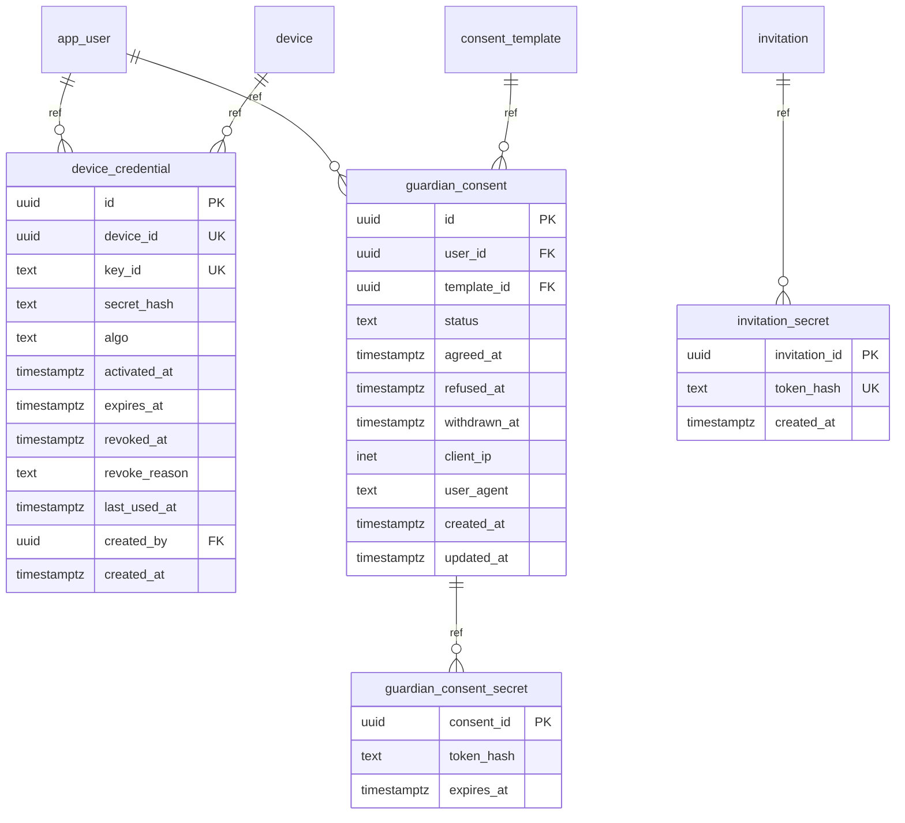

## 신규-2. 위치·법령 대응

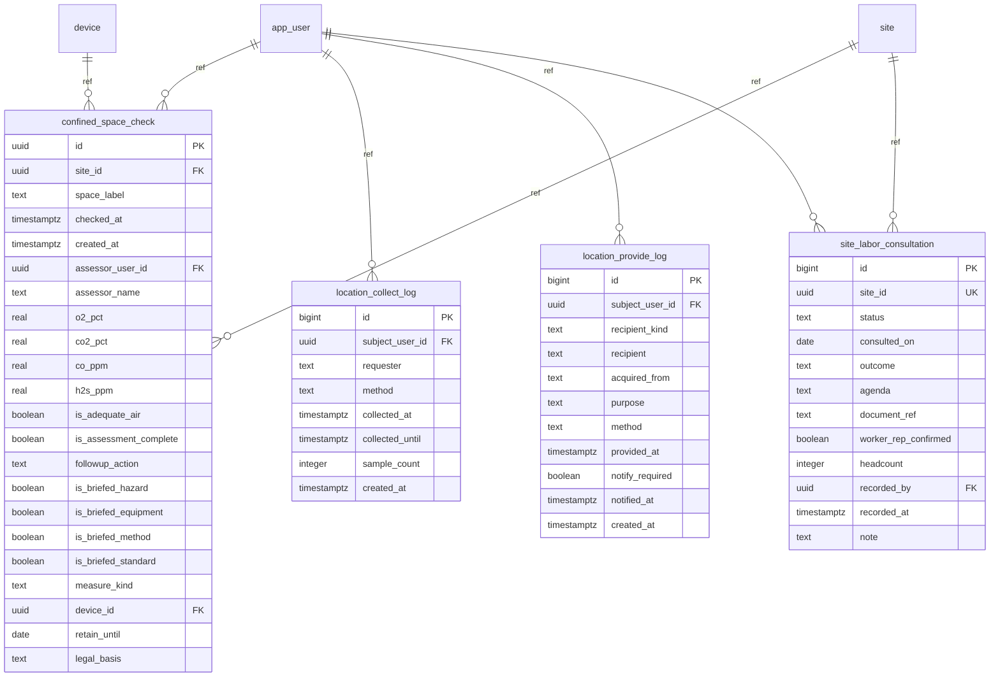

## 신규-3. 조달 공공데이터 피드

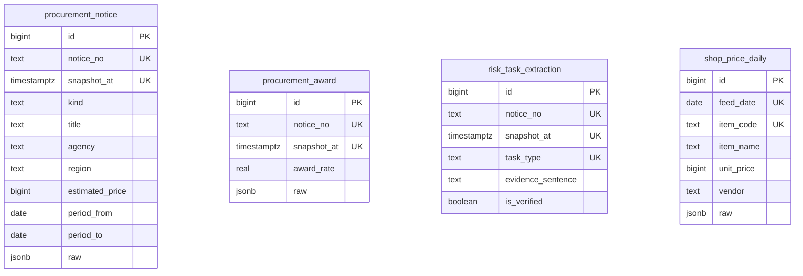

## 신규-4. 운영·분류

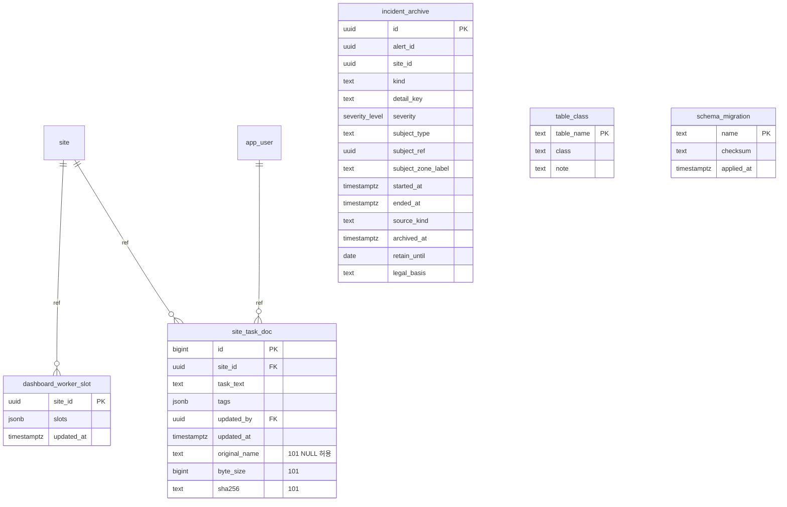

## 전수검사 메모 (2026-09-04)

- 의도 체크리스트 39항목 중 대부분 통과 — 시각 전부 timestamptz·측정표 PII 0·jsonb 15/json 0·평문 연락처 0·append-only 9표·파티션 자식 56/56 정책·테이블 주석 100%
- 남은 검토 후보: `gas_threshold` 시드 0행(법정 적정공기 기본값 부재) · `media` DELETE 차단 트리거 없음(삭제 감사만) · `guardian_consent` 입력 출처 컬럼 없음 · 09 문서의 `check_actor_trust()` 부재 **(→ 같은 날 오후 전부 종결 — 하단 「설계 확정분」 절)**
- **라이브 결합 경고**: 라이브 서버 ensureSchema는 시작 시 구 스키마 39표 DDL + DML 3건 + `imu_collect` 스키마 생성 — 신규 DB에 그대로 물리면 신·구 혼재. 상세는 전수검사 보고서(아티팩트) 참조.

---

# 갱신 (2026-09-04 오후) — 설계 확정분 (마이그레이션 061·062 대기)

전수검사가 남긴 검토 후보가 같은 날 오후 설계 결정으로 전부 닫혔다. 아래는 **설계 확정 · DB 미적용** — 캠퍼스 DB 복구 후 pg-build 계획·승인 절차로 적용한다. 결정 전문·근거는 아티팩트 2종: [가스 임계 근거 대장](https://claude.ai/code/artifact/0aa92837-dd23-41b1-b7c8-3e388bace4a3) · [담당관 확정 현황판](https://claude.ai/code/artifact/7fa72338-f367-4412-857b-abb2e5cf3759).

## 15. 담당관 확정 원장 — D-1~5 확정 (061)

14절의 미결 사양이 전부 닫혔다:

| 결정 | 내용 |
|---|---|
| D-1 | `procurement_notice` **FK 강제** — 파생: 확정 저장 전 서버가 공고 스냅샷 upsert 보장(3일 롤링 창 대응) |
| D-2 | RLS가 `is_site_officer`·`org_type`까지 강제 (쓰기 = owner 또는 site_officer·비contractor) — 클레임은 세션 변수 탑재(정책이 테이블을 조회하지 않는 S-03 관례 유지) |
| D-3 | evidence 3종 유지 — `evidence_file`(공고 첨부 파일명·필수) / `evidence_url`(다운로드 URL) / `evidence_locus`(문서 내 위치) |
| D-4 | 읽기 = **조달청 계열 + owner만** (시공사는 자기 현장 것도 불가) |
| D-5 | **정정 사유 컬럼** 신설 — 같은 공고 2번째 행부터 사유 필수, append-only 이력 추적용 |

061 동반 확정:

- `app_user.is_site_officer` 신설 — 부여제(자가취득 불가 · contractor 소속 부여 불가 가드)
- **N-1**: `REVOKE CREATE ON SCHEMA public FROM PUBLIC` — 객체 생성 차단이지 접속 차단이 아니다(접속은 기존 ACL이 이미 잠금)
- `media` **삭제 유예 트리거** — 업로드 후 **10분** 안에만 삭제 허용(현장 오업로드 정정 창), 이후 삭제 차단. 전수검사 검토 후보 "DELETE 차단 트리거 없음"의 종결
- `guardian_consent` 수집 출처 **전용 컬럼** 신설 확정(마이그레이션 배정 대기) · `check_actor_trust()` 부재는 결함 아님 — 037이 의도적으로 제거(09 문서 쪽이 낡음)

## 16. 가스 임계 v2 — G-1~G-10 값 전부 확정 (061/062)

데이터 사전의 `gas_threshold`(v1)는 direction 단일 방향이라 O₂ 양방향(결핍·과잉)을 한 행에 못 담는다. v2 확정 구조:

- direction·warning_level·danger_level 폐기 → **4경계** `warning_min/max`·`danger_min/max` + **`basis`(근거 명시 의무)** — "근거 없는 값 금지"를 데이터 층에도 강제
- 판정 부등호는 제618조 "이상/미만"과 일치: danger = `v < danger_min OR v ≥ danger_max`
- 종합판정 = **worst(순간 618조, STEL 15분 시간가중, TWA 작업 세션 누적)** — gas_reading 시계열 위의 SQL 계산(펌웨어 무관 · 과거 재판정 가능 · 간격 상한 30s · coverage 산출)
- 확정 시드 3행:

```
('o2',  19.5, 23.0, 18.0, 23.5, '제618조 + 29 CFR 1910.146 + Wróblewski 2022·NASA MOC(자기소화 문턱 23%)')
('co',  NULL, 25.0, NULL, 30.0, '제618조 + ACGIH TLV(CCOHS)')
('h2s', NULL,  5.0, NULL, 10.0, '제618조 + ACGIH STEL(CCOHS)')
```

- STEL·TWA 경계(별표1 현행 원본 육안 확인): CO 200/30 · H₂S 15/10 — O₂ 신호등은 순간축 + 문헌 노랑(18.0~19.5 · 23.0~23.5)
- **환산 = 서버(G-9)**: 펌웨어는 raw ADC 전송만(현행 유지), 계수는 신설 `gas_calibration` 표로 기간 관리 → 계수 개선 시 과거 전체 재환산·재판정 가능. 이중판정(G-6a)은 ppm 임계를 장치별 raw 경계로 역환산 배포

### `gas_calibration` — **생성 완료 (062 · 2026-09-14)**

환산 계수의 기간 관리 원장. **재현본 적용·검증 통과**(table_class=managed_critical · RLS+FORCE · 정책 4개(DELETE 포함) · CHECK 7 · 변경이력 트리거 · 셀프테스트 4건). **행수 0 — 표만 만들고 값은 나중에 넣는다**(태곤 님 결정).
계획서 `DB재구축/db-build/VITALGUARD2/plan-062.md` · 마이그레이션 `DB재구축/migrations/062_gas_calibration.sql`.

**실제 구현이 설계안과 다른 점**
- `class = **managed_critical**`(reference 아님) — 047 이 `gas_threshold` 를 그렇게 두었고 계수도 같은 성격이다(R0 가 틀리면 ppm 이 틀리고 판정이 틀린다). 그래서 `log_record_change` 트리거가 붙는다.
- **`basis` 가 NOT NULL** — "왜 이 값인가·한계가 무엇인가"를 적지 않으면 행이 안 들어간다. 근거 없는 계수를 구조가 막는 자리다.
- `r0_ohm` 대신 **`r0_over_rl` 을 함께** 둔다. RL 을 몰라도 Rs/R0 비율에서 소거되므로 환산이 된다. `chk_gascal_zero` 가 "둘 중 하나 필수 · heater_mode='none'(전기화학식)은 예외"를 강제한다.
- CHECK 에 **`ze07co`·`co2`·`none`·`factory` 를 미리** 넣었다 — MQ-7 사망(2026-09-14)으로 전기화학식 대체가 예정돼 있어 부품이 오면 값만 넣으면 된다.
- **인덱스 보강 (076 · 2026-09-14)** — 062 가 `idx_gas_calibration_lookup` 하나만 만들어 FK 참조측 인덱스 2개(`created_by`→app_user · `device_id`→device)가 빠져 있었다. pg-scan A3-001 로 잡혀 `idx_gas_calibration_created_by`·`idx_gas_calibration_device_id` 를 추가했다.
- ✅ **`sensor_kind` CHECK = `mq7·mq136·sen0322·ze07co·ze15co` 5값**(078 적용 완료 2026-09-14). 함께: `curve_form`(power|linear) 컬럼 신설 · `clean_air_ratio` 를 전기화학식(`heater_mode='none'`)에서만 NULL 허용 · `chk_gascal_linear_coef`(선형이면 `curve_a`·`curve_b` 필수). 컬럼 31→32 · CHECK 7→10.

#### CO 센서 = **ZE15-CO 확정 (태곤 님 2026-09-14)**

MQ-7(반도체식) 사망 후 대체. **ZE07-CO 가 아니라 ZE15-CO 인 이유** — 같은 제조사(Winsen)·같은 전기화학식·같은 5~12V·같은 0~500ppm 인데 넷이 다르다(매뉴얼 v1.2 2023-03-27 직접 확인):

| | ZE15-CO | ZE07-CO |
|---|---|---|
| **고장 출력** | **PIN3 `Sensor fault output`(1Hz · 10% duty)** | **없음** |
| 온도 보정 | 내장 온도센서로 자동 | 명시 없음 |
| 예열 | 30초 | 3분 |
| 응답/복귀 | ≤30초 / ≤30초 | — |
| 수명 | 3-5년(in air) 단일 표기 | 2년 / 3-5년 **제조사 자기 사이트가 충돌** |
| 매뉴얼 | v1.2 · 2023-03-27 | v1.3 · 2015-05-01 |

**고장 출력이 결정적이다.** MQ-7 이 죽었을 때 5일간 몰랐다(분당 폭이 0 이 되고서야 알았다). 전기화학식은 서서히 줄다 급락하는 특성이라 감도 관찰로 급락 시점을 예측할 수 없다. **밀폐공간 CO 30ppm 을 판정하는 장비에서 "센서가 죽었는데 0ppm 으로 보고"는 최악의 실패 모드**다 — 위험한데 안전하다고 말한다. ESP32 GPIO 하나로 1Hz 펄스를 받으면 된다(**GPIO6 이 비어 있다** — v4 ACK 버튼 자리, v5 엔 없음).

**환산은 선형이다** — PIN10 아날로그 `0.4V = 0ppm · 2.0V = 500ppm`. MQ 계열의 `Rs/R0` 멱함수와 **다른 형태**라 `gas_calibration` 에 `curve_form`(power|linear) 구분이 필요하다(078). R0 개념 자체가 없어 `clean_air_ratio` 도 의미가 없다(현재 NOT NULL → 078 에서 전기화학식 예외).

**부품 교체 시 작업 4건** (갈아끼우기만으로는 안 된다):
1. **점퍼선 재배선** — MQ-7 은 4핀(VCC/GND/DO/AO), ZE15 는 15핀 배열. 쓸 핀은 `PIN15 Vin` · `PIN5 GND` · `PIN10 Analog` · `PIN3 Fault`
2. **분압 스틱 제거** — 현재 A0 분압(3.3V 레일 ↔ GPIO1)은 MQ-7 5V 출력을 3.3V ADC 에 맞추려던 것. ZE15 PIN10 은 최대 2V 라 **직결**해야 한다(분압하면 500ppm 을 더 좁은 구간에 밀어넣어 분해능을 버린다)
3. **임계값 재산정** — `gaspod_v5.ino` 의 `MQ7_WARN 150` · `MQ7_ALARM 350` 은 MQ-7 raw ADC 기준이다. ZE15 는 **0.4V(=0ppm)가 이미 raw ≈ 496**(12bit·3.3V 기준)이라 그대로 두면 **켜자마자 상시 경보**가 된다. 법정 CO 30ppm ≈ 0.496V ≈ raw 616
4. **서버 환산** — `gas_calibration` 에 `ze15co` 행(선형 계수). 펌웨어는 raw 만 보내고 환산은 서버가 하는 062 구조라 **펌웨어에서 고칠 것은 임계값 2줄뿐**이다

#### ⏸ 가스 캘리브레이션 — **부품 도착까지 여기서 멈춘다** (태곤 님 2026-09-15)

> **DB 쪽 준비는 끝났다.** 부품이 오면 **값만 넣으면 되고**, 그때 스키마를 더 손댈 일이 생기면
> 그때 추가·변경한다. 지금 상태에서 더 설계하지 않는다.

| 준비된 것 | 상태 |
|---|---|
| `gas_calibration` 표 | ✅ 062 — 기간 관리 · `basis` NOT NULL · 변경 이력 트리거 · 정책 4 |
| `ze15co` 분류 | ✅ 078 — `chk_gascal_sensor` 5값 |
| 선형 환산 자리 | ✅ 078 — `curve_form`(power\|linear) · `chk_gascal_linear_coef` |
| 전기화학식 예외 | ✅ 078 — `clean_air_ratio` 는 `heater_mode='none'` 이면 NULL 허용 |
| FK 인덱스 | ✅ 076 — `created_by` · `device_id` |
| **행(값)** | ⏳ **0행 — 부품 수령 후** |

**부품이 오면 할 일**(작업 4건은 위 절에 있다) 중 **DB 는 한 줄**이다 —
`gas_calibration` 에 `ze15co` 행 하나. 계수는 매뉴얼 규격에서 유도한 값
(`0.4V=0ppm · 2.0V=500ppm` 선형)으로 시작하되, **ADC 실측 없이는 확정하지 않는다**:
`adc_full_scale_v`(ESP32 감쇠 실측)와 `adc_divider_ratio=1.0`(분압 제거 후)이 실물에서 나와야 한다.
`basis` 에는 "매뉴얼 v1.2 PIN10 규격 + ADC 실측" 을 적는다 — 062 가 `basis` 를 NOT NULL 로 둔 이유다.

⚠ **MQ-136(H₂S)의 잠정 R0 `0.9598` 도 아직 표에 없다.** 근거 대장(옵시디언)에만 있고,
번인 미완·온도 보정 없음·보수적 하한 채택이라는 한계가 붙어 있다. 같이 넣을 때 그 한계를
`basis` 에 그대로 적는다.

**모르는 것 둘** — ① **소비전류**: 매뉴얼 규격표에 전류 항목이 아예 없다(ZE07 도 마찬가지). Vin 직렬 멀티미터로 실측해야 배터리 시간이 나온다 ② **물리 치수**: 매뉴얼에 수치가 없다(구조도 그림만). 케이스에 들어가는지는 실물로 확인.

**구매** — 옥션 최저가(20,920원)는 평점 ★1.0 · 후기 0 · 상세설명에 "자사 해외 3PL 물류창고 · 항공특송" · 상품 이미지 전부에 `WhatsAPP:+86` 워터마크라 **권하지 않는다**. 디바이스마트 `no=12541529`(22,000원 · VAT 포함 24,200원 · 배송 2,700원 · 준비 1주일 · ㈜엔티렉스 · 수령 7일 내 반품)로 간다. 예비품 포함 2개 권장(리서치 권고: 교체 주기 2년 · 6개월마다 범프테스트).

#### CO₂ 센서 — **계획만 두고 보류 (태곤 님 2026-09-14)**

법정 적정공기의 이산화탄소 기준은 **1.5% 미만 = 15,000ppm**(법령 원문 확인). 흔한 NDIR 모듈(SCD41 · S8 · CM1106)은 교정 범위가 5,000~10,000ppm 에서 끝나 **숫자는 나와도 정확도를 주장할 수 없다** — ZE07 에서 겪은 "분해능은 있는데 정확도가 없다"와 같은 함정이다.

| | SCD41 | MH-Z16/SEN0220 | ExplorIR-W 5% |
|---|---|---|---|
| 범위 | 0~40,000(교정 400~5,000) | 0~50,000 | 0~50,000 |
| 수명 | — | >10년 | >15년 |
| 전류 | 3mA(30초 주기) | <85mA | 3.5mW ≈1mA |
| 국내 | 아이씨뱅큐 64,100원·1주 | 124,400원 | **[미확인]** |

**ExplorIR-W 가 범위·수명·전류 셋을 다 만족하는 유일한 후보**이나 국내 유통이 미확인이다. MH-Z16 은 권하지 않는다 — MQ-7 히터 150mA 를 떼려는 중에 CO₂ 쪽에서 85mA 를 다시 쓴다. `chk_gascal_gas` 에 `co2` 는 **이미 들어가 있으므로** 부품이 정해지면 `sensor_kind` 한 값만 추가하면 된다.

#### `gas_calibration`

환산 계수의 기간 관리 원장(062 · 31컬럼). 같은 센서·가스에 대해 기간이 겹치지 않는 행을 쌓아
계수를 고쳐도 **과거를 재환산**할 수 있게 한다.

| 컬럼 | 타입 | 키 | 의미 |
|---|---|---|---|
| `id` \* | bigint | PK |  |
| `device_id` | uuid | → device | NULL = 기종 공통 기본값 · 값 = 그 기기 전용. 기기가 하나뿐인 동안은 NULL 로 쓰고, 개체차가 문제되면 기기별 행을 덮는다. |
| `sensor_kind` \* | text |  |  |
| `target_gas` \* | text |  |  |
| `vc_v` \* | real |  |  |
| `adc_divider_ratio` \* | real |  |  |
| `adc_full_scale_v` \* | real |  |  |
| `adc_bits` \* | smallint |  |  |
| `rl_kohm` | real |  |  |
| `r0_over_rl` | real |  | 부하저항 RL 을 모를 때 쓰는 영점 단위. ppm 환산에 쓰이는 것은 Rs/R0 비율이고 거기서 RL 이 소거되므로 RL 을 몰라도 환산이 된다. |
| `r0_ohm` | real |  | RL 을 알 때의 영점(Ω). r0_over_rl 과 둘 중 하나는 있어야 한다(chk_gascal_zero) — 히터 없는 전기화학식(heater_mode=none)은 예외다. |
| `r0_measured_at` | timestamptz |  |  |
| `r0_temp_c` | real |  |  |
| `r0_rh_pct` | real |  |  |
| `clean_air_ratio` \* | real |  | 클린에어에서의 Rs/R0. MQ-7 27.5 · MQ-136 3.6 (MQUnifiedsensor·Hanwei 계보). 전기화학식은 해당 없음. |
| `curve_a` | real |  |  |
| `curve_b` | real |  |  |
| `curve_source` \* | text |  | datasheet = 곡선을 데이터시트에서 차용 · measured = 직접 측정 · mixed = 영점은 실측인데 곡선은 차용(구동 조건이 다르면 여기). |
| `valid_min_ppm` | real |  |  |
| `valid_max_ppm` | real |  |  |
| `ref_temp_c` | real |  |  |
| `ref_rh_pct` | real |  |  |
| `th_corr` | jsonb |  |  |
| `preheat_hours` | real |  |  |
| `heater_mode` \* | text |  | constant_5v = 5V 상시 가열(MQ 계열을 데이터시트 전제와 다르게 쓰는 경우) · cycled = 교번 구동 · none = 히터 없음(전기화학식).    ⚠ MQ-7 을 constant_5v 로 돌려 5일 만에 소자가 죽은 실측이 있다(2026-09-14). 이 값은 수명 예측의 근거다. |
| `calibration_method` \* | text |  | measured_zero = 영점 실측 · datasheet_only = 데이터시트만 · conservative_floor = 안정 구간 하한을 택한 보수값 · factory = 공장 교정. |
| `basis` \* | text |  | **필수**. 이 값이 왜 이런가와 무엇이 한계인가를 문장으로 남긴다. 근거 없는 계수가 들어가지 못하게 하는 자리다    ("추론으로 임계치 잡지 말고 근거를 확실히" — 사용자 원칙). 예: 번인 미완·온도 보정 없음·보수적 하한 채택. |
| `valid_from` \* | timestamptz |  |  |
| `valid_to` | timestamptz |  |  |
| `created_at` \* | timestamptz |  |  |
| `created_by` | uuid | → app_user |  |

원래 컬럼 확정안: `sensor_kind`·`target_gas`·`vc_v`·`adc_divider_ratio`·`rl_kohm`·`r0_ohm`(+측정시각)·`clean_air_ratio`·`curve_a/b`·`curve_source`·`valid_min/max_ppm`·`ref_temp/rh`·`th_corr`(JSON)·`preheat_hours`·`heater_mode`·`calibration_method`·`valid_from/to`·`basis`.

- 공개 계보 확보: MQ-7 `99.042·−1.518`(클린에어 비 27.5, Hanwei 계보) · MQ-136 `36.737·−3.536`(비 3.6) · SEN0322은 %Vol 직접 출력이라 환산 불필요
- **MQ-7 히터 = ⓑ 자체 캘리브레이션 확정(09-04, 하드웨어 담당 결정)**: 데이터시트 곡선은 5V 60초↔1.4V 90초 교번 구동 전제인데 실물 회로는 히터 5V 레일 직결(제어 소자 없음, v4.2 종합 §회로) — ⓐ 펌웨어 사이클은 불가 확정. 상시 5V 유지 + **영점(R0) 자체 실측**: 전원 ON → 안정화(수치 표류 멈춤으로 판정) → 신선공기 평균 raw → R0. **2026-09-07(월) 실측 개시 예정.** 한계 명시: 영점=실측이나 곡선 기울기(a·b)는 데이터시트(교번 구동) 차용 — CO 환산 근거는 "영점 실측 + 곡선 차용(구동조건 상이)"로 표기. RL은 Rs/R0 비율에서 소거(남는 확인 = 분압비 10k/20k · 5V 레일 전압)

## ⚠ 2026-09-14 실측 — MQ-7 사망으로 전제가 바뀌었다

**MQ-7(CO)이 죽었다.** A0 출력 0.0 고정(폭 0) · 히터는 만지면 뜨겁고 5V 레일 정상 · 같은 보드의
MQ-136 은 정상 → **감지 소자 단선**. MQ 모듈 회로상 감지 소자가 끊어지면 A0 가 RL 을 통해 GND 로
당겨져 정확히 0V 가 되는데, 관측과 일치한다. 데이터시트 수명은 5년인데 **실측 5일**이다.
원인으로 보는 것: 회로에 히터 제어 소자가 없어 **5V 상시 가열**로 돌렸다(데이터시트는 1.4V/5V 교번 전제).

**귀결 — CO 판정이 비었다.** 적정공기 법정 4지표(제618조제3호) 중 CO 30ppm 미만을 판정할 수단이 없다.
`confined_space_check.co_ppm` 은 NOT NULL 이라 **센서 없이는 그 표를 채울 수 없다.**
대체 부품 리서치 결과 **ZE07-CO(Winsen · 전기화학 · 히터 없음 · 0.1ppm · 국내 22,000원/24h)** 로 좁혔다.
히터가 없어 번인 개념이 사라지고 예열이 3분이다. 소비전류·수명 표기(매뉴얼 3~5년 vs 제품페이지 2년)는 확인 중.

**MQ-136 R0 잠정 확정** — `R0/RL = 0.9598`(raw 988.8 · 24.5℃ · 43%RH · 안정 구간 하한 채택).
⚠ **잠정치다**: 번인 24h 미완(전원 3회 차단) · 온도 보정 없음(3.2℃ 차이가 479카운트를 만든다) ·
보수적 하한(농도를 높게 읽는 쪽 = 경보를 덜 놓치는 쪽). 062 표에는 **아직 넣지 않았다**.

**R0 를 흔드는 요인 4가지(오늘 전부 실측)** — 이 중 하나라도 통제 못 하면 캡처가 무의미하다:
① A0 접촉(교체 전 분당 폭 36~62 → 교체 후 3~7 · **폭이 접촉 건강의 지표**다, 평균만 보면 못 잡는다)
② 대류(선풍기 = **−46%** · 온도 27.00℃ 고정 상태에서 교차 확인)
③ 전원 방식(배터리 단독 = **−50%** · 뽑기/꽂기 양방향 1분 내 반응)
④ 번인 시간(전원이 끊기면 시계가 리셋된다 — 2026-09-14 에만 3회)

### 2026-09-16 실측 — MQ-136 번인 후(태곤 님 "co 빼고 다 진행" · "mq-7 빼놓고 번인도 해놓은 상태")

라이브 구 DB `gaspod_telemetry` 읽기 전용 실측(13:00 KST 기준).
- **통전**: 09-14 14:43 재통전 → 14:57·15:34 에 22초짜리 재부팅 2회(= "3회 차단"과 일치) → 이후 60초 초과 공백 **0건**, 45h 무중단. 실은 09-07 15:54 이후 09-14 낮 2시간 빼고 거의 연속.
- **MQ-7**: raw 0 고정(빼둔 상태 일치). **전원**: 어댑터(vbat 평균 4.06V · 지속 하락 없음).
- **제조사 예열 조건은 48h 다**(winsen-sensor.com/product/mq136.html "Preheat time: Over 48 hours" · 감지 1~200ppm · 표준 20℃±2 / 55%±5RH · Vc 5V · VH 5V). 위 ④의 24h 보다 엄격 → 캡처 창은 **09-16 15:34 이후**.
- **지난 잠정치 0.9598(raw 988.8) 폐기**: 번인 후 raw 가 시간별 1049~1197 로 8~20% 높다. 그 값을 쓰면 청정공기를 H₂S 로 읽는다.
- **① 접촉 재판정**: 분당 폭이 컸던 원인은 접촉이 아니다 — vbat 이 0.2V 꺼지는 **같은 표본**에서 mq136 도 ~60카운트 같이 꺼진다(10:44:44 1105→1046 · vbat 4.08→3.88). 전원 레일 이벤트. 딥(vbat<4.0)을 빼면 분당 폭 ~10 → 건강. **R0 산출 때 vbat<4.0 표본은 제외한다.**
- **온도 상관 약함**: 시간별 r=0.33 · 20.7카운트/℃ · 습도 r=−0.24. "3.2℃=479카운트"는 MQ-7 실측이었고 MQ-136 엔 적용 안 됨. 보정식 없이 감(th_corr NULL).
- **안정 기준 스캔(24h 시점, 참고용)**: 09-15 15:34 이후 30분 창 125개 중 43개 통과 · 통과 창 raw 1068~1207(중앙 1107) · 최저 창 09-16 12:00 raw 1067.9 → R0/RL 0.8681(25.26℃·45.3%RH). 48h 조건 미달이라 **후보일 뿐** — 15:41 재스캔으로 대체.
- 통과 창 폭 13% 는 지수 −3.536 에서 청정공기 판독 0.4→0.7ppm 차이. 임계 10ppm(raw≈1954) 에는 영향 없음.
- **② 대류**는 데이터로 판정 불가 — 태곤 님 확인 대기. 093 초안 = `DB재구축/migrations/093_mq136_h2s_calibration.sql.draft` · `plan-093.md`.
- **부수 발견 — O₂(SEN0322)**: 신선공기에서 19.2~19.6% 판독(정상 20.9). 펌웨어 `O2_WARN 19.2` 라 재통전 이후 표본 36% 가 WARNING. 펌웨어가 `calibrate()` 를 한 번도 안 부른다(DFRobot 라이브러리 `calibrate(vol, mv)` → `USER_SET_REGISTER 0x08` 에 key 기록). 신선공기에서 1회 교정 필요 = 플래시(태곤 님 물리 작업). 전원 꺼도 유지되는지는 미확인.

---

## 남은 실행 조건 (값 결정 아님 · 실측/환경 대기)

- MQ-7 R0 실측 — **번인 재통전 09-07(월) 15:55 KST**(1차 11:23분은 14:46 배터리 소진으로 무효 · 벽 어댑터 45W 직결) → 캡처 최소 09-08 15:55+ · 권장 09-10 15:55+
- G-7 결측 커트라인 X — DB 복구 후 생존편향 보정 실측(갭 분류 + vbat 소진 제외 + 분모=작업 세션)
- 분압비·5V 레일 전압 확인
- 캠퍼스 DB(project-db-campus:3310) 복구 — 061·062 적용의 전제

후속: 판정 기준·근거 공개 페이지(대시보드 푸터 신설 확정)는 **월요일 캘리브레이션 측정 후 제작 → 라이브 반영** 순서.

---

# 갱신 (2026-09-07) — 워치 유래 데이터 설계 초안 (앱 사양 확보)

## 17. 워치 유래 데이터 — 리스트업(2026-09-07) 기준 설계 초안

**입력** = `~/Downloads/워치-센싱-데이터-리스트업.md` (갤럭시워치9 44mm LTE / 워치8 40mm, 코드 루트 `apps/vitalguard_app/android/wear/`, 전 항목 `파일:줄` 근거). 이것이 02 B-3 이 기다리던 "앱 데이터 계약" 이다.
**설계 기준** = 워치가 센서에서 **직접 읽어 실제로 보내는 값** + 앱 계약에서 **추가로 받기로 할 값**(아래 "앱 계약 파생"). 구 `vital_samples` 57필드·`data_mockup` 은 참조하지 않는다(17행 원칙).
**상태** = **063 재현본 적용 완료(2026-09-07 저녁)** — 표 5개(`wearable` 포함)·뷰 4·자식 파티션 24(12개월)·`ml.imu_window` 734행 이관. 계획서 plan-063/063a(승인·리허설·검증 기입). 캠퍼스 본적용은 DB 복구 후 061→062→063 순, N-1 뒤 러너 GRANT 필수. 아래 긴 본문은 근거·이력이고, 만들 것은 이 절이 전부다.

### 확정안 — 표 4개 (워치가 지금 보내는 키만)

**`watch_vital`** (표본 1건=1행, 평시·착용전이·미착용배터리 공통 · UNIQUE(user_id, measured_at) · 월 파티션 · append-only)
`user_id`→app_user(workerId) · `site_id`→site(서버가 배정 현장) · `measured_at`(ts) · `received_at` · `worn` boolean NOT NULL · `heart_rate` smallint · `heart_rate_measured_at` · `spo2` smallint · `spo2_measured_at` · `skin_temp_c` real · `ambient_temp_c` real · `hrv_sdnn_ms` real · `motion_still_sec` real · `motion_variability_mg` integer · `steps` smallint · `flights_climbed` smallint · `active_energy_kcal` real · `battery_pct` smallint · `battery_charge_uah` integer · `battery_status` smallint · `hr_last_revive_at` · `fgs_revived_at` · `data_origin` · `trace_id`
CHECK 범위는 `vital-stream.ts` 그대로(아래 "코드 대조").

**`watch_location`** (7일 파기용 분리 · 월 파티션 · append-only)
`user_id` · `site_id` · `measured_at`(locationTimestamp) · `received_at` · `latitude` · `longitude` double precision · `accuracy_m` real NOT NULL · `retain_until` date(=measured_at+7일)

**`watch_fall_event`** (낙상 업로드 1건=1행 · UNIQUE(candidate_id, phase) · append-only)
`user_id` · `site_id` · `measured_at`(ts) · `received_at` · `candidate_id` uuid(fallCandidateId) · `phase` text(candidate|post_impact_followup|prompt_result) · `accel_magnitude_g` real · `prompt_outcome` text · `prompt_response_sec` real · `trace` jsonb(원문) · trace 승격 11: `module_version`·`decision`·`p_work`·`p_nonrecovery`·`p_impact`·`samples`·`effective_hz`·`peak_g`·`alert_gate_g`·`alert_gate_passed`·`judged_at` · `alert_id`→alert

**`ml.imu_window`** (학습용 라벨 창 — **별도 스키마 `ml` 로 격리**, 태곤 님 결정 2026-09-07 "학습데이터가 다른 행과 섞이면 안 된다")
`id` text PK(export 의 55자 id 그대로) · `worker_id` text(FK 없음 — 구 사번 `admin6861` 등, 격리 목적) · `family` text NOT NULL(walk·fall·pound·sit·throw·hammer·recovered·nonrecovered) · `fs` smallint · `impact_index` integer · `axes` real[][] · `created_at` timestamptz
- `public` 과 FK 0건(구 `imu_collect` 와 같은 격리). 쓰기 = 수집 라우트 `/api/fall/imu-window` 와 이관 스크립트뿐, 읽기 = platform_admin(ML 담당)만. append-only.
- **이관 대상**: `DB재구축/export/imu_window.ndjson` **734행**(13.2MB, 2026-08-11 export) → 이 표로 적재. 02 E-2 의 "파일 승계·DB 이관 아님"을 **뒤집는다**(2026-09-07). `fall_labels` 12행은 `vital_samples` 를 가리키는 별개 데이터셋이라 대상 아님.
- 운영 낙상(`watch_fall_event`, 메인 앱 후보·결말)과는 **표·스키마 모두 다르다.** 섞이지 않는다.

**`wearable`** (2026-09-07 저녁 "추천으로" 결정 — 063 에 편입) — 작업자 단말 레지스트리. `id` uuid(서버 발급) · `user_id`→app_user · `platform`(**wearos 단독** — 076 에서 watchos 제외) · `model` · `app_version` · `first_seen_at` · `last_seen_at` · `decommissioned_at`. **재설치 = 새 행**(ConfigStore 가 재설치 때 지워지므로 재식별하지 않는다). managed · touch_updated_at · 읽기 본인/platform_admin. 세 워치 표에 `wearable_id` NULL 허용 FK — 팀원 A-4 배포 전까지 NULL.
**A-1 확정**: `heart_rate_source` 순정 경로 = **NULL**. **A-3(workerName 제거)**: 워치 과제가 아니라 **신 DB 전환 배포 체크리스트**(구 서버 소비처 9파일·iOS 동시 배포) — 팀원 목록에서 제외. **팀원 요청은 A-2·A-1 둘**.

### 적재 경로 — 표마다 "어느 문으로 들어와 어느 함수가 쓰는가" (2026-09-07 코드 대조 · `apps/dashboard-web`)

워치가 서버에 들어오는 문은 **둘**이다. ① `POST /api/app/vital` (워치 `HttpTransport.kt:9`, Bearer JWT) · ② `POST /api/fall/imu-window` (라벨 수집). ①은 배치(최대 500)로 오고 한 건씩 `addSample` 을 탄다.

| 신 표 | 수신 라우트 → 핸들러 | 저장 함수 (지금 쓰는 곳) | 신 DB 에서 바꿀 것 |
|---|---|---|---|
| **`watch_vital`** | `app/api/app/vital/route.ts:181` POST → `verifyAppJwt`(사번) → `bodyIsBoundToWorker` → `parseResilientVitalSample` → `store.ts:228 addSample` | `lib/db.ts:1182 persistSample` / `:1199 persistSamples` → **`INSERT INTO vital_samples … ON CONFLICT (worker_id, ts)`** | INSERT 대상을 `watch_vital` 로. 컬럼은 확정안 그대로(위경도 5키는 제외). `ON CONFLICT (user_id, measured_at)`. **`user_id` = JWT 사번 → `app_user.employee_no` 조회**(지금은 사번 text 를 그대로 씀 — `resolvePrimaryWorkerId` 별칭 폴딩은 FK 로 대체). **`site_id` = `site_member` 배정 현장** — 라이브 서버에 사번→현장 해석이 **없다**(db.ts 에 worker 용 site_id 0건) → 신설 |
| **`watch_location`** | 같은 문 (같은 표본 안의 `latitude`·`longitude`·`locationAccuracyMeters`·`locationTimestamp`) | 지금은 `vital_samples` 컬럼으로 함께 INSERT | `persistSample` 이 위경도 4키가 있으면 **`watch_location` 에 한 행 더** INSERT(같은 트랜잭션). `retain_until = measured_at + 7일`. 구획 이탈·위험구역 판정(`lib/geofence-watch.ts`)은 이 표를 읽도록 |
| **`watch_fall_event`** | 같은 문. `fallCandidate=true` 인 표본(`hasMonitorableSignal` 통과 표식, `store.ts:137`) | `lib/db.ts:1241 updateFallCandidateState` → **`UPDATE vital_samples SET fall_update_phase… WHERE fall_candidate_id=$1 AND fall_candidate=1`** (결말이 후보 행을 덮어씀) | UPDATE 를 버리고 **후보·결말 각각 INSERT** (`UNIQUE(candidate_id, phase)`). `fallTrace` jsonb 보존 + 11키 컬럼 승격. 경보로 이어진 결말은 `recordAlert` 뒤 `alert_id` 채움 |
| **`alert`** (기존 표) | 같은 문 · `store.ts:91-114` — `manualSos`→sos · `fallDetected`→fall · `hasNewDangerMetric`→vital | `lib/db.ts:2358 recordAlert` → **`INSERT INTO alerts (worker_id, worker_name, type, ts) ON CONFLICT (worker_id, type, ts)`** | 신 `alert` 로: `kind`·`detail_key`(hr/spo2/temp)·`source_kind='watch'`·`subject_user_id`·**`dedup_key`**(`fall:<user_id>:<measured_at>` 워치 시각) `ON CONFLICT (dedup_key) DO NOTHING`. `worker_name` 은 싣지 않는다. 부재(`lib/absence-watch.ts`)·구획 이탈(`geofence-watch.ts`)은 `source_kind='server'` |
| **`ml.imu_window`** | `app/api/fall/imu-window/route.ts:16` POST → `ingestAuthStatus` → axes 검증(행마다 6열·상한) | `lib/db.ts:2994 insertImuWindow` → **`INSERT INTO imu_collect.imu_window (worker_id, family, fs, impact_index, axes)`** | 대상만 `ml.imu_window` 로. 컬럼·검증 동일. `ensureSchema` 의 `imu_collect` 자동 생성은 제거(신·구 혼재 경고) |
| (제외) `data_mockup` | `isDataMockupOrigin` → `persistDataMockup` (`db.ts:1222`) | `data_mockup` 표 | 신 DB 에 표 없음 — `data_origin='mock'` 으로 `watch_vital` 에 넣거나(009 관례) 버린다. **결정: 넣는다**(뷰 `watch_vital_real` 이 걸러낸다) |

**한 표본이 여러 행이 되는 규칙** (서버 `persistSample` 한 곳에서 처리):
1. `fallCandidate=true` → `watch_fall_event` 1행 (생체 키는 없다)
2. 그 외 → `watch_vital` 1행 (착용 전이·미착용 배터리도 여기 — `worn` 값과 NULL 로 구분)
3. 위경도 4키가 있으면 → `watch_location` 1행 추가
4. `manualSos`/`fallDetected`/생체 위험 전이 → `alert` (기존 `recordAlert` 경로, dedup_key 로)

**앱 쪽 변경 0** — 문·전문 모두 그대로다. 바뀌는 건 서버 `persistSample`·`updateFallCandidateState`·`recordAlert`·`insertImuWindow` 네 함수의 **INSERT 대상과 키**뿐이고, 새로 생기는 건 사번→`user_id`·`site_id` 해석 하나다.
**W-1~W-9 는 이 4표 생성에 걸리지 않는다.** 암호화(W-2)만 "컬럼 암호화 안 함"으로 두고 진행(SQL 판정·집계 필요).

---


### 왜 한 표가 아니라 다섯 표인가

리스트업 §9 가 **같은 구 테이블에 형태가 다른 세 종류**가 섞여 들어간다고 적었다(정상 표본 / 착용 전이 표식 / 미착용 배터리 행). 거기에 §7 낙상 키 7종은 5초 표본이 아니라 **충격 사건 단위**다(구 적재의 58.6%가 이것이었다 — §8). 행 모양이 다른 것을 한 표에 두면 NULL 이 컬럼의 절반이 되고, "이 행이 측정인가 표식인가"를 컬럼 조합으로 추론해야 한다. **행 모양 하나 = 표 하나**로 가른다.

```
리스트업 §9 정상 표본          → watch_vital        (생체·활동 5초 시계열)
리스트업 §9 착용 전이 표식     → wear_event          (worn 전이만)
리스트업 §9 미착용 배터리 행   → wearable_status     (배터리·충전, 장치 상태)
리스트업 §7 낙상 키 7종        → fall_candidate      (충격 사건 · 판정 이력)
리스트업 §4 위치               → watch_location     (위경도·정확도, 7일 파기)
앱 계약 파생 ① 원시 IMU 창     → fall_imu_window     (axes[n][6] · 학습 자산)
앱 계약 파생 ④ 원시 IBI        → hrv_ibi_window      (5분 창 · 계약 성사 시)
```

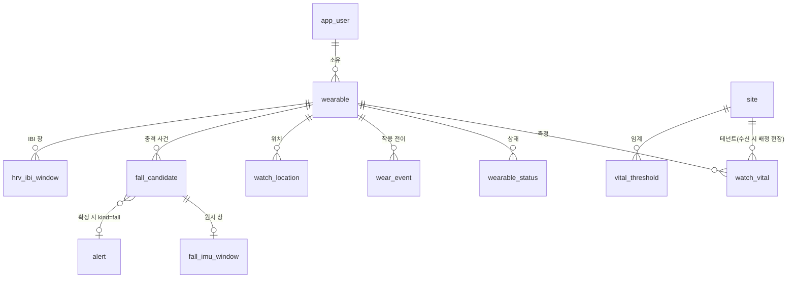

### 공통 관례 — 009 적재 방어를 그대로 쓴다

| 관례 | 적용 |
|---|---|
| `measured_at` = 장치 시각, 기본값 없음 | 리스트업의 `ts` = **flush 시각**(`SampleBuilder.kt:129` `sentAtMs`, 120초 주기 `CollectorService.kt:704`). 센서 시각은 항목별 `*MeasuredAt`(심박·SpO₂·위치)이 따로 온다. 서버가 채우지 않는다 |
| `received_at` | 서버 수신. 차이 5분 초과 = `is_late_arrival()` → **경보만 억제**(§3) |
| `data_origin` device\|mock | 리스트업의 `dataOrigin='wearos_data_vitalguard'` 는 **플랫폼 구분**이라 여기 아니다 → `wearable.platform` |
| `UNIQUE(wearable_id, measured_at)` | 구 `uq_vs_worker_ts` 의 후신. 사람이 아니라 **단말** 단위(한 사람이 단말을 바꿔 차는 경우 — 구 실측 5명·12대) |
| `fn_guard_measure_time()` | 미래 +5분·개시 이전 거부. 리스트업 §2 "삼성 DataPoint.timestamp 와 SensorEvent 는 시간 기준이 다를 수 있다" — 워치가 벽시계로 통일했다지만 DB 가 한 번 더 막는다 |
| 월 파티션 + `_default` + `ensure_month_partition()` | 시계열 4표(watch_vital·wearable_status·watch_location·fall_imu_window) |
| append-only(`fn_reject_mutation` 행+문장) | 원천 측정 전부. 정정은 새 행 |
| `*_real` 뷰 | 집계·ML 은 `watch_vital_real` 등만 |
| `site_id` = 테넌트 키 | 워치 전문에 현장이 없다 → **서버가 수신 시 `site_member` 의 배정 현장으로 채운다**. 배정이 없으면 `ingest_reject(source_kind='app')` |
| `trace_id` | 수신→행→경보→감사 한 줄 재구성 |
| 결측 = NULL | 리스트업 §6 규율 그대로 — `motion_still_sec` 콜백 미실행은 **0 이 아니라 NULL**, SDNN 표본 부족은 NULL |

**받지 않는 것(09 §5-4 확정 5종)** — `guardianName`·`guardianPhone`·`workerName`·`employeeId`·`jobTitle`. 대체는 `user_id` → `app_user`(`guardian_*`·`employee_no`·`job_title` 이미 있음, 052/055 실측). 리스트업은 이미 이 다섯을 싣지 않는다(§8 공통 키 = `ts`·`workerId`·`workerName`·`source`·`dataOrigin` — `workerName` 만 남아 있어 **앱 계약에서 제거 요청**).

**워치가 계산하지만 서버로 안 오는 것(리스트업 §6)** — 심부체온·PSI·스트레스지수·위험도. 관제웹이 같은 알고리즘으로 재계산한다. **저장하지 않는다**(파생값은 원천이 있으면 언제든 다시 낸다). 단 W-5.

### 표 사전

#### `wearable` (신규)

작업자가 차는 단말. `device` 에 넣지 않는 이유 — `device.site_id NOT NULL` 은 **현장에 설치된** 장치의 테넌트 키인데 워치는 사람을 따라 현장을 옮긴다. `device_credential` 도 안 쓴다 — 워치 인증은 장치 키가 아니라 **앱 JWT(사번 일치)** 다(01 §2-1). ⚠ W-1.

| 컬럼 | 타입 | 키 | 의미 |
|---|---|---|---|
| `id` | uuid | PK | |
| `user_id` \* | uuid | → app_user | 소유·착용자. 계정 파기(`purge_user_pii`)가 이 표와 하위 시계열까지 이어져야 한다 |
| `platform` \* | text |  | **`wearos` 만**(076). 리스트업 `dataOrigin` 의 실체. 애플워치는 등록 거부 |
| `model` | text |  | 리스트업 대상 = `galaxy_watch9_44_lte` · `galaxy_watch8_40` |
| `app_version` | text |  | 워치 앱 버전. §7 "모듈 결함 관측"처럼 이상이 버전에 몰리는지 볼 때 |
| `external_id` \* | text | UK | **워치는 자기 식별자를 보내지 않는다**(wear 전체 grep: `watchDeviceModel`·`Build.MODEL`·`ANDROID_ID` 0건). 전문의 식별은 `workerId` 뿐(`UploadPipeline.kt:46`). 단말 로그인은 QR `code+secret` 폴링(`DeviceLoginClient.kt:21`)이라 **서버가 승인 시점에 이 값을 발급**하고 `app_session(client_kind='watch')` 에 묶는다 → W-1 보강 · 앱 계약 ⑩ |
| `first_seen_at` \* / `last_seen_at` | timestamptz |  | 수신 기준 |
| `decommissioned_at` | timestamptz |  | NULL 이면 운용 중. 삭제하지 않는다(과거 측정의 출처) |
| `created_at` \* | timestamptz |  |  |
| `updated_at` | timestamptz |  |  |
| `install_id` \* | uuid |  | 앱 설치 단위 식별자 — 앱이 최초 실행 때 생성해 ConfigStore 에 먼저 저장하고 매 등록에 싣는다. 서버 등록은 (user_id, install_id) upsert 라 저장 실패 후 재시도는 같은 행, 재설치는 새 행, 같은 사람의 기기 2대는 다른 행이 된다. 063 의 "안 쓰인 행 재사용" 규칙은 재시도와 두 번째 기기를 못 갈라 폐기(2026-09-08 검증회신 #3). 부분 UNIQUE(decommissioned_at IS NULL): 닫힌 행은 같은 install_id 로 다시 등록될 수 있다. |
| _(위 3행은 2026-09-14 전수검사 C-002 보강 — 재현본 001~075 실측)_ |  |  |  |

#### `watch_vital` (신규 · 월 파티션 · append-only)

리스트업 §1·§2·§3·§6 의 **정상 표본**. 5초 주기이나 측정된 것만 실린다(§8 — 심박 32%·피부온 23%·SpO₂ 1.9%).

| 컬럼 | 타입 | 키 | 의미 · 근거(리스트업) |
|---|---|---|---|
| `id` | bigint | PK(id, measured_at) | |
| `wearable_id` \* | uuid | UK(+measured_at) → wearable | |
| `user_id` \* | uuid | → app_user | 측정 당시 착용자. wearable 로도 닿지만 RLS·조회가 매번 조인하지 않게 둔다 |
| `site_id` \* | uuid | → site | 서버가 채움(공통 관례) |
| `measured_at` \* | timestamptz | PK | `ts` = flush 시각(`SampleBuilder.kt:129`). 한 flush 에 한 행이라 UNIQUE 가 성립한다 |
| `received_at` \* | timestamptz |  | |
| `heart_rate` | smallint |  | bpm. `HEART_RATE` (§1) 또는 순정 `TYPE_HEART_RATE` (§2) |
| `heart_rate_measured_at` | timestamptz |  | 표본 시각과 측정 시각이 다르다(§1 상태코드·§2 신선도 게이트) |
| `heart_rate_source` | text |  | `samsung_sdk` · `android_sensor`. §2 "순정은 폴백이 아니라 15초 신선도 게이트" — 두 경로 정확도를 가르려면 필요. **⚠ 지금 전문에 없다** — `SampleBuilder.kt:82-83` 은 값·시각만 싣는다 → 앱 계약 ⑦ |
| `heart_rate_status` | smallint |  | `HEART_RATE_STATUS` 원값. **⚠ 지금 전문에 없다** — `SamsungTrackerSource.kt:77` 이 `bpm>0 && status>=0` 으로 거른 뒤 값만 넘긴다 → 앱 계약 ⑦ |
| `spo2` | smallint |  | %. `STATUS==2`(`SPO2_STATUS_COMPLETE`, `SamsungTrackerSource.kt:204`)일 때만 실린다. 결측 NULL. 서버 CHECK 50~100(`vital-stream.ts:51`) |
| `spo2_measured_at` | timestamptz |  | |
| `skin_temp_c` / `ambient_temp_c` | real |  | `OBJECT_TEMPERATURE` / `AMBIENT_TEMPERATURE` |
| `hrv_sdnn_ms` | real |  | 5분 창당 1회(§6) — 대부분 NULL. `MIN_SAMPLES` 미만이면 워치가 NULL 을 보낸다 |
| `motion_still_sec` | integer |  | 무동작 지속. **NULL = 못 잼**(§6) |
| `motion_variability_mg` | real |  | 표본 60개 창. 창 미충족 NULL. ⚠ 리스트업 §6 미해결 경고(창의 초 환산 미확정) — 앱 계약 항목 |
| `steps_delta` / `flights_delta` | smallint |  | **구간 증분만**(§3). 누계는 받지 않는다 — 구 결함 #5 재발 방지. CHECK 상한은 구간 기준 |
| `active_energy_kcal_delta` | real |  | 〃 |
| `worn` \* | boolean |  | 정상 표본은 항상 true(§9). 전이는 `wear_event` |
| `data_origin` \* | text |  | device \| mock |
| `trace_id` | uuid |  | |
| `steps` | smallint |  | 구간 증분(flush 사이). 누계가 아니다. 0 이면 워치가 키를 싣지 않아 NULL 로 온다(SampleBuilder.kt:93) — NULL 은 "0 또는 미보고". |
| `flights_climbed` | smallint |  |  |
| `active_energy_kcal` | real |  |  |
| `battery_pct` | smallint |  |  |
| `battery_charge_uah` | integer |  |  |
| `battery_status` | smallint |  | 1 모름·2 충전·3 방전·4 미충전·5 만충 정수 그대로. 90% 보호 상한이 독 위에서 4 로 앉기 때문에 boolean 으로 접지 않는다(리스트업 |
| `hr_last_revive_at` | timestamptz |  | 심박 침묵 → 트래커 재구독 시각(CollectorService.kt:560-566). 생체가 아니라 수집기 건강 신호 — 판정에 쓰지 않는다. |
| `fgs_revived_at` | timestamptz |  | 하트비트 알람이 죽은 수집 서비스를 되살린 시각(CollectorService.kt:103-108, 2026-09-05 신설). 수집기 건강 신호 — 판정에 쓰지 않는다(가드 테스트 2026-09-05-fgs-revived-at). |
| _(위 8행은 2026-09-14 전수검사 C-002 보강 — 재현본 001~075 실측)_ |  |  |  |

받지 않음: 5종(위). 저장하지 않음: 심부체온·PSI·스트레스·위험도(W-5).

#### `wear_event` (신규 · append-only)

리스트업 §9 **착용 전이 표식**(`worn` + `ts` 만). `TYPE_LOW_LATENCY_OFFBODY_DETECT` 는 권한 없이 화면 꺼져도 온다 — "버튼 없는 운용의 근거"(§2). 센서 없는 기기는 항상 착용으로 본다 → `source='assumed'`.

| 컬럼 | 타입 | 의미 |
|---|---|---|
| `id` bigint PK · `wearable_id` · `user_id` · `site_id` | | |
| `changed_at` \* | timestamptz | 전이 시각(워치) · UNIQUE(wearable_id, changed_at) |
| `worn` \* | boolean | 1.0/0.0 규약 → boolean |
| `source` \* | text | `sensor` · `assumed`(센서 미지원 기기) |

부재 10분·전달 단절 60초 판정은 이 표와 `watch_vital` 공백으로 **서버가** 한다(경보는 서버 판정 원칙).

#### `wearable_status` (신규 · 월 파티션 · append-only)

리스트업 §5 배터리 + §9 **미착용 배터리 행**(10분 간격, "충전 구간이 관제웹에 도달하는 유일한 통로"). 장치 상태라 **건강정보가 아니다** — 민감정보 표와 분리하면 보존·암호화·열람 범위를 따로 둘 수 있다. ⚠ W-3.

| 컬럼 | 타입 | 의미 |
|---|---|---|
| `id` bigint · `wearable_id` · `user_id` · `site_id` · `measured_at` · `received_at` · `data_origin` · `trace_id` | | 공통 |
| `battery_pct` | smallint | 1~100 |
| `charge_counter_uah` | integer | µAh. **퍼센트보다 해상도 ~100배**(§5). 소모율은 저장하지 않는다 — 워치도 안 낸다, 분석이 두 표본으로 계산 |
| `charge_status` | smallint | 1 모름·2 충전·3 방전·4 미충전·5 만충 **정수 그대로**(§5 — 90% 보호 상한이 거치대에서 4 로 앉는다. boolean 으로 접지 않는다) |
| `worn` | boolean | 미착용 행은 false |

#### `watch_location` (신규 · 월 파티션 · append-only · **7일 파기**)

리스트업 §4. 위성 단발(`getCurrentLocation(GPS)`) + FUSED 60초 폴백 병행(09-01 결정). 확인자료(`location_collect_log`)는 **위치값 없이 구간 단위**로 이미 있으므로, 이 표가 위치값 본체다. 049 동의서 문구 "7일 파기" 의 대상. 동의 철회 → `purge_user_pii()` 확장.

| 컬럼 | 타입 | 의미 · 근거 |
|---|---|---|
| `id` bigint · `wearable_id` · `user_id` · `site_id` · `received_at` · `data_origin` · `trace_id` | | 공통 |
| `measured_at` \* | timestamptz | `locationTimestamp`(측위 시각). UNIQUE(wearable_id, measured_at) |
| `latitude` / `longitude` \* | double precision | |
| `accuracy_m` \* | real | **NOT NULL** — §4 "위성 ±5m 와 기지국 ±1,500m 가 같은 필드로 온다". 정확도 없는 좌표는 거부 |
| `provider` | text | `gps`(위성 단발) · `fused`(폴백 상시). §4 두 경로. **⚠ 지금 전문에 없다** — `SampleBuilder.kt:118-121` 은 위경도·정확도·시각만 싣고 `pickFix` 가 정확도 좋은 쪽을 고른 뒤라 출처가 지워진다 → 앱 계약 ⑨. 그 전까지 NULL |
| `retain_until` \* | date | measured_at + 7일. 파기 크론의 대상 컬럼(전체 그림 §8 "부르는 주체가 아직 없다") |

구획 이탈은 **서버가** 이 표와 `site_geometry` 로 판정한다(§5 "브라우저 판정 → server 이관"). 위험구역 진입 판정은 069 에서 기능째 제거됐다.

#### `fall_candidate` (신규 · append-only 이벤트 로그)

리스트업 §7 낙상 업로드 키 7종 = **충격 사건 단위**. 알림 임계 2.8G 이지만 로깅 게이트는 1.8G 라 **알림 안 난 후보도 온다** — 오탐/미탐을 재려면 후보 전부가 있어야 한다. `alert(kind=fall)` 은 확정된 것만이고 `dedup_key = fall:<user_id>:<measured_at>` 은 **워치 시각**(§5 관례)이라 여기 `impact_at` 과 같다.

`fallUpdatePhase` 가 말하듯 후보는 단계를 거친다(후보→프롬프트→응답). append-only 원칙과 맞추려면 **단계마다 새 행**(이벤트 로그)이고 최신 상태는 뷰. ⚠ W-4.

| 컬럼 | 타입 | 의미 · 근거 |
|---|---|---|
| `id` bigint PK | | |
| `candidate_id` \* | text | 워치가 만든 `fallCandidateId`. UNIQUE(candidate_id, phase) |
| `wearable_id` · `user_id` · `site_id` · `received_at` · `data_origin` · `trace_id` | | 공통 |
| `impact_at` \* | timestamptz | 충격 시각(워치). alert dedup 의 `<measured_at>` |
| `phase` \* | text | `candidate` · `post_impact_followup` · `prompt_result` (`vital-stream.ts:97-99`). 갤럭시는 **candidate·prompt_result 두 단계만** 낸다(`FallShadowReporter.kt:61,97`); followup 은 애플 |
| `accel_magnitude_g` \* | real | `accelMagnitudeG`. 게이트 1.8G·알림 2.8G 는 **워치가 정본**(임계 공유 구조 — 판정 페이지 인벤토리) |
| `is_candidate` | boolean | `fallCandidate` |
| `prompt_outcome` | text | `pending` · `dismissed` · `manual_sos` · `auto_escalated` · `moved_cancelled` · `not_alerted` (`vital-stream.ts:100-111`). 카운트다운이 안 열린 후보(게이트 2.8G 미달 또는 danger 아님)는 후보 행에 곧바로 `not_alerted`(`:70`) |
| `prompt_response_sec` | real | `fallPromptResponseSec` — 0.1초 정밀도(`FallShadowReporter.kt:100`), CHECK 0~600 |
| `trace` | jsonb | `fallTrace` 원문 보존. 키 계약은 **additive-only**(`FallMLModule.kt:55-58` — "서버가 이 모양을 근거로 컬럼·도착 가드를 만들 수 있게 고정", 판별자 `module_version`). 아래 11키를 **컬럼으로 승격**하고 jsonb 는 그대로 둔다 |
| `module_version` \* | text | trace.module_version (현재 `6.2.0`). 모양 판별자 |
| `decision` \* | text | trace.decision — `veto_work` · `danger` · `no_danger` (`FallMLModule.kt:33-36`) |
| `p_work` / `p_nonrecovery` / `p_impact` | real | 확률 3종. 임계 `VETO 0.675`·`RECOVERY 0.35`·`IMPACT 0.710`(`FallMLPipeline.kt:19-21`). **`p_nonrecovery = 0.0` 정확히**가 추론 사망 지문(`CollectorService.kt:154-158`) → `check_integrity()` 항목 |
| `samples` / `effective_hz` | integer / real | 창 표본 수·실효 Hz(≈50 이 배포 확인 지표, `CollectorService.kt:116`) |
| `peak_g` / `alert_gate_g` / `alert_gate_passed` | real / real / boolean | 피크 G · 게이트(2.8) · 통과 여부. `accel_magnitude_g` 와 `peak_g` 는 같은 값(`FallShadowReporter.kt:63`) — 한쪽만 둔다 |
| `judged_at` | timestamptz | 판정 시각(초 절삭) |
| `alert_id` | uuid → alert | 확정돼 경보가 났으면 연결 |

⚠ 리스트업 §7 **모듈 결함** — `prob()` 예외를 0.0 으로 삼켜 추론 실패가 "위험 아님"이 된다. DB 는 이것을 못 막는다. `trace` 에 `inference_dead` 류 관측값이 실리면 `check_integrity()` 항목으로 잡는다. 근본 해결은 앱 계약(모듈 수정권).

#### `fall_imu_window` — **뜻 변경 (2026-09-07 태곤 님 회신): 메인 앱 일상 창이 아니라 "라벨 수집 창"**

> **B-1(메인 앱 원시 창 업로드) 철회.** 학습 증분은 라벨이 있어야 하고 라벨은 시나리오 수집(미니앱 A3 · 애플 B4 회복 모드)에서만 나온다 — 메인 앱 일상 창은 정답이 없어 증분이 못 된다. 게이트 조정 재료(피크 G 분포)는 trace 의 `peak_g` 로 충분하다.
> 남는 문제는 **라벨 수집 창의 신 DB 거처**다. 수집 경로 `/api/fall/imu-window`(애플 `ImuWindowUploader.swift`)는 살아 있고 다음 증량 수집도 같은 경로를 쓰는데, 지금 목적지는 구 DB 임시 스키마 `imu_collect.imu_window`(수집→export→DROP)다. 라이브 전환 시 ⓐ 이 표를 신 DB 정식 표로 두거나 ⓑ 임시 스키마를 유지하되 `ensureSchema` 의 `imu_collect` 자동 생성을 떼어낸다(전수검사 메모 "라이브 결합 경고" 지점). **추천 ⓐ** — 라벨 수집분은 모델의 학습 자산이라 정식 관리가 맞다. → 결정 대기 (W-9)
> ⓐ 일 때 아래 초안에서 바뀌는 것: `label` **NOT NULL**(family 값 집합) · `candidate_id` 는 NULL 허용(시나리오 수집은 후보와 무관) · 참여자 = 수집 동의한 사람 · 월 파티션 불필요(수집 회차 단위, 수백 행)

#### `fall_imu_window` → **`ml.imu_window` 로 확정(별도 스키마 격리 · 734행 이관)** — 아래는 초안 이력

리스트업 §7 "원시 IMU 는 워치를 떠나지 않는다" — `ImuWindowLogger` 가 1.8G 게이트로 자르는 **pre 2초 / post 10초 @50Hz 창**이 링버퍼에서 소멸한다. 이것이 없으면 낙상 ML 재학습이 불가능하다. **보존된 `export/imu_window.ndjson`(734행, E-2 승계 자산)과 같은 형식**으로 받아 기존 도구를 그대로 쓴다: `axes[n][6]`, `fs=50`, `impact_index`.

| 컬럼 | 타입 | 의미 |
|---|---|---|
| `id` bigint · `wearable_id` · `user_id` · `site_id` · `received_at` · `data_origin` · `trace_id` | | 공통 |
| `candidate_id` \* | text | → fall_candidate 의 후보. UNIQUE |
| `impact_at` \* | timestamptz | 파티션 키 |
| `fs` \* | smallint | 50 (`FallMLPipeline.FS`). 실공급 ~60Hz 를 `ImuResampler` 가 접은 뒤의 값 |
| `impact_index` \* | integer | 창 안의 충격 표본 위치. `ImuWindowLogger.kt:159-163` — pre 2.0s · post 10.0s · 게이트 1.8G · 불응기 2s · 1초 미만 창은 버림 |
| `axes` \* | real[][] | n×6 (`ax ay az gx gy gz`). 12초 = 600행 ≈ 14KB. CHECK `array_length(axes,2)=6` |
| `label` | text | 사후 라벨(walk·fall·pound·sit·throw·hammer·recovered·nonrecovered — 보존분의 `family` 값 집합). NULL = 미라벨 |
| `labeled_by` / `labeled_at` | uuid / timestamptz | 라벨은 append-only 예외가 아니라 **별도 라벨 행**으로 둘지 W-4 와 같이 결정 |

⚠ W-6 보존·가명화.

#### `hrv_ibi_window` — **보류 (2026-09-07 태곤 님 회신)**

> 만들지 않는다. IBI 는 삼성 Health Sensor SDK 경로에서만 오고(`SamsungTrackerSource.kt:1`) 그 SDK 는 파트너 승인이 **보류** 상태라, 이 표는 승인 결정에 종속된다. 그리고 DB 적재 요건이 아니라 **수집 범위 결정**이다 — 워치가 SDNN 만 보내는 한 "받는 것만 둔다" 원칙상 표가 없는 게 맞다. 아래 초안은 파트너 승인이 풀리고 IBI 를 받기로 할 때의 참고용.

#### `hrv_ibi_window` (초안 보관)

리스트업 §1 "IBI 가 핵심 — 삼성은 원시 박동 간격을 준다" 인데 워치가 SDNN 만 계산해 보내고 IBI 는 버린다. 4단 필터가 **84% 를 폐기**(68→7)하는데 버려진 것을 검증할 수 없다. 앱 계약에서 5분 창의 IBI 배열을 받기로 하면 만든다. **받기로 하지 않으면 만들지 않는다**(라이브가 받는 것만 둔다).

| 컬럼 | 타입 | 의미 |
|---|---|---|
| `wearable_id` · `user_id` · `site_id` · `window_start` · `window_end` · `received_at` · `trace_id` | | |
| `ibi_ms` \* | smallint[] | 원시 박동 간격 |
| `ibi_status` | smallint[] | `IBI_STATUS_LIST` |
| `sdnn_ms` | real | 워치 계산값(대조용) |
| `kept_count` / `dropped_by_stage` | smallint / smallint[4] | 4단 필터 단계별 폐기 수 — 84% 의 내역 |

#### `vital_threshold` — ✅ **080 으로 구현 완료 (2026-09-15)**

초안 당시(2026-09-07) 문제 의식: 심박 130/40 · SpO₂ 92/88 · 체온 임계가 코드 리터럴이고 근거가 "의료 reference" 네 글자였다(판정 페이지 인벤토리 #17·18). 가스는 `gas_threshold` v2 에서 **4경계 + `basis` NOT NULL** 로 "근거 없는 값 금지"를 데이터 층에 강제했으니 생체도 같은 그릇에 담자는 것이었다.

**실제 구현 (080)** — 초안과 두 곳이 다르다.

| | 초안(2026-09-07) | 구현(080) | 왜 |
|---|---|---|---|
| metric | heart_rate · spo2 · **skin_temp** | heart_rate · spo2 · **core_temp** | 라이브 판정은 손목 실측이 아니라 **심박 기반 칼만 추정 심부체온**을 쓴다. 손목 경로엔 기기 발열이 섞인다 |
| 활동 맥락 | 없음 | **`context`(rest·work)** 추가 | 심박만 밴드가 둘이다. 안정 임계로 작업 심박을 재면 정상 작업자가 상시 경보가 된다 |
| 근거 | `basis` 텍스트 하나 | **`basis` + `basis_grade`** CHECK 강제 | 텍스트만으로는 "근거 있는 척"을 못 막는다 — "의료 reference" 도 문장이라 NOT NULL 을 통과했다 |
| 시드 | 넣거나 안 넣거나 | **문헌 리서치 후 4행 적재** | 태곤 님 결정(2026-09-15) |

```
id · site_id(NULL=전역) · metric · context · warning_min/max · danger_min/max
   · sustain_sec · basis * · basis_grade * · valid_from/to · updated_at
CHECK 8 · 부분 유니크 2(전역·현장 각각 현행 1행) · 정책 4 · managed_critical
근거 등급: legal | standard | literature | measured | internal
```

확정 4행(전역):

| metric | context | w_min | w_max | d_min | d_max | sustain | grade |
|---|---|---|---|---|---|---|---|
| heart_rate | rest | 51 | 110 | 41 | 130 | 5 | `standard` |
| heart_rate | work | — | **130** | 46 | **130** | 5 | `standard` |
| spo2 | any | 92 | — | **90** | — | 30 | `standard` |
| core_temp | any | — | **37.8** | — | **38.0** | — | `standard` |

> **081·082 로 두 행이 갱신됐다(2026-09-15 · 기간 관리 — 옛 행은 이력으로 남음).**
> - **SpO2 88 -> 90** — WHO 저산소혈증 정의선. NEWS2(92)는 실측으로 기각했다(표본 213,017 중 `<92` 가 33.4%).
> - **심박 작업 135/155 -> 130 + 5분 지속** — ACGIH 원문이 "몇 분간 지속" 인데 우리는 순간값이었다.
>   실측: 130 이상 연속 구간 306개 중 5분 이상은 **4개(1.3%)** 뿐이라 기준을 지켜도 경보 빈도가 종전과 비슷하다.
>   값 130 은 건설기능인력 평균 52세(`180-52=128`) 기준 보수값(건설근로자공제회 2025.5 · 50대 이상 62.9%).
>   컬럼 `danger_sustain_sec` 이 082 에서 추가됐다(기존 `sustain_sec` 은 경보 분석기용 — 의미가 다르다).
>
> **근거 미특정(`basis_grade='internal'`) 잔여 0건.** 080 시작 시점에는 3건이었다.
>
> **083 — 심부체온 V-3 조사 결과(2026-09-15 · 값 변경 없음).** 애초 "38.0 이중 정의" 로 올렸으나 **모순이 아니라 층위 차이**였다: 종합 신호등은 순간 38.0/38.5, 온열 경보는 10분 지속 37.8/38.0 이다. 지속을 요구하니 임계를 낮춘 것이다. 대신 실측이 더 큰 것을 드러냈다 (라이브 90일 · 작업자 7 · 칼만 추정점 31,391):
> - **위험선 38.5 는 90일간 7명 전원 0건.** 추정치 최댓값이 38.08 이라 구조적으로 발동하지 않는다 (심박 187 구간에서도 체온 추정은 38.03 이 한계).
> - **38.0 으로 내릴 수도 없다.** 한 작업자는 추정점의 24.9%가 38.0 이상이고 지속된다(893건 중 883건이 10분 지속 통과). 나머지 여섯은 0~0.21%.
> - **★ 원인은 모델이 38도 위를 못 내는 것**(084 정정 · 문헌 확인). 체계적 문헌고찰(PMC13328076)이 심박 기반 구성의 "민감도 0" 을 "예측 궤적이 38.0도 문턱을 좀처럼 넘지 않았다 — 참조 측정값은 넘었는데도" 로 설명한다. 최신 모델(biphasic KF 2024)도 유효범위를 "38도까지" 로 한정하고 **개인 파라미터를 쓰지 않는다**. 즉 **개인 보정으로는 안 풀린다** — 083 이 그렇게 단정한 것은 부정확했다. 정확도는 **입력 추가**로 올린다(가슴 피부온 RMSE 0.3269 vs 0.4108)인데 우리 하드웨어엔 없다.
> - **→ 085 로 해소(태곤 님 ⓐ안 · 2026-09-15): 38.0/38.5 → 37.8/38.0.** 위험선을 모델 유효범위 안으로 내리고, 주의선도 함께 내려 `heat-alert` 와 임계를 맞췄다. 이제 두 판정의 차이는 **지속 요구 하나**다 — 신호등=순간 37.8/38.0 · 온열경보=10분 지속 37.8/38.0. 공시가 한 줄로 설명된다.
> - ⚠ **알고 택한 대가**: 한 작업자가 상시 위험이 된다(24.9%).
> - **★ 087 정정** — "38.5 는 원리적으로 도달 불가" 는 **과한 단정이었다**(태곤 님 역산 지적으로 드러남). 관측 모델을 직접 계산하면 **CT 38.5 = 기대 심박 137.4** 이고 역산 심박 187 → 40.7℃ 다. **모델 안에 38.5 가 있다.** 못 낸 이유는 **지속 시간** — 칼만 γ=0.022℃/분이라 38.5 도달에 심박 150 은 55분이 필요한데 우리 고심박 최장이 8분이다. → **0건이 미탐인지 정탐인지 모른다**(참조 측정 없음). 085 의 값은 유지(ACGIH 근거는 유효).
> - 다음은 `plan-086` — **P-1 참조 심부체온으로 검증**(목적이 계수 적합→검증으로 바뀜). 워치를 가슴에 차면 착용 인지됨을 확인해 별도 센서는 불필요하다.

**부등호는 가스와 같다**(하한 `<` · 상한 `>=`). 현행 심박 하한만 "이하(`<=`)" 라서 +1 로 저장했다(41/51/46) — `heart_rate` 가 정수 컬럼이라 `< 41` 과 `<= 40` 은 같은 집합이고 판정이 한 건도 안 바뀐다. 반대로 하면 SpO₂ 가 깨진다(88 이 정상 → 위험).

⚠ **앱은 아직 이 표를 읽지 않는다.** `packages/analyzers/src/thresholds.ts` 상수가 여전히 정본이다. 소비처가 **19곳**(관제웹 9 · 분석기 6 · **플러터 앱 3**)이라 임계 배포 API·앱 캐시·오프라인 동작을 먼저 정해야 한다. 현재 값의 갈라짐을 결박하는 **가드 테스트(`readFileSync`+정규식)** 도 DB 전환 시 의미를 잃으므로 대체 가드 설계가 함께 필요하다. → 별도 계획서.

### 코드 대조 (2026-09-07 · HEAD `880158f4`, 로컬 14커밋 pull 후)

리스트업이 인용한 코드를 직접 읽어 §17 을 대조했다. **답이 나온 것**과 **코드로도 안 나오는 것**을 가른다.

**코드가 답한 것**

| 항목 | 근거 |
|---|---|
| 업로드 키 전수 | `SampleBuilder.kt:82-129` — heartRate·heartRateMeasuredAt·spo2·spo2MeasuredAt·hrvSdnnMs·skinTempC·ambientTempC·activeEnergyKcal·steps·flightsClimbed·motionStillSec·motionVariabilityMg·batteryPct·batteryChargeUah·batteryStatus·hrLastReviveAt·fgsRevivedAt·latitude·longitude·locationAccuracyMeters·locationTimestamp·worn·ts (+ `UploadPipeline.kt:46-47` workerId·source) |
| 행 모양 3종 | `WornMarker.kt` — 전이 표식 `worn+ts`, 미착용 배터리 `worn:false+ts+batteryPct(+chargeUah,+status)`(잔량 못 읽으면 행 없음) |
| 낙상 행 2종 | `FallShadowReporter.kt:54-103` — 후보(ts·fallCandidateId·fallCandidate·phase=candidate·accelMagnitudeG·fallTrace·[not_alerted]) / 결말(ts·id·fallCandidate·phase=prompt_result·outcome·responseSec) |
| trace 키 11개 | `FallMLModule.kt:60-66` (위 표) |
| 활동은 0 이면 안 싣는다 | `SampleBuilder.kt:92-94` `if (steps > 0)` — DB 의 NULL 은 "0 또는 미보고" 다. 서버 상한 steps 5000·flights 500·kcal 200 은 구간 기준(`vital-stream.ts:231-234`) |
| 수집기 상태 2종 | `hrLastReviveAt`(심박 침묵→트래커 재구독 시각, `CollectorService.kt:560-566`) · `fgsRevivedAt`(하트비트 알람 소생 시각, `:103-108`, 9/5 신설). 생체가 아니라 **수집기 건강 신호** — `watch_vital` 에 두되 판정에 안 쓴다(가드 테스트 `2026-09-05-fgs-revived-at.guard.test.ts` 가 그것을 검사) |
| dataOrigin 열거 | `vital-stream.ts:10-16` — ios/watchos/wearos_data_vitalguard · mockup_ios/watchos. → `wearable.platform` + `data_origin`(mockup_* → mock). **주의: 이 열거는 076 이후에도 유지된다** — Zod 런타임 검증에 쓰여 지우면 구 DB 적재분 표시가 깨진다. 등록 허용값(`wearos` 단독)과 출처 분류는 다른 계약이다 |
| 시각 형식 | `IsoMs.kt` — ms 3자리 Z 정준, 서버 `canonicalIsoMs` 와 동일. timestamptz 로 손실 없음 |
| 워치 임계(정본) | `Severity.kt:18-55` — HR 130/40 danger · 110/50 caution · SpO₂ 92/88 · 피부온 38.0/38.5(**"잠정"** 명시 `:93`) · 손목→심부 +0.5 · 붕괴 무동작 90s → `vital_threshold` 시드 후보, basis 는 코드 주석 그대로 "잠정·실측 후 재조정" |
| 창·주기는 미확정 상수 | `CollectorEngine.kt:18` "flush 주기·HRV 창 크기는 설정 상수일 뿐 확정값이 아니다", `:104` hrv 5분 "실측 후 확정" |

**서버 CHECK 범위(`vital-stream.ts` 를 그대로 옮긴다)** — heartRate 20~250 · spo2 50~100 · skinTempC 20~45 · ambientTempC −30~60 · accelMagnitudeG 0~20 · motionStillSec ≥0 · motionVariabilityMg 0~10000 int · hrvSdnnMs 0~500 · activeEnergyKcal 0~200 · steps 0~5000 · flightsClimbed 0~500 · batteryPct 0~100 · batteryChargeUah 0~50,000,000 int · batteryStatus 1~5 int · latitude/longitude 범위 · locationAccuracyMeters 0~10000 · fallPromptResponseSec 0~600.

**코드로도 안 나오는 것(진짜 결정·계약 사항)**

- `MotionTracker.kt:9` 창 60개의 초 환산 — "실측 ③ 뒤 재확정" 그대로 미결. `motion_variability_mg` 의 의미가 걸린다
- 심박 상태코드·경로, 위치 provider, 단말 식별자 — 전문에 없다(위 ⚠ 3곳). 앱 계약 ⑦·⑨·⑩
- 원시 IMU 창·IBI — 워치 안에서 소멸(§7·§1). 앱 계약 ①·④
- SOS 부재 — 제품 결정(앱 계약 ⑪)

### 결정 W-1 ~ W-9 — **정리 완료 (2026-09-14 · 재현본 실측 대조)**

> 2026-09-07 에 8건을 올렸고, 그 뒤 063~077 이 적용되면서 대부분 **구현으로 결정이 끝났다.**
> 아래는 재현본(55432)을 직접 조회해 확인한 현재 상태다. **W-1~W-9 전부 종결됐다**(W-8 은 2026-09-15 · 080 으로 해소).

| # | 결정 | 결과 | 확인 |
|---|---|---|---|
| **W-1** | 워치를 `device` 에 넣나, 별도 `wearable` 인가 | ✅ **`wearable` 별도 표** — 추천안대로 | `to_regclass('public.wearable')` 있음 (063) |
| **W-2** | 생체·위치 컬럼을 pgcrypto 로 암호화하나 | ✅ **미적용** — 추천안대로(서버 SQL 판정·집계를 살린다). TLS·RLS·보존기간·`incident_archive` 가명화로 대신 | 설치된 확장은 `plpgsql` 하나뿐 |
| **W-3** | 배터리를 `watch_vital` 컬럼으로 두나, `wearable_status` 분리인가 | ⚠️ **한 표로 구현됨** — 추천은 "분리"였으나 `watch_vital` 에 `battery_pct` · `battery_charge_uah` · `battery_status` 로 들어갔다. 분리 표 없음. **구현이 결정을 대신했다** | `wearable_status` 없음 · 위 3컬럼 확인 |
| **W-4** | `fall_candidate` 를 새 행(append-only)인가, outcome UPDATE 인가 | ✅ **새 행 + latest 뷰** — 추천안대로 | `watch_fall_event` + `watch_fall_event_latest` 둘 다 있음 |
| **W-5** | 워치 계산값(심부체온·PSI·스트레스)을 감사용으로 받나 | ✅ **받지 않음** — 추천안대로 | `watch_vital` 26컬럼에 `core_temp`·`psi`·`stress` 계열 **0개** |
| **W-6** | `fall_imu_window` 보존기간·가명화 | ✅ **`ml` 스키마 분리** — `ml.imu_window`(현재 0행 · 734행 이관 대기) | `to_regclass('ml.imu_window')` 있음 |
| ~~W-7~~ | 원시 IBI | ⛔ **보류로 종결**(삼성 파트너 승인 보류 + DB 적재 요건 아님) | |
| ~~W-8~~ | `vital_threshold` 를 지금 만들고 시드를 "근거 미특정" 으로 넣나, 근거화 뒤 만드나 | ✅ **결정·구현(2026-09-15 · 080)** — 태곤 님이 **문헌 리서치 먼저**를 택했고, 리서치 뒤 확정 4행 적재. `basis_grade` 를 CHECK 으로 강제해 근거 미특정 값이 스스로 `internal` 이라 밝히게 했다 | `vital_threshold` 4행 · CHECK 8 · 정책 4 |
| ~~W-9~~ | 라벨 수집 창 거처 | ✅ **결정됨(2026-09-07)**: `ml.imu_window` | |

**W-3 주석** — 추천(분리)과 다르게 한 표로 갔다. 분리 근거였던 "미착용 행이 NULL 표본이 되지 않음"은 `battery_status` 로 구분할 수 있으므로 실질 손해는 없다. 다만 **보존기간을 따로 못 준다**(생체와 같은 파티션에 묶인다) — 배터리는 비민감인데 생체 보존 규칙을 따라간다. 바꾸려면 별도 마이그레이션이 필요하고, 지금 바꿀 이유는 없다.

**W-8 해소 (2026-09-15 · 080)** — 태곤 님 지시로 **문헌 리서치를 먼저** 하고 그 결과를 담아 표를 만들었다. 리서치가 근거 지도를 바꿔 놓았다:

| 값 | 리서치 전 | 리서치 후 | 등급 |
|---|---|---|---|
| 심부체온 38.0 / 38.5 | "자체 실측" | **ACGIH 열스트레스 기준과 값도 순서도 일치** — 미순응·미선발자 38.0℃ · 순응·의학적 선발자 38.5℃ | `standard` |
| 심박 안정 40 / 50 / 110 / 130 | "의료 reference" | **NEWS2(RCP 2017) 맥박 배점과 하한이 정확히 일치**(≤40=3점 · 41–50=1점). 50 은 2018 ACC/AHA/HRS 동방결절 기능부전 정의 요소. 110 은 Rodgers & Kenworth(1986) 33% 심박예비(40세 기준 ≈106bpm)와 맞음. 상한은 우리가 1bpm 보수적 | `standard` |
| 심박 작업 135 / 155 / 45 | "ISO 8996·ACGIH 참고" | ⛔ **근거 없음 + 기준보다 느슨**(아래 V-1) | `internal` |
| SpO₂ 92 / 88 | "의학 기준" | 92 는 NEWS2 2점 구간 시작과 맞으나 **88 은 근거 없고 느슨**(아래 V-2) | `internal` |

**★ 리서치가 드러낸 안전 결함 2건 — 둘 다 경보를 덜 울리는 방향이다.**

- **V-1 작업 심박 위험선 155.** ACGIH 지속 심박 한계는 `180 − 나이`(30세 150 · 40세 140 · 50세 130). 우리 155 는 30세 기준보다도 높다. 게다가 **작업 위험선이 안정 위험선 130 보다 높아**, 활동이 `heavy` 로 분류되면 130~154 구간이 위험에서 주의로 내려간다. 나이 의존 임계를 표가 표현하지 못하는 문제도 함께 남는다.
- **V-2 SpO₂ 위험선 88.** WHO 저산소혈증 정의는 `<90%`, NEWS2 는 `≤91%` 를 최고점(3)으로 본다. **NEWS2 가 최고 위험으로 보는 89~91% 를 우리는 주의로만 본다.**
- (V-3) 심부체온 38.0 이 `severity.ts` 에서는 주의 시작, `heat-alert.ts` 에서는 경고다 — 대외 공시 전 정리 필요.

값 변경은 판정 동작을 바꾸므로 **080 은 현행 값을 그대로 옮기고 `basis` 에 사실을 적었다.** `basis_grade='internal'` 질의 한 줄로 목록이 나오므로 결정을 미뤄도 잊히지 않는다.

> 참고 — BTS(영국흉부학회) 88~92% 는 **COPD 환자 산소요법 목표 범위**다. 건강한 작업자 경보선 근거로 쓰면 성격이 다른 기준을 끌어오는 것이라 채택하지 않았다.

### 앱 계약 파생 (이 설계가 워치 앱에 요구하는 것)

1. **원시 IMU 창 업로드** — `fall_imu_window` 형식(candidate_id·fs·impact_index·axes[n][6]). 1.8G 게이트 창만. → 리스트업 우리 요구 ①
2. **낙상 ML 모듈 소스 또는 수정권** — `prob()` 예외 삼킴. DB 밖 문제. → 요구 ②
3. **삼성 SDK 파트너 승인** 책임·기한. → 요구 ③
4. **IBI 5분 창 배열** (W-7 채택 시). → 요구 ④
5. `workerName` 전송 제거(09 §5-4). `steps`·`flights`·`calories` 는 **증분만**(이미 그렇다 — 유지 확인)
6. `MotionTracker` 창 크기 재확정(리스트업 §6 미해결 경고) — `motion_variability_mg` 의 의미가 여기 걸린다
7. 심박 경로(`heart_rate_source`)와 상태코드를 전문에 실을 것 — 지금은 값만 온다
8. 오프라인 큐 정책 — **코드로 확인됨**: `VitalQueue` 상한 **5,000행·가장 오래된 것부터 폐기·재시작 후 복원**(`VitalQueue.kt:15,40`), flush 120초, 배치 500(`UploadPipeline.kt:28`). 5초 표본이 아니라 flush 당 1행이라 5,000행 ≈ 수일. `is_late_arrival()` 5분 억제와 맞물린다 — 큐가 밀리면 경보 없이 적재만 된다(의도)
9. 위치 `provider`(gps/fused) 전송 — 지금은 정확도로 간접 추정만 가능
10. 단말 식별자 — 워치가 안 보낸다. 서버 발급(`wearable.external_id`)을 앱이 저장·재전송하거나, 세션 토큰에 묶는다
11. SOS — **갤럭시 워치 앱에 SOS 트리거가 없다**(wear 전체 grep 0건). `alert(kind='sos')` 의 워치 출처는 없고 `fallPromptOutcome='manual_sos'` 도 갤럭시는 내지 않는다(`FallShadowReporter.kt:44-45` 는 `moved_cancelled`·`auto_escalated` 만). 워치에 SOS 를 둘지는 제품 결정

**회신 (2026-09-07, 태곤 님)** — 위 목록은 외부 계약이 아니라 **팀원(워치 앱 담당)에게 보내는 내부 요청**이다.
- ⑤·⑦·⑨·⑩(전문 키 추가 — 심박 status/source · 위치 provider · workerName 제거 · 서버 발급 단말 식별자) → **팀원 요청 확정**. 절차는 팀원이 `fgsRevivedAt` 때 쓴 것과 같다: `vital-stream.ts` 등재 → strip 허용목록 → 가드 테스트
- ② 낙상 ML 모듈 수정권 → **태곤 님 보유**. `prob()` 예외 삼킴은 외부 요청이 아니라 직접 수정 대상. DB 의 `p_nonrecovery = 0.0` 지문 검사는 고쳐질 때까지의 임시 검출기
- ③ 삼성 SDK 파트너 승인 → **보류**
- ⑪ SOS → 워치에 지금 없음. **생기면 그때 DB 에 얹는다**(`alert(kind='sos')`·`source_kind='watch'` 는 이미 있어 스키마 변경 없이 받는다)
- ⑥ MotionTracker 창 초 환산·W-5 가드 테스트 → **DB 적재와 무관, 목록에서 제외**(팀원 R-트랙 사항. DB 는 보낸 정수를 그대로 담는다)
- ① 메인 앱 원시 IMU 창 → **철회**(라벨 없는 창은 증분이 못 된다). 라벨 수집 창의 거처는 W-9
- ④ IBI → **보류**(삼성 파트너 승인 보류)

### 남은 것

- W-1~W-8 결정 → 063 계획서(pg-build) · 062(가스 v2·gas_calibration) 뒤
- `purge_user_pii()` 확장: wearable 하위 5표 + `hrv_ibi_window` 파기 경로 · 위치 7일 크론(전체 그림 §8 ⏰ — `CRON_SECRET` 회전 선행)
- RLS: `watch_vital`·`watch_location` 은 **본인 + 배정 현장 관리자**. 조달청 담당관(owner_officer)은 생체 열람 대상이 아니다(09 "생체·가스·영상 독립" — 확인 필요)
- `ingest_reject.source_kind='app'` 으로 배정 현장 없음·정확도 없음·시각 이상을 거부 기록
- SpO₂ 1.9%(리스트업 §8)는 DB 문제가 아니다 — 임계 92/88 을 운영 기준으로 쓸지는 판정 페이지 결정 ②

# 갱신 (2026-09-09) — 070 캘린더·미디어 컬럼 추가 (③(e) 캘린더 전환)

**결정** — 태곤 님 2026-09-09 "070 마이그레이션으로 컬럼 더한 후 다음 작업 계속 진행". 기능을 줄여 옮기는 대신 컬럼을 더한다. 컬럼 이름은 앱 응답 필드(구 스냅숏 어휘)와 같다.
**상태** — 재현본(55432) 적용·셀프테스트 통과·`schema_migration` 70건(2026-09-09). 캠퍼스는 A 트랙(…→069→070). 파일 `DB재구축/migrations/070_calendar_media_columns.sql` · 계획서 `db-build/VITALGUARD2/plan-070.md`.

| 표 | 추가 | 왜 |
|---|---|---|
| `calendar_label` | `sort_order int NOT NULL DEFAULT 0` | 화면이 라벨 배열 순서를 그대로 쓴다(전체 교체 PUT) |
| `calendar_event` | `end_date_key date` · `note text` · `hazard_type text` + CHECK 2(hazard 5종 · end > start) · `label_id` FK **ON DELETE SET NULL** | 여러 날 일정·메모·위험작업 유형(기상 예보 충돌 판정 입력). 라벨 전체 교체가 일정을 못 지우게 막지 않게 — 일정은 남고 분류만 빈다 |
| `media` | `date_key date`(NULL = captured_at → uploaded_at KST) · `title text` · `description text` | 캘린더 귀속 날짜(촬영일과 다를 수 있다)·제목·설명 메모. **077 이후 이 3컬럼만 일반 세션에서 UPDATE 가능**(나머지 15컬럼은 `trg_media_evidence_guard` 가 거부) |
| `media_comment` | `updated_at timestamptz` + touch 트리거 · **정책 `p_media_comment_delete`**(bypass · platform_admin · 본인) | 018 은 DELETE 정책이 없어 댓글을 지울 길이 없었다. 수정(`p_media_comment_own`)은 본인만 유지 |

**앱 쪽 같은 날 결정(브랜치 `feat/newdb-cutover`)** — 라벨·일정 id 는 서버 uuid(클라 `crypto.randomUUID()`), 기본 라벨 4종은 현장 첫 조회 때 서버가 심는다, 일정 수정·삭제 = 등록자 본인 또는 platform_admin(구 owner 전용), 사진 업로드는 **앱 로그인 JWT(actor) 필수** — 익명 APP_UPLOAD_TOKEN 업로드는 현장·귀속이 없어 신 DB 에 못 넣는다. 사진 삭제는 061 의 10분 창(그 뒤는 bypass 파기 절차만).
⚠ 캠퍼스 적용 전 확인 — `p_media_comment_delete` 정책과 FK ON DELETE SET NULL 은 "컬럼 추가" 승인 문구 밖 항목.

# 갱신 (2026-09-09 저녁) — 071 수동 사고 등록 원장 + 조사 창 스냅숏

**결정** — 태곤 님 2026-09-09: "incident_archive 말고 새로운 수동 등록 표를 만들어서 거기에 넣고 관리" → 남는 한계(파기 함수가 사고 구간 워치 데이터를 보호하지 않음)는 **"2" = 등록 시점 스냅숏**으로.
**상태** — 재현본(55432) 적용·셀프테스트 통과·`schema_migration` 71건(2026-09-09). 캠퍼스는 A 트랙(…→070→071). 파일 `DB재구축/migrations/071_incident_report.sql` · 계획서 `db-build/VITALGUARD2/plan-071.md`.

**왜 새 표인가** — `incident_archive`(033)는 경보(alert)의 사본이다. 사람이 등록하는 표가 아니고 메모가 없으며, 경보 없이 일어난 사고는 넣을 경보가 없다. 구 관제의 "사고 조사" 화면(사고 등록 → 전후 창 조회 → CSV)에 대응하는 수동 원장을 따로 둔다. incident_archive 의 취지(경보 사본 분리 저장)는 그대로.

| 표 · 함수 | 내용 |
|---|---|
| `incident_report` | site_id · subject_user_id(uuid, 이름 복제 없음) · occurred_at(미래 +5분 CHECK) · note(≤500) · alert_id(FK 없음) · reported_by/at(**트리거 강제**) · retain_until(**occurred_at+3년 트리거 강제** · 생성 컬럼 불가=060 교훈) · legal_basis. 쓰기 = 관리 역할(fn_require_manager) · INSERT 만 · UPDATE/DELETE 는 정책 없음 + fn_reject_mutation 행·문장(060 선례). 읽기 = 현장 범위. table_class audit. |
| `incident_window_archive` | 사고 조사 창 스냅숏 — report_id · kind(vital·location·alert) · source_id(원본 id · 멱등 키) · measured_at · payload jsonb(`to_jsonb(원본 행)` · uuid 만) · retain_until. 서버(bypass)만 쓰고 추가 전용. 제21조제3항 분리 저장 — incident_archive 가 경보에 하는 것과 같은 원칙. |
| `archive_incident_window(report_id, hours)` | 등록 직후 서버가 한 번 부른다. 창 = 조사 화면과 같은 대칭 창(6·12·24·48h). watch_vital·watch_location·alert(대상 사람)를 복사하고 건수 jsonb 를 돌려준다. bypass/platform_admin 만. |
| `fn_media_held_for_incident` 재정의 | 055 두 조건 그대로 + incident_report(현장+대상+사고 시각 ±1일 · retain 미경과) — 사진 좌표 7일 파기 예외 |
| `check_retention` 재정의 | 기존 6항목 그대로 + incident_report·incident_window_archive 3년 경과 |

**운영 규칙** — 위치는 049 동의서상 **7일 뒤 지워지므로 사고 발생 7일 안에 등록해야 위치가 스냅숏에 남는다**. 생체는 시간 파기가 없어 배정 종료 전이면 된다. 늦은 등록은 location=0 으로 돌아오고 앱이 그 사실을 알린다.
**남는 것(A 트랙)** — 파기 함수(purge_watch_location · purge_user_pii)는 incident_archive 도 보지 않는다. 이 설계에서는 스냅숏이 대신하므로 파기 함수를 고치지 않는다. 3년 경과 스냅숏의 파기 경로(purge)는 check_retention 이 알려주기만 한다(046 과 같은 사정).
⚠ 캠퍼스 적용 전 확인 — 함수 재정의 2건(fn_media_held_for_incident · check_retention)은 "표 신설" 승인 문구 밖 항목.


# 갱신 (2026-09-10) — 072 낙상 정답 라벨 + 워치 QR 로그인 코드 (③(e)-4k 전환)

**결정** — 태곤 님 2026-09-10 "이거 전부 진행"(신 DB 결함 목록의 라벨 거처 없음 · 결함 ② app_device_login 대응표 없음) → 표 2개 신설. 계획서 승인 15:04 → 재현본(55432) 단일 파일 적용·셀프테스트 통과 15:05 · `schema_migration` 72건. 파일 `DB재구축/migrations/072_fall_label_device_login.sql` · 계획서 `db-build/VITALGUARD2/plan-072.md`. 캠퍼스는 A 트랙(…→071→072).

**① `ml.fall_label`** — 낙상 후보(`watch_fall_event` · phase=candidate 행)당 정답 라벨 1행. 구 `fall_labels`(vital_samples 후보 행 sample_id upsert)의 후신.
| 컬럼 | 타입 | 뜻 |
|---|---|---|
| `event_id` | bigint PK → watch_fall_event(id) | 후보 행만(트리거 `ml.fn_guard_fall_label` · 결말 행이면 23514 · 없으면 23503) |
| `label` | text CHECK | true_fall · false_positive · unsure (구 라우트 허용값 그대로) |
| `note` | text ≤500 | 메모 |
| `labeled_by` | uuid → app_user | 라벨러 — 비 bypass 세션이면 트리거가 current_actor_id() 로 강제(없으면 42501) |
| `labeled_at` | timestamptz | 트리거가 항상 now() |
- 왜 따로인가: 후보 원장은 append-only(fn_reject_mutation)라 라벨 컬럼을 둘 수 없고, `ml.imu_window` 는 시나리오 수집 창이라 후보와 무관. 학습 데이터라 ml 스키마.
- RLS FORCE · 정책 ALL = bypass 또는 platform_admin(imu_window 와 같은 범위) → site_manager 는 후보는 보되 라벨 열이 비어 오고 INSERT 는 42501. 해제 = DELETE(미지정 = 행 없음). record_change·table_class 미부착(063 ml 관례).
- 앱(③(e)-4k): `fall-candidates`(후보 행 + 같은 candidate_id 의 최신 결말 LATERAL + 라벨) · `fall-label`(eventId · 42501→403 · 23514/23503→404) · `fall-export` CSV 열 교체(id, candidate_id, ts, …, decision, algo_predicted_fall=decision danger, fall_detected=danger∧alert_gate_passed, p_work/p_nonrecovery/p_impact, peak_g, …, trace_json, ground_truth_label, …). ⚠ 구 열(motion_still_sec·freefall_preceded·peak_rotation_rad_s·hr_*·좌표)은 신 표에 없다 — `ml/fall-detection/optimize_thresholds.py` 는 ML 트랙에서 재작성.

**② `app_device_login`** — 워치 QR 로그인 코드(RFC 8628 형태 · lib/device-login.ts). 구 표의 후신이되 **토큰 미저장**.
| 컬럼 | 타입 | 뜻 |
|---|---|---|
| `code` | text PK CHECK `^[A-HJKMNP-Z2-9]{4}-[A-HJKMNP-Z2-9]{4}$` | 워치 화면·QR 의 코드(0/O·1/I/L 제외 알파벳 · 31^8 · 5분) |
| `secret_hash` | text CHECK sha256 hex64 | start 때 워치만 받은 secret 의 해시 — poll 은 이게 맞아야 답한다 |
| `status` | pending → approved → consumed | 트리거 `fn_guard_device_login_transition`: 그 두 전이만 · 만료 코드 승인 거절 |
| `created_ip` · `created_at` · `expires_at` | | CHECK expires_at > created_at |
| `user_id` | uuid → app_user | 승인한 계정(= 워치 사용자). approved 면 NOT NULL(CHECK) |
| `approved_at` · `consumed_at` | | consumed 면 consumed_at NOT NULL(CHECK) |
- 왜 토큰이 없나: 구 표는 승인 시 발급한 JWT 를 평문 `token` 컬럼에 뒀다 → 신 원칙(app_session 토큰 미저장)에 맞춰 **승인 계정만 두고 poll 소비 시점에 서버가 그 계정으로 발급**(login 과 같은 `principalOf(account)` 규칙 · 비활성 계정은 만료 응답). DB 가 새도 토큰이 안 샌다.
- RLS FORCE · 정책 ALL = bypass 만(세션·actor 없는 경로 · login_attempt 와 같은 사정) → 앱은 `lib/newdb/device-login-access.ts`(service `device_login` · 4문장)로만 접근. 하루 지난 행은 발급 때 서버가 지운다. table_class = managed.
- 앱 배선: start = pending 행 · approve = 자격 검증 뒤 `approveDeviceLogin(code, actor.id)`(env owner 는 actor 없어 403 not_supported) · poll = `consumeDeviceLogin` 이 돌려준 계정으로만 `signAppJwt`(두 번째 poll 은 expired).

**재현본 검증(2026-09-10)** — 셀프테스트 17건(라벨 8 · 코드 9) 되감기 통과 · 앱 통합 테스트(`lib/newdb/fall-label.test.ts` · `device-login.newdb.test.ts`) · curl E2E(dev 3200: QR 발급→승인→토큰 1회→만료 · 라벨 저장/해제/404 · CSV 33행).


# 갱신 (2026-09-11) — 073 시공사 법인 계정 · 사업자등록증 · CCTV 열람 판정 (③(e)-4p CCTV 게이트의 거처)

**결정** — 태곤 님 2026-09-11: 시공사 법인 계정은 백엔드에 구성한다 · **현장별 발급**(A 현장 ↔ A 현장 담당관 ↔ A 시공사 법인 계정) · 계약서는 시스템 밖(우리가 확인한 뒤 발급 · 초기 비밀번호는 메일) · 첫 로그인 전 비밀번호 변경 강제 · 사업자등록증 적재 · 그 현장 CCTV 는 **법인 계정 + 해당 현장 담당관만** · 송출 on/off(젯슨 게이트 enabled · 서버 과금 절약용)는 최고 관리자(platform_admin)만, 다른 역할은 못 쓰고 CCTV 는 항상 ON 이 기본. "담당관" 해석 = 그 현장 시공사 소속 site_manager 배정자(여럿이면 전원 · 태곤 님 "맞다") — 1인 지정은 후속 후보.
**상태** — 계획서 승인 3건(계획 · ④ 기존 함수 재정의 · 담당관 해석) → 재현본(55432) 단일 파일 적용·셀프테스트(자격 3 · 초기 비밀번호 4 · 열람 판정 8 · 문서 4) 되감기 통과 16:27 · `schema_migration` 73건. 파일 `DB재구축/migrations/073_company_account_cctv.sql` · 계획서 `db-build/VITALGUARD2/plan-073.md`. 캠퍼스는 A 트랙(…→072→073).

**① `app_user` 표지 3 컬럼**(기본값이 있어 기존 행 무변경 · 데이터 사전 `app_user` 에도 **073** 행 추가)
| 컬럼 | 타입 | 뜻 |
|---|---|---|
| `is_company_account` | boolean NOT NULL DEFAULT false | 시공사 법인 계정 표지. 소속 = 그 현장의 시공사(`site.contractor_company_id`) · 역할 = site_manager(4역할 모델 유지 · 표지가 성격을 더한다) · 현장 묶음 = `site_member`(발급 때 서버가 1행). 별도 표를 두지 않은 이유 — "이 사람이 이 현장을 볼 수 있는가"의 답이 둘로 갈린다 |
| `password_must_change` | boolean NOT NULL DEFAULT false | 초기 비밀번호 상태. true 면 로그인 대신 비밀번호 변경을 먼저 요구한다(앱 403 mustChangePassword · 토큰 없음). 관리자·서버는 발급/재발급 때 true |
| `password_changed_at` | timestamptz | 비밀번호를 바꾼 시각 — "언제 바꿨나"는 감사 질문 |
- `trg_app_user_company_account`(`fn_guard_company_account` · BEFORE INSERT/UPDATE OF is_company_account, company_id, role): 표지가 켜진 행은 contractor 소속 + site_manager 만(23514 · bypass·관리자 포함 모든 경로).
- `trg_app_user_password_stamp`(`fn_stamp_password_change` · BEFORE UPDATE OF password_hash): 해시가 바뀌면 `password_changed_at = now()`, 본인(비 bypass·비 admin) 변경이면 `password_must_change = false`. 이름순으로 `trg_app_user_privileged` 앞에 돈다.
- `fn_guard_privileged_columns` **재정의**(★ 기존 함수 · 061 본문 + 두 줄): `is_company_account` 자가변경 차단 · `password_must_change` 는 "true→false 이면서 같은 UPDATE 에서 password_hash 가 바뀔 때"만 허용. 다른 경로(표지만 끄기·스스로 켜기)는 막힌다.

**② `company_document`** — 회사 문서(지금은 사업자등록증 `biz_registration` 하나). 파일 본문은 NCP 비공개 버킷(media 와 같은 방식 · 서버 PUT), 표에는 위치·원본명·해시·크기만. 대표자 성명 등이 찍힌 문서라 읽기는 좁다. 같은 회사에 다시 올리면 새 행(이력 · 최신 = uploaded_at DESC).
| 컬럼 | 타입 | 뜻 |
|---|---|---|
| `id` | uuid PK | |
| `company_id` | uuid → company | 회사 |
| `kind` | text CHECK | `biz_registration` |
| `storage_provider` | text DEFAULT 'naver' CHECK | |
| `storage_key` | text UNIQUE | 버킷 객체 키(`company-doc/<회사>/…`) |
| `original_name` | text 1~255 | 올린 파일명 |
| `content_type` | text CHECK | image/jpeg · image/png · application/pdf |
| `byte_size` | bigint > 0 | |
| `sha256` | text hex64 | 나중에 버킷 객체와 대조해 바뀌지 않았음을 증명 |
| `uploaded_by` | uuid → app_user ON DELETE SET NULL | 올린 사람(관리자) |
| `uploaded_at` | timestamptz | |
- 인덱스 `(company_id, kind, uploaded_at DESC)` · `trg_company_document_change`(record_change) · RLS FORCE · 정책 `p_company_document_admin` ALL = bypass 또는 platform_admin · `p_company_document_own_read` SELECT = 자기 회사(→ **075 에서 법인 계정으로 좁힘**) · `table_class` managed.

**③ `can_view_site_cctv(p_user uuid, p_site uuid) → boolean`**(sql STABLE · 앱·정책 공용 정의) — active 이면서 platform_admin, 또는 site_manager ∧ `company_id = site.contractor_company_id` ∧ `site_member`(left_on IS NULL). 담당관과 법인 계정이 여기 해당하고 작업자·발주기관 담당관·다른 회사·미배정 관리자는 false. 인자를 받는 이유 = 서버(bypass) 컨텍스트에서 카메라→현장을 찾은 뒤 부르기 위함. 송출 on/off 는 platform_admin 전용이며 앱이 판정한다.
**두지 않은 것(결정에 없음)** — main 의 `cctv_site_role`(사용자별 명시 행) · `open_to_approved`(승인자 전원 공개) · `cctv_ticket_audit`(발급 감사는 기존 `audit_log` action='cctv_ticket').

**앱 파생(브랜치 `feat/newdb-cutover` · 2026-09-11 · 4p-1~4p-5)** — 발급 `POST /api/admin/company-accounts`(platform_admin · multipart · 회사 = site.contractor_company_id · app_user + site_member + NCP PUT + company_document 1행 · 초기 비밀번호는 응답에 **한 번만**) · 첫 로그인 403 mustChangePassword → `POST /api/admin/password/initial-change`(세션 없음 · 로그인 잠금 공유 · 본인 actor 컨텍스트 UPDATE → 트리거가 상태 해제·시각 도장) · 폰/워치 승인도 `password_change_required` 403 · CCTV 티켓 `lib/newdb/cctv-access.ts`(service `cctv_ticket` 로 카메라 단건 → 현장 → `can_view_site_cctv` · control = platform_admin · `audit_log` 기록 실패 시 미발급 · sid = site uuid) · 화면 송출 토글은 platform_admin 세션에만 · 시공사 계정(/contractor)에는 "내 현장 CCTV"(토글 없음) · `/admin/company-accounts` 페이지(발급 폼 · 목록 · 문서 다운로드 presign) · 현장 설정 모달(노사협의 `site_labor_consultation` upsert → 카메라 device+camera 한 트랜잭션 · 협의 없으면 422 · 카메라 등록은 platform_admin 만). 컷오버 메모: 젯슨 GATE_SITE 를 현장 uuid 로 · CCTV_TICKET_KEY 는 Cloud Run 에만.

# 갱신 (2026-09-11 저녁) — 074 pg-scan 재검사 정리(FK 인덱스 · 중복 인덱스 · 감사표 불변 · 관리 함수 EXECUTE · schema_migration RLS) + 소유자 절차 A6

**결정** — 태곤 님 2026-09-11 "치명적 이슈와 더불어 발견 목록에 있는 심각도가 존재하는 것들을 해결했나?" → pg-scan 재검사(재현본 073 · 9/8 대비 치명 3 = ensureSchema·SET LOCAL 0곳·media 삭제 차단 해소 · 높음 L-003/L-004 해소 — 전부 브랜치 코드와 061 로) 에서 남은 **DB 쪽 중간 4건 + 높음 1건** 을 074 로. 승인 3건(계획 · ② DROP INDEX 2 건별 · A6 scanner 실행).
**상태** — 재현본(55432) 단일 파일 적용·셀프테스트 되감기 통과 19:03 · `schema_migration` 74건 · A6 소유자 절차 19:07. 파일 `DB재구축/migrations/074_index_audit_hardening.sql` · 계획서 `db-build/VITALGUARD2/plan-074.md`. 캠퍼스는 A 트랙(…→073→074 + 소유자 절차). 표·컬럼·정책 변경 없음.

| # | 발견 | 조치 |
|---|---|---|
| ① | A3-001 FK 참조측 인덱스 없음 46 | `CREATE INDEX idx_<표>_<컬럼>` **37문**(파티션 부모 `watch_vital`·`watch_location`(wearable_id) → 자식 8 자동). 부모 행 삭제·키 변경 때 자식 표 전체를 훑지 않게. `app_user(department_id, company_id)` 는 부분 인덱스 `idx_app_user_department` 가 FK 검사에 충분해 제외 |
| ② ★ | A4-002 워치 파티션 중복 인덱스 12 | `DROP INDEX idx_watch_vital_user_time` · `idx_watch_location_user_time`(063 · (user_id, measured_at DESC) · 자식 10 도 함께) — UNIQUE(user_id, measured_at) 과 같은 컬럼이고 B-tree 는 역방향 스캔이 되므로 DESC 인덱스가 따로 필요 없다. 가장 큰 두 표에서 쓰기마다 인덱스 하나씩 덜 유지. 앱·테스트 이름 참조 0(grep). 되돌리기 = 063 정의로 재생성 |
| ③ | A12-001 감사표 변조 차단 트리거 0 | `trg_audit_log_immutable` · `trg_login_attempt_immutable` · `trg_record_change_immutable` BEFORE UPDATE OR DELETE → `fn_reject_mutation`(weather_reading 과 같은 방식). 변경 정책이 없어 세션은 못 고쳤지만 bypass(서버)는 고칠 수 있었다 → 이제 bypass 도 못 고친다. 앱 코드에 이 세 표의 UPDATE/DELETE 0 · purge_user_pii 는 audit_log INSERT 만. `ingest_reject` 는 purge_ingest_reject 가 DELETE 하므로 제외 |
| ④ | A10-6-001 관리 함수 PUBLIC EXECUTE | `REVOKE EXECUTE … FROM PUBLIC` 12: check_default_partition · check_partition_runway · check_trigger_delete_return · drop_partitions_before · ensure_month_partition · ensure_partitions · purge_guardian_contacts · purge_ingest_reject · purge_location_logs · purge_media_location · purge_user_pii · purge_watch_location. 소유자는 계속 실행. `close_alert`(세션 컨텍스트로 앱이 호출)·`rls_bypassed`(정책 함수)·`fn_*`(트리거 함수)는 제외 |
| ⑤ | S-003 schema_migration RLS 없음 | `ENABLE ROW LEVEL SECURITY`(FORCE 아님) + 정책 없음 = 소유자(마이그레이터 · migrate.mjs 는 bypass 도 켠다)만 읽고 쓴다 |
| A6 | A6-001 PUBLIC CREATE 잔존(높음) | **파일 밖** — 스키마 소유자만 REVOKE 할 수 있다(061 §7 · plan-061a · 러너 실행 시 실효 0 실측). 재현본은 scanner 로 `REVOKE CREATE ON SCHEMA public FROM PUBLIC` → nspacl `{scanner=UC/scanner,=U/scanner,vg2owner=C/scanner}`(PUBLIC C 제거 · vg2owner CREATE/USAGE 유지). 캠퍼스는 그쪽 public 스키마 소유자 계정으로 같은 문장 |


**미해결(결정 대기)** — A10-8-001 앱 접속 롤 = 소유자(높음): 롤 신설·GRANT 설계는 캠퍼스 적용과 묶어 결정(④ 로 거둔 ensure_partitions·purge_* 는 크론이 부르므로 그 롤에 GRANT 동반) · A10-7-001 app_user 민감 컬럼 정책(중간): 앱이 `app_user_directory` 뷰만 읽도록 바꾸는 앱 작업 선행 · S-001/S-002/S-004 = 9/8 억제(의도된 설계) 유지. pg-scan 의 A10_6 축은 REVOKE 뒤에도 오탐(aclexplode grantee=0 으로 판정해야 · 스킬 수정 후보).
**운영 주의** — `login_attempt` 보존 정리는 향후 DISABLE TRIGGER 를 동반한 마이그레이션으로.

# 갱신 (2026-09-11 저녁) — 075 사업자등록증 읽기 범위 = 그 회사의 활성 법인 계정만

**결정** — 태곤 님 2026-09-11 "추천안대로"(코더 토론 2번: 문서 열람 = platform_admin + 그 회사 법인 계정만 · 별도 페이지 `/admin/company-accounts`). 073 의 `p_company_document_own_read`(company_id = current_actor_company())는 같은 시공사의 작업자·현장 담당관도 앱 JWT 로 라우트를 직접 부르면 등록증 메타·다운로드 URL 을 받을 수 있다 — 등록증은 회사 소유 문서이지 현장 인력의 열람 대상이 아니고, 앱 게이트만으로는 직접 호출을 못 막으므로 정책 자체를 표지(`app_user.is_company_account`)까지 좁힌다.
**상태** — 계획서 승인 → 재현본(55432) 적용·셀프테스트(법인 계정 1행 · 같은 회사 담당관 0 · 작업자 0 · platform_admin 1) 되감기 통과 19:07 · `schema_migration` 75건. 파일 `DB재구축/migrations/075_company_document_read_scope.sql` · 계획서 `db-build/VITALGUARD2/plan-075.md`. 캠퍼스는 A 트랙(…→074→075).

| 객체 | 변경 |
|---|---|
| `p_company_document_own_read` ★ DROP + CREATE(같은 이름) | `FOR SELECT USING (company_id = current_actor_company() AND EXISTS (SELECT 1 FROM app_user me WHERE me.id = current_actor_id() AND me.is_company_account AND me.status = 'active'))` |

쓰기(ALL = bypass/platform_admin)·표·컬럼·트리거 변경 없음. 파괴적 문장 = DROP POLICY 1(교체용). 되돌리기 = 073 정의로 재생성.
**앱 쪽(4p-4)** — `GET /api/admin/company-documents` · `download-url`(presign · calendar media 패턴)의 라우트 게이트도 같은 범위(platform_admin 또는 자기 회사 법인 계정)로 두고 DB 정책이 최종선. 재현본 E2E: admin 200 · 법인 계정 200 · 타사 담당관 403 · 무인증 401.

# 갱신 (2026-09-14) — 076 애플워치 제외 + 062 이력 복구 + 파티션 런웨이 / 077 media 증거 컬럼 가드

**결정** — 태곤 님 2026-09-14 ① "애플 아이폰에 관련한 DB는 다 빼, 어차피 우리 이제 안드로이드 기반 워치랑 태블릿 위주로 갈거야" ② pg-scan 전수검사 후 "superuser 즉, DB 최고관리자만 할 수 있는 방식은 제외하고 해결할 문제를 진행하자".

**상태** — 재현본(55432) 단일 파일 적용·셀프테스트 되감기 통과 · `schema_migration` **78건**. 파일 `migrations/076_drop_watchos.sql`·`077_media_evidence_guard.sql` · 계획서 `plan-076.md`·`plan-077.md`. 캠퍼스·라이브 미적용(태곤 님 허락 전).

## 076 — 애플 제외 · 062 이력 · FK 인덱스 · 파티션

DB 전수 조사 결과 **아이폰(iOS) 관련 스키마는 신DB 에 애초에 없다**(표·컬럼·enum·CHECK·주석·기본값에 `ios`·`apple`·`apns` 0건 — 폰앱이 2026-09-12 에 범위에서 빠졌기 때문). 남은 애플 흔적은 `wearable.platform` 의 `watchos` 하나뿐이었다.

| # | 조치 |
|---|---|
| ① ★ | `DELETE FROM wearable WHERE platform='watchos'` **10행**. 전부 `model='Test Watch'` · 당일 생성 = `wearable-register.newdb.test.ts` 잔재. 참조 측정(watch_vital·watch_location·watch_fall_event) **0건** 확인 후 삭제. 실측정은 wearos 28단말이 보유 |
| ② ★ | `wearable_platform_check` 를 `CHECK (platform = 'wearos')` 로 교체(DROP + ADD). `ADD CONSTRAINT` 가 기존 행을 검사하므로 ①이 선행돼야 한다 |
| ③ | `COMMENT ON COLUMN wearable.platform` 교체 — 왜 wearos 뿐인지를 남긴다 |
| ④ | `idx_gas_calibration_created_by` · `idx_gas_calibration_device_id` — 062 가 `idx_gas_calibration_lookup` 하나만 만들어 FK 참조측 인덱스가 빠졌다(074 관례 `idx_<표>_<컬럼>`) |
| ⑤ | `INSERT INTO schema_migration ('062_gas_calibration.sql','replica')` — 062 를 psql 로 직접 적용하며 이력 등록이 빠져 있었다. 번호 갭 62 하나 |
| ⑥ | `SELECT * FROM ensure_partitions(12)` — 파티션 **20개 신규**(RLS 정책 각 3개 복사). `watch_vital`·`watch_location` 이 3개월치(2026-12-01)뿐이었다 → 6개 부모 전부 2027-10-01 |

**앱 파생** — `app/api/app/wearable/register/route.ts` 의 `PLATFORMS` 를 `{"wearos"}` 로, 오류 문구·타입도 단독으로. 가드 테스트는 단언을 지우지 않고 4가지(허용값·400 응답·타입·가드 위치)로 강화. **`vital-stream.ts` 의 dataOrigin 열거는 그대로 둔다** — Zod 런타임 검증에 쓰여 지우면 구 DB 적재분 표시가 깨진다. 등록 허용값과 출처 분류는 다른 계약이다.

> **⚠ 062 이력 누락의 성격 정정** — 처음에 "러너가 062 에서 멈춘다(치명)"고 판정했으나 **과했다**. 재현본 `schema_migration` 의 checksum 은 78행 전부 문자열 `replica` 라 `migrate.mjs` 는 001 에서 이미 거부한다. 이건 사고가 아니라 plan-066 부터의 관례다("재현본은 checksum 이 전부 replica 라 migrate.mjs 가 거부한다 — psql 직접 적용"). 캠퍼스·라이브에는 062 가 적용된 적이 없어 위험이 없다.

## 077 — media 증거 컬럼 UPDATE 가드 (pg-scan A10-10)

`media` 의 정책은 `p_media_site` 하나뿐이고 `FOR ALL · can_access_site(site_id)` 라 **현장 접근 권한이 곧 변경 권한**이었다. 삭제는 `trg_media_delete_window`(10분 유예 · 061)가 막지만 **UPDATE 를 막는 층이 없었다** — 행을 남긴 채 `storage_key`·`captured_at`·좌표·`ocr_text` 를 바꾸면 삭제 감사(047)에도 안 남고 증빙만 조용히 달라진다.

- `fn_guard_media_evidence()` + `trg_media_evidence_guard` BEFORE UPDATE FOR EACH ROW
- **증거 15컬럼 거부**: `site_id` `user_id` `media_type` `storage_provider` `storage_key` `url` `thumbnail_url` `captured_at` `ocr_text` `latitude` `longitude` `road_address` `purpose` `uploaded_by` `uploaded_at`
- **허용 3컬럼**: `title` `description` `date_key` — 앱이 실제로 고치는 것은 `description` 하나(`lib/db.ts:3767`, 전수 grep)

> **append-only 로 만들지 않은 이유 · bypass 분기를 남긴 이유** — 정당한 UPDATE 가 둘 있다. ① 앱의 설명 메모 수정 ② `purge_media_location()` 이 **bypass 를 켠 채** 좌표를 NULL 로 만든다(위치정보법 파기). pg-scan A10-9 는 "가드에 bypass 분기를 두지 말라"고 권고하지만 media 에는 적용하지 않는다 — `fn_media_delete_window` 가 이미 같은 층위를 쓴다("법정 파기 통로(047) — 얼굴 사진 파기를 막으면 안 된다"). **법령이 요구하는 파기를 트리거가 막으면 그게 결함이다.**

## superuser 가 필요해 닫지 못한 것 (vg2owner = super/createrole/createdb/bypassrls 전부 false)

| 발견 | 필요 권한 |
|---|---|
| A6-001 `public` 에 PUBLIC CREATE 잔존 | 스키마 **소유자 = `scanner`**(superuser) |
| A10-8 접속 롤 = 표 소유자(134표 전부 vg2owner) | `CREATE ROLE` |
| A10-9② bypass 를 GUC 대신 `BYPASSRLS` 롤로 | `CREATE ROLE` |
| A11-3 파티션 **정례화** | DB 작업 아님 — Cloud Run 스케줄러 잡(태곤 님 결정). 호출 롤에 `GRANT EXECUTE` 필요(074 가 PUBLIC 에서 REVOKE) |
| A10-7 민감 컬럼 19개 | vg2owner 로 가능하나 **실익이 A10-8 에 종속** — `app_user` 에 `p_app_user_company`(FOR ALL · 같은 회사면 읽기·쓰기)가 있어 동료의 `password_hash`·`guardian_*` 가 열린다. 다만 앱이 소유자 롤로 붙는 한 컬럼 GRANT·뷰 강제가 무력하다. `app_user_directory` 뷰는 이미 `email_domain`·`phone_last4`·`has_guardian_contact` 로 깎여 있다 |

# 라이브 전환 전 적재 목록 (2026-09-14 · 재현본 전수 대조)

**왜 만드나** — 신DB 는 지금 설계·구축 단계라 표가 비어 있는 게 정상이다. 문제는 **라이브에 물리는 순간**이다. 앱이 읽는 기준 표가 비어 있으면 기능이 조용히 죽거나(`UNKNOWN`) 판정 자체가 안 된다. 전환 체크리스트에서 빠지면 안 되는 것만 추렸다.

**조사 방법** — 표 70개의 행 수를 `SET app.bypass_rls='on'` 상태로 전수 조회하고, 마이그레이션 001~078 의 시드 INSERT(셀프테스트 DO 블록 제외)와 대조한 뒤, 각 표를 **앱 코드가 실제로 읽는지** grep 으로 확인했다.

## A. 구조 변경이 선행돼야 하는 것 ⚠

### A-1. ~~`gas_threshold` v1 구조~~ → **079 로 v2 전환 완료 (2026-09-14)**

> ✅ **해소됨.** 4경계(`warning_min/max`·`danger_min/max`) + `basis` NOT NULL + `stel_ppm`·`twa_ppm` 자리 확보, 확정 3행 적재 완료. **법령 경계도 바로잡았다** — v1 은 `value > danger_level` 이라 CO 30.0ppm 을 CLEAR 로 봤는데, 제618조는 "30ppm 미만"이 적정공기이므로 30 은 위험이다. v2 는 `>=` 로 판정해 DANGER 가 나온다. 앱(`gas-judge.ts`) 동시 수정은 코더 진행 중.

<details><summary>전환 전 기록(접힘)</summary>

§16 에서 G-1~G-10 을 v2 로 확정했는데 **표는 아직 v1 이다**:

| | 현재 표(v1) | 확정안(v2) |
|---|---|---|
| 경계 | `warning_level` · `danger_level` + `direction` | **`warning_min/max` · `danger_min/max` 4경계** |
| 근거 | 없음 | **`basis` NOT NULL**(근거 없는 값 금지를 데이터 층에 강제) |
| O₂ | 단일 방향이라 결핍·과잉을 한 행에 **못 담는다** | 양방향 한 행 |

즉 **값을 넣기 전에 v2 마이그레이션이 필요하다.** 지금 구조로는 O₂ 확정값(19.5/23.0/18.0/23.5)을 넣을 자리가 없다.

</details>

적재된 확정 3행(§16):
```
('o2',  19.5, 23.0, 18.0, 23.5, '제618조 + 29 CFR 1910.146 + Wróblewski 2022·NASA MOC(자기소화 문턱 23%)')
('co',  NULL, 25.0, NULL, 30.0, '제618조 + ACGIH TLV(CCOHS)')
('h2s', NULL,  5.0, NULL, 10.0, '제618조 + ACGIH STEL(CCOHS)')
```
STEL·TWA 경계는 별표1 현행 원본 육안 확인분: CO 200/30 · H₂S 15/10.

### A-2. ~~가스 임계가 관제 화면에서 안 보인다~~ → **080 으로 해소 (2026-09-15)**

> ★ **079 를 적용하고도 화면에는 도달하지 못하고 있었다.** `gas_threshold` 정책이 `can_access_site(site_id)` 하나뿐인데 전역 행은 `site_id IS NULL` 이고 `can_access_site(NULL)=false` 라, **관제 세션에서 전역 임계가 0행**이었다. 임계 목록이 비면 `judgeGas` 가 전부 `unjudged` 를 돌려주므로 **가스 신호등이 항상 "판정 불가"** 였다.
>
> 재현본 실측(2026-09-15): `bypass` 3행 ↔ `user`(site_manager) **0행**. 호출부가 정확히 그 컨텍스트다 — `app/api/gaspod/telemetry/route.ts:86` 이 `withDbContext({kind:"user", actor})` 안에서 `listCurrentGasThresholds()` 를 부른다.
>
> **080 이 읽기 정책을 나눠 고쳤다** — `SELECT` 는 `site_id IS NULL OR can_access_site(site_id)`, 쓰기 3종은 `can_access_site(site_id)` 그대로. 적용 후 관제 세션에서 가스 3행 · 생체 4행이 보이고, 전역 행 쓰기는 여전히 bypass·platform_admin 만 된다. `vital_threshold` 는 처음부터 이 구멍을 만들지 않았다.
>
> **앱 후속(작음)**: `lib/db.ts:957` 주석 "전역 기본값은 platform_admin/bypass 에게만 보인다(A 트랙 확인 항목)" 이 이제 사실이 아니다 — 다음 커밋에서 정정.

**비어 있으면** — `site-env-rules.ts`/`site-environment.ts` 가 `UNKNOWN` 을 낸다. `CLEAR` 로 접지 않으므로 **위험을 정상으로 위장하지는 않는다**(설계가 정직하다). 다만 판정이 안 나온다.

## B. 값만 넣으면 되는 것

| 표 | 넣을 값 | 비어 있으면 | 시점 |
|---|---|---|---|
| `gas_calibration` | ZE15-CO 선형 계수 `curve_a=312.5` · `curve_b=-125`(0.4V=0ppm·2.0V=500ppm 에서 유도) + `adc_full_scale_v`(ESP32 감쇠 실측) + `adc_divider_ratio=1.0`(분압 제거 후) + `basis`(매뉴얼 v1.2 PIN10 규격) | raw ADC → ppm 환산 자체가 안 된다 | **부품 수령 후**(ADC 실측이 필요) |
| `site_geometry` | 운영 현장의 고정 좌표 | 기상 조회(현장 좌표 기준)·이탈 판정 불가 | 현장 등록 시 |
| `company_domain` | 회사별 이메일 도메인 | 가입 시 도메인→회사 자동 매핑 불가(수동 승인은 가능) | 회사 등록 시 |

> `vital_threshold` 는 **080 으로 4행이 적재됐다**(전역 기본값). 다만 앱이 아직 이 표를 안 읽으므로 **전환 목록이 아니라 앱 전환 과제**다 — 아래 요약 ⑤.

> `site_geometry` 는 재현본에서 `site` 284행 중 **2행**뿐이다. 다만 284 대부분은 조달청 공공데이터로 들어온 공고 현장이고, 실제 운영 현장은 `device` 가 붙은 51곳 수준이다 — 전량이 아니라 **운영 현장만** 필요하다.

## C. 마이그레이션이 자동으로 넣는다 — 할 일 없음

`table_class`(047·050·060~063·071~073) · `consent_template`(008·049) · `company` 조달청 1행 + `department` 조달청 부서(007, DO 블록 안).

## D. 앱이 아직 안 쓴다 — 지금 넣을 이유 없음

`notify_channel`(경보 도달 채널) · `safety_cost_basis`(금액 산정 근거). 둘 다 `managed_critical` 로 분류돼 있고 표는 서 있으나 **앱 코드 참조 0건**(2026-09-14 grep). 배선이 생기는 시점에 다시 본다.

## E. 적재 목록이 아니라 온보딩 절차인 것

`company`(시공사) · `site`(현장) · `app_user`(계정) · `site_member`(배정) · `device`·`camera`(장치). 전환 시 일괄 투입이 아니라 **운영 개시와 함께 사람이 등록**하는 것들이다.

---

**요약 (2026-09-15 갱신)**

| # | 항목 | 상태 |
|---|---|---|
| ① | `gas_threshold` v2 + 확정 3행 | ✅ **079 완료** |
| ②  | 가스 임계 가시성(전역 행이 관제 세션에 0행) | ✅ **080 완료** |
| ③ | `vital_threshold` + 확정 4행 | ✅ **080 완료** |
| ④ | `gas_calibration` ZE15 행 | ⏳ **부품 수령 후**(ADC 실측 필요) |
| ⑤ | 생체 임계 앱 전환(소비처 19곳 · 임계 배포 API · 대체 가드) | ⏳ 별도 계획서 |
| ⑥ | `site_geometry` 운영 현장 좌표 | ⏳ 현장 등록 시 |
| ⑦ | `company_domain` | ⏳ 회사 등록 시 |

## F. 전환 잔여 — 표가 없어 501 을 내던 기능 (2026-09-15 전수 조사 · **셋 다 해소**)

앱이 참조하는 표를 추출해 신DB와 대조했다. **구DB 표 참조는 0건**이다(테스트 픽스처 제외).
즉 **표 수준의 전환은 끝났다.** `app/api` 의 501 라우트 9개 중 6개는 RLS 거부 코드 `42501` 이
우연히 잡힌 것이고, **실제 미구현은 셋**이었다.

| 기능 | 막힌 이유 | 상태 |
|---|---|---|
| **2단계 인증(TOTP)** | `app_user` 에 시크릿·스텝 거처 없음 | ✅ **088 해소** — `totp_secret_enc`·`totp_enabled`·`totp_last_step` + 스텝 단조 증가 트리거 |
| **비밀번호 재설정** | `password_reset_request` 표 없음 | ✅ **089(표) + 앱(2026-09-15)** — 신청·심사 라우트와 심사 화면까지. **임시 비밀번호 평문은 표에 없다**(해시+만료만) |
| **아이디 찾기** | 앱 측 이메일 HMAC 헬퍼 없음 | ✅ **앱에서 해소**(2026-09-15) — `lib/pii-crypto` 가 `piiHmac(normalizeEmail(...))` 를 만들어 `email_hmac` 과 맞춘다. **DB 변경 0** |

**088 의 설계 요점 둘**
- **재사용 차단을 DB 가 맡는다.** 앱이 이미 적어 둔 대로("메모리로 세면 인스턴스마다 따로 센다" ·
  Cloud Run 다중 인스턴스) `totp_last_step` 단조 증가를 트리거가 강제한다. 되돌릴 수 있으면
  같은 6자리를 재사용할 수 있다. 시크릿을 교체하면(재등록) 스텝은 초기화된다 — 새 시계다.
- **이름이 규약을 타야 감사 로그에서 가려진다.** `app_user` 는 `managed_critical` 이라 모든 변경이
  `record_change` 에 남는데, `mask_sensitive_jsonb` 가 `secret|_enc$` 를 정규식으로 잡는다.
  `totp_secret_enc` 는 두 조건 모두에 걸려 자동으로 `***` 가 된다(실증 완료).

이것으로 테스트 44건 중 TOTP 몫 12건이 되살아날 수 있다(앱 후속).

**아이디 찾기는 DB 가 아니라 앱이 막고 있었다 (2026-09-15 해소 · 마이그레이션 0건)**
`email_enc`/`email_hmac` 는 008 부터 있었는데 **그 값을 만드는 앱 코드가 아예 없었다.** 표를
아무리 봐도 안 보이는 결함이라 "DB 는 준비됨" 으로 적어 두었던 자리다. `lib/pii-crypto` 가
그 구멍이고, 같은 헬퍼가 088 의 TOTP 시크릿 암호화도 함께 맡는다.

본인 확인 수단은 **이름 + 이메일 두 값뿐**이고 더 늘릴 수 없다. 이것은 부족이 아니라 설계다 —
생년월일 컬럼은 제24조의2 상 처리 근거가 없어 의도적으로 뺐고(위 `app_user` 절), 문자·PASS 는
사업자등록이 없어 개통 자체가 막혀 있다. 그래서 열거 방어를 요청 제한(10회/10분)과 두 값
동시 일치가 떠맡고, 찾은 아이디는 마스킹해서 내린다.

⚠ **조회 경로가 bypass 를 탄다.** 로그인 전이라 actor 가 없고 `app_user` 정책은 self/company
뿐이라, 일반 세션으로는 0행이다(재현본 실측). 로그인 자격 조회와 같은 사정이라 같은 사유
(`auth_lookup`)로 묶고 호출처를 허용목록으로 고정했다.

⚠ **키가 없으면 503 이다.** `PII_HMAC_KEY` 미등록 상태에서는 "일치하는 계정이 없다" 가 아니라
설정 오류로 답한다 — 둘을 같은 문구로 덮으면 원인을 못 찾는다.

**비밀번호 재설정 — 089 뒤의 앱 작업에서 나온 것 셋 (2026-09-15 · 마이그레이션 0건)**

⚠ **`chk_prr_reject` 는 NOT NULL 만 요구했다.** 빈 문자열 사유가 DB 를 통과했다(재현본 실측).
표만 보면 "사유 없이 거부할 수 없다" 로 읽히지만 그렇지 않았다. 앱이 먼저 막고(라우트 400 · 화면 입력 요구),
**090 이 표로 올렸다**(2026-09-15 적용) — `reject_reason IS NOT NULL AND length(btrim(reject_reason)) > 0`.
　※ `IS NOT NULL` 을 빼면 안 된다 — NULL 에서 그 식이 UNKNOWN 이 되고 **CHECK 는 UNKNOWN 을 통과시킨다.**
　　 첫 작성에서 실제로 빠뜨렸고 090 셀프테스트가 잡았다(DB 무변경).

⚠ **심사 경계가 앱 게이트보다 좁다.** `p_prr` 는 `rls_bypassed() OR is_platform_admin()` 뿐인데
앱의 `verifyUserAdmin` 은 owner_officer·site_manager 도 통과시킨다. 그대로 두면 그들에게는
**빈 목록과 409** 만 보인다(RLS 는 거부가 아니라 0행이다). 라우트가 platform_admin 을 따로 확인해
403 으로 말하고, 화면도 최고관리자에게만 패널을 낸다. 경계를 넓히려면 **정책을 고쳐야 한다** —
앱이 bypass 로 무르는 길은 막아 두었다(가드).

⚠ **`temp_password_expires_at` 을 트리거가 몰랐다.** 073 의 `fn_stamp_password_change` 는
`password_must_change` 까지만 풀고, 이 컬럼은 그보다 뒤(089)에 생겼다. 본인 비밀번호 변경 경로
둘(첫 로그인 전 · 내 정보)에서 **앱이 NULL 로 푼다.** 안 풀면 본인이 바꾼 비밀번호인데도 임시 만료가
지나는 순간 로그인이 거부된다. **090 이 트리거에 올렸다**(2026-09-15 적용).

　※ 090 뒤에도 **앱 코드는 남긴다.** 트리거는 `is_platform_admin()` 이면 손대지 않아
　　 최고관리자가 **자기** 비밀번호를 바꾸는 경우를 못 푼다(관리자의 타인 재발급과 구별할 수 없다).
　　 그 구멍을 앱이 메운다 — 중복이 아니라 분담이다.

⚠ **심사 권한은 넓히지 않는다(결정).** `p_prr` 를 platform_admin 단독으로 둔다. 넓혀 달라는 요구가
없었고, 넓히는 것은 "남의 비밀번호를 누가 재설정할 수 있는가" 라는 제품 결정이다. 필요해지면 그때 별도로 한다.

📌 **계정 행은 지워지지 않는다(033 의 의도).** 변경이력(`record_change`)이 생긴 `app_user` 는 DELETE 가
막힌다 — 이력이 append-only 이고 FK 가 SET NULL 이라 이력 UPDATE 에서 걸린다. 파기는
`purge_user_pii()` 로 **식별정보만 비우고 행은 남긴다**. "그때 그 현장에 누가 있었나" 를 답해야 하기 때문이다.

**089 의 설계 요점 둘**
- **라우트가 501 뿐이라 앱 가드에서 설계를 뽑았다.** `2026-08-15-account-recovery.guard.test.ts` 가 지켜야 할 성질 7개를 적어 두었고, 그중 "권한 경계는 가입 승인과 같은 verifyUserAdmin" 이 표의 골격을 정했다 — `signup_request` 의 정책·트리거·분류를 그대로 따른다.
- **임시 비밀번호 평문은 표에 없다.** 승인 시 앱이 평문을 만들어 화면에 한 번 보여주고 DB 에는 해시와 만료만 남는다. `user_id` 를 NOT NULL 로 둔 것은 열거 공격 방지 규약(계정을 찾았을 때만 행을 만든다)을 구조로 강제한 것이다.
- ⚠ 실행 중 `check_fk_policy` 가 **내가 만든 FK 를 잡았다**(`reviewed_by` NO ACTION → 004 정책 위반 · 지적 4→5). `ON DELETE SET NULL` 로 고쳐 재적용해 4로 복귀. **새 표를 만들 때 검사기를 돌려 보는 것이 이래서 필요하다.**

---

**~~남은 판정값 결정 3건(태곤 님 몫)~~ → 3건 모두 종결(2026-09-15~17)** — 당시 080 은 손대지 않고 `basis` 에 사실만 적어 두었고, 이후 태곤 님 결정으로 닫혔다. **V-1** 작업 심박 155 → 값이 아니라 판정 방식이 문제였다(082 · 130 이 5분 지속). **V-2** SpO₂ 88 → **90**(WHO 저산소혈증 정의선 · 081 · NEWS2 92 는 표본 33.4%가 위험이 되어 기각). **V-3** 심부체온 이중 정의 → 모순이 아니라 층위 차이(083)였고, 대신 모델 유효범위 문제가 드러나 **37.8/38.0** 으로 내렸다(085 · 087 정정).


# 갱신 (2026-09-16) — 캠퍼스 061~094 적용 · 094 잉크 media_type · 093 H₂S 초안 · 이식 ⑥ 테스트가 잡은 결함

**캠퍼스 신 DB 가 재현본과 같아졌다.** `node migrate.mjs`(태곤 님 실행) 로 061~092 + 094 = 32개 적용(14:09 KST · 실패 0). 러너의 RLS 우회는 `SET app.bypass_rls='on'`(GUC) 라 superuser 가 필요 없었다(롤 VITALGUARD2 · rolsuper=f). 검증: dry-run 0 · `schema_migration` 93행 · pg_dump 스키마 diff 는 파티션 창·pgcrypto(캠퍼스만 · 미사용) 뿐. 워치 2표 파티션이 3개월뿐이던 드리프트는 `ensure_partitions(12)` 로 12개월(둘 다 202709 까지). **앱에 월 1회 파티션 크론 라우트가 없었다** → `/api/cron/partition-check`(`cron_partition` · ensure_partitions(2)+check_partition_runway · purge 는 제외) 신설. 스케줄 등록은 라이브 연결 뒤.
pg-scan(캠퍼스 · 읽기 전용 · `DB재구축/tools/pgscan/run.mjs`) **조건부 통과** — 치명 0 · 높음 0 · 중간 1(위치 로그 DELETE 가 bypass 정책 층위 = 위치정보법 파기 크론용, 설계상 불가피) · 낮음 3 · 억제 6(설계 확인). DB CONNECT 는 postgres·VITALGUARD2 뿐(학원 서버 다른 롤 40개 접속 불가). 보고서 `db-build/VITALGUARD2/pg-scan-campus-2026-09-16.html`.

**094 `media_type_ck` = image·video·ink + `chk_media_ink_is_annotation`((media_type='ink') = (annotation_of IS NOT NULL)).** 057 이 image·video 로 좁혀 둔 것을 091 잉크본이 몰랐다 — 잉크본 INSERT 가 CHECK 위반이었고 모의 테스트는 못 잡았다(DB 를 모의). D 커밋 검토 때 재현본 제약을 읽어 발견. 재현본·캠퍼스 둘 다 적용. 작업자 actor 컨텍스트로 원본 image → 잉크 ink INSERT 통과 · 원본 없는 ink 거부 실증(ROLLBACK). 음성은 media 가 아니라 `media_comment.audio_*`(092) — 컬럼 COMMENT 에 CCTV audio 금지 근거(개인정보 보호법 제25조제5항·통신비밀보호법 제3조제1항)는 그대로 유지.

**093 H₂S(MQ-136) 계수 — 재현본 적용 완료(2026-09-17 승인 · checksum 77640f7d2c78e702) · 캠퍼스는 전환 직전 러너.** 값: 48h 후 첫 완전 창 09-16 15:34~16:04 · raw 1056.3 · **R0/RL 0.8808** · 25.03℃/43.7%RH · n 335 · 예열 48.5h · conservative_floor · curve mixed. 제조사 예열 조건 **48h**(winsen-sensor.com/product/mq136.html · 감지 1~200ppm · 표준 20℃/55%RH · VH 5V) → 마지막 재부팅 09-14 15:34 기준 09-16 15:34 이후 창에서 재스캔. 지난 잠정치 0.9598 폐기(번인 미완). 창 선택 = 안정 기준(30분·10분 3구간 상대변동 ≤2%·온도 ≤0.15℃) 통과 창 중 최저 raw(conservative_floor) · vbat<4.0 딥 제외(딥은 접촉이 아니라 전원 레일 이벤트 — 같은 표본에서 mq136 도 함께 꺼짐). 곡선 a 36.737·b −3.536·클린에어비 3.6 차용(mixed) · 온도·습도 보정 없음 · basis 에 전부 문장으로. ② 대류 = 없음(태곤 님 확인).

**이식 ⑥(main 테스트 8개 → 신 DB 어휘 203건)이 잡은 결함** — ① operation-status·site-status 가 `withDbContext` 없이 조회 → RLS fail-closed 0행(모두 not_registered / 빈 신호등) ② 기상 폴백 weatherCode 0(맑음) ③ **DB 함수(091·092)는 왔는데 HTTP 라우트 `app-media` 가 172줄 옛 판** — 멱등키·잉크본·음성 댓글·용량 상한 없음 · 댓글 삭제가 녹음 키 RETURNING 안 함 · 목록이 녹음 서명 안 함. 전부 수정(커밋 6a55ddd0 · 6bb0576e). 교훈: **DB 함수 존재 ≠ 라우트가 그 입력을 받음 — 이식 완료 판정은 HTTP 경계 테스트로.**

**O₂(SEN0322)** — 신선공기 19.2~19.6% 판독 · 펌웨어 O2_WARN 19.2 라 표본 36% WARNING · calibrate() 미호출 → v5.3 에 시리얼 'c'→'y' 교정 명령(커밋 b16879cd · 플래시는 태곤 님 · R0 캡처 뒤).

**가스 서버 환산·종합판정 구현(2026-09-17 · 브랜치 5c25426f · 788d6b31)** — §16 G-9 환산 = `lib/newdb/gas-convert.ts`(power/linear · 단선·포화 NULL · 범위로 자르지 않음 · 검산 raw 1056.3→0.396ppm · 10ppm↔raw≈1938.5) · 계수는 device 컨텍스트 60초 캐시(`p_gas_calibration_read USING(true)`) · 수집 시 `gas_reading.co_ppm/h2s_ppm` 저장(044 불변 표라 계수 변경은 새 행부터 · 과거 재환산은 raw+계수 이력으로 분석 시). G-1(c) 종합판정 = worst(순간 `gas-judge.ts`, **STEL 15분** `gas-twa.ts` step 시간가중 · 30초 초과 갭 결측 · coverage<0.5 판정 안 함(잠정 · G-7 뒤 교체)). **TWA 는 `judgeTwa` 만 있고 호출처 없음 — G-8 "작업 세션 시작" 기준 미확정(태블릿 질문지 Q13)**. 관제 UI·앱 신호등 모두 raw 시연용 임계를 버리고 서버 판정(079)을 쓴다.

**G-8 종결(태곤 님 2026-09-17)** — TWA 의 "작업 세션 시작" 을 사람이 정하지 않는다. **창 끝 = 마지막 수신, 창 길이 = 8시간**(노출기준 고시 정의: 1일 8시간 작업 기준 시간가중평균)으로 굴러가는 창. 초과 = WARNING. 15분 창은 STEL. 표본 부족(coverage<0.5 잠정)이면 유보 — 켠 지 4시간 미만은 순간·STEL 이 지킨다. 시간가중평균은 gas_reading 위 SQL(lead() · 갭>30s 결측 · 창 경계 절단)로 계산 — **구현 완료(브랜치 L 커밋 · `gasTimeWeighted` · 재현본 동치 검사 18건 통과)**. 응답 `axes{instant,stel,twa}` · `stel/twa{avg,coverage}`.

# 갱신 (2026-09-25) — 095 CCTV 서버 중계 표 2개 · 캠퍼스 093·095 적용(95개 전부 동기) · Q2 태블릿 역할 게이트

**왜 표가 필요했나.** main 이 2026-09-17 에 CAM-03(b7ce7b73)·CAM-01(dd481446) **서버 중계**를 넣었다(`docs/cctv-gate-server`). 젯슨 푸셔가 5초마다 올리는 JPEG 한 장을 DB 한 행에 덮어쓰고 화면은 젯슨이 아니라 서버에서 가져간다 — 시청 경로에서 Tailscale·DuckDNS·포트포워딩이 빠진다. 표(ticket)의 jti 는 서버 인스턴스가 여럿이라 메모리로는 1회 소비를 못 지킨다. main 은 두 표를 `ensureSchema` 에 두었는데 이 스키마에는 `ensureSchema` 가 없다 — **정본은 095 다.** 계획서 `DB재구축/db-build/VITALGUARD2/plan-095.md`.

**상태** — 재현본 dry-run 2026-09-23 → 태곤 님 승인 후 재현본 적용 2026-09-25(`NOTICE: P0095 self-test ok` · `schema_migration` checksum `replica`) → **캠퍼스 적용 2026-09-25**(093 과 함께 2개 · readiness: 파일 95 · 적용 95 · 대기 0 · 불일치 0 · 재현본표식 0). checksum `39d243032cd835f6`. **파괴적 문장 없음 · 기존 객체 변경 없음**(새 표 2 · 정책 3 · 트리거 2 · table_class 2행).

**신 DB 식 매핑** — 카메라 대장은 `device(device_type='camera', external_id='CAM-01'|'CAM-03')` + `camera` 확장행이다. main 의 `cctv_camera`·`cctv_site` 는 **두지 않는다**. 앱이 external_id → `device.id` 로 찾아 쓴다(`lib/newdb/cctv-access.ts` · 쓰기는 device 컨텍스트, 읽기는 service `cctv_relay`). 카메라 행 자체는 095 에 없다 — 온보딩 데이터다(등록 전에는 표 발급이 404 `unknown camera`).

**① `cctv_frame`** — 카메라당 **한 행**. 이력이 아니라 화면이다. 5초마다 256KB 를 덮어쓰므로 변경 이력(`record_change`)을 달지 않고(table_class `managed`), 대신 autovacuum 을 본표·TOAST 둘 다 `scale 0 · threshold 20` 으로 조여 bloat 를 막는다.

| 컬럼 | 타입 | 키 | 뜻 |
|---|---|---|---|
| `device_id` \* | uuid | PK → device ON DELETE CASCADE | 카메라 장치. 앱은 `external_id`(CAM-03)로 찾아 이 uuid 로 쓴다 |
| `site_id` \* | uuid | → site | 카메라 소속 현장. `fn_check_device_site('device_id')`(021)가 `device.site_id` 와 같음을 강제한다 — **남의 현장에 그림을 꽂을 수 없다** |
| `jpg` \* | bytea | | 프레임 본문. `CHECK octet_length BETWEEN 1 AND 262144`(256KB) |
| `captured_at` \* | timestamptz | | 프레임 시각. 푸셔가 시각을 안 보내므로 **서버 도착 시각**이다. stream 이 이 값으로 stale(503)을 가른다 |
| `stats` | jsonb | | 푸셔 쿼리스트링의 통계(`persons`·`helmet` → `person_count` 등 · `lib/cctv-frame.ts parseIngestStats`). `CHECK jsonb_typeof = 'object'`. 내보낼 때는 `publicStats` 화이트리스트만 |
| `updated_at` \* | timestamptz | | `trg_cctv_frame_touch`(touch_updated_at) |

- RLS FORCE 2정책. `p_cctv_frame_device` **FOR ALL** = `rls_bypassed()` 또는 **device 컨텍스트**(`current_actor_id() IS NULL AND site_id = ANY(session_site_ids())`) — 적재는 사람이 아니라 장치가 한다. `p_cctv_frame_viewer` **FOR SELECT** = `can_view_site_cctv(current_actor_id(), site_id)`(073) — 사람은 읽기만, 그것도 그 현장 CCTV 를 볼 자격이 있을 때만.

**② `cctv_ticket_jti`** — 표 1회 소비 기록. 젯슨 게이트의 sqlite 소비를 서버(인스턴스 여럿)로 옮긴 것.

| 컬럼 | 타입 | 키 | 뜻 |
|---|---|---|---|
| `jti` \* | text | PK | 표 식별자(1~128자). INSERT 가 충돌하면 재사용 → 401 |
| `exp` \* | bigint | idx | 표 만료(epoch 초 · > 0). **정리 기준이지 판정 기준이 아니다** — 만료 판정은 서명 검증(`verifyTicket`)이 한다 |

- RLS FORCE 1정책 `p_cctv_ticket_jti` = `rls_bypassed()` 만. 사람 세션에는 0행.
- 만료분(`exp < now-60s`)은 **소비 때 확률적으로**(2%) 지운다. 크론을 따로 두면 그 크론이 죽었을 때 무한히 쌓인다.

**셀프테스트 6건**(되감기 `SELFTEST-ROLLBACK-095` · site 0행이면 건너뜀) — device 컨텍스트 적재·덮어쓰기 1행 유지 · 남의 현장 site_id 거부 · 미배정 사람 세션 0행 · 사람 세션 쓰기 42501 · jti 2회 소비 0행 · 사람 세션 jti 0행. ⚠ 첫 dry-run 은 `updated_at` 증가를 `now()` 로 재서 실패했다 — **트랜잭션 안의 `now()` 는 상수**다. `stats` 덮어쓰기 확인으로 바꿔 통과.

**dev E2E(재현본 · 2026-09-25 · `db-build/VITALGUARD2/e2e-cctv-relay.sh`)** — ingest3 토큰 없음 401 / 있음 201 → 1행 · `stats.person_count=2` · 표(read) 발급 → stream3 **200 image/jpeg** · 같은 표 재사용 **401** · stats3 200 · connection3 는 POST 전용이며 control 표 **501**(서버는 젯슨을 부를 수 없다 — 그게 이 설계의 요점) · read 표 403 · 무표 401 · `captured_at` 10분 전 → **503 stale**.

**Q2 — 태블릿 서버 게이트(스키마 변경 아님 · 2026-09-25 · 커밋 83dd1b78).** 발주처 담당관(`owner_officer`)은 태블릿을 쓰지 않는다는 9/17 회신을 **서버에서도** 강제한다. 이유가 DB 쪽에 있다: 앱에 나가는 `role` 은 구 어휘(`legacyRole`)라 `owner_officer` 와 `site_manager` 가 **둘 다 `admin`** 이어서 앱이 구분할 수 없다. `requireAppAdmin` 이 관리 역할 셋(`isManagerRole`)이 아니라 **`isTabletRole`(platform_admin·site_manager)** 로 판정한다. 재현본 실로그인 E2E: owner_officer 로그인 200 → `/api/app/admin/*` 5곳 **403** · site_manager·platform_admin 200 · 무토큰 401. 관제웹 권한(`hasAdminMenuAccess`)과 `can_view_site_cctv` 는 그대로다.

# 갱신 (2026-09-26) — 096 보호자 수집 출처 · 097 CO₂ 자리 · 098 계정 참조 FK 정리

세 건 모두 **재현본 적용 완료**(태곤 님 승인 · `schema_migration` 96·97·98 · checksum `e8217438f55c3f22` · `9c2c7111bc6d125f` · `09ae58a6c7b0f0cb`). 캠퍼스는 전환 직전 러너에 함께 싣는다. 앱 검증 tsc 0 · 전체 테스트 2356 중 2346 통과 · 실패 0.

## 096 — `guardian_consent.collected_by` (개인정보보호법 제20조①)

2026-09-04 전수검사가 "입력 출처 컬럼 없음"으로 잡고 같은 날 "수집 출처 **전용 컬럼** 신설"로 확정했던 건이다. 그 뒤로 번호가 배정되지 않은 채 남아 있던 **마지막 확정 미구현 건**이었다.

문제의 핵심은 한 컬럼이 두 뜻을 겸하던 것이다. `user_id` 의 본뜻은 **"누구의 보호자인가"**(FK `ON DELETE CASCADE` · 보호자 인적사항은 `app_user.guardian_*`)인데, 데이터 사전은 그것을 "입력한 작업자"로도 읽고 있었다. **관리자가 대신 입력하면 실제 입력자가 사라진다** — 보호자가 제20조로 "누가 내 번호를 줬냐"고 물었을 때 틀린 사람을 대게 된다.

| 컬럼 | 타입 | 키 | 뜻 |
|---|---|---|---|
| `collected_by` | uuid | → app_user ON DELETE SET NULL | 보호자 연락처를 **실제로 입력한 계정**. 본인 입력이면 `user_id` 와 같고, 대리 입력이면 다르다. NULL = 입력자 계정이 파기돼 SET NULL 된 것(서버는 INSERT 때 항상 채운다) |

- 인덱스 `idx_guardian_consent_collected_by`(074 FK 인덱스 관례).
- **경로 컬럼(앱/웹/종이)은 두지 않았다** — 오늘 입력 경로는 작업자 본인 프로필 하나뿐이고(`p_app_user_self`), 대리 입력 여부는 `collected_by <> user_id` 로 그대로 읽힌다. 값이 하나뿐인 열거는 근거 없는 값이 들어갈 자리만 만든다.
- **NOT NULL 로 두지 못하는 이유** — `check_fk_policy` 가 (NOT NULL + SET NULL) 을 ERROR 로, (app_user + NO ACTION) 을 WARN 으로 든다. 둘을 동시에 피하는 조합은 nullable + SET NULL 뿐이다.
- ⚠ 셀프테스트가 처음 실패했다: `ux_gc_user_active`(부분 UNIQUE · 사람당 pending|agreed 1행)를 몰라 한 사람으로 여러 행을 넣었다. 활성 동의 없는 계정 셋을 고르도록 고쳤다.
- **앱은 아직 이 행을 만들지 않는다**(`guardian_consent` INSERT 라우트 0곳). 컬럼은 그 구현이 생길 때 채워야 할 자리다.

## 097 — `gas_reading.co2_ppm` (자리만)

태곤 님 2026-09-26: *"이산화탄소는 어차피 나중에 들어올 거니 신 DB 에서 받을 준비만 해."* 2026-09-14 "계획만 두고 보류"를 자리 선점으로 바꾼 것이다.

```
gas_reading.co2_ppm  real          -- 부모에 추가 → 월 파티션 13개에 전파
gas_reading_range_ck               -- 재작성: 기존 9개 + co2_ppm 0~50000
gas_reading_real (뷰)               -- CREATE OR REPLACE · co2_ppm 을 끝에 추가
gas_threshold_gas_check            -- o2·co·h2s + 'co2'(허용값만)
```

- **임계 행은 넣지 않았다.** 079 원칙(`basis` NOT NULL · "근거 없는 값 금지")대로 센서가 정해진 뒤 근거와 함께 넣는다. 지금 넣으면 못 재는 값으로 신호등이 켜진다. 법정 기준은 **1.5% 미만 = 15,000ppm**(제618조).
- **상한 50,000ppm** — 후보 3종의 측정 상한(SCD41 40k · MH-Z16 50k · ExplorIR-W 50k)을 덮는다. 좁게 잡으면 포화 구간의 원값이 CHECK 에 걸려 **행 전체가 버려진다**(적재 실패가 곧 결측이다).
- **raw ADC 컬럼 없음** — 후보가 전부 디지털(UART/I²C)로 ppm 을 직접 낸다. 아날로그로 정해지면 그때 더한다.
- `chk_gascal_sensor` 는 그대로 — 부품이 정해지면 `sensor_kind` 한 값만 추가하면 된다(`chk_gascal_gas` 에는 `co2` 가 062 부터 있다).

## 098 — 계정 참조 FK 4건: 진짜 결함 1 + 검사기 오탐 3

`check_fk_policy` 가 들고 있던 4건을 하나씩 읽었더니 성격이 갈렸다.

| FK | 자식 표 | SET NULL 이 되나 |
|---|---|---|
| `gas_calibration.created_by` | 변경 이력만 | ✅ **된다 → 004 정책대로 고쳤다** |
| `incident_report.reported_by` · `subject_user_id` | **append-only**(`fn_reject_mutation` on UPDATE) | ❌ |
| `safety_cost_confirmation.confirmed_by` | 〃 · NOT NULL · managed_critical | ❌ |

**append-only 표에서는 SET NULL 을 걸어도 동작하지 않는다** — 부모 삭제가 자식에 UPDATE 를 일으키는데 그 UPDATE 를 불변 트리거가 거부한다. "삭제가 막힌다"가 "다른 오류로 삭제가 막힌다"로 바뀔 뿐이고 스키마는 실제와 다른 의도를 말하게 된다. 그리고 이 표들에서는 **막히는 것이 설계다** — 계정 파기는 행 삭제가 아니라 `purge_user_pii()`(033)로 하고 `app_user` DELETE 는 `fn_guard_app_user_delete` 가 이미 막는다.

그래서 ①`gas_calibration.created_by` 만 `ON DELETE SET NULL` 로 고치고(`created_by` 는 004 의 이름 목록에 그대로 있던 컬럼이다 — 062 가 빠뜨렸다), ②`check_fk_policy` 에 **"자식이 append-only 면 제외"** 를 넣었다. 늘 뜨는 3건을 그냥 두면 "원래 뜨는 것"이 되고 그 사이에 진짜 결함이 섞여 사라진다.

규칙을 무디게 만들지 않았다는 것은 셀프테스트로 고정했다 — append-only 가 **아닌** 시험표의 NO ACTION 은 여전히 1건으로 잡히고, 같은 표에 UPDATE 불변 트리거를 달면 제외되며, **INSERT 전용 트리거는 제외 사유가 아니다**(UPDATE 비트를 정확히 본다).

`safety_cost_confirmation.confirmed_by` 의 NOT NULL 은 풀지 않았다. 004 는 필요하면 풀라고 했지만 이 표는 분쟁 원장이고 **확정자 없는 확정 행**이 생길 자리를 만드는 쪽이 더 나쁘다.

**결과** — `check_fk_policy` 4행 → **0행**. `check_table_class` 0 · `check_integrity` 0 · 파티션 런웨이 경고 0 · `check_rls`·`check_schema_health` 각 2(기준선 = `schema_migration` 표 · 095 때와 같음).

# 갱신 (2026-09-27) — 099 현장 변경 이력 · 100 열거 근거 21건 · 정본 관문을 bypass 로 봐야 한다

## 099 — `site` 가 변경 이력에서 빠져 있었다

끝난 공사 3곳을 `closed` 로 바꾸고 `record_change` 를 봤더니 **한 줄도 없었다.** 003 이 변경 이력 트리거를 붙인 목록(`safety_cost_basis`·`safety_cost_plan`·`tax_invoice`·`gas_threshold`·`site_member`·`app_user`·`weekly_verification`·`site_geometry`·`danger_zone`, 011 이 `company`·`department`·`notify_channel`)에 **`site` 가 없다.** 좌표·위험구역·배정은 남는데 현장 자체만 빠졌다.

`site.status` 는 013 코멘트가 *"active 가 아닌 현장은 경보 판정에서 뺀다"* 고 적은 값이다. 한 글자가 그 현장 경보를 통째로 멈춘다. `owner_company_id`·`contractor_company_id` 는 안전관리비 책임 주체다.

→ `trg_site_change`(AFTER INSERT/UPDATE/DELETE → `log_record_change()`). 003 명명 그대로. 멱등.

**실측 확인(캠퍼스 · 되감기)**: 최고관리자 신분으로 `closed`→`suspended` 변경 → `record_change` 에 `operation=update · changed_cols={status} · 행위자=admin · closed→suspended`.

## 099 — `check_schema_health` 의 소유자 전용 RLS 오탐

074 5절이 `schema_migration` 을 **일부러** `ENABLE`(FORCE 아님) + 정책 없음으로 뒀다. 정책을 달면 마이그레이션 러너가 자기 이력을 못 읽어 **자기 자신을 막는다**(043 5절). 검사기가 이를 `RLS FORCE 누락`·`RLS 정책 없음(전면 차단)` ERROR 2건으로 들었다.

이름을 하드코딩해 빼지 않고 **원리로 갈랐다**:

| 조합 | 판정 |
|---|---|
| 정책 있음 + FORCE 없음 | ERROR `RLS FORCE 누락` — 소유자가 정책을 빠져나간다 |
| 정책 없음 + FORCE 있음 | ERROR `RLS 정책 없음(전면 차단)` — 소유자조차 못 읽는다 |
| 정책 없음 + FORCE 없음 | **소유자 전용 설계.** 표 코멘트에 `근거:` 가 없으면 WARN(059 표지 관례) |

`schema_migration` 코멘트에 `근거:` 문장을 더해 새 WARN 도 통과한다.

## 100 — 열거 CHECK 근거가 21건 다시 쌓였다

058(2026-08)이 40개 컬럼을 채우고 059 가 검사기를 세웠는데, 이후 **062·063·070·071·072·073·078·080·089 가 규칙을 안 지켰고 094 는 `media.media_type` 의 근거 문장을 지웠다.** 캠퍼스·재현본 양쪽에서 같은 21건.

- 주석이 충실한 13건 → 원문을 살리고 뒤에 근거만 붙임
- 주석이 없던 8건 → 값의 뜻과 출처를 새로 씀
- **못 찾은 2건은 지어내지 않았다**(058 미확인 표지): `company_document.content_type` 의 세 형식 선정 이유 · `password_reset_request.status` 의 `expired` 전환 경로
- `gas_calibration.target_gas` 근거 확보: 산업안전보건기준에 관한 규칙 **제618조제3호** 적정공기 4지표(060:28-29 인용)
- `vital_threshold.metric` 의 `core_temp` 는 **심박 기반 칼만 추정치**(080:210) — `watch_vital` 에 그런 컬럼이 없다. 워치 실측값으로 설명하지 않는다

## ★ 정본 관문은 `run_all_checks()` 이고, bypass 로 돌려야 한다

- **`check_integrity` 만 보면 부족하다.** 정본은 `run_all_checks()`(038 · 검사기 9종 + 파티션 · **0행이 정상**).
- `check_partition_runway` 는 6행이 전부 `severity='OK'` 로 나온다 — "0행 기준" 검사기가 아니다(현재 months_left 12).
- **RLS 아래에서 돌리면 현장 범위가 걸린 표(device·alert·app_user)의 지적을 못 본다.** 실측: 캠퍼스 RLS 아래 23행 / bypass 24행(차이 = `check_device_auth` 의 `gaspod-01` 자격증명 없음 — 장치 키 발급 전). 재현본 32행 / 554행(테스트 데이터가 많아 차이가 크다). → `BEGIN READ ONLY` + `SET LOCAL app.bypass_rls='on'` 으로 돌릴 것.
- 발견 경위: 099 첫 판이 파일 머리의 `SET app.bypass_rls='on'`(세션 수준)을 **끝에서 끄지 않아** 같은 세션의 후속 검사기가 우회 결과를 봤다. 038 은 맨 끝에 `RESET app.bypass_rls;` 가 있다(짝이 맞는 유일한 본보기). **098 도 누락이지만 이미 적용돼 체크섬 때문에 손대지 않는다 — 다음 파일부터 짝을 맞춘다.**

## 적용 현황 (2026-09-27)

| | 마이그레이션 | `run_all_checks()` |
|---|---|---|
| 재현본 | 100개 | 8행(전부 `check_connection_encrypted` = 로컬 평문, 환경 특성) |
| 캠퍼스 | 100개 | **0행**(RLS 아래) · bypass 1행(`gaspod-01` 자격증명) |

checksum — 099 `ca311a056305610a` · 100 `a4e0b4725e0e2aea`. 계획서 `plan-099.md`·`plan-100.md`.

덧붙여 `tools/close-ended-sites.mjs` 신설 — 끝난 공사(`ends_on < current_date` 이고 `status='active'`)를 `closed` 로. 기본 검증만, `--apply` 로 반영. 자식 행(인원·장치·카메라·노사협의)이 하나라도 있으면 건너뛴다. **행위자를 찾는 조회만 bypass 로 켜고 곧바로 끈 뒤 GUC 7개를 앱과 같게 세워 정식 권한으로 돈다** — `is_platform_admin()` 은 DB 를 안 보고 `app.actor_role` 세션 변수만 읽으므로(005:63) `app.actor_id` 만 세우면 아무 현장도 안 보인다.

# 갱신 (2026-09-27 후반) — 101 업로드 출처·기상 코드 칸 + 계획 의존 버그

태곤 님 결정 "칸+앱까지" — 칸만 만들면 "만들어 뒀다" 는 착각만 남고 전환 후 쌓이는 데이터에는 여전히 빠진다.

## 101 컬럼 6개 (전부 nullable)

| 표 | 컬럼 | 왜 |
|---|---|---|
| `site_task_doc` | `original_name` `byte_size` `sha256` | 업로드 원본의 출처. 073 `company_document` 과 같은 이름·형식. 해시는 "올린 파일이 그 파일이 맞는가" 의 유일한 근거 |
| `weather_reading` | `weather_code` `sunrise` `sunset` | 외부 API 가 **주고 화면도 쓰는데** 저장만 못 했다. 장애 때 폴백이 그 자리를 비웠다 |

nullable 인 이유 — 재현본에 각 216행이 이미 있다(캠퍼스 0행). NOT NULL 로는 적용이 실패하고, 두 DB 스키마가 갈라져도 안 된다. 형식은 CHECK 로 지킨다(073 방식). 근거는 컬럼 코멘트 `근거:` 표지(100 규칙 · 날씨코드 0~99 는 open-meteo 문서와 UCAR WMO 4677 표 확인).

`weather_reading` 은 파티션 표라 097(gas_reading)처럼 부모에 걸어 전파. **셀프테스트는 자식 수를 세서 맞춘다** — 캠퍼스 15 / 재현본 14 로 달라 숫자를 박으면 한쪽이 깨진다.

## ★ 재현본에서 통과하고 캠퍼스에서 죽은 버그

```
relation "public.pg_proc" does not exist   (42P01)
```

셀프테스트가 `information_schema.columns` 를 훑으며 행마다 `format('public.%I', c.table_name)::regclass` 를 평가했다. **그 캐스트는 없는 관계에 예외를 던진다.** 플래너가 JOIN·필터보다 먼저 평가하면 `pg_catalog.pg_proc` 같은 행에도 적용돼 죽는다. 같은 SQL·같은 `search_path` 인데 두 DB 에서 결과가 갈렸다 — **평가 순서에 의존하는 쿼리**다.

고친 두 겹: ① `::regclass` → `to_regclass()`(예외 대신 NULL) ② `WITH ... AS MATERIALIZED` 로 대상 표·컬럼을 먼저 걸러 낸 뒤 주석을 본다. 평가 순서를 플래너에게 맡기지 않는다.

**교훈** — 컬럼 값에서 이름을 만들어 `::regclass` 로 캐스트하는 자리는 전부 같은 위험을 갖는다. 문자열 상수 캐스트는 안전하다. **이런 버그는 재현본만으로는 못 잡는다 — 캠퍼스에 한 번 돌려 봐야 한다.**

## 채우지 않은 것

기존 216행은 그대로 둔다. 과거 업로드의 해시는 원본이 없어 계산할 수 없고 과거 관측의 날씨코드는 알 수 없다. 앱 폴백도 **NULL 이면 여전히 `undefined`** 를 낸다 — 날씨코드 0 은 "맑음" 이라 흐린 날을 맑다고 말하게 된다(`weatherPayloadFromDaily` 주석의 경고가 계속 유효하다).

## 실제 저장 확인 (재현본 · 앱 함수 직접 호출)

- `setSiteTaskDoc` → `original_name=실측확인용_과업지시서.pdf · byte_size=9 · 해시 일치 true`
- `insertWeatherReading` → `weather_code=61 · sunrise=2026-09-27 06:30+09 · sunset=18:20+09`

해시는 **텍스트 추출 전에** 계산한다 — PDF 파서가 ArrayBuffer 를 이전하면 빈 버퍼의 해시가 남는다. 파일명 255자 초과는 거부하지 않고 문자 단위로 자르며 확장자를 보존한다(DB `char_length` 기준 · 한글·이모지 안전).

## 적용 현황 (2026-09-27 마감)

재현본·캠퍼스 **각 101개**. checksum 101 = `c2fc5d967e9d7206`. 계획서 `plan-101.md`.
캠퍼스 `run_all_checks()` 0행(RLS 아래) · bypass 1행(`gaspod-01` 자격증명 = 장치 키 발급 전).
# 갱신 (2026-09-28) — 전환 준비와 CCTV 권한

이번 갱신은 **기존 101개 스키마의 문서 정합과 전환 준비 상태 갱신**이다. 9월 28일에 새 표·FK·마이그레이션을 추가한 것은 아니다. 실제 DB 연결 전환·Jetson 변경은 태곤 님의 보류 지시를 유지한다.

## 카탈로그와 준비 상태

- 캠퍼스 `public`·`ml` 실측: 표 74, FK 119, 인덱스 246, RLS 정책 149, 사용자 트리거 146, 뷰 13. 파티션 자식을 제외하고 부모를 포함한다. `schema_migration` 101행, 연결 TLS 사용, 현재 롤의 CREATEROLE은 false다.
- 101의 `site_task_doc.original_name/byte_size/sha256`, `weather_reading.weather_code/sunrise/sunset` 여섯 컬럼이 모두 존재하며 nullable임을 재확인했다. `weather_code`의 실제 타입은 smallint다. 과거 NULL을 가짜 기본값으로 채우지 않는다.
- 마지막 전체 준비 점검(9/27)은 37/37, `run_all_checks()`는 READ ONLY + bypass에서 ERROR 0·개별 장치 자격증명 WARN 3이었다. RLS 아래 0행만으로 전부 정상이라고 판단하지 않는다. 현재 코드의 가스포드 공용 토큰·CCTV 서명 티켓 경로와 개별 `device_credential` 검사 범위는 다르다.
- PII 암호화·조회 키는 캠퍼스 적재 정본과 일치하는 Secret Manager **버전 2**를 준비했다. 새 DB 접속·새 크론키도 별도 시크릿으로 준비했다. 키 원문은 문서에 넣지 않는다. 라이브 리비전 연결은 아직 하지 않았다.
- 신규 예약 작업 3개는 PAUSED 상태로 준비했다. 기존 작업 3개의 인증 교체·재개는 실제 전환 순서에 포함한다.

## 073 CCTV 열람 관계와 실증 데이터

CCTV 열람의 정본은 다음 조건이다. 태블릿에 입장 가능한 역할(Q2)과 CCTV 열람 허용은 같은 검사가 아니다.

```text
active platform_admin
또는
active site_manager
  AND app_user.company_id = site.contractor_company_id
  AND 해당 site_member가 활성(left_on IS NULL)
```

~~9/28 변경 전에는 학원 현장의 시공사가 NULL이고 실증 관리자는 성광종합건설(주) 소속이어서 CCTV 열람이 거부됐다.~~ → **태곤 님의 새 결정으로 `(주)VG종합건설`을 데모 시공사로 생성하고 현장·관리자 소속을 연결해 해소했다.** 사업자번호는 만들지 않고 NULL로 유지했다.

| 대상 | CAM-01 | CAM-03 | 판정 |
|---|---|---|---|
| 활성 최고관리자 | 허용 | 허용 | platform_admin 조건 |
| 배정된 실증 현장관리자 | 허용 | 허용 | (주)VG종합건설 소속 + 같은 시공사 현장 + 활성 배정 |

- [x] **사용자 결정·반영 완료:** 기존 실제 회사 대신 데모 시공사 `(주)VG종합건설`을 새로 만들었다. 학원 현장의 `contractor_company_id`와 `demo_site_mgr.company_id`를 연결했다. 073 권한 함수는 변경하지 않았다.
- **37/37은 계정·표 등의 준비 지표이므로 실제 열람 권한을 따로 확인한다.** 이번 변경 후 준비 점검 37/37과 최고관리자·실증 현장관리자의 양 카메라 허용을 모두 재확인했다.
- C-9 계정별 태블릿 스위치와 기기 시리얼 등록은 미채택 상태다. Q2 역할 제한·현장 배정·073 CCTV 권한으로 구분한다.

## 실제 영상 경로와 게이트 현장 ID

- 현재 영상은 태블릿이 관제웹에서 read 티켓을 받아 **Jetson 게이트에 직접 요청**하는 경로다. 서버 중계는 회신상 비활성화돼 있다. 095의 `cctv_frame`·`cctv_ticket_jti`는 준비된 서버 중계 구조이며, 표가 존재한다는 이유로 현재 영상이 이 표를 통과한다고 설명하지 않는다.
- 장치 등록은 `device` + `camera`, 이름은 `camera.zone_label`이 정본이다. CAM-01=AI 카페, CAM-03=301호 등록 완료. 타일 이름 편집도 DB로 저장하며 platform_admin만 변경한다.
- 장우진 측 읽기 회신: 1호기 `cctv-gate.service`는 GATE_SITE 환경값 없이 **SITE-01 기본값**을 쓴다. CAM-01·CAM-03 모두 같은 SITE를 검사한다. 신 DB 티켓 sid는 두 카메라가 속한 `site.id`, **1a915556-0451-4f2b-873b-0468017b198b**다.
- 실행본 세 파일은 `origin/tmp-507e`와 해시가 일치했다. 오래된 준비 브랜치의 gate/pusher 두 파일만 실행본으로 맞춰 **5abff069**에 저장·push했다. main 전체나 연구 브랜치 전체를 병합하지 않았다.
- 전환용 `site.conf`를 로컬에 준비했다. 서버 티켓 sid와 게이트 값을 같은 전환 창에 맞춰야 하며, 서로 다르면 두 카메라가 403이다. 기존 cam1/tls/ratelimit 설정·JTI DB는 보존한다. 복구는 이번에 추가한 site.conf만 비활성화해 SITE-01 기본값으로 돌아간다. **실제 배치·재시작은 하지 않았다.**

## PPE 계측과 판정의 구분

실행본의 기본 `no_vest_count`는 고정 0이지만, 전용 조끼 모델은 조끼·맨몸통·사람 귀속 수를 별도 `vest_detail.last`에 기록한다. 회신의 오프라인 검증에서 조끼를 입고 쪼그린 정면 20장을 미착용으로 오판해 화면 판정 연결을 보류했다는 기록이 있다.

현재 자세 모듈의 앉음·누움 결과가 조끼 판정에 들어가는 경로는 없다. 게이트는 조끼 계측 키를 관제에 내보내지 않고, 관제는 조끼 전체에 '판정 범위 외'를 고정 표시한다. **계측은 동작하지만 판정 연결은 보류**가 정확하다. 이를 신 DB가 미착용 결과를 0으로 바꿔 저장하는 문제로 분류하지 않는다. 미착용 0명과 판정 불가를 같은 값으로 해석하지 않는다.

## 검증 완료와 실제 전환 대기

- [x] 서버 기준 6fe1c227: 기존 전체 검사 2,375 통과 / 0 실패 / 10 skip, 프로덕션 빌드·Cloud Build 성공. 이번 엣지 정합 이후 서버 전체 검사를 다시 돌렸다는 뜻은 아니다.
- [x] 실제 앱 통신 코드 + HTTPS + 별도 PostgreSQL 신 DB 스키마의 통합 6/6. UUID 경보 확인·현장 격리·역할 거부·서버 중계 티켓 단회 소비 확인.
- [x] 인수한 실제 게이트 코드 + 제품 TS 서명기의 합성 티켓: 양 카메라 UUID·기존 sid 거부·카메라 격리·단회 소비·복구 14/14. PPE 순수 함수 4/4, 관련 서버 검사 43/43.
- [x] AICAM_301A + Tailscale ON에서 정식 태블릿 1.3.1의 기존 라이브 CAM-03 실영상 연속 수신. 티켓 12건 모두 200, 화면 종료 후 30초 추가 발급 0. 신 DB UUID로 실제 장비를 전환한 검사는 아니다.
- [x] 실증 현장관리자 CCTV 운영 설정 결정·반영 — (주)VG종합건설 데모 회사 연결, CAM-01·CAM-03 열람 허용.
- [ ] 승인된 전환 창: main 병합·검증 이미지/새 시크릿을 같은 리비전에 반영 → 게이트 현장 ID 동기화 → 두 카메라·워치·가스포드 수신 → 예약 작업 전환·재개·30분 관찰.
- [ ] TG i_n 핫스팟의 IPv6 DNS 전달 실패는 별도 미해결. 다른 Wi-Fi에서 성공했다고 핫스팟 문제까지 해결한 것으로 적지 않는다.

## 근거와 정본

작업 폴더 `~/Desktop/조달청 프로젝트/DB재구축/`:

- `15_라이브_전환_런북_초안_20260916.md` — 실행·복구 순서.
- `21_신DB_재인수_검증_20260927.md`, `22_Compose_신DB_통합검증_20260927.md` — 서버·격리 통합.
- `23_태블릿_실수신_DNS_진단_20260927.md`, `24_태블릿_DNS_CCTV_실수신_20260928.md` — 핫스팟 실패와 현재 Wi-Fi 실수신을 구분한 기록.
- `25_젯슨_실행본_신DB_전환검증_20260928.md` — 실행본 해시·정합·로컬 전환 검사·운영 선택 대기.
- `preflight-20260927/cutover-manifest.json` — 검증 서버 이미지 6fe1c227과 준비 커밋 5abff069를 구분한 정본.
- `preflight-20260928/campus-cctv-access.json`, `jetson-cutover/result.json`, `obsidian-erd/catalog.json` — 읽기 전용 권한·검증·카탈로그 증적.


## 데모 시공사 연결 완료 (2026-09-28 15:17 KST)

태곤 님이 실제 회사 대신 `(주)VG종합건설`이라는 데모 시공사를 만들도록 결정했다. 캠퍼스 신 DB에서 새 company 1행을 만들고, 학원 실증 현장과 기존 `demo_site_mgr`를 이 회사에 연결했다. 사업자번호·도메인은 임의로 만들지 않았다. 비밀번호·역할·현장 배정은 변경하지 않았다.

- 되감기 리허설 후 한 트랜잭션으로 확정 반영했다. 변경은 company INSERT 1·site의 contractor_company_id UPDATE 1·app_user의 company_id UPDATE 1이며 세 이력 모두 관리자 행위자가 기록됐다.
- RLS 우회를 끈 실제 현장관리자 문맥에서 CAM-01·CAM-03 열람 모두 true, 독립 읽기 점검에서 최고관리자도 모두 true다. 전체 DB 준비 점검 37/37, 정본 통합 검사 ERROR 0을 확인했다.
- 재실행 검증에서 회사 생성·현장 변경·관리자 변경이 모두 0건으로 멱등성을 확인했다. 온보딩 입력도 같은 데모 회사로 갱신했다.
- 이는 신 DB 준비 데이터 반영이며 **운영 서버의 DB 연결·Jetson 설정·라이브 배포는 계속 보류**한다. 기존에 신 DB로 로그인한 실증 계정은 재로그인해 최신 회사 정보가 포함된 세션을 사용한다.
- 근거: `DB재구축/preflight-20260928/demo-contractor-applied.json`, `demo-contractor-idempotence.json`, `campus-cctv-access-after-demo.json`, `newdb-readiness-after-vg-demo.json`.
