# ML 학습·평가 기록 — CCTV 보호구·자세 (2026-07 ~ 10)

CCTV 영상에서 **안전모·조끼 착용**과 **자세(낙상)** 를 가려내는 모델의 학습 이력과 평가 수치를 한곳에 모은다.
보호구 모델은 Google Colab(A100 · 1차만 T4)에서 yolo26s 로 학습했고, 판정은 현장의 Jetson Orin Nano Super 2대가 TensorRT 로 돌렸다.
젯슨은 **2026-10-07 반납**했다. 모델·학습 자료의 보관 위치와 저장소에 넣지 않는 이유는 [MODELS.md](../../기존_조달청모듈/safetymonitor/ml/ppe-detection/MODELS.md),
엣지 구조는 [CCTV 최종 구현 기록](../../기존_조달청모듈/safetymonitor/cctv-ai/최종-구현-기록-20261007.md)에 있다.

> 수치는 전부 학습 결과표(드라이브 `vitalguard-ppe/runs/*/results.csv`)·평가표(`results/*/*.csv`)와 저장소 기록에서 옮겼다.
> 출처 파일은 맨 아래에 적었다. 학습 자료 사진은 라이선스(재배포 금지·비상업)와 초상 때문에 싣지 않는다.

## 한눈에

| 항목 | 값 |
|---|---|
| 학습 | Colab 실행 11회(완주 8 · 중단 3) · 1차 → 7차-E · 마지막 라이브 **7차-E**(09-15 ~ 10-07) |
| 현장 35장 배포 게이트 (7차-E) | 안전모 **96/100**(거짓 1) · 사람 **99/113**(거짓 7) · 조끼 **77/100**(거짓 2) — 세 게이트 동시 통과는 7차-E 뿐 |
| 미착용 머리 검출 (홀드아웃 1,566개 · conf 0.25) | 재현율 **0.958 ~ 0.974** · 정밀도 **0.999 ~ 1.000** (5·6·7-A·7-D차) |
| CAM-03 엣지 엔진 (7차-E) | 맨머리 검출 **382/382** · 착용자 오경보 **0/105** (판별력이 낮은 자 — 「나쁘지 않다」까지만 말한다) |
| 자세 모델 교체 (09-14) | yolo11n → **yolo11s-pose** · 판정 가능 프레임 90.2 → **99.6%** · 낙상 재현율 0.671 → **0.785** · F1 0.684 → **0.761** (GMDCSA-24) |
| 낙상 규칙 문턱 | 143.88시간 · 사람 프레임 283만으로 스윕 · 오탐 **0.99건/시간** · 현장 정답 0건이라 경보에는 연결하지 않음 |
| 젯슨 추론 시간 | PPE **14.1 ~ 14.9ms** · 자세 **14.1 ~ 16.0ms** · 영상 **30fps** |

## 1. 보호구 모델 학습 이력 (Colab)

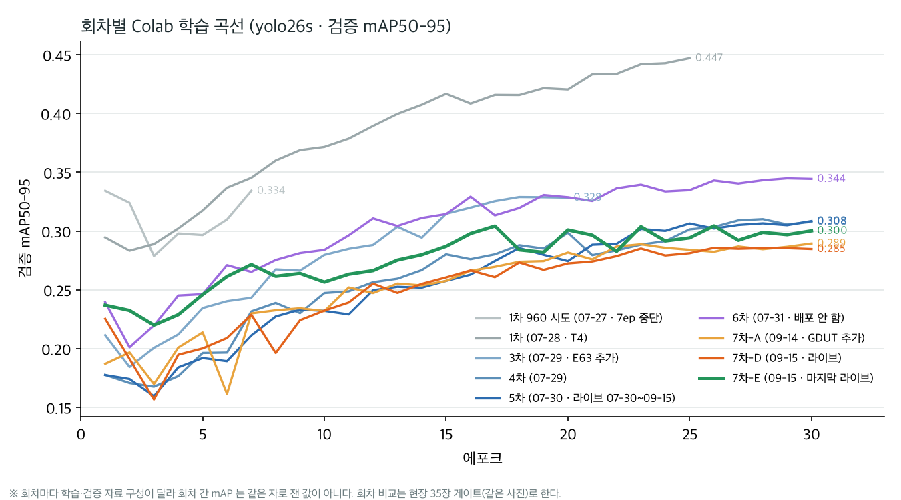

| 회차 | 날짜 | 바뀐 것 | 학습 | 검증 mAP50-95 | 배포 |
|---|---|---|---|---:|---|
| 1차 960 시도 | 07-27 | 960 입력으로 첫 시도 | 7/150 에포크에서 중단 | 0.334 | — |
| 1차 | 07-28 | SH17 9,933장 + CSS 2,658장 · 8클래스 | T4 · b16 · 25에포크 · 12.3시간 | 0.447 | 엔진 벤치만 |
| 2차 | 07-28 | HHW 추가 · SH17 비중 0.5 (설계) | **실행 안 함** — 3차로 건너뜀 | — | — |
| 3차 | 07-29 | AI Hub **E63** 추가(SH17 0.3 · CSS 1.0 · HHW 0.5 · E63 0.2) | A100 · b16 · 20에포크 · 1.9시간 | 0.328 | 엔진 빌드 |
| 4차 | 07-29 | SH17 head·helmet 라벨 제거 · HHW 0.15 · E63 0.4 · E63 12시퀀스 홀드아웃 | A100 · b16 · 30에포크 | 0.308 | CAM-03 시험 |
| **5차** | 07-30 | 안전모와 겹치지 않는 SH17 head 복귀 · person 의사라벨 · HHW 0.45 | A100 · b64 · 30에포크 · 1.5시간 | 0.308 | **라이브 07-30 ~ 09-15** (09-12 부터 직사각 544×960 엔진) |
| 6차 | 07-31 | AI Hub **507** 추가(3,488장) → 9번째 클래스 `no_safety_shoes` | A100 · b64 · 30에포크 · 1.6시간 | 0.344 | **배포 안 함** — 착용자 머리 오경보 0.211 → 0.323(+53%) · 홀드아웃 helmet 재현율 0.575 → 0.465 |
| 7차-A | 09-14 | 507 제외 → 8클래스 · **GDUT** 2,531장 추가 · 학습 18,789장 | A100 · b64 · 30에포크 · 약 1.6시간 | 0.289 | 배포 안 함 — SH17 필터가 안전모 박스를 버려 helmet 이 무라벨이 됨 |
| 7차-C | 09-14 | E63 끄기 (설계) | **실행 안 함** — 맥 파일럿 5회로 대체 | — | — |
| **7차-D** | 09-15 | SH17 의 안전모 사진 238장 제외 | A100 · b64 · 30에포크 | 0.285 | **라이브 09-15 14:52** |
| **7차-E** | 09-15 | SH17 전부 제외(`USE_SH17=False`) | A100 · b64 · 30에포크 · 32분 | 0.300 | **라이브 09-15 저녁 ~ 10-07 반납** |

> ⚠ 회차마다 학습·검증 자료 구성이 달라서 검증 mAP 는 회차끼리 같은 자로 잰 값이 아니다(1차의 0.447 이 높은 것도 검증셋이 쉬웠기 때문이다).
> 판본 비교는 같은 사진으로 잰 **현장 35장 게이트**와 **홀드아웃**으로 한다. 7차는 맥에서 5에포크 파일럿을 먼저 돌렸고, 「안전모는 에포크에 평평 · 조끼는 에포크를 먹는다」는 파일럿의 예측이 A100 30에포크 본학습에서 그대로 나왔다(helmet 97 → 96 · 조끼 59 → 77).

## 2. 현장 35장 배포 게이트

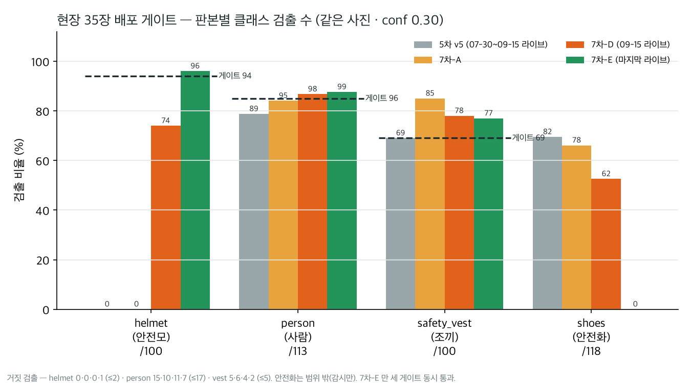

같은 현장 사진 35장(정답 안전모 100 · 조끼 100 · 사람 113 · 안전화 118)에 conf 0.30 으로 돌린 결과다. 게이트 문턱은 파일럿3 에서 정했다.

| 판본 | helmet /100 | person /113 | safety_vest /100 | shoes /118 | 게이트 |
|---|---|---|---|---|---|
| 5차 v5 | 0 · 거짓 0 | 89 · 거짓 15 | 69 · 거짓 5 | 82 | 실패 |
| 7차-A | 0 · 거짓 0 | 95 · 거짓 10 | 85 · 거짓 6 | 78 | 실패 |
| 7차-D | 74 · 거짓 0 | 98 · 거짓 11 | 78 · 거짓 4 | 62 | 실패 |
| **7차-E** | **96 · 거짓 1** | **99 · 거짓 7** | **77 · 거짓 2** | 0 | **통과** |
| 게이트 | ≥ 94 · 거짓 ≤ 2 | ≥ 96 · 거짓 ≤ 17 | ≥ 69 · 거짓 ≤ 5 | 감시만 | — |

- 7차-E 는 재현율과 거짓 검출이 **같이 줄었다**(person 거짓 11 → 7 · vest 4 → 2). SH17 을 빼며 라벨 정의가 다른 자료끼리의 혼선이 줄어든 것으로 본다.
- 대가는 안전화 0 이다. 안전화·장갑은 과업 범위 밖이라 감시만 했다.

## 3. 미착용 머리 검출 — 홀드아웃

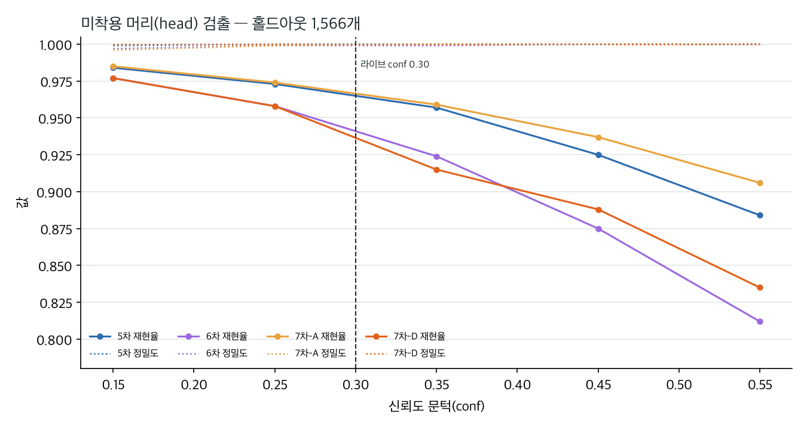

4차부터 학습에서 떼어 둔 예약 홀드아웃(E63 시퀀스)의 미착용 머리 1,566개로 잰 검출이다. conf 0.25 행만 옮긴다. 같은 홀드아웃에서 기존 공개 모델 `vyra_ppe.pt` 의 재현율은 0.011 이었다.

| 판본 | 재현율 | 정밀도 | TP | FP | FN | 홀드아웃 helmet 재현율 |
|---|---:|---:|---:|---:|---:|---:|
| 5차 | 0.973 | 1.000 | 1,524 | 0 | 42 | 0.575 |
| 6차 | 0.958 | 0.999 | 1,501 | 1 | 65 | 0.465 |
| 7차-A | 0.974 | 0.999 | 1,526 | 1 | 40 | 0.613 |
| 7차-D | 0.958 | 1.000 | 1,500 | 0 | 66 | 0.613 |

- F1 이 가장 높은 지점은 네 판본 모두 conf 0.10 이었다(5차 재현율 0.987 · 정밀도 0.999). 라이브는 conf 0.30 으로 돌렸다.
- 7차-E 는 이 홀드아웃 표가 없다. 7차-E 의 판정은 현장 35장과 CAM-03 으로 했다.

## 4. CAM-03 엣지 엔진 (젯슨 · 544×960)

| 판본 | 착용자 오경보(정정) | 맨머리 검출 | 미탐 |
|---|---:|---:|---:|
| 5차 | 0/105 | 380/382 | 2 |
| 7차-D | 0/105 | 382/382 | 0 |
| **7차-E** | **0/105** | **382/382** | **0** |

- 자 = 사용자가 육안으로 어려운 장면 633장을 뺀 착용 107 · 미착용 382 프레임이다. 남은 것이 쉬운 프레임이라 **판별력이 거의 없다** — 7차-E 가 5차보다 낫다는 근거로는 쓰지 않고, 「나쁘지 않다」까지만 말한다.
- 이전 자(09-15 · 7차-D 배포 때) — 검출 5차 428/435 → 7차-D 434/435 · 오경보 53/167 → 52/167 · 안전모 1/168 → **115/168**.

## 5. 조끼 전용 모델 (맥 MPS 학습)

보호구 모델이 **등 돌리거나 쪼그린 사람의 조끼**를 놓쳐 조끼만 보는 모델을 따로 만들었다. Colab 이 아니라 맥(MPS)에서 학습했다.

| 판본 | 자료 | 결과 |
|---|---|---|
| vest v1 (09-21) | CSS 2,508장 · person / safety_vest / torso | 미착용 사진 85% · 거짓 신고 0 · 현장 조끼 78%(거짓 12) |
| vest v2 (09-22) | v1 + CAM-01 사진 30장(사람 542 · 조끼 0) | 미착용 85.1 → 99.3% · CAM-01 34.5 → 62.1% (p<0.0001) · 현장 조끼 76 → 73% |
| 시드 s1·s2 (09-24) | v1·v2 를 시드 셋씩 | 미착용·지역난방공사·현장 차이는 전부 시드 폭 안 |
| 「30장 효과」 (09-28) | CAM-01 사람 336명 | 미착용 판정 비율 v1 24.7 ~ 32.7% → v2 **67.3 ~ 72.9%** · 아홉 짝 모두 v2 우세 · v2 거짓 조끼 0 |

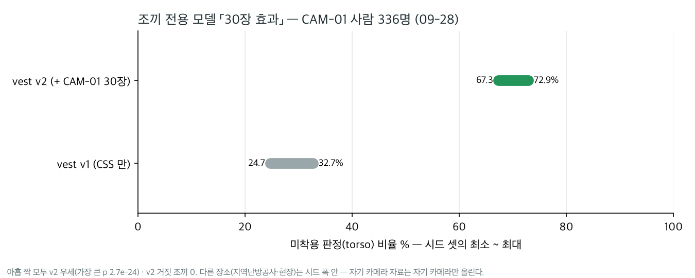

- 결론 — **자기 카메라 자료는 자기 카메라만 올린다.** 다른 장소는 움직이지 않았다.
- 3분법(착용·미착용·판정불가) 실측(09-25 · v2) — 착용 200장 중 거짓 미착용 22장(11.0%, 그중 20장이 쪼그린 정면) · 미착용 134장 거짓 조끼 0. 여섯 판본 모두 6.5 ~ 11.0%.
- 09-25 두 젯슨에서 조끼 엔진을 돌리기 시작했지만, 거짓 미착용이 10% 를 넘어 **관제 화면에는 연결하지 않기로** 정했다(09-25 사용자 결정 · 화면은 「판정 범위 외」).

## 6. 자세 모델과 낙상 규칙

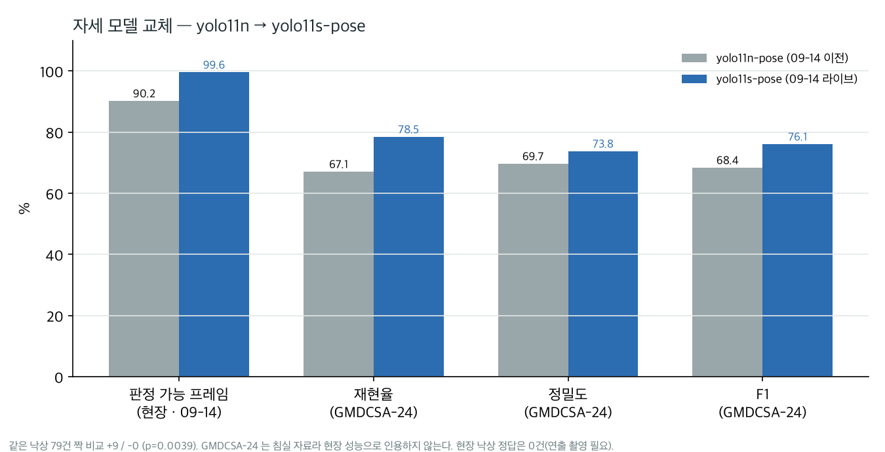

자세는 학습하지 않고 Ultralytics 공개 가중치 `yolo11s-pose` 를 그대로 TensorRT 로 썼다(640 · conf 0.25). 09-14 에 yolo11n-pose 에서 바꿨다.

| 근거 | yolo11n | yolo11s |
|---|---:|---:|
| 현장 판정 가능 프레임 | 90.23% | **99.61%** |
| 현장 판정 불가(「-」) 프레임 | 5.97% | **0.00%** |
| GMDCSA-24 재현율 · 정밀도 · F1 | 0.671 · 0.697 · 0.684 | **0.785 · 0.738 · 0.761** |
| 같은 낙상 79건 짝 비교 | — | +9 / -0 (p = 0.0039) |
| 젯슨 단독 · PPE 와 합쳐 (09-13 벤치) | 13.07 · 26.96ms | 16.02 · 30.23ms |

**낙상 규칙** — 상태는 직립 · 불안정 · 누움 · 낙상 · 판정불가 다섯이다. 몸통이 수직에서 65° 넘게 0.5초 이상 누워 있고
직전 2.5초 안에 초당 프레임 높이 0.15 이상 떨어졌으면 「낙상」, 아니면 「누움」이다. 일어설 때까지 「낙상」을 유지한다.

| 문턱 | 값 | 정한 근거 |
|---|---|---|
| 몸통 각도 직립 / 누움 | 35° / 65° | — |
| 수평 유지 `FALL_HOLD` | **0.8 → 0.5초** (09-14) | 143.88시간 · 사람 프레임 283만 스윕 — 근거리 연출 낙상 검출 0 → 2 · 오탐 0.79 → 0.99건/시간 · 0.4초는 1.01건/시간에 검출 그대로 |
| 하강 속도 / 하강 창 | 초당 0.15 / 2.5초 | — |
| 추적 유지 `TRACK_TTL` | 1.5 → 4.0초 (09-14) | 「낙상」이 「누움」으로 떨어지던 추적 5개 중 2개 수리 · 낙상 프레임 73 → 110 |
| 키포인트 신뢰도 / 무릎만 | 0.5 / 0.30 | 아래 표 |

| 무릎 신뢰도 문턱 | 판정 가능 | 앉음 정확도 |
|---|---:|---:|
| 0.5 | 35.2% | 92% |
| **0.3 (채택 · 무릎만)** | **58.5%** | **90%** |
| 0.2 | 72.0% | 87% |
| 0.1 (기각 · 가려진 무릎 환각) | 90.3% | 84% |

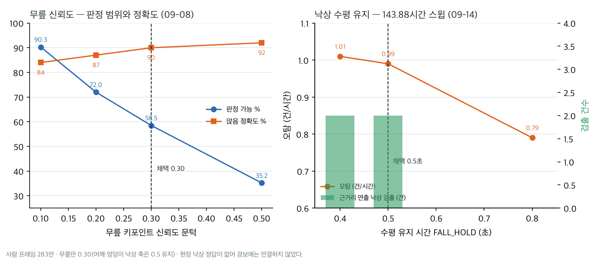

- 09-08 에 상자 종횡비·어깨선 기울기를 판정에서 뺐다. 「누움」 14건이 전부 카메라 각도 때문이었다. 「다리 수평」 조건도 뺐다. 낙상·누움 판정 12,538건 중 99% 가 앉은 사람이었다.

**한계** — 그대로 적는다.
- **경보를 내지 않는다.** 오탐을 세기 위한 1단계라 영상 위 표시에만 썼다(`fall_count` 는 0).
- **현장 낙상 정답이 0건이다.** 상용 자동 경보 기준(F1 0.90)에 못 미치고(최고 0.761), 연출 낙상 54건 촬영이 필요하다고 계산했지만 촬영 기록은 없다.
- **GMDCSA-24 는 침실 자료**라 현장 성능으로 인용하지 않는다.
- **밤에는 판정 불가 프레임이 34.9%** 였다(낮 2.5%).

## 7. 젯슨 추론 시간

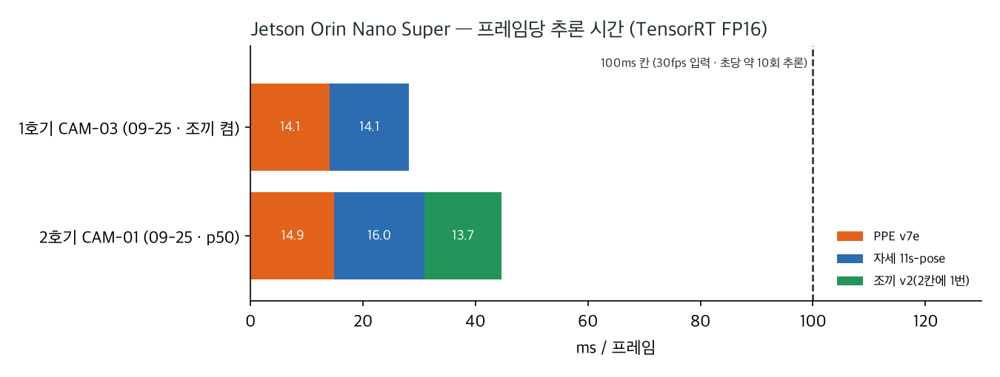

| 날짜 | 기기 | PPE | 자세 | 조끼 | 영상 |
|---|---|---:|---:|---:|---:|
| 09-14 | 1호기 | — | 15.73ms (PPE 와 합쳐 28.13ms · 예산 33.8%) | — | — |
| 09-22 | 2호기 CAM-01 | 15.3 ~ 17.1ms | 19.56ms | — | 사람 0명 29.9 → 6명 20.0fps |
| 09-25 | 1호기 CAM-03 | 14.1ms | 14.1ms | 켬 | 30.0fps · 추론 10.2회/초 |
| 09-25 | 2호기 CAM-01 | p50 14.9ms | p50 16.0ms | 13.7ms (2칸에 1번) | 29.7fps |
| 09-28 | 2호기 CAM-01 | — | p95 18.5ms | — | 29.3fps |

**상시 운영 19일 (2호기 CAM-01 · 09-18 ~ 10-06)** — 반납 직전 2호기에서 꺼낸 포즈 로그 34파일(3.8GB)을 접은 것이다.
1,429만 8,262 프레임 · 431.5시간 · 하루 약 86만 프레임(초당 약 10회) · 고유 트랙 13,051 · 사람 0명 프레임 87.8%.
낙상 규칙이 「낙상」으로 판정한 사건은 134건(5초 끊김 기준 · 실제 낙상 0)이라 **0.31건/시간**이고, 그중 72건이 10-01 20~21시에 몰렸다(화면에 1명). 그 밖 17일은 0.15건/시간이다.

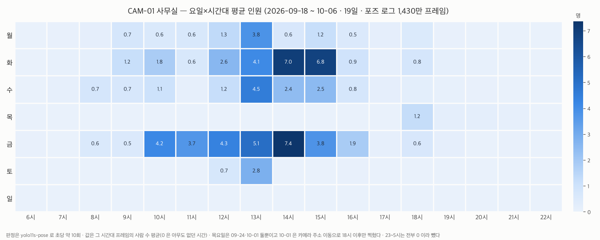

사람 수만 센 집계라 개인정보는 없다. 화·금 13~15시가 7명 안팎으로 가장 붐비고 야간·주말은 0 이다. 목요일은 09-24·10-01 둘뿐이고 10-01 은 카메라 주소 이동으로 18시 이후만 찍혔다.

## 8. 7차-E 학습 산출 그림 (Ultralytics)

<table>
<tr><td align="center" width="33%"><a href="7차E_학습산출/results.png">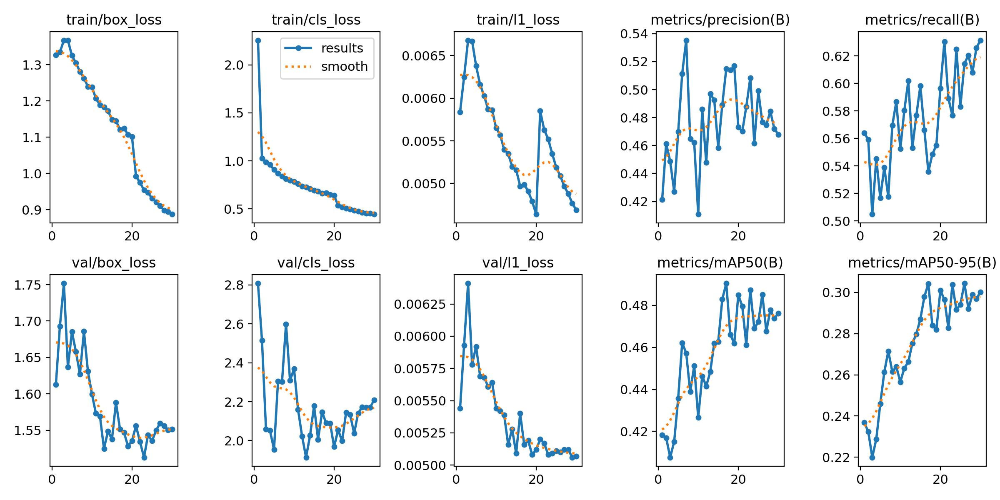</a> 학습·검증 손실과 지표</td>
<td align="center" width="33%"><a href="7차E_학습산출/BoxPR_curve.png">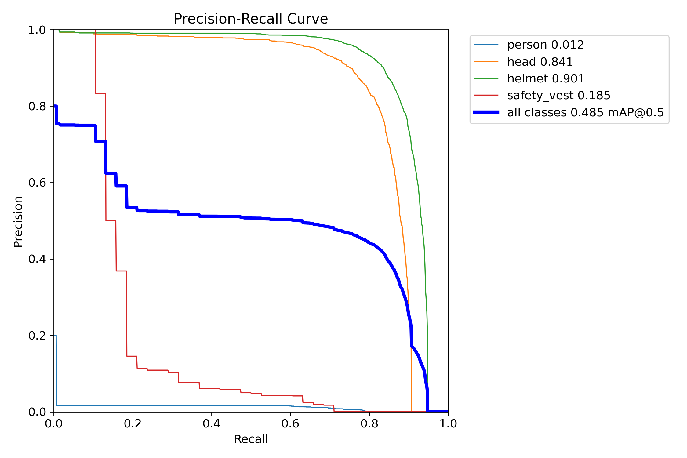</a> 클래스별 PR 곡선</td>
<td align="center" width="33%"><a href="7차E_학습산출/confusion_matrix_normalized.png">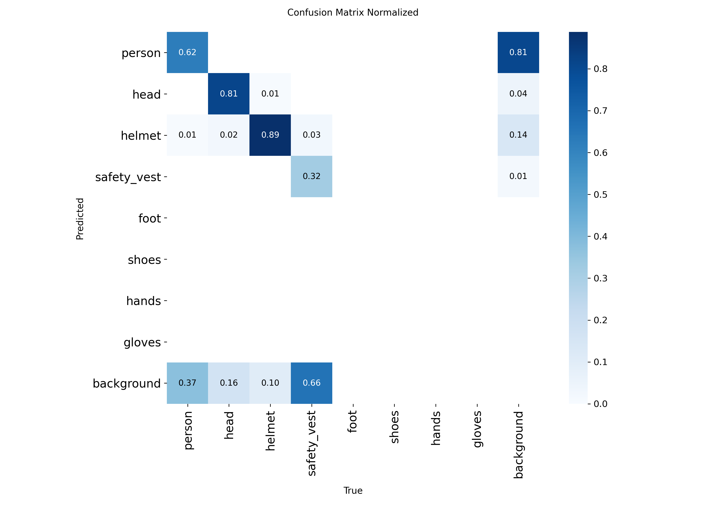</a> 정규화 혼동 행렬</td></tr>
</table>

> ⚠ 검증셋은 출처마다 라벨이 붙은 클래스가 다르다(부분 라벨 — E63·HHW 에는 person 라벨이 없다). 그래서 PR 곡선의 person 0.012 · safety_vest 0.185 는
> 모델이 사람을 맞게 잡아도 정답이 없어 거짓으로 세어진 값이 섞여 실제보다 낮다. 클래스별 성능은 현장 35장 게이트(2절)로 본다.

## 9. 학습 자료와 라이선스

| 자료 | 규모 | 쓴 클래스 | 라이선스 | 쓴 회차 |
|---|---|---|---|---|
| AI Hub E63 (전기설비 공사현장) | 35,227장 | head · helmet | 학습용 한정 · 재배포 금지 | 3차 ~ 7차-E |
| Hard Hat Workers v13 | 16,866장(증강 포함) | head · helmet | 기록이 갈림 — 확인 필요 | 3차 ~ 7차-E |
| Construction Site Safety v27 | 2,603장 | person · head · helmet · vest | CC BY 4.0 | 1차 ~ 7차-E |
| SH17 | 27,765파일 / 고유 15,807 | person · foot · shoes · hands · gloves · vest · (선별 head) | CC BY-NC-SA 4.0 | 1차 ~ 7차-D |
| AI Hub 507 | 3,488장 | no_safety_shoes · head | AI Hub 약관 | 6차만 |
| GDUT | 2,531 + 643장 | helmet · head | 확인 필요 | 7차-A ~ 7차-E |

평가 전용 — 현장 35장(정답 helmet 100 · vest 100 · person 113) · 지역난방공사 100장 · CAM-01·CAM-03 실촬영.

## 출처

- 학습 결과표·평가표 — 드라이브 `vitalguard-ppe/runs/*/results.csv` · `results/*/` (보관 위치는 MODELS.md)
- 회차 기록 — [`ml/ppe-detection/context-notes.md`](../../기존_조달청모듈/safetymonitor/ml/ppe-detection/context-notes.md) · [`README.md`](../../기존_조달청모듈/safetymonitor/ml/ppe-detection/README.md) · [`deploy-v7d-20260915.md`](../../기존_조달청모듈/safetymonitor/ml/ppe-detection/deploy-v7d-20260915.md) · `tmp-507e` 가지의 `v7e-result-20260915.md`·`checklist.md`
- 자세·낙상 — [`cctv-ai/edge/pose_fall.py`](../../기존_조달청모듈/safetymonitor/cctv-ai/edge/pose_fall.py) · [`ml/fall-detection/rule-plan-20260913/deploy-yolo11s-20260914.md`](../../기존_조달청모듈/safetymonitor/ml/fall-detection/rule-plan-20260913/deploy-yolo11s-20260914.md) · `tmp-507e` 가지의 `ml/fall-detection/rule-plan-20260913/`
- 추론 시간·조끼 실측 — [`cctv-ai/edge/jetson-etc/checklist.md`](../../기존_조달청모듈/safetymonitor/cctv-ai/edge/jetson-etc/checklist.md)
