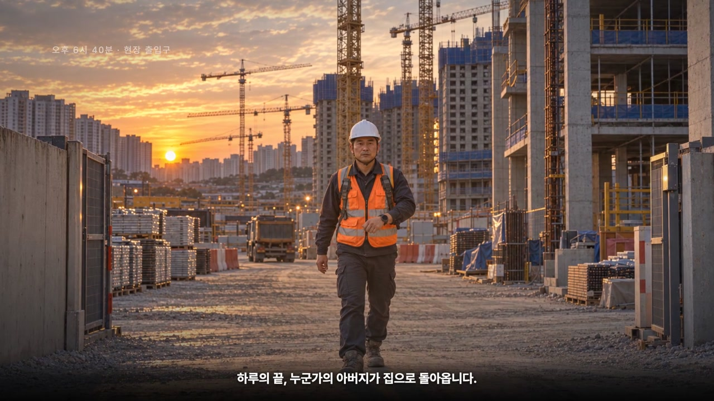
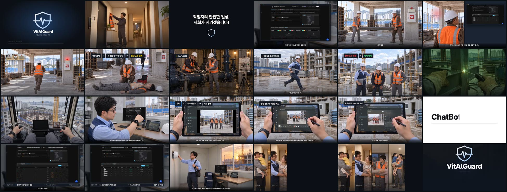

# VitAlGuard 시연 영상 (3분 37초 · 1080p)

  

- **원본 mp4(118MB)**: [Releases › portfolio-2026-10](https://github.com/becks0724/vitalguard/releases/tag/portfolio-2026-10) 자산 `VitAlGuard_demo_2026-10.mp4`. GitHub 파일 한도(100MB) 때문에 저장소 본문이 아니라 Release 에 둔다.
- **유튜브**: 일부 공개 링크는 README 대문에 함께 건다(전환 후 갱신).

## 구성 — 기승전결 10장면 · 52컷

| 장면 | 내용 | 보여 주는 것 |
|---|---|---|
| 1 오프닝 | 방패 위에 심전도가 그려지는 로고 | 브랜드 |
| 2 아버지의 귀가 | 노을 지는 현장을 걸어 나와 현관에서 보호구를 벗고 딸을 안아 올린다 | "작업자의 안전한 일상" 카피 |
| 3 관제 플랫폼 허브 | 담당관 모니터의 관제 웹에서 네 서비스로 선이 뻗는다 | **관제 웹 실제 화면** |
| 4 AED-alert | 2인 철근 작업 → 낙상 → 워치 감지 → AED 함 위 경광등 점등 → 관제 웹 「낙상 긴급 알람」 모달 → AED 패드 → 구급차 | **AED-alert 실물 · 관제 웹 실제 모달** |
| 5 GasPod | 맨홀 진입 → GasPod 설치 → LED 초록→빨강 → 가스 탭 「위험」 전환 → 담당관이 태블릿 들고 달려가 대피 | **GasPod 실물 · 가스 누출 감지기 탭 실제 화면** |
| 6 Watch App | 목재 운반·용접·타워크레인 1인칭 사이 손목의 Galaxy Watch 9 요약 화면 | **워치 앱 실제 화면**(심박·SpO₂·피부온) |
| 7 Tablet App | 워크 캘린더 → 사진 촬영 → 전송 완료 → 펜으로 표시하기 → 전송 이력 | **Lenovo 태블릿 앱 실제 화면** |
| 8 관제 웹 | AED 탭 · 가스 탭 · 작업자 모니터링 탭 · 태블릿 홈 → 담당관 퇴근 | **관제 웹 3개 탭 실제 화면** |
| 9 다섯 개의 귀가 | 세로 5분할로 다섯 가족의 포옹이 차례로 켜진다 | 수미상관 |
| 10 엔딩 | 로고와 다짐 | "작업자가 안전하게 집으로 돌아가는 길" |

## 제작 방식

- **콘티 52컷**(시나리오 JSON → SVG 패널)을 먼저 그린 뒤, **실물 사진(AED-alert·GasPod)과 인물 앵커 6장을 참조로 사진급 장면 38컷을 생성**했다. 기기 화면은 검게 생성하고 **실제 서비스 캡처를 사영변환(matrix3d)으로 합성**해 UI 글자가 깨지지 않게 했다.
- 렌더는 Remotion(React) 기반 자체 파이프라인: 장면별 TSX, 자막·나레이션(샷 단위 wav) 동기화, 19개 구조 게이트(자막 스키마·전환 0프레임·중앙선 밀도 등) 통과 후 1080p 렌더.
- 서비스 화면 원본은 [`../서비스 화면/`](../서비스%20화면/) 참고.
